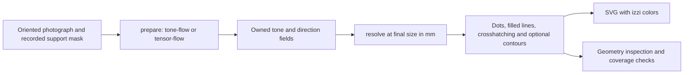

# Portrait engraving C++ API

Date: 2026-11-13. Status: **implemented and digitally validated**.
For current routing, start at [Portrait engraving](../portrait.md). The
[November 14 banknote extension](20261114_banknote_portrait_api.md) adds
`tensor-flow/1` and `banknote/1`; the hedcut contract below remains supported.
This API supports the [anniversary stage 2 work](sessions/20261113.guilloche_anniversary_24_stage_2.md)
and other photograph-to-vector portrait work. The standard-only
[core](../html/izzi-portrait_8h.html) and [SVG adapter](../html/izzi-svg-portrait_8h.html)
are installed public C++20 headers.

Use `izzi::portrait` with three primary operations: `prepare`, `resolve`, and
`render_svg`. Preparation owns normalized image fields; resolution produces
physical vector marks; SVG rendering applies color and serialization. A
support mask is an explicit input, including all-one support for whole photos.
Recoloring or moving an engraving reuses its geometry;
changing its physical size regenerates marks at the intended print dimensions.

For the stage-2 anniversary portraits, use `tone-flow/2` with `hedcut_v2()`.
The `/1` preparation, recipes and geometry hashes remain compatible. The
before/after review
compares all sixteen source selections at the same physical width.



## Fit with izzi

Izzi is C++20 and header-only. Its [surface-tension API](../html/izzi-svg-surface-tension_8h.html)
already separates specifications, `resolve`, resolved geometry, resource
budgets, diagnostics and `render_svg`. The portrait API follows that pattern.

The stage 1 Python adapter
uses elliptical subject emphasis, a faded crop boundary, short drypoint strokes
or bowed gravure carriers. It retains background tone and hard-codes brown
paint while generating SVG. Stage 2 needs explicit face isolation, coordinated
stippling and hatching, stronger control of facial detail, and separate paint.

Installed headers and the deferred serialization extension:

| Header | Responsibility |
| --- | --- |
| `izzi-portrait.h` | Borrowed image views, owned preparation, specifications, validation and vector resolution; standard library only |
| `izzi-svg-portrait.h` | SVG document/fragment emission and existing `svg::color_qi` paint types |
| `izzi-portrait-json.h` | Later strict recipe/receipt serialization using izzi's existing JSON conventions |

Image codecs, EXIF orientation, ICC conversion and optional face detection live
in adapters. The core consumes decoded luminance and masks and performs no file
I/O. The stage 2 adapter uses Pillow for
EXIF/ICC decoding and explicit polygon masks, and writes little-endian float
planes to the [native review driver](../../examples/portrait-engraving-plates.cc).
All portrait mark generation runs in C++. A detector may suggest a selection,
but the persisted mask and crop determine the result. This also supports
sunglasses, face coverings and the supplied rabbit-mask portraits.

## Core declarations

These declarations describe the installed surface. Definitions and internal
helpers are inline. Defaults are starting proof settings, not claims about
printer capability. Include the installed header instead of copying declarations.

```cpp
#include <cstddef>
#include <cstdint>
#include <optional>
#include <span>
#include <stdexcept>
#include <string>
#include <string_view>
#include <variant>
#include <vector>

namespace izzi::portrait {

inline constexpr std::string_view api_version = "izzi-portrait-1";

struct plane_view {
  std::span<const float> samples;
  std::size_t width = 0, height = 0, row_stride = 0; // Stride in samples.
};

struct plane {
  std::size_t width = 0, height = 0;
  std::vector<float> samples; // Packed rows, owned storage.
  plane_view view() const &;
  plane_view view() const && = delete;
};

struct pixel_rect {
  std::size_t x = 0, y = 0, width = 0, height = 0;
};

struct point_uv { double x = 0, y = 0; }; // Normalized crop coordinates.

struct line_field_view {
  plane_view cos_2theta, sin_2theta, confidence;
};

struct source_view {
  std::string id;
  plane_view linear_luminance; // Linear-light Y, finite, [0,1].
  plane_view subject_mask;     // Required membership coverage, [0,1].
  std::optional<plane_view> feature_protection;
  std::optional<line_field_view> direction_guidance;
};

struct tone_spec {
  double black_point = 0, white_point = 1;
  double brightness = 0, contrast = 1, gamma = 1;
};

struct prepare_spec {
  std::string algorithm = "tone-flow/1";
  pixel_rect crop;
  std::size_t analysis_long_edge = 1600;
  double subject_threshold = 0.5;
  double fallback_angle_rad = 0.6;
  tone_spec tone;
};

enum class severity { information, warning, error };
struct diagnostic {
  severity level;
  std::string code, field, message;
};

struct resource_budget {
  std::size_t maximum_input_pixels = 64'000'000;
  std::size_t maximum_working_pixels = 4'000'000;
  std::size_t maximum_marks = 300'000;
  std::size_t maximum_vertices = 3'000'000;
  std::size_t maximum_work_units = 100'000'000;
  std::size_t maximum_owned_bytes = 512 * 1024 * 1024;
  std::size_t maximum_svg_bytes = 64 * 1024 * 1024;
};

class resource_error : public std::runtime_error {
public:
  using std::runtime_error::runtime_error;
};

struct prepared_portrait {
  std::string source_id, input_sha256, preparation_sha256;
  prepare_spec specification;
  std::vector<std::vector<point_uv>> support; // Source-derived even-odd rings.
  plane darkness, subject_mask, feature_protection;
  plane cos_2theta, sin_2theta, flow_confidence;
  std::vector<diagnostic> diagnostics;
};

struct stipple_spec {
  bool enabled = true;
  double share = 0.35;
  double diameter_mm = 0.12;
};

struct hatch_spec {
  std::string id = "hatch-primary";
  double share = 0.65;
  double darkness_begin = 0.15, darkness_full = 0.45;
  double angle_offset_rad = 0;
  double pitch_mm = 0.35, width_mm = 0.10, maximum_length_mm = 2;
  double feature_suppression = 0;
};

struct contour_spec {
  bool enabled = false;
  double width_mm = 0.10;
  double minimum_contrast = 0.12;
};

struct print_spec {
  double minimum_line_width_mm = 0.08;
  double minimum_dot_diameter_mm = 0.10;
  double minimum_gap_mm = 0.06;
  double maximum_local_coverage = 0.55;
  double coverage_window_mm = 1;
  double coverage_sample_mm = 0.025;
};

struct hedcut_spec {
  double row_spacing_mm = 0.28;
  double maximum_dot_diameter_mm = 0.23;
  double shadow_darkness = 0.52;
  double maximum_dash_length_mm = 0.85;
};

struct engraving_spec {
  std::string algorithm = "stipple-hatch/1";
  double width_mm = 35; // Height follows the crop's aspect ratio.
  std::uint64_t seed = 0;
  double edge_fade_mm = 0.3;
  double geometry_tolerance_mm = 0.005;
  stipple_spec stipple;
  std::vector<hatch_spec> hatches {hatch_spec{}};
  contour_spec contours;
  print_spec print;
  hedcut_spec hedcut; // Used and hashed only by hedcut/2.
};

struct point_mm { double x = 0, y = 0; };
struct dot_mark { point_mm center; double radius_mm = 0; };
struct filled_path {
  std::vector<std::vector<point_mm>> rings; // Implicitly closed, even-odd fill.
};
struct mark {
  std::uint64_t id = 0;
  std::variant<dot_mark, filled_path> geometry;
};
struct mark_layer {
  std::string id;
  std::vector<mark> marks;
};

struct portrait_statistics {
  std::size_t marks = 0, vertices = 0;
  double estimated_painted_area_mm2 = 0;
  double estimated_peak_local_coverage = 0;
  double estimated_tone_rmse = 0;
};

struct resolved_portrait {
  std::string source_id, preparation_sha256, recipe_sha256, geometry_sha256;
  engraving_spec specification;
  double width_mm = 0, height_mm = 0;
  std::vector<mark_layer> layers;
  portrait_statistics statistics;
  std::vector<diagnostic> diagnostics;
};

[[nodiscard]] std::vector<diagnostic>
validate(const source_view&, const prepare_spec&, const resource_budget& = {});

[[nodiscard]] std::vector<diagnostic>
validate(const prepared_portrait&, const engraving_spec&,
         const resource_budget& = {});

[[nodiscard]] prepared_portrait
prepare(const source_view&, const prepare_spec&, const resource_budget& = {});

[[nodiscard]] resolved_portrait
resolve(const prepared_portrait&, const engraving_spec&,
        const resource_budget& = {});

[[nodiscard]] engraving_spec currency_engraving_v1();
[[nodiscard]] engraving_spec hedcut_v1();
[[nodiscard]] engraving_spec hedcut_v2();

} // namespace izzi::portrait
```

## SVG and paint declarations

```cpp
#include "izzi-svg-color.h"

namespace izzi::portrait {

struct layer_ink {
  std::string layer_id;
  svg::color_qi color {svg::color::black};
};

struct paint_spec {
  svg::color_qi ink {svg::color::black};
  std::vector<layer_ink> overrides;
  std::optional<svg::color_qi> paper; // Absent means transparent background.
};

struct svg_options {
  std::string id_prefix = "portrait";
  std::string title, description;
  double units_per_mm = 1;
};

[[nodiscard]] std::string
render_svg(const resolved_portrait&, const paint_spec&,
           const svg_options& = {}, const resource_budget& = {});

[[nodiscard]] std::string
render_fragment(const resolved_portrait&, const paint_spec&,
                const svg_options& = {}, const resource_budget& = {});

} // namespace izzi::portrait
```

`render_svg` creates a standalone document with physical `width`/`height` in
millimeters. `render_fragment` creates one self-contained group for composition
into an existing SVG. `units_per_mm` converts local millimeters into the host's
user units; it does not resize the physical engraving. All IDs, including
accessible title/description references, receive the supplied prefix. Duplicate
paint overrides and overrides for missing layer IDs are errors. The caller
supplies a distinct prefix for each fragment instance in a composed document.

Dots become circles, and hatches/contours become filled vector outlines.
The first renderer emits constant-width, rounded hatch outlines and complete
dots. It conservatively rejects any mark whose full bounding rectangle touches
excluded source-mask pixels; it does not emit clipped partial dots. This keeps
all emitted geometry inside support without a hidden raster mask. The public
`filled_path` representation supports holes with the even-odd fill rule and
allows future clipped or variable-width algorithms without changing exporters.
`geometry_tolerance_mm` controls cap subdivision and streamline step size; the
minimum accepted tolerance is 1e-6 mm, with a bounded cap subdivision count.

## Example call

The caller keeps decoded image/mask storage alive for `prepare`. Everything
returned from `prepare` and `resolve` owns its data. An owning plane only exposes
a view from an lvalue, preventing accidental views into temporary storage.

```cpp
namespace p = izzi::portrait;

std::string make_portrait(p::source_view source, p::pixel_rect crop)
{
  p::prepare_spec prep;
  prep.crop = crop;
  prep.tone.brightness = 0.03;
  prep.tone.contrast = 1.15;
  const auto prepared = p::prepare(source, prep);

  auto spec = p::currency_engraving_v1();
  spec.width_mm = 38;
  spec.seed = 2026111324;
  const auto geometry = p::resolve(prepared, spec);

  p::paint_spec paint;
  paint.ink = svg::color::rurikon;
  p::svg_options output;
  output.id_prefix = "v01-front-face-a";
  output.title = "De Kosnik anniversary portrait";
  return p::render_svg(geometry, paint, output);
}
```

For the anniversary's 1000-unit-wide trim, set `units_per_mm` to
`1000 / 155.956` and translate the returned fragment into the layout. Generate
each face at its final physical width. Color experiments use the same
`resolved_portrait`, with explicitly selected entries from
`svg::spectrum<svg::palette_kind::izzi_hue>()`; exclude its `none` sentinel.

## Contracts that make the API durable

### Inputs, coordinates and ownership

- All input planes share the full, already-oriented source dimensions. Crops
  are half-open pixel-edge rectangles; pixel centers are `(x + 0.5, y + 0.5)`.
  `row_stride` is measured in float samples. Validate the last addressed sample
  against the span using checked arithmetic before reading any pixels.
- Luminance is finite linear-light Y in `[0,1]`. An sRGB adapter decodes the
  sRGB transfer function before computing luminance; it converts other input
  profiles explicitly. Source alpha multiplies the authored subject coverage.
  Unpremultiply decoded color where necessary before luminance conversion.
- `subject_mask` is required membership, not detection confidence. Thresholding
  it at `subject_threshold` establishes the permitted support, including holes
  and disconnected components. The threshold must be in `(0,1]`. Missing masks
  and crops with no selected support are errors; an all-white selected face is
  valid and produces an empty, transparent engraving.
- Trace and retain the canonical support from the selected mask at source
  resolution before reducing the analysis grid. `support` stores the resulting
  rings in normalized crop coordinates, using a versioned contour/saddle rule
  and excluding the exterior. Tone-grid resampling cannot fill a mask hole or
  move the authoritative silhouette. Budget these boundary vertices too.
- Isolation precedes smoothing and tone/flow analysis: excluded background
  samples have zero weight in every neighborhood operation. Filtering cannot
  bleed a dark wall into the face. Edge fading is measured inward from the
  support boundary and changes mark density, not raster opacity.
- Preparation preserves crop aspect ratio. Sampling steps on each axis follow
  from the crop and recorded field dimensions; derivative/flow calculations
  account for those steps. The target long edge is capped at source resolution.
  Insufficient sampling for a chosen physical
  mark size produces a diagnostic. No silent upsampling creates facial detail.
- Feature protection is a separate `[0,1]` field. It suppresses specified hatch
  passes and redirects their tone allocation toward stippling; it does not
  erase eyes, glasses or mouths. Missing protection is zero. Supplied direction
  guidance uses `(cos(2 theta), sin(2 theta))` and confidence, so opposing vectors
  describe the same hatch orientation. Positive-confidence directions must be
  normalized; zero confidence uses the versioned image-derived field/fallback.
- One source selection may contain a pair of faces. Separate selections allow
  independent tone settings and seeds while borrowing the same source buffer.
  Masks preserve visible hair, glasses, facial coverings and expressions.

### Tone and mark synthesis

The `tone-flow/1` contract first maps linear Y to the sRGB grayscale transfer
curve `g`. It then applies the following normalized operations in order:

```text
u = clamp((g - black_point) / (white_point - black_point), 0, 1)
v = clamp(contrast * (u - 0.5) + 0.5 + brightness, 0, 1)
darkness = pow(1 - v, gamma)
```

Require `0 <= black_point < white_point <= 1`, finite brightness in `[-1,1]`,
nonnegative contrast and positive gamma. Neutral settings preserve the input
grayscale response. Automatic percentile levels may be an adapter convenience,
but it must store the resolved black/white points. Replaying a recipe never
re-estimates them from a different crop or background.

The `stipple-hatch/1` engine uses a seeded jitter lattice for density-controlled
stippling, streamlines following a
smoothed orientation field, and optional source-edge contours. Weighted Voronoi
stippling is a useful algorithm reference for distributing dots by image tone
([Secord, 2002](https://www.cs.ucdavis.edu/~ma/SIGGRAPH02/course23/notes/papers/Secord.pdf)).
Orientation-guided hatching has a useful precedent in
[Hertzmann and Zorin, 2000](https://mrl.cs.nyu.edu/publications/illustrating-smooth/),
which operates on 3D surfaces. For this 2D API, image-derived directions are a
heuristic that supplied guidance can correct; they do not recover facial 3D
shape. The engine revision pins the actual sampling and integration algorithms.

Stippling and hatching share one target coverage field. Target coverage is
`darkness * maximum_local_coverage * inward_edge_fade`. A hatch's eligibility
ramps smoothly between `darkness_begin` and `darkness_full`; its `share` is
further multiplied by `(1 - feature_suppression * feature_protection)`. Eligible
nonnegative shares are normalized at each sample. Sparse contours consume
coverage first; the remaining budget is distributed across eligible passes.
Hatch IDs are unique and cannot use the reserved `stipples` or `contours` IDs.
Overlapping painted areas are counted as a union. Adding a shadow pass must not
apply the full darkness again. Unrepresentable tone produces a diagnostic.

`currency_engraving_v1()` emphasizes flowing primary hatches, stippled transitions
and a restrained second direction in shadows. `hedcut_v1()` favors stippling and
shorter hatches. These are frozen recipes of the same primitives. Neither name
promises that an arbitrary photograph automatically meets a likeness target.

Every emitted footprint stays within the selected source-pixel support.
Admission checks include complete mark extents, including dot radii and hatch
width. Conservative rejection near concave boundaries can reduce edge density;
the result reports residual tone error. Within-pass gap exclusion uses a
sampled grid with a conservative dilation. Crossings between different hatch
passes are allowed and contribute their union to coverage. The first renderer
uses constant line widths and rounded caps. Highlights are unpainted openings.

Coverage measurements use the recorded `coverage_sample_mm` and
`coverage_window_mm` over unioned footprints. The reported area, peak coverage
and tone error are estimates at that sampling resolution. They are neither
exact geometric bounds nor printer ink-channel estimates. A print proof remains
the test of surviving dots, gaps and facial detail.

### Contour-aligned hedcut revision

`tone-flow/2` uses the same explicit tone transform, then mixes 70% original
darkness with 30% mask-normalized neighborhood darkness. A separably smoothed
structure tensor provides the tangent direction. The neighborhood radius is
12 analysis pixels, with Gaussian sigma 5. Supplied direction guidance still
overrides the inferred direction according to its confidence. The fallback
angle is used only where no tensor direction exists; it is not blended across
the whole photograph as it was in `/1`.

`hedcut/2` requires this preparation revision. It traces separated integral
curves and places variable dots along their arc lengths. Darker marks become
short, round-ended curved dashes; bounded residual stippling fills spaces in
deep shadows. High-contrast portions of the 0.5 darkness contour are traced
first to retain frames, lips and other source features. This is image analysis,
not an anatomical reconstruction. The existing feature-protection plane is
retained in preparation and provenance but does not suppress `/2` marks;
there is no crossing hatch pass to suppress.

The direction comes from the general hedcut characteristics visible in
[Kevin Sprouls's portfolio](https://www.sprouls.com/): aligned dots, connected
feature contours, open highlights and denser directional shadows. The
[isophote-based research by Kim et al.](https://asu.elsevierpure.com/en/publications/automated-hedcut-illustration-using-isophotes/)
supports using both image edges and shading directions. This implementation
is an independent deterministic C++ method; it does not implement their full
algorithm or use a style-transfer model.

```cpp
izzi::portrait::prepare_spec preparation;
preparation.algorithm = "tone-flow/2";
preparation.crop = {0, 0, image_width, image_height};
auto fields = izzi::portrait::prepare(source, preparation, budget);
auto recipe = izzi::portrait::hedcut_v2();
recipe.width_mm = 32;
recipe.seed = 20261113;
auto marks = izzi::portrait::resolve(fields, recipe, budget);
auto svg = izzi::portrait::render_svg(marks, {});
```

The frozen `hedcut_v2()` defaults are 0.28 mm row spacing, 0.10–0.23 mm
dots, up to 0.85 mm shadow dashes, and 0.10 mm feature contours with minimum
contrast 0.20. The minimum clear gap is 0.04 mm; the sampled local coverage
ceiling is 0.82. These are proof settings, not measured printer capabilities.
`stipple.diameter_mm` is the minimum dot diameter in `/2`. Stippling must be
enabled with share 1 and the hatch-pass list must be empty. Contour settings
remain configurable. The new `hedcut` settings are hashed only for `/2`.

All three layers (`contours`, `hedcut-shadow`, `stipples`) share exact
Euclidean capsule clearance and the sampled union-coverage ceiling. The
complete mark bounds must remain inside the original source mask. The maximum
dot diameter plus print gap must fit the row spacing. Work, spatial indices,
traced geometry and temporary allocations remain subject to the caller's
resource budget. The same CPU/compiler, inputs, seed and recipe reproduce the
same geometry; recoloring still leaves it untouched.

Dark regions can remain lighter than the requested tone under spacing and
support constraints. `TONE_UNDERRUN` reports that limitation. Compare appearance
at actual print size: the target coverage ceiling differs from `/1`, so the
two revisions' tone-error numbers are not a like-for-like quality score.

### Validation, bounded work and replay

`validate` returns structured field-addressed diagnostics. `prepare` and
`resolve` validate inputs and reject errors with `std::invalid_argument`;
resource admission or work exhaustion throws `resource_error`. SVG rendering
also validates caller-edited geometry and paint. Ordinary allocation failure
remains `std::bad_alloc`. No function returns partially successful artwork after
exhausting a limit.

Budgets admit input addressing, owned image/flow/coverage storage, candidate
generation, integration work, mark/vertex counts, temporary geometry and actual
SVG bytes. Storage admission uses conservative estimates for container capacity
and scratch; it is not an operating-system RSS cap. Caller-owned source buffers
and allocator bookkeeping are outside that estimate. Work counters charge
field scans, neighborhood taps, candidate steps and footprint/grid operations;
there is no unbounded retry or convergence loop.
Preview uses a separate explicit recipe and receives a separate receipt.
Prepared fields are inspectable values but must be retained together: changing
a field invalidates their preparation hash and requires another `prepare` call.
This avoids stale support/tone/flow combinations. Resolved geometry can be
inspected and edited; SVG output validates its shapes, IDs and paint again.

Reproducibility requires more than a seed. Pin the preprocessing and engraving
algorithm IDs, resolved numeric settings, field sampling, mask/guidance bytes,
physical width and seed. Use a specified integer PRNG, fixed traversal and
stable ordering; avoid implementation-dependent random distributions and
unordered-container iteration. Per-layer streams derive from the seed and
stable layer ID, so reordering unrelated layers does not reseed existing marks.
Tone redistribution can still change geometry when a pass is added.

The core computes content hashes from canonical active plane samples, dimensions
and identifiers; padding is excluded and signed zero normalized. Reject NaNs and
infinities. The preparation hash also covers all preparation settings and the
algorithm revision; the recipe hash covers preparation plus engraving settings.
The geometry hash covers ordered layers and final numeric geometry. Paint and
placement have separate downstream cache keys. The adapter records original
file hashes and decoding/color-conversion versions alongside these core hashes.
Its numeric JSON receipts use binary64 round-trip precision, include every
resolved tone/engraving setting, and use the exact binary64 physical width in
cache identity. Two widths that share the same displayed decimal label retain
separate artifacts. The driver replay regression covers this boundary.

Promise byte-repeatability within a pinned implementation/toolchain and numeric
environment. Across compilers/architectures, test geometric and raster
tolerances; do not promise universal floating-point identity. Persist resolved
geometry when exact future reproduction matters. Color changes reuse that
geometry but can change perceived contrast and require visual review.

Named `/1` algorithms and `_v1` presets never silently change their output
contract. New behavior gets a new revision; unknown revisions are rejected.
JSON recipes materialize defaults and use stable string names. Recipe JSON
references external images/masks by content hash; loading stays in adapters.
This header-only library promises an explicit source/schema migration policy,
not binary ABI stability. Avoid positional aggregate initialization in examples
so additive settings do not force call-site rewrites.

## Implementation and acceptance

Core tests cover padded rows and canonical hashing,
background isolation, source-pixel holes, independent footprint membership,
white input, invalid values, edited-preparation rejection, deterministic replay,
recoloring, physical-size regeneration, resource failure and SVG escaping.
GCC and Clang C++20 warning-as-error checks pass, along with standalone headers,
two-translation-unit linkage, the installed consumer and ASan/UBSan. LeakSanitizer
is disabled because it cannot run under this environment's ptrace wrapper.

The stage 2 gallery
contains the twenty vector compositions and actual-size portrait, pattern,
centering and palette PDFs. The portrait proof compares stipple, hatch, currency
and hedcut modes on a clear face, both heads from a pair and a covered face.
Source/mask comparisons and prepared tone/protection/flow PNGs accompany the
persisted SVG geometry and receipts. Original photographs remain unchanged.

The image-derived flow is a 2D heuristic, not recovered facial surface geometry.
Some dark sources retain `TONE_UNDERRUN` warnings, especially stipple-heavy
recipes whose minimum gaps limit density. These warnings remain in receipts;
technical admission does not establish an artist's likeness assessment or a
physical print result. The public API is versioned source compatibility, not a
binary ABI promise. Strict JSON serialization remains a future extension.

## Expanded-reference banknote model

The [2026-11-14 banknote API and parameter study](20261114_banknote_portrait_api.md)
defines the new `tensor-flow/1` and `banknote/1` engine, independent DLH weights,
maximum line width, source contour emphasis and flow controls. It is based on
the expanded transnational reference photographs and includes equal thirds,
pure modes, and high-contrast low-curvature proofs. The stage 3 compositions
use fresh recipes; earlier recipe comparisons are not part of that review.
