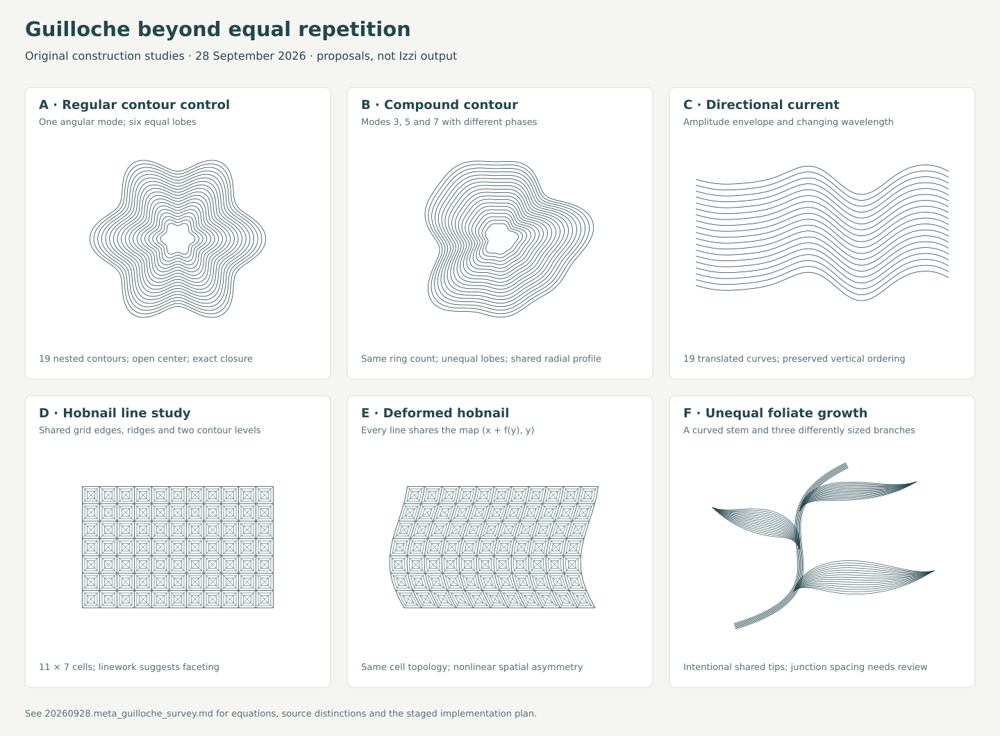
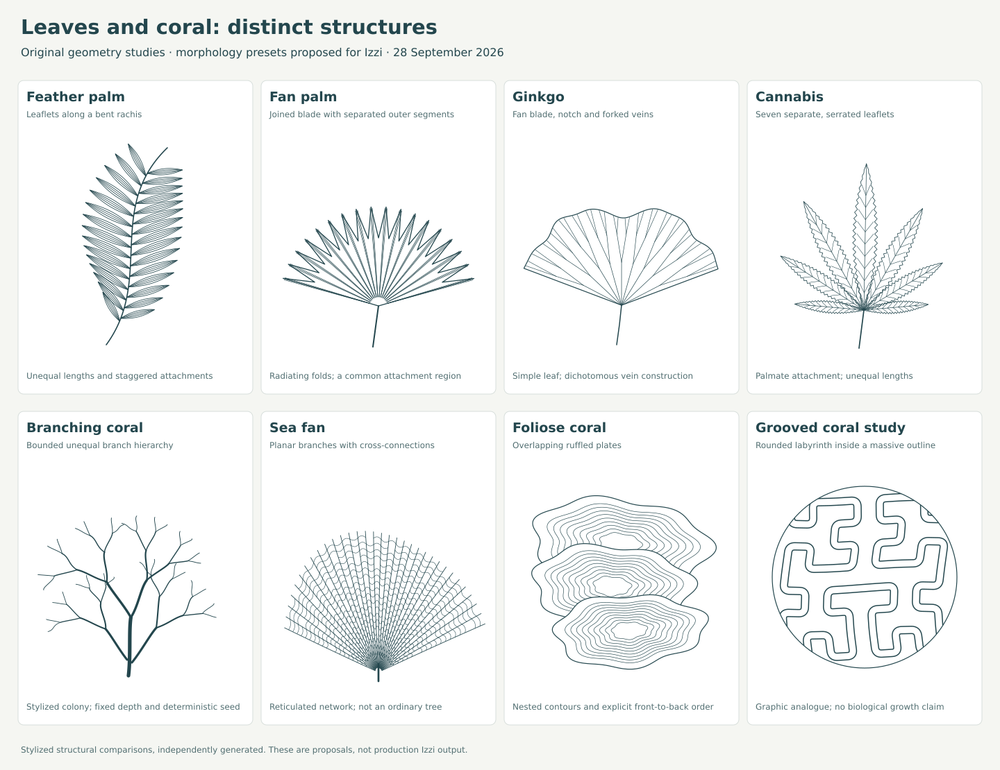
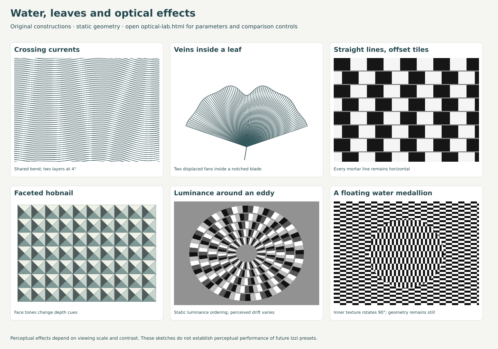

# Guilloche enrichment survey and implementation plan

Recorded: 2026-09-28, America/Los_Angeles.

Source snapshot: izzi `f5bdd21e0f41`.

Status: **approved scope implemented across all software stages, 2026-09-29**.
See the [implementation and verification record](20260928.meta_guilloche_implementation.md)
and [123-plate native gallery](../../generative_patterns/guilloche-enrichment/index.html).
The proposal and research observations below preserve their original context;
the implementation record supersedes their statements about then-missing APIs.
Physical lenticular lens/print proof remains a separate, unperformed check.

Brief: [meta guilloche](20260928.meta_guilloche.md), including the subsequent
directions to explore **asymmetric guilloche**, group Hamonshū's graphic water
forms, review documentation/examples, add varied leaf and coral patterns,
and incorporate optical tricks, plus the brief's subsequent **Human review**.

Retain **compound contour rosettes**, **faceted hobnail fields**, and
**foliate scroll guilloche** as the three foundations. The human review
expands the current implementation scope to include a distinct **arabesque
category based on Islamic geometric patterns**, **basketweave**,
**lenticular arrays**, three **flinqué variants**,
three more **botanical forms**, and the requested **coral/anemone forms**.
Basketweave and lenticular arrays are now scheduled work. The initial
one-to-three-type synthesis no longer caps this expanded plan.

Use two separate categories throughout: **foliate = vines, scrolls and
vegetal forms; arabesque = Islamic geometry**.

Start with authoring/resource contracts, then develop the first bounded
contour, basketweave, and two-view lenticular slices. Contours support the
flinqué and organic work; basketweave and lenticular arrays can use existing
geometry without waiting for the entire botanical set. Extend the existing
wave family alongside contours. A second generic wave or rose-curve family
would duplicate substantial existing capability.

Asymmetry should be an explicit construction choice: unequal lobes, directed
flow, smoothly changing cells, and unequal branches. Keep the line rhythm and
continuity that make the result read as guilloche. Pointwise jitter alone does
not provide that structure.

### Human-review disposition

| Request in the updated brief | Incorporated scope | Stage |
| --- | --- | --- |
| 1–3 flinqué extensions; Monsieur Bovet Turquoise and Patek 7040 | Three presets: lotus, swirling ribs, and an eccentric compound field, with engraving geometry separate from translucent finish. | F1 |
| 1–8 coral extensions; nine named references | Eight work packages: seven named coral forms and one sibling anemone family with pink-tipped and saddle-carpet variants. Preserve the existing sea-fan control. | S3b |
| Papyrus, Saguaro Cactus, willow | Three botanical presets covering an umbel, a ribbed columnar plant, and a pendulous branch system. | S3a |
| Separate arabesque from foliate; base it on Islamic geometric patterns | Foliate owns vines, scrolls and vegetal forms. Arabesque owns Islamic star/polygon lattices and geometric strapwork with explicit tile connections. | S3 / A1 |
| Add basketweave now | A lattice construction with bundled warp/weft and real over/under interruption, followed by diagonal and deformed variants. | B1 |
| Add lenticular arrays now | A bounded multi-view interlacer, calibration output, orientation/phase controls and explicit physical-scale metadata. | L1 |

The revision updates the contracts, dependencies, comparison set and
acceptance criteria below. Existing SVG sheets document the original studies;
they do not yet depict all additions from this review.

## Construction studies



[Open the SVG](20260928.meta_guilloche_studies/asymmetry.svg) to examine the
linework. [The standard-library Python generator](20260928.meta_guilloche_studies/generate.py)
makes this sheet reproducible. These are original mathematical sketches for
the proposal, independently generated from the constructions below. They are
not outputs of new Izzi APIs or facsimiles of historical artifacts.

The sheet compares regular and compound contour rosettes (A/B), an asymmetric
wave field (C), regular and smoothly deformed hobnail linework (D/E), and an
unequal foliate branch structure (F). F demonstrates the leaf-and-stem part of
the proposed scroll family; terminal spirals and production junction handling
remain implementation work.

Two companion sheets extend the study:

- [Leaf and coral structures](20260928.meta_guilloche_studies/organic.svg):
  feather palm, fan palm, ginkgo, cannabis, branching coral, sea fan,
  foliose coral and a grooved-coral analogue.
- [Optical treatments](20260928.meta_guilloche_studies/optical.svg), with an
  [interactive comparison lab](20260928.meta_guilloche_studies/optical-lab.html):
  current and leaf interference, Café Wall tilt, hobnail depth cues,
  peripheral drift and an Ouchi texture study. Each has a cue-removing control.

The [Hamonshū catalogue](../../generative_patterns/hamonshu.md#graphic-water-catalogue)
and [filterable source gallery](../../generative_patterns/hamonshu-water-gallery.html)
organize the actual historical water drawings separately from these original
procedural sketches. None of the source thumbnails contains a writing example.

## 1. Current Izzi status

The source is more complete than the early plans, but less uniform across
C++, JSON, and graph synthesis than the family overview suggests.

| Area | Verified current state | Implication for enrichment |
| --- | --- | --- |
| Core vocabulary | Seven centerline alternatives, 13 composition kinds, five pattern classes, and 16 family labels in [izzi-svg-guilloche.h](../../html/izzi-svg-guilloche_8h.html). | A family label, geometry primitive, and composition algorithm are distinct API concepts. Add each only where needed. |
| Curves | Roulette, mathematical rose, regular polygon, Lissajous, sine wave, radial ray, and harmonic wave. | Basic waves and multi-petal figures already exist. |
| Transformations | Family phase, scale, rotation, normal offset, radial modulation, and seeded jitter; composition repeats; plate registration and rotation. | Composition-level asymmetry is already possible. Arbitrary smooth deformation and explicit multi-mode polar contours are absent. |
| Fields and treatments | Fish scale, barleycorn, latent microline bands, sunburst, multicolor lines, medallion, vignette, and flinque. | Add a faceted cell construction; retain the existing frame and color machinery. |
| Dutch additions | Builders for radiate, stack, quad, hexagon, mandala, and triptych return arrangements of existing primitives. | Useful precedent for composite builders without proliferating low-level geometry kinds. |
| JSON authoring | [The parser](../../html/izzi-svg-guilloche-json_8h.html) and [schema](../../../schemas/izzi.guilloche-scene-1.schema.json) support nine `layout.geometries` kinds: sunburst, band_guilloche, latent_image, fish_scale_field, barleycorn_field, medallion, vignette, multicolor_line, and flinque. | P4/P5 authoring landed. Generic direct rose/roulette and the six Dutch builders are not all exposed through this array. |
| JSON scene assembly | The parser always appends a compatibility `radial-field`, then the authored geometries, and constructs word/number ornaments. Top-level `pattern` changes the field's metadata. | Naming a family does not select its geometry. A pure asymmetric field needs an explicit authoring path that can omit this radial field and text. |
| Graph integration | `make_guilloche_composite` in [izzi-svg-graph-guilloche.h](../../html/izzi-svg-graph-guilloche_8h.html) explicitly handles the original nine families. Its `rosette/default` arm also catches latent-image and Dutch family values. | The earlier documentation overstated coverage; that statement is corrected in this change. Add explicit cases for new types; do not mistake a returned rosette for support. |
| Examples and profiles | [The family document](../../generative_patterns/guilloche.md) records 261 capability plates and 12 latent plates after September's review changes. Profile conversion primarily adjusts rose sampling, family count/jitter, plates, and text ornaments. | Example coverage is extensive, but new field and branch densities need their own profile rules. These plate totals were not regenerated for this survey. |
| Adjacent wave library | [Hamonshū](../../generative_patterns/hamonshu.md) has 153 catalogued volume-2 specimens, 16 procedural motif kinds, and 13 curated motifs at seven curvature ratios. The local archive has three volumes. | Reuse its wave/scroll construction knowledge. Its public output is SVG path data, whereas guilloche resolves structured point paths and budgets. Integration needs a point-emitting interface, not string parsing. |

Two distinctions matter geometrically:

- `sample_centerline(rose_spec)` implements `r = R cos(p θ + phase)`.
  This passes through the center. For integer `p`, the usual visible petal
  count is `p` for odd `p` and `2p` for even `p`; the member name `petals`
  should not be treated as an exact count of visible lobes in every case.
- A circular Lissajous centerline plus the existing radial modulation can
  already approximate a **single-mode positive-radius lobed contour**.
  The missing capability is a direct, bounded multi-mode contour contract
  with independent harmonic phases, predictable nesting, and authoring
  controls. This is the reason to add the proposed contour type.

The present normal-offset operation uses neighboring sampled points. Closed
paths are snapped shut after transformation. Endpoint equality therefore does
not establish smooth tangent continuity, and a large normal offset can create
cusps or crossings. New organic constructions need more than that operation.

### What the old plans contribute

| Record | What remains useful | What has changed |
| --- | --- | --- |
| [August 16 vocabulary and pilot](20260816.dutch_guilloche_stage_2.md) | Separate implementation kind, geometric class, and historical family name; reuse plates and budgeted resolution. | Its missing-family inventory predates the implemented pilot. Its proposed wave envelope and border/corner logic should not be counted as implemented merely because `band_guilloche` exists. |
| [August 16 capability review](20260816.dutch_guilloche_stage_3.md) | Matched parameter sweeps with a rosette control and separate review artifacts. | The original 27-plate count is historical. |
| [August 17 P1–P6 proposal](20260817.openai_api_guilloche_v2_proposal.md) | Additive presets, compatibility defaults, explicit authoring, and deterministic latent-image geometry. | Current source and the later family-document sections show P4/P5 implemented. The stale early “full JSON” open-item sentence is replaced with the specific remaining gaps in this change. |
| [August 21 radiate](20260821.dutch_guilloche_stage_4_plan.md) and [multi-motif plan](20260821.dutch_guilloche_stage_5_plan.md) | Separate layers, independently adjustable extents, bounded grids, and multiple motifs in one composition. | These are valuable composite recipes, not six entirely new curve samplers. |
| [September 21 examples review](20260921.make_examples_review_1.md) and [September 26 production record](20260926.short_center_frame_moire_guilloche_praxis.md) | Wider parameter ranges, readable plate IDs, fitted artwork, and reproducible motion controls. | Visual and motion experimentation should now include changes of geometric structure, alongside density, color, and registration. |

## 2. Field survey and historical sources

Three source traditions are useful: engine-turning mechanisms, ornament
construction, and drawn wave studies. Their relationship is inspiration and
shared geometry; a drawn leaf or wave is not automatically evidence of a
historically machine-cut guilloche technique.

**Engine turning.** Holtzapffel & Co.'s digitized catalogue has an 1849 title
page and older 1844 running headers. PDF pages 45–46 describe eccentric,
oval, geometric, and straight-line chucks; pages 55–56 describe rose engines,
phase divisions, compound figures, and primary/secondary curves. This supports
thinking in combinations of motions and profiles rather than a single flower
formula. It does not establish that every proposed digital deformation could
be cut by those machines. [Holtzapffel catalogue, digitized primary text](https://upload.wikimedia.org/wikipedia/commons/c/c6/Holtzapffel_%26_Co._-_Engine%2C_Lathe%2C_%26_Tool_Manufacturers_and_General_Machinists_%28Catalogue%29_%28IA_HoltzapffelCatalogue1849%29.pdf#page=45).

**Ornament construction.** Owen Jones's *The Grammar of Ornament* (1856),
especially propositions 6–7 and 11–13, connects subordinate decoration to
larger forms, stems, and tangent junctions, and advocates stylized natural
forms. Those are useful design heuristics for a foliate sampler. They are
historical aesthetic prescriptions, not universal mathematical requirements.
The text consulted here is the reproduced primary text of the propositions.
[Jones, general principles](https://www.readingdesign.org/grammar-of-ornament).

**Wave studies.** Mori Yūzan's *Hamonshū* (1903), volume 2, is particularly
valuable for asymmetry. Direct inspection of local
scan 13
shows unequal curling branches, isolated eddies, and directed wave clusters;
scan 22
shows dense current bands, unequal crests, and varied empty intervals. My
design inference is to share a smooth flow across neighboring strokes while
allowing the larger composition to be unbalanced. The repository's
[source and catalogue notes](../../generative_patterns/hamonshu.md#sources-and-provenance)
provide the edition links and page mapping. Its descriptive English motif
names are modern catalogue labels. The local scan files are resource inputs,
not newly bundled assets of this report.

Current makers provide direct evidence of a broader vocabulary. Patek
describes crossing straight-line cuts for Clous de Paris and cam-controlled
curves for rose-engine work. Breguet lists wave, basketweave, barleycorn, and
Clous de Paris among its patterns. [Patek, guillochage techniques](https://www.patek.com/en/manufacture/artisans-of-time/guillochage),
[Breguet, artisans and machines](https://www.breguet.com/en/magazine-quai-de-l-horloge/edition-no-10/artisans-and-machines).

| Category | Construction to explore | Izzi disposition |
| --- | --- | --- |
| **Clous de Paris / hobnail** | Intersecting grooves and visibly faceted square or diamond cells. | **Add:** a field with shared cell edges and explicit ridge/contour linework. Barleycorn's pointed outlines do not provide this faceting. [Patek's hobnail description](https://static.patek.com/pdf/pressreleases/ru/2006_PatekPhilippe_Ref_5119.pdf). |
| **Vagues / waves** | Parallel undulations, changing amplitude, unequal crests, and directed current bands. | **Extend:** existing harmonic bands and Hamonshū knowledge; add envelope and phase/frequency controls. No separate generic wave family needed. |
| **Multi-lobed rosettes** | Positive-radius nested contours with primary and secondary angular profiles. | **Add:** an explicit compound contour type; retain existing rose and roulette curves as controls. |
| **Organic / landscape contours** | An irregular boundary expanded into related lines; river-like corridors and topographic forms. | **Start with bounded star-shaped contours and directed waves.** General arbitrary-outline offsets need a later topology-aware implementation. |
| **Foliate** | Vines, scrolling tendrils, stems, leaves and other vegetal forms, in free or repeated arrangements. | **Add:** a bounded vine/scroll/branch grammar and botanical morphology builders. |
| **Arabesque** | Islamic geometric star/polygon arrangements, connected strapwork and tessellations. | **Add separately:** shared tile topology, edge-matching rules and geometric recipes, following the updated brief's reference. [Met, geometric patterns](https://www.metmuseum.org/essays/geometric-patterns-in-islamic-art). |
| **Basketweave / panier** | Bundled strands in alternating over/under crossings. | **Add now:** `basketweave_field`, with crossing ownership, underpass gaps, and periodic boundary rules. |
| **Eccentric / oval compound figures** | Offset centers, unequal axes, layered rotations, and combined periodic motions. | **Preset/composition work now:** exploit existing origin, Lissajous, roulette, and plate controls; add primitives only after a demonstrated gap. |
| **Fish scale and barleycorn** | Overlapping arcs or pointed grains on a staggered lattice. | **Already present:** useful controls for the new faceted field and later smooth deformation. |
| **Sunburst and irregular ray fields** | Radial strokes with variable angular spacing or length. | **Extend existing sunburst:** asymmetry can be meaningful even when each ray remains simple. |
| **Flinqué** | Engraving under a translucent finish; lotus, swirling and eccentric compound line fields. | **Extend now:** three presets grounded in the two requested watch references. Current Izzi flinqué is a radial-ray builder plus circular tint, not those new engraving patterns. |
| **Medallions, vignettes, iris color** | Finish, frame, and plate treatments applied around geometry. | **Reuse:** surrounding composition and color machinery. |
| **Latent and lenticular effects** | Direction-modulated microline structure versus ordered interlacing of distinct source views. | Latent bands are implemented. **Add lenticular arrays now** as a composition/export capability with pitch, phase, orientation, view order and calibration. |

For organic guilloche, Breguet describes its Quai de l'Horloge motif as a
recomposition of the Seine's branches from the Turgot map. This is evidence
for using geographic contours as design inputs; the bounded contour model
below is my proposed digital synthesis. [Breguet, guilloche motifs](https://www.breguet.com/en/guilloche-according-breguet).

For irregular spacing, Breguet also describes a wave cam producing slightly
varying angles in the radiating decoration of its Double Tourbillon. This is
a more concrete precedent than simply labelling random variation “organic.”
[Breguet, Double Tourbillon construction](https://www.breguet.com/en/magazine-quai-de-l-horloge/edition-no-10/double-tourbillon-quai-de-lhorloge).

## 3. Asymmetric approaches

Judge asymmetry at three levels: the individual curve, the line family, and
the whole composition. An off-center rosette changes composition, while its
internal rotational symmetry may remain intact. Both effects are useful and
should be named accurately in review plates.

| Approach | Useful controls | Existing support and next step |
| --- | --- | --- |
| **Unequal composition** | Different centers, extents, weights, phases, or layer counts. | Already expressible through multiple compositions and plates. Establish a low-cost control series. |
| **Mixed angular modes** | Several integer frequencies, independent gains/phases, inner radius, ring spacing. | Highest-priority new contour capability. Coprime active modes remove repeated angular sectors about the chosen origin; phases also determine remaining mirror symmetry. |
| **Uneven angular allocation** | A monotone angular map or positive normalized sector weights. | Good for irregular rays and unequal lobe widths. Moving sample positions alone can merely reparameterize the same curve; move the geometry's angular placement relative to its radial profile. |
| **Directed waves** | A smooth amplitude envelope, changing wavelength, independently phased harmonics, shared displacement across rows. | Extend `harmonic_wave_spec` with compatibility defaults. Start with translated copies of one curve, then test controlled variation between rows. |
| **Smooth spatial deformation** | A shared nonlinear map applied to all lines and cell boundaries. | Generalizes hobnail and later existing lattices. Start with an invertible triangular map; independently moving each cell breaks shared edges. |
| **Unequal foliate growth** | Branch position, length, handedness, curl, leaf width, and clear spaces. | New small path grammar. Keep an explicit spine and branch hierarchy so the asymmetry reads as growth. |
| **Seeded smooth variation** | A few bounded coefficients selected by a stable motif ID and seed. | Sample the same continuous function at every resolution. Avoid per-vertex noise and frame-by-frame reseeding. Use after the analytic constructions are established. |

Two particularly useful constructions have simple limits:

1. **Angular mapping:** `g(θ) = θ + Σ (b_m/m) sin(mθ + ψ_m)`, with
   positive integer `m` and `Σ |b_m| < 1`, is strictly increasing and wraps
   once. For a lobed curve, use `r(θ)(cos g(θ), sin g(θ))`; substituting
   `g(θ)` everywhere in the original curve only changes its parameterization.
   A constant-radius circle remains a circle under either construction.
2. **Triangular spatial mapping:** `F(x,y) = (x + f(y), y)` has inverse
   `(X,Y) -> (X - f(Y), Y)`. Applying this same smooth map to every path
   preserves their intersections and adjacency. Panel E uses a sinusoid plus
   a quadratic drift for `f`. It changes the field itself, with no need for
   cellwise random displacement.

A simple affine stretch or shear can retain a pattern's half-turn symmetry.
Cropping a symmetric motif makes an asymmetric window into it. Neither should
be the sole demonstration of a new intrinsically asymmetric family.

Use one regular, one restrained asymmetric, and one strongly asymmetric
setting for every new type. Keep canvas, ink, line count, and framing matched
where possible. Inspect the actual strokes before introducing multicolor
plates or motion.

## 4. Proposed constructions and treatments

The names and parameter limits here are **proposed contracts**, not current
API names. The historical sources motivate the forms; the equations, bounds,
and implementation choices below are this survey's synthesis.

### A. Compound contour rosette — `lobed_contour`

**Appearance:** related closed contours around a clear center, ranging from
regular scallops to an unequal, organic outline. Panel B demonstrates shape
asymmetry while keeping all contours nested.

```text
h(θ) = 1 + Σ a_k cos(kθ + φ_k)
r_j(θ) = R_j h(θ),       R_j = R_inner + j ΔR
p_j(θ) = origin + r_j(θ) (cos θ, sin θ)
```

Use positive integer frequencies, `R_inner > 0`, `ΔR > 0`, and
`Σ |a_k| < 1`. These conditions give positive radii, periodic closure, simple
individual polar contours, and strictly nested rings about the same origin.
For the first implementation, share `h` across rings. Ring-dependent phases
and drifting centers would require additional nonintersection checks.

The study uses 19 rings, `R_inner=22`, `ΔR=5`, and three modes
`(k,a,φ) = (3,0.11,0), (5,0.075,0.6), (7,0.05,1.7)`.
Thus `h >= 0.765` and the **radial** gap is at least `3.825` drawing units.
That is not a bound on the shortest perpendicular gap between strokes;
screen-space inspection and segment-distance checks still matter.

Suggested first limits: at most eight modes, frequencies 1–64, amplitude sum
at most 0.45, and an explicit sample count sufficient for the highest mode.
The renderer should reject undersampled requests or use deterministic bounded
subdivision, rather than silently draw polygonal high-frequency details.

Add a `polar_contour_spec` alternative at the end of `centerline_geometry`,
with explicit mode records and a builder such as `make_lobed_contour`.
Reuse `composition_kind::rosette`, with one composition repeat and a family of
scaled contours. Add the family label `lobed_contour` in `pattern_class::radial`.
Update sampling, point estimation, closure, and every relevant visitor.

Keep **rotation** separate from **shape evolution**: rotating a contour adds
frequency-scaled phase changes, whereas adding the same phase to all modes
generally changes its shape. Expose those meanings distinctly in future
motion controls.

Alongside this type, add an opt-in **vagues/current preset** to the existing
band family. For `u` along a band, use
`y_j(u) = j spacing + E(u) A sin(Φ(u))`, optionally with extra harmonics.
If every row shares the displacement, positive spacing preserves vertical
ordering. Panel C uses a growing envelope and quadratic phase. Its curves
can have small perpendicular gaps despite that ordering. Envelopes and phase
curves need their own spatial sampling bounds. Overturning wave crests require
a parametric path, for which Hamonshū offers a better starting point.

### B. Faceted hobnail field — `hobnail_field`

**Appearance:** a regular field of small pyramid-like cells in linework,
with optional smooth deformation into an asymmetric surface. Panels D/E
compare identical cell topology before and after deformation.

Construct a square lattice with shared horizontal and vertical boundaries.
Each cell has four ridge strokes from its center toward its corners and a
small number of inset contour loops. Optional plate assignments can emphasize
faces later. A rotated square lattice gives a diamond orientation. This is
an SVG interpretation of faceting; simulated metal reflections are a separate
rendering problem.

Proposed controls: rows, columns, pitch, orientation, inset-level count,
ridge visibility, and optional shared deformation. Start with a regular
`24 × 24` field and two inset levels; review coarser and finer variants.
Use one closed path per inset level in the production representation and emit
each grid boundary once. With four ridges and two loops per cell, that is
`rows + columns + 2 + 6 rows columns` paths before clipping: 3,506 at the
suggested density. The study generator uses separate edge segments for
clarity, so its path count differs.

Add `hobnail_spec`, `composition_kind::hobnail_field`, and
`pattern_family::clous_de_paris` under `pattern_class::lattice`. A deformed
variant can retain the family's ancestry in metadata while being labelled
“deformed hobnail” in the review. Reuse existing plate treatment and checked
row/column multiplication. Charge every ridge, contour, and sampled warped
edge to the resource estimate.

This differs from `barleycorn_spec::relief`, which changes the exponent of
individual closed grain outlines. Relabelling those grains would leave the
shared grooves and face structure unimplemented.

### C. Foliate scroll guilloche — `foliate_scroll`

**Appearance:** a stem carrying unequal leaves and curling terminals, built
from related fine lines. It can form an asymmetric border, a free spray, or a
repeat with deliberate handedness. It need not orbit a common center.

The foliate category includes running vine borders, scrolling tendrils,
bifurcating palmette fields and vegetal interlace, as well as the botanical
forms in section 6. The Met's panel supplies a reference for bifurcating
vines and split leaves. Keep these constructions in foliate.
[Met, Panel 30.112.4](https://www.metmuseum.org/art/collection/search/448500).

Use a small explicit path grammar: a sampled cubic spine, a bounded list of
branches attached at normalized spine positions, leaf contours around each
branch, and optional terminal spiral segments. Preserve a tangent direction
where a branch leaves the spine. Define shared tips and intentional junctions
separately from crossings between unrelated strokes.

Initial controls: branch positions, lengths, side/handedness, width, curl,
leaf-line count, and sampling tolerance. Start with three unequal branches,
5–9 leaf lines, and no recursion. A leaf envelope such as `sin²(πu)` offers
a smooth taper; join and tip behavior must be evaluated on the complete
stroke construction. Cap branch counts before allocating geometry.

Add a `foliate_scroll_spec` and composition resolver returning several
structured paths, with `pattern_family::foliate_scroll` and initially
`pattern_class::banded`. The family is defined by its spine-and-branch
organization. Repetition can subsequently arrange it into a field or frame.

Hamonshū's scroll and spiral helpers are useful precedents, but a leaf grammar
is additional work. Factor or adapt point-emitting helpers while preserving
the existing Hamonshū SVG serialization. Do not recover geometry by parsing
its emitted SVG strings. Dense leaf tips in panel F deliberately expose the
junction-spacing problem to solve before this becomes a production preset.

### D. Three flinqué extensions — engraving plus finish

The requested [La Patiala article](https://lapatiala.com/guilloche-watch/)
identifies the visual direction; its page returned a verification screen
during this revision. The makers' own descriptions supply the usable
construction references. Bovet describes a **twelve-petal lotus motif under
translucent colored lacquer** for Monsieur Bovet. Patek describes reference
**7040/250G-001** as a **swirling hand-guilloched pattern under translucent
blue enamel**. Preserve that lacquer/enamel distinction in provenance;
Izzi's `flinque` remains a digital treatment family.
[Bovet, turquoise guilloché dials](https://www.bovet.com/news/tantalizing-turquoise-guilloche-dials/),
[Patek, reference 7040/250G-001](https://www.patek.com/en/collection/grand-complications/7040-250g-001).

The current `make_p3_flinque` builds repeated radial rays and adds a filled
circle using `flinque_overlay_spec {tint, opacity, radius}`. Its parser exposes
ray count, tiers and tint controls. The extension therefore needs new
engraving constructions beneath the finish, not just more blue palettes.

| Proposed preset | Construction | Controls and comparison |
| --- | --- | --- |
| `flinque_lotus` | Related twelve-lobe contour bundles with a clear inner aperture, inspired by Monsieur Bovet's named lotus motif. Use the compound-contour machinery; do not trace a dial photograph. | Lobe count, bundle spacing, lobe depth, phase and finish opacity. Compare twelve equal lobes with bounded unequal lobes, first without tint and then with it. |
| `flinque_swirl` | Curved radial ribs sharing a radius-dependent angular twist, inspired by Patek's described swirling engraving. | Inner/outer radius, rib count, twist function, handedness and sampling. Compare zero twist, one restrained twist and a stronger twist with identical density/finish. |
| `flinque_eccentric` | An offset engraving center and unequal angular allocation inside a fixed circular or bounded custom aperture; optionally compose two unequal fields. This is an original synthesis. | Engraving center independent of aperture center, sector weights, crop and per-field density. Compare a centered control and a deliberate offset under the same finish. Bovet's off-center dial is a composition reference. |

For the swirl, use
`p_j(r) = c + r (cos(θ_j + τ(r)), sin(θ_j + τ(r)))`, with `r` increasing
from a positive inner radius and all ribs sharing `τ`. Distinct angular
offsets remain distinct at each radius; density and perpendicular stroke
clearance still need checking. Bound twist derivatives and sample against
their curvature. Keep the inner aperture to avoid a collapsed center.
The proposed functions are digital constructions, not recovered machining
instructions. [Bovet, Monsieur Bovet composition](https://www.bovet.com/collections/fleurier/monsieur-bovet/).

Retain `pattern_family::flinque` and `composition_kind::flinque`, with an
explicit new engraving selector whose compatibility default is the current
ray construction. Reuse `polar_contour_spec` for lotus geometry and a bounded
parametric rib sampler for swirls. Keep finish color/opacity and aperture
mask independent of those samplers. Extend strict JSON, graph preset
selection, profiles and estimators together. A solid monochrome engraving
plate must remain readable before adding tint. A static tint or highlight
ramp is a pictorial approximation; it does not reproduce the material's
angle-dependent optical response.

### E. Arabesque based on Islamic geometric patterns

Follow the brief's added [Islamic geometric patterns reference](https://en.wikipedia.org/wiki/Islamic_geometric_patterns):
build **arabesque** as a distinct Izzi composition category based on
star/polygon arrangements, connected strapwork and repeat rules. **Arabesque
is Islamic geometry; foliate is the vine and vegetal category** defined in
section 4C. Use these names consistently in APIs, metadata and examples.

The Met describes circles, polygons and stars as geometric building blocks.
Its teaching guide provides square, triangular and hexagonal grids and star
constructions. These museum references supply construction grounding for
arabesque.
[Met, geometric patterns](https://www.metmuseum.org/essays/geometric-patterns-in-islamic-art),
[Met, Islamic Art and Geometric Design, activities 1–9](https://resources.metmuseum.org/resources/metpublications/pdf/Islamic_Art_and_Geometric_Design_Activities_for_Learning.pdf).

Propose `arabesque_spec`, `composition_kind::arabesque_field`, and
`pattern_family::arabesque`, with explicit recipe and arrangement metadata.
Represent the supporting polygons as a shared vertex/edge/face graph, then
derive the visible star/strapwork paths. Store connection position, direction
and stroke identity along each paired tile edge. Adjacent decorations must
connect after the declared tile transform; intentional internal polygon
corners remain corners. Rendering must not infer connectivity from nearly
coincident sampled vertices. Keep the support grid and visible geometric
ornament separately inspectable.

Start with three recipes:

1. **`arabesque_star8`:** an eight-point star from two squares rotated by
   45 degrees, arranged with connecting polygons on a square-grid repeat.
   Deliver construction-grid and finished strapwork views, then a bounded
   unequal variant that preserves the shared connections.
2. **`arabesque_hex6`:** six-point stars and hexagonal cells on a triangular
   grid, with selected edges forming a continuing line network. Compare
   plain linework with a bundled, interlaced treatment using B1's crossing
   ownership and underpass helper.
3. **`arabesque_girih10`:** a finite decagonal-motif patch using matched
   decorated girih tiles: decagon, pentagon, rhombus, elongated hexagon and
   bowtie. Begin with one validated patch template and an explicit boundary;
   arbitrary placement of these tiles is not a tiling algorithm.

Lu and Steinhardt describe that five-tile construction and the matching
decoration directions at shared edges. Use it as a geometry reference;
local tenfold motifs do not establish global tenfold symmetry in a periodic
field. The initial finite patch makes no claim of quasiperiodicity or an
unbounded substitution system.
[Lu and Steinhardt, Science 315 (2007), pp. 1106–1110](https://paulsteinhardt.org/wp-content/uploads/2023/01/LuSteinhardt2007.pdf).

Controls include recipe, tile scale, repeat/patch dimensions, line or ribbon
width, bundle count and crossing order.

Review each recipe's construction grid and finished monochrome field. For
periodic recipes, also inspect a `3 × 3` repetition and match boundary
positions/directions. For the girih patch, check shared-edge agreement,
tile coverage and its declared outer boundary. Keep regular source-based
controls beside asymmetric adaptations; shared deformation must preserve
connectivity and crossings. Count faces, edges, visible paths and intersections
before expansion. This is an additional composition
family with geometric identity, separate from `foliate_scroll`.

For later asymmetry research, Lin and Kaplan's *Freeform Islamic Geometric
Patterns* develops polygon patches from circle packings to mix differently
sized rosettes. This suggests a route beyond uniform repeats after the three
bounded recipes work; it is a separate layout algorithm, not random vertex
jitter. [Lin and Kaplan, 2023](https://arxiv.org/abs/2301.01471).

### F. Basketweave — `basketweave_field`, current scope

Add `basketweave_spec`, `composition_kind::basketweave_field` and
`pattern_family::basketweave` in the lattice class. The first preset uses
paired or tripled fine strands within each broad warp/weft band; neighboring
band crossings alternate over and under. Build both directions from shared
lattice coordinates and retain a crossing table keyed by band indices.

At each crossing, keep the upper band's paths continuous and split the
lower band's paths around its underpass. The clearance follows band width,
stroke width and crossing angle. Begin with perpendicular bands, where the
interval is simple; use a geometric intersection/clearance calculation for
deformed bands. Cutting the lower paths preserves the weave on transparent
backgrounds and across plates; painting a background-colored patch over a
crossing would not provide that behavior.

Controls: rows/columns, band pitch and width, strands per band, strand gap,
over/under parity, rotation, and optional shared deformation. First deliver
the square paired-band weave and a diagonal arrangement. The deformed
variant follows S4. A periodic tile uses repeat dimensions compatible with
the parity cycle; reject or explicitly mark nonperiodic edge arrangements.
At every crossing exactly one band is upper. Thin profiles may reduce
strand count, but must retain the crossing sequence and recognizable bands.

Reuse crossing ownership and split-path helpers for arabesque interlace and
Hamonshū braids. Their motifs remain separate. Charge all emitted fragments
and clearance subdivisions to the estimator; a count of unsplit source
bands alone understates the final path budget. Native examples must include
a skeleton/crossing map, transparent-background output, a periodic tile,
and a dense readable field.

### G. Lenticular arrays — interlacing and calibration, current scope

Add a `lenticular_array_spec` and a dedicated composition/export stage that
accepts **2–8 already-resolved source views** on one registered canvas. Start
with a two-view flip between distinct geometric motifs. Add ordered
multi-view contour/phase sequences within the same API. This is separate
from latent-image line orientation and from moiré interference.

Inputs must specify view order, lens-axis orientation, pitch, registration
phase, shared crop, physical output size, and the raster sampling resolution
when producing a raster. Separate abstract SVG units from millimeters;
nominal screen pixels cannot establish the physical lens pitch. For pitch
`L` in lenses per inch and `N` views:

```text
lens period P = 25.4 / L millimeters
view-strip width s = P / N
view index(q) = floor((q - registration_phase) / s) mod N
```

Here `q` is the coordinate perpendicular to the lens axis, modulo uses a
nonnegative result, and phase is in millimeters. Vertical lens axes use
vertical image strips with indexing along x; horizontal axes index along y.
Preserve source coordinates when clipping each assigned strip. Phase,
orientation and view order are explicit because reversal changes the flip
or motion direction.

For effective raster sampling resolution `D` pixels per inch, the nominal
samples per view strip are `D / (L N)`. A synthetic `D=600`, `L=60`, `N=2`
test gives five samples per strip; it is a numerical fixture, not a printing
recommendation. An exact integer-grid mode can require integral strip width
and phase alignment. Fractional-pitch output must place boundaries from a
global coordinate formula and report its sampling error, rather than round
each strip independently and accumulate drift. Distinguish image-sampling
PPI from a printer's advertised dot resolution.

Deliver vector interlacing first using one reusable definition per source
view and one union-of-strips clip per view. This bounds duplication of dense
guilloche geometry. A proposed `izzi-svg-lenticular.h` can own the export
spec/resolved masks; JSON authoring and resolved schemas must expose the
same view references and calibration metadata. Budget input geometry,
strip-mask rectangles, definitions/references and serialized output before
rendering. Give reusable view definitions globally unique IDs.

Include a pitch/registration test strip and a browser view-index diagnostic
in the first implementation. The diagnostic shows strip assignment and
source views; it is not a physical lens simulation. DPLenticular describes
measuring the optical pitch for the actual material and output process,
while Triaxes documents matching interlaced strips to that measured pitch.
[DPLenticular, prepress and pitch testing](https://dplenticular.com/technology/prepress-process/),
[Triaxes, pitch-test documentation](https://triaxes.com/docs/Pitch-test-en/Description.html).

The software delivery is the interlacer, calibration artifacts, diagnostics
and tested coordinate contract. Claiming a successful physical flip requires
a separate lens/print check at the intended size, alignment and viewing
distance. Include that check in acceptance reporting when hardware is
available; do not defer the software stage while waiting for it.

## 5. Hamonshū: grouped water forms and integration

This is useful as a source catalogue in its own right and as an input to
guilloche. The completed [machine-readable index](../../generative_patterns/hamonshu-water-catalogue.json)
covers **all 86 PNG scans**: 29 in volume 1, 28 in volume 2 and 29 in volume 3.
There are 84 scans containing water ornament and two text-only exclusions.
Counts include repeated cover decoration. Source PDFs and PNGs stay in place.

| Form group | Scans containing it | Procedural connection |
| --- | ---: | --- |
| Currents and waterlines | 61 | Directed bands, long meanders, related flow contours. |
| Crests and breakers | 54 | Parametric overturning hooks; nested crest contours. |
| Eddies, scrolls and spirals | 56 | Handed spiral terminals, opposing curls, coiled medallions. |
| Ripples, scallops and nested arcs | 20 | Partial rings, staggered arc bundles, scale fields. |
| Foam, spray, droplets and cells | 45 | Sparse secondary marks attached to a parent flow or crest. |
| Braids, lattices and herringbone | 16 | Crossing graphs, diagonal bundles and alternating repeats. |
| Fans, fountains and feathered jets | 9 | Diverging paths and bounded branches; a bridge to foliate forms. |

This is a **manual multi-label classification of scans**, not a claim to have
individually indexed every motif in volumes 1 and 3. Many spreads belong to
several groups, so counts do not sum to 84. Names describe visual forms; they
are not translated historical pattern names. Arrangement is a separate axis:
band, field, medallion, cluster, border or spread.

Calligraphy, colophons, title strips, marginal writing and writing equipment
are excluded. Volume 1 scan 2 and volume 3 scan 28 are retained only as
excluded inventory records. Mixed scans explicitly name the usable graphic
region: for example, the right-hand water ribbon in volume 3 scan 27.
Seven water-only source crops introduce the groups; full scans remain linked
for provenance. The gallery can filter source lists by group and volume.

The current C++ catalogue is narrower: 153 volume-2 specimens, with printed
page ranges and within-page motif indices. The new `v3-s022` style IDs refer
to scan filenames; do not substitute them into `pattern_spec` page fields.
The existing volume-2 page mapping should be retained, and separate mappings
for volumes 1 and 3 should be recorded only after verification.

Two source findings affect integration:

1. `classify_pattern` chooses a procedural kind by searching the English
   slug, with precedence between words such as spray, curl, ripple and fan.
   That is an implementation dispatch heuristic, not the reviewed visual
   taxonomy. Add explicit form/arrangement/renderer metadata for new entries;
   preserve legacy dispatch for old entries until an intentional migration.
2. `catalogue_key` incorporates the English name as well as the page and
   motif numbers. Renaming a label can therefore change the procedural
   output. Add a versioned stable geometry key independent of display text
   for new specimens, while retaining legacy keys for existing output.

First add point-emitting geometry and bounds underneath the existing SVG
serialization. The current native example reparses its emitted absolute
`M/L/Z` strings to fit rows; structured paths remove that dependency and
allow guilloche to estimate paths and points before allocation. Then build
one faithful **structural interpretation** per group, with source crop,
geometry-only output and parameter sweep shown together. Label these as
procedural interpretations, not tracings or reconstructions of every mark.

Start with currents, eddies and arcs: they share the most infrastructure.
Add breakers and foam together, then crossing-aware braids and fan/jet
branches. Independent density, curvature, phase and direction sweeps will
show more than the existing 13-by-7 curvature grid alone. Water-only scenes
also need the proposed explicit way to omit JSON's radial field and text.

## 6. Multiple leaf forms and coral



Use **morphology presets over structured paths**, with silhouette, attachment
graph, internal veins/contours and arrangement controlled separately. Palm,
ginkgo and cannabis should remain recognizable with a single monochrome
stroke style; changing only the lobe count of a rose does not supply their
different structures. The sketches are stylizations rather than species
identification plates.

| Proposed preset | Distinguishing construction | Useful asymmetric controls |
| --- | --- | --- |
| `palm_pinnate` | A curved rachis carrying many separate narrow leaflets. | Rachis bend, staggered attachment, unequal leaflet length, droop and tip direction. |
| `palm_fan` | A radiating blade with joined basal segments and divided outer tips. | Unequal sector widths, split depth, fan aperture and a displaced stalk. |
| `ginkgo` | A simple fan-shaped blade, shallow or deep notch, and repeatedly forking veins. | Unequal lobes, notch displacement, asymmetric edge undulation and vein branch positions. |
| `cannabis_palmate` | Several separate lanceolate, serrated leaflets attached at one point. | A configurable 5/7/9-leaflet design range, unequal leaflet lengths, spread and serration depth. These counts are preset choices, not an exhaustive botanical definition. |

The palm distinction follows the University of Florida's descriptions of
pinnate, palmate and intermediate costapalmate leaves. Ginkgo's simple blade
and dichotomous veins follow NC State's plant record. Florida's plant
identification circular describes cannabis as palmately compound with
serrate margins. These are morphology references; no cultivation behavior
is being modeled. [UF/IFAS, palm leaf structure](https://gardeningsolutions.ifas.ufl.edu/plants/trees-and-shrubs/palms-and-cycads/palm-leaf-structure/),
[NC State, Ginkgo biloba](https://plants.ces.ncsu.edu/plants/ginkgo-biloba/common-name/ginkgo/),
[FDACS, hemp identification circular](https://ccmedia.fdacs.gov/content/download/96962/file/CIRCULAR-Hemp-01945.pdf).

For a narrow leaflet, use a centerline `C(u)` and a normal-width envelope
`C(u) ± w(u) N(u)`, with a bounded serration profile when requested. Specify
tip convergence and common attachment points explicitly. A ginkgo blade is
better represented by a fan boundary with a notch and a separate forked vein
graph. A fan palm requires connected inner blade regions and deeper outer
divisions. These constructions can feed a foliate composition without making
each botanical name a new centerline enum.

### Three further botanical forms

Add all three plants from the human review. Use **botanical forms** as the
broader preset group: a papyrus head, an entire saguaro outline and a willow
spray are useful ornamental subjects, but are not three variants of a leaf.
Normalize the brief's “papayrus” label to **papyrus** in the proposed API.

| Proposed preset | Structural model | Parameters and required control |
| --- | --- | --- |
| `papyrus_umbel` | A tall curved culm ending in a dense radiating head, with optional small terminal ray clusters. Reuse fan/jet paths and bounded secondary attachments. | Culm height/bend, head radius, ray count, droop and cluster count. Show a single head and an unequal three-stem group; avoid turning the head into a closed palm blade. |
| `saguaro_candelabra` | A ribbed central column with rounded top and arms that bend outward then upward. Use a connected silhouette with longitudinal contour lines. | Trunk width/taper, rib spacing, arm count, attachment height and unequal arm lengths. Show silhouette-only and ribbed controls; joins must not leave interior trunk outlines crossing through an attached arm. |
| `willow_pendula` | Arched supporting branches carrying long hanging branchlets and narrow leaves. Reuse the foliate graph, with a downward-biased branch curve instead of radial rays. | Canopy width, branchlet length/droop, shared wind bend, leaf spacing and unequal branch weight. Compare bare branch structure with the leafy spray. |

The papyrus model follows NC State's culm/ray/secondary-umbel description.
The saguaro's characteristic columns and arms are documented by Saguaro
National Park, whose cactus notes also describe the external pleats. The
willow reference is specifically the pendulous form of *Salix babylonica*,
with narrow leaves. These are structural cues for stylization, not growth
simulations. [NC State, papyrus](https://plants.ces.ncsu.edu/plants/cyperus-papyrus/),
[NPS, saguaro](https://home.nps.gov/sagu/learn/nature/saguaro.htm),
[NPS, cactus pleats](https://www.nps.gov/sagu/learn/nature/cacti-and-desert-succulents.htm),
[NC State, weeping willow](https://plants.ces.ncsu.edu/plants/salix-babylonica/).

For branches, *The Algorithmic Beauty of Plants* distinguishes a rewriting
grammar's topology from its geometric interpretation; its plant-organ chapter
also uses separately positioned surfaces. This supports keeping attachment
structure separate from the leaf shape. Implement a bounded explicit graph
first; introduce L-system expansion later only where it offers useful
control, with depth and node budgets checked before expansion.
[Prusinkiewicz and Lindenmayer, chapter 1](https://algorithmicbotany.org/papers/abop/abop-ch1.pdf),
[chapter 5](https://algorithmicbotany.org/papers/abop/abop-ch5.pdf).

### Coral foundations and the expanded reference set

The original four studies establish these reusable constructions:

| Proposed preset | Geometry | Relationship to the leaf machinery |
| --- | --- | --- |
| `coral_branching` | Tapering primary and secondary branches with unequal angles and lengths. | Reuse bounded branch graphs and curves, without leaf attachments. |
| `coral_sea_fan` | A planar branch network with cross-connections and open cells. | Needs a graph with cycles; a tree alone cannot represent reticulation. The sketch uses a deliberately simple fan lattice. |
| `coral_foliose` | Overlapping, ruffled plates or whorls with fine contour lines. | Reuse compound contours and explicit occlusion order; avoid drawing hidden back edges through front plates. |
| `coral_grooved` | A massive outline containing rounded, winding channels. | A separate labyrinth construction. The study uses a bounded, rounded Hilbert-order meander with smooth deformation, solely as a graphic analogue. |

NOAA describes distinct branching, digitate, table, foliose and massive
forms, and fan-like soft corals. That variety argues against one “fractal
coral” parameterization. The study's reticulated fan and grooved labyrinth
are design interpretations, not biological growth models or species claims.
[NOAA, coral growth forms](https://oceanservice.noaa.gov/education/tutorial_corals/coral03_growth.html).

The human review now supplies a more specific roster from the
[Citrus Reef article](https://www.citrusreef.com/blogs/news/types-of-coral-reef-species).
Cover **all nine requested names in eight work packages**: seven coral
morphologies and one adjacent anemone family with two variants. The common
names and article item numbers identify the requested references; geometry
recipes below are proposed interpretations. Treat that article as visual
curation, not the authority for biological classification.

| Package / article item | Proposed preset | Construction and acceptance distinction |
| --- | --- | --- |
| C1 / 1. Staghorn Coral | `coral_staghorn` | Extend `coral_branching` with elongated, tapering, antler-like branches and unequal forks. Read as a sparse branching skeleton before adding small surface marks. |
| C2 / 2. Lettuce Leaf Coral | `coral_lettuce` | Extend `coral_foliose` with thin upright/overlapping plates and ruffled margins. Control plate spacing, curl and hierarchy; distinguish these plate edges from the soft mantle forms of fox coral. |
| C3 / 4. Carnation Coral | `coral_carnation` | A soft-looking branching scaffold carrying dense terminal polyp rosettes. Separate branch depth from rosette density so the terminal tufts do not become an undifferentiated solid mass. |
| C4 / 5. Bubble Coral | `coral_bubble` | Rounded inflated lobes distributed over a bounded colony shape, with explicit front/back occlusion. Vary lobe scale and packing; preserve shared colony structure rather than a uniform dot lattice. |
| C5 / 8. Sun Coral | `coral_sun` | Clusters of tubular cups, each with a ring of radiating tentacles. Control cup orientation, opening and tentacle count. Show a cup-only control so the result is not merely a field of generic flowers. |
| C6 / 9. Fox Coral | `coral_fox` | A connected sequence of broad, fleshy, ruffled mantles over a meandering base. Use smooth continuous lobes and fold contours; distinguish it from discrete bubble lobes and thin lettuce plates. |
| C7 / 11. Grooved Brain Coral | `coral_brain_grooved` | Replace the regular Hilbert-like study's obvious grid with bounded smooth winding valleys, paired ridges and irregular channel spacing inside a massive outline. Keep minimum channel clearance and a simple sparse control. |
| C8 / 14. Pink-Tipped Anemone; 15. Saddle Carpet Anemone | `anemone_pink_tipped`, `anemone_saddle_carpet` | One sibling anemone family: long separated curved tentacles with terminal accents for the first variant; a folded disk densely covered with short tentacles for the second. Both retain a central oral region. Their tentacle length and coverage, not color alone, must distinguish them. |

C1, C2 and C7 specialize existing construction proposals; they do not each
require another low-level geometry kind. C3–C6 add different attachments or
surface organizations. Retain `coral_sea_fan` as an additional reference
control for a network with cycles. C8 shares tentacle/attachment helpers but
uses **anemone** metadata: neither named anemone is a coral preset.

Primary morphology checks support the important distinctions: FWS describes
staghorn's cylindrical branches; *Corals of the World* describes bubble
coral's variably inflated vesicles and fox coral's continuous fleshy mantles
over meandering valleys. NOAA identifies *Tubastraea* cup corals as stony
corals. Aquarium documentation describes anemones' tentacles and central
mouth. Do not carry the retail article's
“soft coral” labels for sun coral, fox coral or anemones into the API.
[FWS, staghorn coral](https://www.fws.gov/species/staghorn-coral-acropora-cervicornis),
[Corals of the World, bubble coral](https://www.coralsoftheworld.org/species_factsheets/species_factsheet_summary/plerogyra-sinuosa/),
[Corals of the World, fox coral](https://www.coralsoftheworld.org/species_factsheets/species_factsheet_summary/nemenzophyllia-turbida/),
[NOAA, Tubastraea in its reef assessment](https://sanctuaries.noaa.gov/science/conservation/2020-baseline-ecological-assessment-of-artificial-reef-hi-a-389-a.html),
[Monterey Bay Aquarium, anemone body form](https://www.montereybayaquarium.org/animals-the-ocean/animals-a-to-z/giant-green-anemone).

The next native botanical review therefore covers **seven plant forms**
(the four original leaves plus papyrus, saguaro and willow), and the reef
review covers **seven requested coral forms, the sea-fan control and two
anemone variants**. Use sparse structure and developed linework for each,
before testing plate color or optical treatments. Branch taper, serration
scale, polyp size, tentacle spacing and net-cell size must respond to output
scale. Budget attachments separately from graph depth, with no unrestricted
recursive or noise-driven detail setting.

## 7. Incorporating optical effects



The [interactive lab](20260928.meta_guilloche_studies/optical-lab.html) combines
optical treatments with water, leaf and hobnail geometry. It offers current
angle/bend controls, leaf-fan displacement, face-tone reversal and a global
comparison mode. All drawings are static. Each SVG can be saved separately.

Keep three concepts explicit: **interference geometry** produces measurable
beat patterns; **pictorial cues** suggest depth; **perceptual illusions** can
make unchanged geometry appear tilted or moving. Aliasing introduced by
resizing is another phenomenon and should not be presented as intentional
mathematical interference.

| Treatment | Integration recipe | Comparison control and limit |
| --- | --- | --- |
| Current moiré | Superpose related wave-line fields, with small orientation, pitch or registration differences. | Hide one layer; set bend to zero for an analytically checkable straight-grating control. Warped fields need local analysis. |
| Leaf/sea-fan moiré | Layer displaced vein fans or reticulated nets inside a shared silhouette. | Hide one layer. The optical ginkgo study uses straight decorative fans; the morphology sheet has forked veins. No single global period is claimed. |
| Café Wall border | Offset alternating dark/light cells, retaining thin straight mortar lines; use around a hobnail panel. | Align the tile rows. Mortar coordinates remain horizontal in both drawings. Contrast, width and luminance affect the percept. |
| Hobnail depth cue | Assign consistent face tones or hatching directions to faceted cells. | Flatten or reverse face tones while retaining every edge. This suggests relief; it does not simulate metal or certify a specific depth judgment. |
| Peripheral drift eddy | Repeat ordered luminance segments along rings or curled paths. | Replace the repeated four-step order with a mirrored eight-step sequence containing the same tones. This removes a consistent direction cue; it does not promise every remaining percept disappears. |
| Ouchi medallion | Change rectangular texture orientation inside an oval or water emblem. | Match inner and outer textures so the boundary disappears. Relative motion depends on viewing movements and display scale. |
| Lenticular flip / ordered view array | Interlace registered source views at the declared lens pitch and phase; select orientation and view order explicitly. | Inspect labeled strip assignment and phase, compare source views and interlaced output, and use a physical pitch/alignment proof for a lens-dependent claim. New L1 work; absent from the current six-panel lab. |

Gregory and Heard's original Café Wall paper varies tile contrast and mortar
width/luminance. Kitaoka and Ashida show that stepwise luminance order and
fragmented/curved edges affect peripheral drift. Fermüller, Pless and
Aloimonos present biased flow estimation as an account of the Ouchi effect.
These sources justify experimental ingredients, not a guarantee that any
decorative adaptation retains the original effect.
[Gregory and Heard, 1979](https://richardgregory.org/papers/cafe_wall/cafe-wall_p1.htm),
[Kitaoka and Ashida, 2003](https://www.psy.ritsumei.ac.jp/~akitaoka/PDrift.pdf),
[Fermüller et al., 2000, abstract](https://pubmed.ncbi.nlm.nih.gov/10768044/).

For ideal straight gratings, let each `k` be a normal frequency vector in
cycles per drawing unit. A selected difference component has
`P = 1 / |k1 - k2|`; for equal pitch `s` and a small angle difference `δ`,
`P = s / (2 sin(|δ|/2))`. At coincident frequencies there is no finite beat.
For unoriented lines, normalize the angular relationship modulo a half-turn
and select the corresponding spectral component. Curved waves, radial fans
and mixed lattices are not fully described by this scalar formula.

Izzi's existing `moire::detail::beat_period` combines scalar inverse-spacing
difference with an angular term divided by the larger spacing. It is a
useful representative estimate, but is not the exact vector result for
general unequal-pitch pairs. Its angle difference is clamped rather than
normalized as an unoriented line angle. Add exact straight-grating reference
checks before expanding that statistic's meaning. Retain an explicit
“no global estimate” outcome for ineligible fields, instead of assigning a
plausible-looking number to every organic pattern.

Keep current/leaf interference and hobnail faceting in O1, using existing
fields and plates. Lenticular arrays now have their own early stage, L1,
because they need view registration and export/calibration contracts rather
than a new perceptual-illusion palette. Add Café Wall and static motion
studies as separately named treatments with controls. Existing latent-image
bands provide a related direction-sensitive comparison. Basketweave's actual
over/under geometry is current B1 work; deliberately ambiguous crossings,
false spirals and illusory contour cutouts remain secondary experiments.

## 8. Documentation and example improvements

The family documentation should answer, in order: what the form is, how it
is constructed, which controls change it, how to reproduce a small example,
and which historical or mathematical source supports the description.

| Priority | Source finding | Improvement |
| --- | --- | --- |
| First | [Guilloche](../../generative_patterns/guilloche.md) had an early “full JSON authoring” open item despite its later P4/P5 sections, and claimed graph support for every family. | Corrected those statements in this change. Add a maintained C++/JSON/graph/profile coverage table and an actual geometry-only authoring example when S0 lands. |
| First | [Hamonshū](../../generative_patterns/hamonshu.md) foregrounds the downstream ocean-projection workflow; its catalogue is volume 2, while resources include three volumes. | Linked the reviewed source catalogue and stated volume-2 API scope. Separate native construction/navigation from cartofreako projection notes; pair source crops with interpretations and explicit stable IDs. |
| First | The Hamonshū example varies curvature across seven columns; density, phase and orientation remain fixed in that curated grid. It reparses SVG path strings for bounds. | Add independent sweeps and a seven-group overview. Return points/bounds from construction rather than recovering them from serialization. Preserve the existing 91-variation view as a regression/control sheet. |
| First | [Grignani](../../generative_patterns/grignani.md) said “add an example” despite listing two. Ribbon/ripple geometry and projection were barely explained. | Corrected the example status and added the construction distinction. Document every unit, parameter range, sampling cost and projection limitation; show untilted and tilted views of the same geometry. |
| First | [Moiré](../../generative_patterns/moire.md) describes a substantial nine-kind field API, but its beat statistic needs a narrower interpretation. | Added estimate limits and the ideal straight-grating formula. Add matched single-layer/pair controls and explicit handling of angle periodicity and unequal spacing. |
| Next | High line counts and fixed-size previews can hide silhouette, seam and junction problems. | For each family, show a sparse structural plate, a dense plate, and a small raster; report physical/output scale, line width, path count and sampling. Retain an unfitted view when fit-to-bounds could conceal extent changes. |
| Next | Historical family names, source descriptors, algorithms and perceptual treatments are mixed at times. | Record them as distinct fields: source/provenance, form group, construction, arrangement and treatment. Mark original synthesis and speculative additions explicitly. |

The Grignani audit also suggests focused follow-up checks. Its rolling ribbon
uses a finite-difference tangent and switches an auxiliary frame axis near
vertical tangents. Check frame continuity at that switch. Its path closes with
`Z`, but arbitrary fold/roll frequencies need not give matching seam geometry;
document or validate the periodic subset. Its ripple uses a linear taper
clamped to zero, which can introduce a derivative corner. Projection discards
depth and does not sort visible/hidden surfaces. These observations motivate
targeted examples and tests; they are not a claim that the two current
default examples are broken.

Add a short curve-reference table to the native family docs:

| Construction | What to explain | Reference |
| --- | --- | --- |
| Roses versus contour rosettes | Center-crossing rose equations, odd/even petal counts, and the positive-radius alternative. | The exact Izzi sampler plus the construction equations in section 4; use maker terminology only for the historical family. |
| Compound angular profiles | Integer harmonic modes, independent phases, frequency/rotation distinction and sampling. | [NIST DLMF §1.8, Fourier series](https://dlmf.nist.gov/1.8). The positivity and nesting limits here are derived for this proposal. |
| Cubic branches and joins | Endpoint tangent directions, derivative continuity and the effect of normal offsets. | [C.-K. Shene, Bézier derivatives](https://pages.mtu.edu/~shene/COURSES/cs3621/NOTES/spline/Bezier/bezier-der.html). |
| Branch topology and leaf organs | Attachment graphs, bounded rewriting and separately oriented leaf geometry. | [The Algorithmic Beauty of Plants, chapters 1 and 5](https://algorithmicbotany.org/papers/). |
| Water-pattern vocabulary | Source volume/scan, visible form, arrangement and interpretation limits. | [The reviewed Hamonshū source index](../../generative_patterns/hamonshu.md#graphic-water-catalogue). |
| Arabesque | Islamic star/polygon construction, shared tile edges, strapwork, local motif symmetry versus global repetition. | The Met's geometric-design activities, Lu–Steinhardt girih construction and Lin–Kaplan freeform study linked in section 4E. |
| Optical treatments | Measured geometry, cue-removing control and scale dependence. | The original perception papers linked in section 7; keep their studied stimuli separate from proposed decorative adaptations. |

## 9. Staged implementation

Implement one family at a time with its parser, schema, tests, profile rules,
documentation, and minimal comparison plate. This avoids another round where
family labels are available earlier than their actual geometry. Stage labels
identify work packages, not a requirement to finish every preceding row.
After S0, prioritize **B1 basketweave and L1 lenticular interlacing alongside
S1 contours**. Both requested “now” additions belong to this implementation
milestone; neither waits for completion of the botanical or coral catalogue.

| Stage | Dependencies and work | Completion evidence |
| --- | --- | --- |
| **S0 — Contracts and accurate status** | Establish shared structured-path, closure, spacing, crossing, clipping, physical-unit and resource contracts. Design optional `layout.include_radial_field` with default `true`, plus an explicit ornament-free content mode, in the JSON header/schema. The source catalogue and documentation audit are already available. | Old authoring documents resolve identically; explicit new authoring can produce a geometry-only field. Metadata alone never changes geometry. Existing defaults and enum values remain stable; new definitions, masks and path fragments have estimators. |
| **S1 — Contours and directed waves** | After S0, add the polar contour variant and builder in [the core header](../../html/izzi-svg-guilloche_8h.html). Extend harmonic waves with optional envelopes/phase controls while preserving their old defaults and evaluation path. Add strict JSON authoring and graph cases. | Regular/asymmetric/extreme contour and wave plates; positive-radius and closure checks; nesting checks; under-resolution diagnostics; meaningful geometry returned for the requested family. |
| **B1 — Basketweave now** | After S0, implement paired/tripled warp/weft bands, explicit crossing ownership, underpass splitting and parity-compatible repeats. Deliver square and diagonal arrangements, parser/schema, graph dispatch, density profiles and fragment budgets. Shared deformation follows S4. | Continuous upper bands, clear lower-band interruptions and alternating ownership; transparent-background and multi-plate output; repeat-boundary checks and a readable thin profile. |
| **L1 — Lenticular arrays now** | After S0, add `lenticular_array_spec`, reusable source-view definitions, strip clipping and export in the proposed `izzi-svg-lenticular.h`. Start with two existing resolved views; extend to 2–8 views, axis/phase/order controls, physical units, strict JSON, calibration and diagnostics. | Two-view flip and ordered four-view examples; exact strip-assignment fixtures and fractional-pitch error reporting; bounded masks/definitions/output; pitch-test artifact and view-index diagnostic. Report physical lens/print validation separately when available. |
| **H1 — Water paths and stable metadata** | After S0, add structured Hamonshū paths/bounds beneath legacy serialization, explicit form/arrangement fields and stable geometry keys for new entries. Start with currents, eddies and arcs, then breakers/foam, braids and fans; use B1's crossing helper for braids. | Existing 153-entry output remains unchanged; source scan IDs do not overwrite printed-page IDs; one source/interpretation comparison for each of seven groups; budgets measured before allocation. |
| **S2 — Hobnail field** | After S0, add cell spec, shared-edge construction, ridge/contour paths, estimator, parser/schema, and explicit graph handling. Begin with regular square and diamond orientations. | Faceting remains recognizable in monochrome; cell boundaries are not unintentionally doubled; estimated and resolved counts agree; low-density profile remains a hobnail field. |
| **F1 — Three flinqué extensions** | After S1, add lotus, swirl and eccentric engraving selectors to the existing flinqué family. Reuse contours and bounded ribs; keep aperture and finish separate. Extend JSON, graph selection, profiles and estimators together. | Three visibly different monochrome engravings plus finish variants; lotus and swirl source cues documented; legacy radial-ray default unchanged; aperture/clip bounds and new selector validation checked. |
| **S3 — Foliate grammar** | After S0, add bounded vine/spine/scroll/branch/leaf construction, including running vines and bifurcating palmettes. Review reuse of [Hamonshū helpers](../../html/izzi-svg-curves-hamonshu_8h.html) and H1's structured paths; vegetal interlace uses B1's crossing helper. Add JSON and graph support together. | Vine/scroll continuity, branch attachment directions, tip policy, intentional contacts, finite paths, and resource limits are tested. Regular paired growth and unequal growth are visibly distinct. Foliate owns the vine and vegetal vocabulary. |
| **S3a — Seven botanical forms** | After S3, retain feather palm, fan palm, ginkgo and cannabis; add papyrus umbel, saguaro candelabra and pendulous willow. Keep silhouette, attachment and internal linework independently adjustable. | Seven monochrome structure/detail pairs; recognizable papyrus rays, connected ribbed cactus arms and hanging willow branchlets; output-scale-aware serrations, veins and leaf density; explicit attachment/tip contacts. |
| **S3b — Eight reef work packages** | After S3 and S1, implement C1–C8 from section 6: staghorn, lettuce, carnation, bubble, sun, fox, grooved brain, and anemones with pink-tipped/saddle-carpet variants. Preserve the cyclic sea-fan control. | Ten named reef designs including the retained sea fan; structure/detail pairs, distinct folded/vesicular/tubular/grooved forms, explicit occlusion and cross-connections, and bounded branch/attachment counts. Anemone metadata remains separate from coral. |
| **A1 — Arabesque category** | After S0, add the shared polygon/tile graph and star8, hex6 and finite girih10 recipes from Islamic geometric patterns. Add geometric interlacing with B1's crossing helper. Wire the explicit family/composition through JSON, profiles and graph synthesis. | Three construction-grid/ornament pairs; periodic unit cell and `3 × 3` fields where applicable; shared-edge and boundary checks for the finite girih patch. Islamic geometry defines the category; asymmetric variations preserve connections; graph expansion is bounded. |
| **S4 — Shared asymmetry and motion** | Extend each completed geometry family with bounded angular/triangular maps where useful; apply one spatial map before plate transforms. Add coefficient-based seeded variation after analytic controls work. Extend profiles and motion, including B1/A1 repeat and crossing constraints. | Shared edges remain coincident; crossing order and clearances survive supported deformations; deterministic output and coherent resampling; motion has stable path IDs and periodic endpoints where a loop is promised. |
| **O1 — Optical treatments** | After their source fields exist, implement the six original effect/control studies: current and leaf interference, facet tones, Café Wall, peripheral drift and Ouchi texture. Document the beat estimator and exact linear reference cases. L1 is a separate early deliverable. | One effect/control pair per treatment, with unchanged coordinates where claimed. Full-size and small-size checks; geometric measurements separate from viewer reports. No automatic animation is required. |
| **S5 — Comparative review and documentation** | Add a separate native example, proposed `examples/guilloche-enrichment-plates.cc`, and wire it through CMake and Make. Add dedicated lenticular examples/calibration. Update documentation and review outputs at every stage; finish the cross-family comparison here. | The review sets below, individual SVGs, strict JSON examples, source links, diagnostics, and a reproducible manifest. Compare with existing rose, barleycorn, wave and flinqué controls before choosing presets. |

For each new family, wire the complete route: enums and `to_string`, builder,
sampler/resolver, validation and budget estimation, JSON parser and strict
schema, resolved metadata, profile companions, and graph synthesis. Add new
enum alternatives at the end and keep new aggregate fields trailing with
compatibility defaults. Retain `izzi-guilloche-1`/scene-v1 behavior for old
inputs; newly authored optional fields naturally require a reader that knows
those fields.

Preset variations within flinqué or foliate do not each need new family or
centerline enums. Lenticular interlacing needs an export/composition contract
and view references; it must not masquerade as a new sampled curve. Graph
selection should produce supported source views and pass them to that stage.

An optional deformation has to reach specialized lattice resolvers as well
as generic centerline families. Several existing resolvers perform plate
transforms internally, so adding a transform only to
`apply_family_transform` would miss those fields. Establish a consistent
geometry/deformation/plate ordering and verify it explicitly.

Fix graph handling deliberately: first characterize the current fallback,
then add real cases for the new families and document the status of the
older latent/Dutch cases. Changing all historical fallback behavior at once
would obscure the visual effect of this enrichment.

Build the following review sets as their stages land, with static geometry
reviewed before motion. Keep them on separate sheets so a reviewer can compare
one structural question at a time.

| Review set | Required comparisons |
| --- | --- |
| Core constructions | Five families (contour rosette, hobnail, foliate scroll, arabesque, basketweave) × three regular/asymmetric/limit settings × two densities = 30 plates; add three matched legacy controls and three directed-wave studies, for 36 plates. Apply each family's supported seam/crossing constraints to its asymmetric settings. |
| Arabesque recipes | Ensure all three recipes have construction-grid/finished-geometric-ornament pairs; use `star8` for the core family sweep. Show the finite `girih10` boundary and its shared tile graph. |
| Flinqué | Three engraving presets × bare/finished states = six plates, plus the existing radial-ray control. Include the source cues and fixed aperture used for each comparison. |
| Botanical forms | Seven forms × structure/developed linework = 14 plates. Include the requested papyrus, saguaro and willow as well as the four leaf forms. |
| Reef forms | Ten designs × structure/developed linework = 20 plates: seven requested corals, the retained sea fan, and two anemones. |
| Water | Seven source-crop/procedural-interpretation pairs, preserving water-only crops and catalogue provenance. |
| Optical treatments | Six effect/control pairs, corresponding to O1 and the original optical lab. |
| Lenticular | Separate two-view-flip and ordered-four-view packets, each with source views, interlaced SVG, pitch/registration calibration and strip-index diagnostic. Include reversed order and both lens axes in automated fixtures. |

The existing six-panel asymmetry sheet, organic sheet and optical lab remain
research sketches. They do not establish native support for the expanded
review set. Avoid multiplying every motif by every density, palette, finish
and optical treatment; use the focused comparisons above.

## 10. Verification and acceptance criteria

The existing resource model is suitable: core defaults are 20,000 paths,
2,000,000 points, and 64 MiB SVG. New complexity must be estimated before
allocation with checked multiplication/addition. Do not raise these defaults
to hide an uncontrolled field or branch expansion.

Use guilloche.cc for analytic invariants and
budgets, scene JSON tests and
schema contract tests
for valid/invalid authoring,
profile companions for
density behavior, and graph synthesis tests
for actual family dispatch. Include the existing multi-translation-unit test
when extending the header-only API.

The important new checks are:

- **Geometry:** analytic closure plus seam tangents, positive contour radii,
  simple nested rings in the supported mode, and minimum segment-to-segment
  spacing at the intended output scale. Treat permitted foliate junctions
  separately from unintended intersections.
- **Flinqué:** each new engraving remains distinguishable in monochrome;
  aperture masks and finish bounds do not alter its sampled geometry. Freeze
  the legacy ray output and exercise all new selector values through strict
  JSON and graph dispatch.
- **Arabesque:** compare tile-edge positions, connection directions and stroke
  identities; test `3 × 3` repetitions for periodic recipes and shared-edge
  coverage/boundaries for the finite girih patch. Preserve intentional polygon
  corners and a recognizable star/polygon network. Bounded asymmetry
  preserves connections and declared crossings. Verify
  local motif symmetry separately from the whole field's symmetry.
- **Basketweave:** every crossing has one upper and one lower band, alternating
  as declared. Check parity at tile boundaries, underpass clearance, and
  transparent/multi-plate output. Estimate emitted fragments, not just source
  bands; reject deformations that invalidate the supported crossing model.
- **Botanical and reef forms:** recognize the structural controls before
  color. Check cactus arm unions, leaflet/tentacle attachments, hidden plate
  edges and smooth brain-coral valleys. Distinguish bubble, fox and lettuce
  geometry, and preserve separate coral/anemone IDs. Cap terminal attachments
  as well as branch depth and graph nodes.
- **Lenticular:** use exact strip-index fixtures for view order, both axes,
  phase wrap and negative coordinates; verify crop registration and SVG-unit
  conversion to physical size. Test integral-grid output, globally placed
  fractional boundaries, reported raster sampling error and rejection of
  unusable resolution. Charge masks, definitions/references and SVG bytes;
  verify unique IDs and two-view/four-view calibration artifacts. Report a
  physical flip only after a lens/print check; a browser diagnostic establishes
  software assignment only.
- **Declared asymmetry:** verify the regular control's expected angular
  repetition; confirm that the asymmetric control loses it. Inspect reflection
  symmetry too. A color change, translation, or crop is insufficient evidence
  for a claim about intrinsic curve asymmetry.
- **Deformation:** shared boundaries use identical transformed points. Use
  maps with an explicit inverse or a conservative global injectivity argument;
  a positive Jacobian at sampled points alone is not such a guarantee.
- **Determinism:** fixed-input SVG/JSON hashes, stable motif seeds, and smooth
  variation independent of vertex indexing. The same coefficients should
  describe the same curve at different sample counts.
- **Profiles:** reduce actual cell, ring, branch, or internal-line density;
  reducing `family.count` alone has no effect on a custom cell resolver.
  Review full-size and phone-size rasters for merged strokes and lost detail.
- **Motion:** continuous coefficient evolution, no per-frame reseeding,
  preserved path ordering, and explicit seam checks for loops. A
  `motion_safe` profile name alone does not establish temporal suitability.
- **Compatibility:** unchanged default scenes, stable existing example IDs,
  and separate new review outputs. Keep current protected visual baselines
  as comparison evidence throughout implementation.

After each implemented family, run its focused C++/JSON/schema/profile/graph
checks. Add focused lenticular unit/schema/export checks to the proposed
module, including clip references and resource estimates. Before completing
the integrated change, run `make guilloche-check`
and the graph-guilloche synthesis tests, then visually inspect the new native
plates. Historical test counts in the August plans are historical receipts,
not verification of this proposal.

## 11. This survey's verification and limits

The catalogue and construction-study checks below record the original
research deliverable, committed as `1314aaf3`. They are not evidence that
the newly planned native APIs or expanded comparison plates exist.

The survey reviewed the source, schema, tests, example documentation, and
earlier plans listed above; searched primary maker and museum sources; read
the Holtzapffel catalogue text and Jones propositions; and visually examined
all 86 local Hamonshū scans using contact sheets, with selected spreads and
all seven catalogue crops inspected more closely. The Holtzapffel PDF image
endpoint was unavailable,
so its technical observations rely on the fetched text, not inspected plate
images. The foliate attribution uses the museum's own object description.

The three construction sheets were generated, parsed as SVG XML, rasterized
and visually inspected. The asymmetry generator checks finite coordinates
and panel bounds for 1,976 paths and 67,201 sampled vertices; the organic
generator checks 1,047 paths and 33,852 vertices. The optical exporter checks
six distinct effect/control pairs, slider endpoints and facet-tone reversal.
The hobnail sketches serialize each small edge separately; production path
consolidation is described above.

All three SVG sheets regenerated byte-for-byte. The catalogue builder
validated exact coverage of the 86 unique source PNGs and the three PDFs;
its guide, gallery and seven crops also regenerated byte-for-byte. Node
checks exercised all 32 gallery group/volume combinations against the JSON,
and the lab's default rendering, six control toggles, restoration, three
sliders, facet reversal and six SVG-download callbacks. All 12 exported
effect/control SVGs parsed successfully. These JavaScript checks used a
minimal DOM substitute: Chrome and Firefox could not launch in the sandbox,
so browser layout and actual download interaction remain unverified.

That deliverable's local-link validation checked 713 document, image and
source links and 13 Markdown anchors without failures. `git diff --check`
and explicit whitespace checks for its new text artifacts passed.

The human-review revision consulted the two watchmakers' descriptions,
botanical and coral morphology references, museum ornament descriptions,
Islamic geometric construction references and lenticular production
documentation linked in the new sections. The supplied
La Patiala page presented a verification screen, and the watch image endpoints
could not be fetched; the new watch-specific cues therefore rely on the
makers' text, not direct geometric measurement of dial photographs. The
Citrus Reef list identifies the requested visual subjects; primary sources
support the morphology and the coral/anemone distinction. This revision
changes the plan and family status documentation only. Its source links,
request coverage and stage dependencies were reviewed separately from the
original artifact-generation checks. Local validation of the three changed
Markdown documents passed for 48 local links and three Markdown anchors;
all 21 named preset and construction identifiers are present and all 14 stage
identifiers are unique. These checks do not certify external-link availability.

The source crop review confirms that the catalogue previews contain water
forms rather than writing examples. The static optical sheet was inspected
as a rendering, not as a psychophysical experiment. The radial-gap and
inverse-map arguments apply to their stated constructions; these studies do
not certify all future parameter combinations, production foliate junction
spacing, or perceptual efficacy for every viewer. Reproduction instructions
are in the [study directory](20260928.meta_guilloche_studies/README.md).

No C++ implementation, historical resource or production baseline was changed
for this research deliverable or the human-review plan revision. The original
change corrected or clarified four family documents and added the catalogue,
generators, SVG studies and local HTML explorers. Native C++/JSON/profile/graph
tests were not rerun for the plan revision because implementation is unchanged.
Begin implementation with S0 contracts, then the prioritized S1/B1/L1 slices:
compound contours and waves, basketweave, and lenticular interlacing. H1 and
the morphology/repeat stages build out the broader vocabulary with their own
comparison and compatibility checks.
