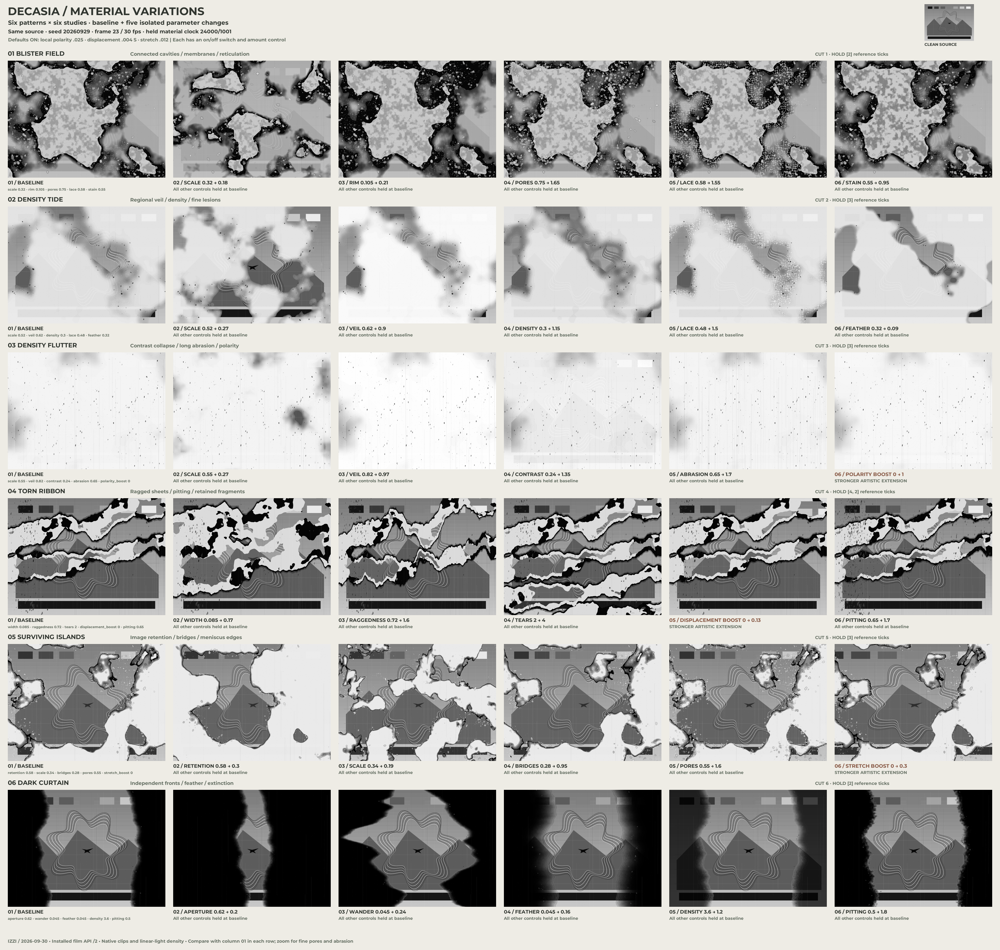
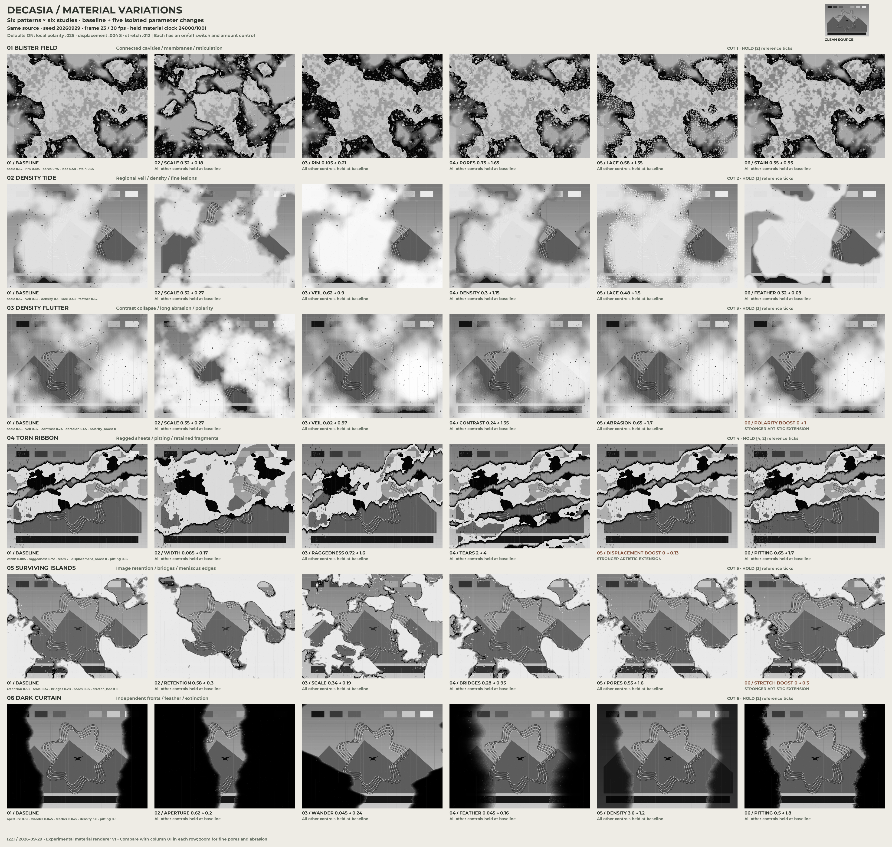

# Decasia: nitrate and silent-era decay motions

2026-09-29 · Reference analysis, C++ implementation plan, and 6 × 6 parameter atlas.
Status audited 2026-09-30.

2026-09-30 continuation: [Decasia 2 / unified film glitch](20260930.decasia-2.md)
adds named material variants, Forbidden Quest as canonical source 7, sub-source
analysis and standardized review plates/PDF with compact MKV reels. This
document retains the original six-source study and v1 production record.

Extend the [glitch-motion praxis](20260926.glitch-motion-studies_praxis.md)
with six independently controllable film motions: **blister fields, density
tides, density flutter, torn ribbons, surviving islands, and dark curtains**.
Their defining behavior is the interaction of persistent material structure,
abrupt changes between film images, and intervals during which an image holds.
The new vocabulary needs both pale and dark damage, fine structure around
large boundaries, and regional changes in the surviving picture.

Artistic extensions are retained: local polarity reversal, elastic emulsion
pulls, exaggerated ribbon displacement, gate motion, and deliberate cycles of
disappearance and return. Reference presets and expressive variants have
separate, inspectable controls.

**Status — implementation plan complete, verified 2026-09-30.**
Stages A–F and the original study are delivered. The installed `/2` API, strict
recipe reader, supported SVG import, source-sampling planner, artistic controls,
and explicit movie adapter are implemented and tested. The production delivery
includes a new 36-cell native atlas, twelve wide/tall proofs, and six 12-second
review chapters. Section 9 records the checks and the scope of visual review;
completion does not imply the user's final artistic approval.

The [user guide](../../generative_movement/film-decay.md) describes the shipped
contract, units, source construction and backend capabilities. The original
study and its `izzi.film-decay-study/1` CLI remain available. All six historical
study baselines still match byte-for-byte after extracting their generator into
`src/izzi-film-decay-fields.h`.

[](20260929.decasia-nitrate-silent-decay.production.svg)

The [production receipt](20260929.decasia-nitrate-silent-decay.production.json)
records the new cells, resolved `/2` recipes, chapter programs, traces and
renderer hashes. The 72-second review
and wide/tall comparison
are generated locally. The earlier `.plate.*` artifacts below remain the
historical study delivery from `0b4a4bf2` and `9b41a420`.

**Verification.** The new inventory reproduces all 2,660 decoded
comparison frames and the six documented cadence distributions; all twelve
supplied video files are hashed. Native/hybrid comparisons average under one
byte per channel across the six fixtures. The production contracts, legacy
seven-family suite, shared contours, surface tension, standalone headers and
relocated package consumers pass. Zero-strength lossless movie pixels and
aligned audio are byte-identical. The independent artifact audit validates
all 2,160 review frame plans, 1,072 material programs and eighteen shuffled
seek checks. The [verification receipt](20260929.decasia-nitrate-silent-decay.verification.json)
preserves the measured results.

## 1. Six inputs and timing authority

Use the supplied cut script for the source-film intervals. Its filename in
this checkout is
decasia-cuts.sh.
The six definitions total **111 seconds**. End times below are exclusive.

The primary comparison copies are in
`resources.rizal/glitch-nitrate-scratch-fade/decasia/ssk.1080p/`.
Every filename starts with `Decasia.2002.1080p.Bluray.DTS.x264.GCJM-`.

| Input | Script interval in *Decasia* | Requested length | Normalized copy: decoded frames | Container duration | Original stream-copy container |
| --- | --- | ---: | ---: | ---: | ---: |
| Cut 1 | 00:04:11–00:04:41 | 30 s | 720 | 30.113 s | 39.914 s |
| Cut 2 | 00:06:00–00:06:10 | 10 s | 239 | 10.052 s | 13.721 s |
| Cut 3 | 00:16:50–00:17:21 | 31 s | 744 | 31.114 s | 38.913 s |
| Cut 4 | 00:24:42–00:24:48 | 6 s | 143 | 6.048 s | 7.715 s |
| Cut 5 | 00:26:48–00:27:02 | 14 s | 335 | 14.056 s | 15.974 s |
| Cut 6 | 00:51:21–00:51:41 | 20 s | 479 | 20.062 s | 22.188 s |

All normalized copies are 1920×1080, square-pixel H.264 at **24000/1001 fps**,
with FLAC audio. The originals are 1456×1080 H.264 with DTS audio and the same
reported video rate. Analysis removes the normalized copies' 232-pixel side
padding on each side, then downsamples the 1456×1080 picture to 432×320 gray.
This keeps inserted padding out of temporal measurements.

The six normalized copies decoded successfully: **2,660 frames**, without
reported video decoding errors. First video PTS is 0.083 s for cuts 1 and 3,
0.084 s for the others. All observational times below mean
`frame PTS − first video PTS`, using zero-based decoded frame numbers. They
are cut-relative observations, not a replacement for the script's source
intervals. Audio was inventoried, not listened to or analyzed.

The existing `manifest.json` and `SHA256SUMS` cover only cut 6. Their two
checksums match the corresponding supplied files; the manifest's output paths
refer to an older `resources.rincon/.../output/` location. The script defines
all six cuts but its active command invokes only `${CUT6}`. The implemented
`scripts/analyze-decasia-references.py` enumerates all six explicitly and writes
a separate inventory under `outputs/decasia-production/references/`; it never
executes that one active cut command.

## 2. What each input contributes

The subjects identify the inspected shots; they do not identify their original
productions or the chemical cause of every visible mark.

| Input and inspected anchors | Observed spatial and temporal behavior | Motion to add |
| --- | --- | --- |
| **1 — cellular damage over a faint interior image.** Broad samples through 0–29.988 s; adjacent f192–203, 8.008–8.467 s. | Large pale cavities have dark, uneven margins. Small pale cells accumulate beside those margins; fine labyrinth-like texture occupies neighboring gray material. Distinct images hold in pairs, then the arrangement changes substantially. The large forms and their fine edges operate at different scales. | **Blister field:** connected lobes, merging/splitting regions, contrasting rims, and clustered satellite cells. Give coarse organization and fine edge renewal separate controls. |
| **2 — sea and rocks.** f96–107, 4.004–4.462 s; broader samples at 0, 2.711, 6.298, and 9.926 s. | The shore remains readable through veils of changing density. Bounded cavities and dark/light scalloped rims interrupt the water. Three-frame holds separate larger changes. Wave movement belongs partly to the photographed scene; it does not by itself establish deformation of the film image. | **Density tide:** broad translucent density fronts with small lesions at the margins. Preserve a controllable amount of source detail under the veil. Offer elastic displacement as an explicit expressive addition. |
| **3 — figure moving in shallow water.** f336–347, 14.014–14.473 s; broad samples across 0–30.989 s. | The figure alternates between stronger photographic contrast and pale, relief-like visibility. Fine longitudinal marks remain visible. At f341–343 a pale region suppresses much of the figure while the background retains darker areas; this is regional behavior. Three-frame holds are clear. | **Density flutter:** changes in regional contrast and white veil, with persistent scratches. Local inversion is useful artistically, but these samples do not prove a particular photochemical reversal process. |
| **4 — standing portrait.** f24–35, 1.001–1.460 s; f52 at 2.169 s, f77 at 3.211 s, f142 at 5.922 s. | Fine vertical pitting coexists with intermittent diagonal/transverse strips and large dark/light torn shapes. A fairly stable face makes the changing damage easy to distinguish. Held runs alternate between four and two transferred frames. | **Torn ribbon:** an irregular strip opens across an otherwise readable print, with ragged sides, discontinuous displacement, and a brief lifetime. Treat literal pulling or elastic stretching as an artistic model of the appearance. |
| **5 — seated portrait.** f144–155, 6.006–6.465 s; broader samples at 0, 2.544, 8.884, and 13.930 s. | The face and torso survive inside changing clear regions. Pale loss has dark meniscus-like borders; fine bright contours and small cavities appear around those borders. Recognizable anatomy survives beside near-total loss. Predominantly three-frame holds. | **Surviving islands:** generate the remaining image regions directly, including narrow connections and isolated pockets. Couple perimeter detail to those regions and allow their topology to change. |
| **6 — small aircraft against sky.** f240–251, 10.010–10.469 s; broad samples through 19.936 s. | Very large soft dark fronts close and reopen the visible sky. The opening changes shape and lateral position, sometimes approaching blackout. The aircraft provides a small persistent scale reference. Pairs of transferred frames often share the same arrangement. | **Dark curtain:** independently moving dark fronts and a changing aperture, with sparse edge pitting. Its control is the survival of a picture window, rather than a fixed centered vignette. |

### Full-resolution revision

The revision inspects the **1456×1080 active picture without downsampling**:
cut 1 f196/f198, cut 2 f101, cut 3 f341, cut 4 f25, cut 5 f150, and cut 6 f242.
This changes the implementation emphasis, particularly for the first input:

| Pattern | Detail missed by the first illustration | Implemented study response |
| --- | --- | --- |
| Blister field | Gray membranes survive inside large cavities; oily margins have strongly varying width; fine cells connect into lace. | Warped connected scalar field; separate variable rim field; subdued image inside cores; fine stains, cellular walls, clustered irregular pores, and sub-pixel marks. |
| Density tide | Veils preserve image detail and carry small scalloped lesions along their margins. | Regional linear-light density/veil bands, margin-linked cellular lace, and finer pitting. |
| Density flutter | Contrast loss is regional; longitudinal abrasion is much finer than the earlier marks. | Held regional response field and hundreds of fine, persistent, uneven scratches; small vertical pits. |
| Torn ribbon | Large pale and dark sheets coexist with surviving image fragments and very fine pitting. | Ragged strip fields with separate black loss, pale loss, and retained-image clips; dense fine pitting. |
| Surviving islands | Connected picture areas have necks, cavities, and bright worm-like edge structure. | Sample-quantile retention, adjustable bridge field, soft meniscus bands, perimeter lace and pores. |
| Dark curtain | Extinction has broad variable gradients and small edge defects, rather than a hard solid sidebar. | Independently wandering fronts, bounded aperture, linear-light attenuation bands and fine edge pitting. |

These are procedural interpretations of visible structure. They are not
pixel reconstructions, chemical simulations, or fitted models of those shots.

### Cadence is a first-class finding

For each decoded gray frame, compute mean absolute difference from the previous
frame on the cropped 432×320 picture. Mark a change when that mean exceeds
5 on the 0–255 scale, then count intervals between marked changes. This is a
simple transfer-cadence diagnostic, not optical flow or a measurement of film
chemistry. Low differences inside held runs include grain, registration, and
encoding variation; these are near-holds rather than identical pixel hashes.

| Cut | Intervals between detected changes | Starting preset cadence |
| --- | --- | --- |
| 1 | 358 intervals of 2 frames | `[2]` |
| 2 | 78 intervals of 3 frames | `[3]` |
| 3 | 247 intervals of 3 frames | `[3]` |
| 4 | 23 intervals of 2 and 23 of 4; inspected runs alternate | `[4, 2]`, with explicit phase |
| 5 | 109 intervals of 3, one of 1, one of 2 | `[3]`; preserve exceptional reference changes in the observation record |
| 6 | 214 intervals of 2, nine of 4, one of 12 | `[2]`; weak changes during dark passages can fall below the threshold |

Cuts 1–3 retain these intervals at thresholds 3, 5, and 8. Cut 4 retains its
2/4 pattern at thresholds 3 and 5. Cut 6 is more threshold-sensitive, especially
near blackout; the longer detected intervals are not proof of intentional
longer holds. The visual adjacent-frame checks support the dominant patterns.

At 24000/1001 fps, two ticks last 83.417 ms, three last 125.125 ms, and four
last 166.833 ms. A `[2]` pattern means two ticks of that declared clock, **not
two output frames at every render rate**. At 30 fps, use rational-time sampling
to reproduce the duration. Do not infer an original camera speed of 8, 12, 16,
or 24 fps from these transfer copies.

This timing interpretation is consistent with Morrison's account of making
an optically stretch-printed negative for *Decasia*. In the same interview he
distinguishes the offset superimposition used in *Light Is Calling* and parts
of *The Mesmerist*. That technique can inform an expressive variant, but it
should not be attributed to these six cuts without evidence.
[Morrison interview, *Offscreen*, 2004](https://offscreen.com/view/morrison2).

### Material vocabulary and limits of identification

Mechanical scratching, damage to image-bearing emulsion, changes in the film
base, and projection/printing behavior need separate controls. The NFPF guide
distinguishes mechanical damage, biological damage, shrinkage, and nitrate
decomposition; its nitrate stages include fading and emulsion blistering.
Visual similarity in a transferred frame does not establish which process
caused an individual mark. Here, “blister,” “reticulation,” “meniscus,” and
“peel” name visible structures and motion models, with causal attribution left
open. [NFPF, *The Film Preservation Guide*, pp. 13–16](https://www.filmpreservation.org/userfiles/image/PDFs/fpg.pdf).

The model should read as a sequence of already damaged film images passing
through a presentation system. Screen time is not chemical aging time. A
later image may contain more surviving picture than an earlier one. Monotonic
destruction and subsequent recovery remain available as authored narratives,
with their own named controls.

## 3. Revisit the delivered implementation

The existing seven-family implementation provides useful timing, seeds,
ordered application, limits, and review infrastructure. Preserve the delivered
`izzi.video-glitch/1` contract and historical renders.

| Existing mechanism | Limitation exposed by the six inputs | Extension |
| --- | --- | --- |
| `film_damage`: seven fixed-center analytic erosion shapes whose radii/edges oscillate with time | Repeated smooth breathing dominates; no connected material field or deliberate held-image cadence | Sample a correlated field by material-frame identity, then extract regions whose topology can change |
| Erosion selects complete source segments by their midpoint | Small marks depend on source tessellation; a long segment can cross damage without being cut correctly | Use closed SVG clip regions; any later flattened-path export must find all intersections |
| Global opacity loss per wear pass | Veils, contrast collapse, dark occlusion, and bright loss are coupled or absent | Separate local density response, image removal, and deposited light/dark material |
| Fixed scratch identities and 6 Hz transient dust | Useful starting vocabulary, but insufficient lifetime and coordinate-space control | Film-attached scratches and dust follow material frames; gate debris has a separate presentation-space lifetime |
| `scene` holds strokes; `from_guilloche_lines()` converts fills to outlines | Cannot directly express filled emulsion regions, full-area density, or surviving filled artwork | Add a film scene with fills and clipped groups, plus an explicit legacy-stroke adapter |
| `ghost` makes displaced spatial replicas | Does not express a film exposure/printing hold or adjacent-image temporal blend | Add explicit cadence and optional temporal-exposure descriptors |
| Movie adapter paints holes with its configured backing and uses a fixed two-pixel scratch | Transparent removal and density response need different operations | New film adapter consumes typed masks/regions and normalized widths; preserve existing `/1` behavior |

The current moiré changes to `scripts/video_glitch_movie.py` add paint roles
and a recovery frame. Preserve those controls when the film adapter is added.
The old seven-family schedule must continue to reproduce its existing output.

## 4. Shared C++ foundation — implemented

The reusable implementation now lives in
[src/izzi-levels-contours-regions.h](../../html/izzi-levels-contours-regions_8h.html), namespace
`izzi::level_set`. It is a standalone C++20 header, registered in the public
CMake install list. It contains no decoder, raster renderer, random state,
film-specific source model, or external geometry dependency.

| API | Behavior |
| --- | --- |
| `interpolate<Point>()`, `march_cell<Point, Segment>()` | The extracted surface-tension contour interpolation and saddle pairing, preserving the previous arithmetic and compatible caller types |
| `sample_grid(width, height, columns, rows, field, budget)` | Samples a caller's scalar field on a rectangular grid; rejects invalid dimensions, nonfinite samples, and oversized allocations |
| `closed_regions(grid, level, budget)` | Returns the high-side regions, `value >= level`, clipped to the grid rectangle; rings preserve islands and holes |
| `region_set::rings` | Closed rings stored without a duplicated last point; serialize each with `Z` and use even-odd fill/clip semantics |
| `density_response`, `map_density(intensity, response)` | A bounded artistic transfer of normalized **linear-light** intensity, including logarithmic attenuation, contrast, white veil, polarity, and amount |

`izzi-svg-surface-tension.h` imports the shared marching helpers. Its existing
point/segment types, model-specific `sample_field()`, scene specification, and
SVG serialization remain in that header. This keeps film-specific evolution
out of the reusable extraction code and avoids changing the surface-tension
field merely to accommodate film damage.

### Closed-region reconstruction

The new filled-region path uses four linear triangles per grid cell, meeting
at a center whose value is the corner mean. Clip the high side of each
triangle, cancel shared interior edges, then trace the surviving boundary
edges into rings. Shared mesh-edge identities join intersections; coordinate
rounding is not used as a substitute for topology. This closes regions at the
viewport, preserves internal holes, and handles exact-threshold point contacts.

This is an explicit piecewise-linear reconstruction. It is **not identical
to the legacy marching-squares line approximation**: a contour inside a cell
can bend at the center fan. Surface-tension continues to use the unchanged
line path. New film fills and their rims should derive from the same new
region geometry, so that their boundaries agree. Grid density remains a
declared approximation; sub-cell damage cannot be recovered from absent samples.

Default extraction limits are 262,144 cells, 2,000,000 vertices including mesh
and intersections, 2,000,000 working boundary edges, and 60,000 loops.
These are per extraction. The future film planner must also enforce a total
budget across layers, contour bands, SVG instances, and frames in flight.

### Density response

The implemented order is:

1. Mix input intensity with its inverse by `polarity`.
2. Apply `contrast` about linear intensity 0.5, clamping to [0,1].
3. Multiply by `10^(-optical_density)`.
4. Mix toward white by `white_veil`.
5. Mix the result with the original input by `amount`.

Accepted ranges: density 0–8, contrast 0–4, veil/polarity/amount 0–1.
Default response is identity; amount zero preserves the input exactly.
Alpha is unaffected. An SVG adapter must convert sRGB paint values into the
declared working space and back; a future movie adapter must likewise declare
its transfer function. The helper alone is not a photographic emulsion
simulation or a complete color compositor.

This example uses the implemented API:

```cpp
#include <izzi-levels-contours-regions.h>

namespace ls = izzi::level_set;

auto grid = ls::sample_grid(640, 640, 128, 128, [](ls::point p) {
  const double x = (p.x - 320) / 640;
  const double y = (p.y - 320) / 640;
  const double r2 = x*x + y*y;
  return (r2 - .025) * (.16 - r2); // An annular surviving region.
});
auto regions = ls::closed_regions(grid, 0);
// Emit regions.rings as closed paths in an even-odd clipPath.

ls::density_response response;
response.optical_density = .3;
response.white_veil = .12;
const double mapped = ls::map_density(.6, response);
// 'mapped' is linear intensity; it is not an SVG sRGB byte value.
```

## 5. Film motion architecture — implemented

Generic contours, closed regions, and density response remain in the shared
header. The installed `src/izzi-svg-film-decay.h` provides material fields,
checked rational clocks, typed motions, source-space transforms, and composition.
`src/izzi-svg-film-decay-json.h` implements the strict, separately versioned
**`izzi.video-glitch/2`** contract in `svg::video_glitch::film`. The shared
material generator is `src/izzi-film-decay-fields.h`; the original study wrapper
uses that same implementation. Actual shipped controls and capability limits
are documented in [film decay](../../generative_movement/film-decay.md).

The `/1` parser and emitter remain unchanged. Do not append types to
the legacy parameter variant without revisiting every visitor: several
current visitors use their final `else` as the satellite implementation, and
family names are indexed by variant position. The new contract uses
explicit family tags. A `/1` document is never silently rewritten as a new
film preset.

### Three clocks and two source-sampling modes

**Presentation time** is exact output frame/rate plus declared offset. It
controls event windows, optional gate motion, and editorial envelopes.
**Material frame** identifies a film image and its attached defects. A
**field evolution control** sets spatial correlation and optional authored
aging independently of both clocks.

For a constant hold `h`, calculate
`material_frame = floor(reference_ticks / h)`, with the ticks derived by
checked rational arithmetic. For a pattern such as `[4,2]`, use cycle length
and prefix sums to find the held material frame. Store the phase explicitly.
Validate positive holds, rational denominators, offsets, and integer overflow.

The planner provides two explicit modes:

- `damage_only`: preserve the caller's source time and hold the generated
  material field. Use this for existing movies whose duration and source
  coverage must stay intact.
- `whole_print`: return a source-sample time as well as the damage plan.
  The caller generates or decodes that source sample and holds its attached
  defects together. An explicit rational `source_step` determines playback
  speed; it does not claim to identify the historical camera rate.

The planner returns source-sampling instructions **before** the caller
constructs the input scene. Applying geometry to an already generated scene
cannot retrospectively change its source time. Whole-print retiming of an
existing movie also needs an explicit duration/audio policy; the six synthetic
studies can remain silent. Global amount zero bypasses damage and retiming
for an exact identity result.

### Correlated material fields

Use stable document seed, effect ID, field ID, material-frame index, and
feature ID with the existing `splitmix64-counter-v1` arithmetic. Version the
field algorithm separately, for example `film-field-v1`. Each feature has a
bounded, seekable lifetime and a deterministic birth interval. Reconstruct it
from its identity and time; avoid dependence on the frame rendered previously.

Separate a coarse field correlated across several material frames from a
fine field that can renew on each material frame. A useful construction is
a sampled strip field `F(x/S, y/S + k*pitch)` plus an independently keyed
fine component, where `S = min(active_width, active_height)` and `k` is the
material-frame index. Correlation length controls how much of the material
arrangement persists as the strip advances. Fixed-image hold intervals keep
both components fixed. Optional interpolation between material frames is an
artistic smoothing control, defaulting to zero in reference presets.

Thresholding a shared field permits connected regions to meet or separate.
Use the same resolved boundary for the pale core, dark rim, and adjacent
fine cells. Small marks should cluster around that boundary rather than
covering the whole picture uniformly. Reticulation can use secondary contour
levels or a finer bounded field in an annular neighborhood of the coarse
boundary. Renderable minimum feature size follows grid and export tolerance.

### Geometry, paint, and operation order

Use active-picture coordinates throughout. Centers use width/height fractions;
radii, rim widths, and fine feature sizes use fractions of `S`. Horizontal
displacement uses width fractions; vertical displacement uses height fractions.
Keep intentional anisotropy separate from proportional placement. Inserted
letterboxing and pillarboxing remain outside the film domain by default.

A film scene needs filled paths, strokes, clipped source groups, and ordered
paint operations. Retain holes using `clip-rule="evenodd"`, and qualify IDs
by document/layer/plate cell to prevent nested SVG collisions. Reuse the
guilloche renderer's clip-group conventions, while adding compound-region
support explicitly. The existing line-only adapter does not already preserve
native fills.

Distinguish three actions: remove source geometry, paint pale/dark material,
and transform source density. Transparent removal requires clipping or
cutting the source; drawing a transparent shape on top does not remove it.
In a complete print, erased regions can reveal a declared light substrate.
In a compositing layer, they can reveal the layer below. Both are useful and
must be selected in the recipe.

Default physical ordering is: source sampling → film-attached wear → local
emulsion deformation → density/loss regions → film border → rigid gate
transform → gate-attached debris → composition. Deformation carries attached
damage with it; projection motion carries the whole print, including its
defects. A named artistic ordering can deliberately detach them.

For discontinuities, clip source pieces before applying different transforms.
For continuous elastic pulls, adaptively subdivide source paths and bound
displacement and gradient. Native clip paths can preserve strokes and fills
without tessellation-dependent midpoint deletion. Flattened exports require
all segment/region intersections and explicit curve tolerance, including cases
where both segment endpoints lie outside a small region.

A `/1` result can be imported into the new film scene before film processing.
Do not feed filled/clipped film groups back through a stroke-only `/1` operator
and silently discard their semantics. Either support that capability
explicitly or reject that ordering.

## 6. Six motions and design-stage tuning ranges

The following values preserve the **initial design-stage tuning ranges**, not
estimates of chemical age or measurements fitted to the clips. The production
API promotes the five study controls per family and adds common field, lifetime,
orientation, event, deformation, gate, wear and exposure controls; its exact
shipped bounds are in the user guide. The original study controls are in section 7. Counts are integers. Shared
controls include strength [0,1], seed, material cadence, field correlation,
active rectangle, paint roles, and a clipping/painting choice for image loss.

| Motion / production type | Geometry and temporal rule | Initial controls |
| --- | --- | --- |
| **Blister field / `emulsion_bloom`** | Threshold a coarse connected field. Pale cores, dark rims, small satellite cavities, and fine contour lace share field identity. Hold the resolved structure, then renew part of it on the next material frame. | 4–32 primary sources; radius .03–.25 S; rim .002–.025 S; 0–512 satellite cells; correlation 1–16 material frames; `[2]` cadence |
| **Density tide / `density_tide`** | One or more broad fronts change local transmission and white veil. Shape can drift across the film while fine lesions change along its margins. Maintain readable source detail beneath intermediate density. | 1–4 fronts; transition width .03–.25 S; density 0–1.5; veil 0–.75; contrast .35–1; `[3]` cadence |
| **Density flutter / `density_flutter`** | Regional density and contrast switch between bounded states at material-frame boundaries, with persistent fine scratches. Spatially varied response prevents a uniform screen flash. | 1–6 regions; contrast .15–1; veil 0–.8; state lifetime 1–8 material frames; polarity .025 in the artistic study default, switchable off, 0–1 in extensions; `[3]` cadence |
| **Torn ribbon / `emulsion_ribbon`** | Long irregular strips cross the print at arbitrary angles. Their two sides and retained strip are separate clip regions. Gaps, ragged edges, and optional shifted image fragments have finite lifetimes. | 1–4 strips; width .003–.08 S; length .3–1.5 S; angle −90°–90°; displacement 0–.08 width; lifetime 1–6 material frames; `[4,2]` cadence |
| **Surviving islands / `survivor_islands`** | Resolve retained image regions inside a damaged surround. Narrow bridges, holes, and detached pieces can appear or vanish. Rim activity follows the retained regions. | 1–8 coarse islands; retained fraction .08–.85 as a tuning target; boundary detail .002–.02 S; dark rim 0–.03 S; `[3]` cadence |
| **Dark curtain / `edge_curtain`** | Two or more low-frequency, irregular fronts define a moving aperture. Their positions, width, feather, and extinction vary independently. Fine defects occupy selected edges. | 1–3 fronts; aperture 0–1 width; center wander 0–.4 width; feather .01–.15 S; density 0–3; `[2]` cadence |

Retained fraction is a target requiring a field quantile/threshold solve; it
must not be advertised as exact coverage until that solve and grid tolerance
are implemented. Counts, radius distributions, and thresholds stay explicit
in the resolved recipe. Intensity is not coupled to historical wear-pass count.

### Supporting motion controls

Upgrade scratches to finite or long-lived paths whose x-position drifts slowly
and whose width/opacity may vary along their length. Support full-height and
broken scratches, with light/dark paint selected independently. Film dust
holds with the material frame; gate dirt/hair holds in presentation coordinates.

Gate weave, intermittent vertical judder, frame-line slippage, and exposure
pumping remain available as separate controls. Their amplitudes default to
zero in the six reference presets until a registered-image measurement supports
specific values. A silent-era label does not automatically imply every one
of these artifacts.

### Artistic extensions retained

| Extension | Useful motion / expressive intent | Implementation boundary |
| --- | --- | --- |
| **Local polarity and solarized relief** | A face or rosette passes through a pale trace into an inverted island, then returns. Couple reversal to a density front, not only to global time. | The production layer implements regional inversion and thresholded solarization in linear light, including filled source paints. Both are artistic. |
| **Elastic emulsion pull** | Picture fragments stretch toward a receding rim or hang from a thin surviving bridge. | Use a smooth bounded displacement field inside each retained region; reserve discontinuities for explicitly cut boundaries. |
| **Peel and recoil** | A ribbon lifts, shifts, briefly exposes the substrate, then snaps into a different material frame. | Separate the ribbon's geometry, source displacement, and event envelope. The recoil is an authored gesture. |
| **Reel memory** | Similar cavity organizations recur with evolving detail, creating a refrain. | Explicit `repeat_material_frames` and variation seed; ordinary seeking must not create repetition accidentally. |
| **Catastrophic eclipse and recovery** | A curtain suppresses almost the entire image; a small island carries the subject into the next reveal. | Author aperture/density keyframes and keep surviving detail measurable. Recovery describes the composition, not reversal of chemical decomposition. |
| **Exposure echo and expressive gate motion** | Offset held images, irregular advances, or a rigid print shake create additional rhythmic tension. | Temporal source samples require an explicit exposure/retiming adapter. Reuse of the legacy spatial `ghost` alone cannot produce a temporal exposure. |
| **Tinted emulsion** | Warm loss regions and cool retained lines can separate material layers in a colored izzi composition. | Use explicit named paint roles. The six monochrome inputs do not calibrate this coloration. |

## 7. Original executable 6 × 6 parameter atlas (preserved)

[](20260929.decasia-nitrate-silent-decay.plate.svg)

Open the [native SVG](20260929.decasia-nitrate-silent-decay.plate.svg) to zoom
into membranes, abrasion, pores, and seams. The
[JSON receipt](20260929.decasia-nitrate-silent-decay.plate.json) contains every
resolved control, extension switch/amount, material frame, geometry count,
cell hash, and implementation hash.

The atlas is **3840×3648**, with six rows and six columns. Each row contains
one baseline and five independent parameter changes. Compare each changed
cell with the first cell of its row; changes do not accumulate across columns.
All 36 cells share seed **20260929**, output frame **23 at 30 fps**, the same
native tonal diagnostic source, and the same small artistic defaults. The
source includes filled gray shapes, a grid, rosette strokes, tonal swatches,
and a small central silhouette. It remains stationary in the motion preview.
The field and its marks are generated independently of the supplied footage.

At this sample time the reference tick is **18**. Material frames are
**9, 6, 6, 6, 6, 9** for the six rows. A common time intentionally produces
different material indices when the reference cadence differs. Column identity
only changes SVG IDs, never the seed or material field.

| Row | 01 — baseline | 02 — one change | 03 — one change | 04 — one change | 05 — one change | 06 — one change |
| --- | --- | --- | --- | --- | --- | --- |
| Blister field | scale .32; rim .105; pores .75; lace .58; stain .55 | scale **.18** | rim **.21** | pores **1.65** | lace **1.55** | stain **.95** |
| Density tide | scale .52; veil .62; density .30; lace .48; feather .32 | scale **.27** | veil **.90** | density **1.15** | lace **1.50** | feather **.09** |
| Density flutter | scale .55; veil .82; contrast .24; abrasion .65; polarity boost 0 | scale **.27** | veil **.97** | contrast **1.35** | abrasion **1.70** | polarity boost **1.00** |
| Torn ribbon | width .085; raggedness .72; tears 2; displacement boost 0; pitting .65 | width **.17** | raggedness **1.60** | tears **4** | displacement boost **.13** | pitting **1.70** |
| Surviving islands | retention .58; scale .34; bridges .28; pores .55; stretch boost 0 | retention **.30** | scale **.19** | bridges **.95** | pores **1.60** | stretch boost **.30** |
| Dark curtain | aperture .62; wander .045; feather .045; density 3.60; pitting .50 | aperture **.20** | wander **.24** | feather **.16** | density **1.20** | pitting **1.80** |

The last flutter/islands cells and the displacement cell deliberately explore
stronger artistic effects. All other cells retain the shared minimal amounts.
Every baseline is an artistic study informed by its reference, not a claim
that its extension values were measured from film damage.

### Units, ranges, and operation

`S` is the short side of the active picture; here **540 units**. Field sampling
uses `[0, 728/540] × [0,1]`. Scale, ribbon width, curtain feather, wander, and
displacement use fractions of `S`; aperture uses a fraction of picture width.
The blister rim and tide feather are **scalar-field units**, not measured
screen-space thickness. Noise amplitude and the local field gradient affect
their apparent width. Pores, lace, stain, abrasion, pitting, raggedness, and
bridges are dimensionless artistic weights. Density is logarithmic optical
attenuation; veil and polarity are normalized mixing amounts. Stretch is an
increase in horizontal scale, with the picture center as its pivot.

| Pattern | Accepted controls and ranges |
| --- | --- |
| Blister | `scale` .12–.65; `rim` 0–.25; `pores` 0–2; `lace` 0–2; `stain` 0–1 |
| Tide | `scale` .15–1; `veil` 0–1; `density` 0–2; `lace` 0–2; `feather` .05–.8 |
| Flutter | `scale` .15–1; `veil` 0–1; `contrast` 0–2; `abrasion` 0–2; `polarity_boost` 0–1 |
| Ribbon | `width` .01–.25; `raggedness` 0–2; integer `tears` 1–4; `displacement_boost` 0–.2; `pitting` 0–2 |
| Islands | `retention` .08–.9; `scale` .15–.65; `bridges` 0–1; `pores` 0–2; `stretch_boost` 0–.4 |
| Curtain | `aperture` .02–.98; `wander` 0–.3; `feather` .005–.2; `density` 0–6; `pitting` 0–2 |

Retention selects a quantile of field **vertex samples**, not an exact
continuous-area solve. The receipt also records the resulting polygon area
fraction as `retained_area`. Scale or bridge changes solve the quantile again,
so comparisons retain approximately the same coverage while changing topology.
Other families report `-1` for this inapplicable measurement.

Colors are decoded from sRGB, passed through the shared linear-light
`map_density`, then encoded back to sRGB. Density/veil fields use **28 discrete
region bands**; slight banding can remain at high magnification. Fine pores
and scratches are direct vector geometry below the scalar grid spacing.
Stills sample **384×285 cells**; the motion proxy uses **192×142**. Neither
render embeds a reference frame, bitmap texture, SVG filter, or raster noise.

### Minimal artistic extensions — enabled by default

The three controls apply to source copies **inside material regions**. They
leave the material boundary in film coordinates and perturb the retained image
relative to it. They do not transform the atlas labels or clean source.

| Extension | Default | Amount range | Effect |
| --- | --- | --- | --- |
| `polarity` | enabled, **.025** | 0–1 | 2.5% mix toward local inversion in linear light, before contrast/density/veil. |
| `displacement` | enabled, **.004 S** | 0–.2 S | Translate retained image by 2.16 units horizontally and .432 vertically at this picture size. |
| `stretch` | enabled, **.012** | 0–.4 | A 1.2% horizontal expansion of the retained image, pivoted at the picture center. |

Each extension stores `enabled` and `amount` separately. Turning it off keeps
its configured amount and suppresses both the base amount and any family
boost. Turning it back on restores that setting. Setting a base amount to
zero removes its minimal contribution; use `off` to also suppress an explicit
boost. These are bounded local affine transformations in the preserved study.
The production API adds nonlinear bounded pulls and authored peel/recoil
envelopes separately; see sections 5, 8 and the user guide.

For displacement and stretch, the family boost is added to the base amount.
Flutter combines the regional boost `b` and base polarity `p` as
`1 - (1 - b) * (1 - p)`, bounded by 1. Thus a polarity boost of 1 reaches a
full local negative regardless of the small default. The stronger variants
are independent controls, not hidden changes to the source or seed.

### C++ implementation and reproduction

The compatibility entry point is
[examples/film-decay-study.h](../../../examples/film-decay-study.h), with
[examples/film-decay-plates.cc](../../../examples/film-decay-plates.cc) as the
CLI. The entry point now aliases the generator extracted into the installed
`izzi-film-decay-fields.h`, preserving the study's output. Both study and
production reuse `izzi-levels-contours-regions.h` for sampling, closed regions
and linear-light density; neither duplicates the contour/region algorithms.

Compile an optimized native renderer, then generate all 36 cells, individual
JSON recipes, the assembled SVG/PNG, and a two-second six-panel motion proxy:

```sh
mkdir -p build/film-decay
g++ -std=c++20 -O2 -Wall -Wextra -Wpedantic -Werror -Isrc \
  examples/film-decay-plates.cc -o build/film-decay/izzi_film_decay_plates
python3 scripts/render-film-decay-studies.py \
  --columns 384 --workers 4 --motion-seconds 2 \
  --output outputs/decasia-film-studies/v2 \
  --publish-plate docs/development/sessions/20260929.decasia-nitrate-silent-decay.plate.svg
```

The render script generates
native cells in parallel, assembles the atlas, deduplicates repeated geometry,
validates internal references, and uses CairoSVG/Pillow for the raster review.
The PNG rasterizes each native cell independently and places it at its atlas
coordinates, avoiding expensive repeated global definition lookup. FFmpeg
encodes the H.264 review proxy. Required Python packages are `cairosvg` and
`Pillow`; no reference video is needed for generation.

The generated motion proxy
contains **60 output frames at 30 fps**, with the six baseline materials side
by side. Its frame trace
records the rational reference tick and six material states for every frame.
This short, stationary-source study isolates material change and cadence.
Moving-source attachment, whole-print retiming and the longer 72-second
chapter review are delivered separately by the production workflow below.

Generate or customize a single cell; row and column numbers are **1-based**:

```sh
# Blister baseline with a stronger membrane stain; minimal extensions stay on.
build/film-decay/izzi_film_decay_plates --cell 1 1 outputs/blister.svg \
  --set stain=0.8 --set pores=1.2

# Independently disable, adjust, and re-enable artistic extensions.
build/film-decay/izzi_film_decay_plates --cell 5 1 outputs/islands.svg \
  --extension polarity=off \
  --extension displacement=0.007 \
  --extension stretch=0.02 --extension stretch=on

# All three artistic operations off, including a cell's explicit boost.
build/film-decay/izzi_film_decay_plates --cell 3 6 outputs/flutter-off.svg \
  --extension polarity=off --extension displacement=off --extension stretch=off
```

Every command writes its SVG and a JSON sidecar. `--list` prints all 36 resolved
recipes. `--frame`, `--fps`, `--seed`, and `--columns` expose the clock, random
identity and resolution. Output FPS is an integer 1–240; frame index is bounded
at 10,000,000. The reference clock is always rational **24000/1001**, with
`[2]`, `[3]`, `[3]`, `[4,2]`, `[3]`, `[2]` hold patterns starting at phase zero.
The CLI rejects unknown controls, nonfinite/out-of-range values, fractional
tear counts and unsupported grid sizes.

The native C++ equivalent is:

```cpp
#include "examples/film-decay-study.h" // Compile with -I. -Isrc.
namespace study = izzi::film_decay_study;
int main() {
  auto parameters = study::preset(0, 0); // Zero-based row/column in C++.
  study::set(parameters, "pores", 1.2);
  study::context sample;                 // Frame 23, 30 fps, seed 20260929.
  study::set_extension(sample.extensions, "polarity", "off");
  study::set_extension(sample.extensions, "stretch", "0.02");
  auto output = study::render(parameters, sample, "custom-blister");
  // output.svg; output.boundary_points; output.rings; output.retained_area.
}
```

The renderer is stateless: a material state depends on seed, sampled time,
pattern controls, extension settings and grid resolution. Stable candidate IDs
keep the underlying field fixed when changing mark acceptance or amount.
Counter noise drives slow organization and held fine renewal separately.
Budgets reject excessive grid, region, aggregate contour and SVG byte counts;
there is no silent fallback that removes detail to meet a budget.

## 8. Implementation sequence and current status

The approved continuation is complete in the working tree on **2026-09-30**.
The former gaps in B–F are closed by the production code and evidence below.

| Stage | Completion evidence |
| --- | --- |
| **A — shared foundation: complete** | Installed `src/izzi-levels-contours-regions.h`; unchanged surface-tension marching arithmetic; closed-region/density and standalone-header checks. |
| **Study — six patterns and parameter atlas: complete** | Original CLI, 36-cell atlas, configurable minimal extensions and two-second proxy preserved. All six baseline SVGs match byte-for-byte after generator extraction. |
| **B — reference inventory and film contract: complete** | `scripts/analyze-decasia-references.py` inventories all six script intervals, hashes twelve files and decodes 2,660 comparison frames. Installed `izzi-svg-film-decay.h` and `izzi-svg-film-decay-json.h` supply explicit `/2` tags, checked rational clocks and strict JSON round-trip/rejection. |
| **C — region composition and first two motions: complete** | Native filled/stroked source scenes, compound ancestor clips, paint roles, SVG importer and all six generators share a material program. Tests cover wide strokes, holes, density, opaque substrate, transparent removal and operator order. |
| **D — density and expressive motion: complete** | All six production motions include deterministic material lifetimes, film/gate attachment, event/keyframe controls, bounded elastic pulls, thresholded solarization, temporal exposures and explicit repetition. Minimal polarity/displacement/stretch remain enabled and independently configurable. |
| **E — production review and documentation: complete** | `examples/film-decay-render.cc`, `scripts/render-film-decay-production.py` and the user guide deliver 36 production cells, twelve aspect-ratio proofs and six 12-second source/effect chapters. Stationary, moving and whole-print sources have complete plans, program hashes and independent seek verification. Visual review scope is recorded in section 9. |
| **F — explicit movie integration: complete** | `scripts/film_decay_movie.py` and `scripts/render-film-decay-movie.py` implement the declared hybrid route; `video_glitch_movie.transform_film()` exposes it to existing BGR/BGRA callers. Tests verify lossless zero identity, native/hybrid agreement, active crop, sampled PTS, delayed video/audio alignment and explicit retiming policy. |

The production importer accepts the native SVG subset listed in the user
guide, rather than claiming complete SVG support. Unsupported source features
and line-only export after film processing fail explicitly. Existing `/1`
effects can run before an explicit film import; filled film results are not
silently reduced to legacy strokes. Native C++ rendering has no raster fallback.

The line extractor and region extractor have different representations.
Avoid a second copy of either algorithm in the film or movie modules. Keep
surface-specific Gaussian sources in the surface-tension header, and put
film-strip correlation and feature lifetime generation in the film header.
Neither should become a policy in `izzi-levels-contours-regions.h`.

The production atlas uses 256 scalar columns; motion and wide/tall proofs use
128, with aspect-preserving grids. The adapter caches resolved material states
across held output frames and reuses their regions for density levels. Cache
identity includes the recipe, native binary, field state, resolved controls,
domain and quality. Budgets count clipped copies and density bands as well as
unique geometry; exceeded budgets fail instead of silently reducing detail.

## 9. Verification and review record

The implemented foundation is tested by
tests/level-set.cc. Coverage includes full and
empty domains, boundary closure, threshold equality, an annulus with a hole,
disconnected islands, single and shared point-touching saddles, all 81 single-cell combinations
of negative/zero/positive corner samples, finite extreme values, resource
rejection, and density identity/attenuation/veil/polarity behavior.

The production contracts in `tests/film-decay.cc` and
`tests/film-decay-render.py` cover:

- **Compatibility:** historical `/1` parsing and recipes retain their
  semantics and existing family order. Keep the current seven-family
  verification suite passing.
- **Timing:** `[2]`, `[3]`, and `[4,2]` holds resolve correctly at their
  rational boundaries, at 24000/1001, 25, and 30 fps, including seeking and
  chunk boundaries. Equal rational times produce equal material state.
- **Identity and ordering:** zero strength is an exact pass-through; a held
  material state stays fixed while independently enabled gate motion can
  continue. Film-attached and gate-attached features move in their declared
  spaces. Imported legacy artwork retains its paint and echo semantics.
- **Topology:** merge, split, island, hole, viewport contact, and tear cases
  remain valid. Filled source regions and wide strokes obey the same clips.
  Native clipping does not depend on source segment midpoints; unsupported
  line-only flattening is rejected rather than bridging removed regions.
- **Density and alpha:** test known linear-light ramps, constant gray, white
  substrate, black material, and transparent cutout separately. Regional
  inversion must include the selected substrate/paint roles; recoloring only
  source lines is not a full photographic negative.
- **Reproducibility and bounds:** shuffled evaluation order and resumed
  renders reproduce results; reject nonfinite controls, invalid rationals,
  duplicate/unknown JSON keys, invalid counts, ID collisions, and total budget
  overflow. Pin native binary and renderer versions for byte-level receipts.
- **Review coverage:** a still source isolates material behavior, a moving
  source exercises attachment, and wide/tall sources expose placement errors.
  Native and proxy artifacts separate reference cadence from expressive
  smoothing; the visual inspection and its limits are described below.

The [user documentation](../../generative_movement/film-decay.md) provides a units/ranges table, source-sampling
examples, transparency/substrate examples, composition order, backend capability
matrix, performance controls, and all six reference-to-preset mappings.
Artistic controls appear alongside the reference defaults. Frame traces and
their referenced material programs record source time, material frame, hold
phase, feature/region/point counts, density controls, ordering, seed/version and
resource usage. A seed alone does not identify an algorithm.

### Production continuation — verified 2026-09-30

The [verification receipt](20260929.decasia-nitrate-silent-decay.verification.json)
combines the independent artifact audit, pixel/movie integration measurements,
legacy baseline hashes and package-consumer result. Eighteen focused CTest
checks passed across the film, contour, surface-tension, legacy video-glitch,
standalone-header and package suites. The final Python integration run also
covers SVG rejection/visibility semantics and the existing BGR/BGRA boundary.
The documented C++ example compiled and ran.

| Evidence | Result |
| --- | --- |
| Reference inventory | Six source intervals, 111 requested seconds; twelve supplied files hashed; all 2,660 normalized frames decoded; documented cadence distributions reproduced. |
| Production atlas | 36 native SVG/PNG cells; fixed seed/time; all thirty nonbaseline cells change one control and produce a nonzero pixel difference; unique IDs and valid local references. |
| Domain proofs | All six motions at 972×540 and 540×972; twelve native SVGs and full-resolution raster proofs. |
| Motion review | Six 12-second chapters, 1072×462 at 30 fps; all 2,160 frames decode; stationary, moving/damage-only and artistic/whole-print sections are labeled. |
| Independent clock/program audit | Every frame's rational cadence, phase and source/echo sample checked; 1,072 program hashes checked; eighteen shuffled fresh-process seeks reproduce geometry, density, loss, wear and counts. |
| Native/hybrid comparison | Mean absolute difference by family: .5263, .8600, .2452, .2093, .2555, .2430 byte/channel; the separate bounded-pull fixture is .5651. These are fixture measurements, not a guarantee of pixel identity for every source. |
| Movie identity and timing | Thirty decoded RGB frames and 48,000 audio samples are byte-identical at zero strength. A second fixture with delayed first video PTS preserves the exact corresponding audio window. A cropped whole-print fixture verifies held source samples and explicit silent policy. |
| Installed API | Build-tree and relocated installed consumers pass with 67 headers, eight include fragments and eleven existing schemas; the consumer exercises the new film JSON and cadence API. |
| Historical output | All six study baseline SVGs match their pre-extraction bytes at 384 scalar columns; legacy `/1` family contracts and shared surface-tension checks pass. |

Visual inspection covered the native production atlas, representative native
detail, the corrected wide/tall sheet, and all six chapter contact sheets
(twelve source/effect pairs per chapter). The blister study now combines large
connected cavities, gray membrane remnants, variable rims and fine clustered
pores. Tide and flutter produce distinct regional veils; flutter deliberately
permits very pale source visibility. Ribbon and island controls preserve
recognizable fragments, and the curtain's authored eclipse closes and reopens
the picture window. Native boundaries and fine scratches survive in the
full-resolution artifacts; proxy rendering loses some fine detail.

The temporal review combines decoded sample frames with complete rational
frame-plan and held-program checks. Real-time audiovisual playback was not
performed in this environment, and no user artistic approval is inferred.
The generated movie is available for that viewing. These are procedural
interpretations of the six inputs; neither the review nor the automated tests
establish photochemical accuracy or a reconstruction of a particular shot.

Reproduce the production delivery and independent audit:

```sh
CCACHE_DISABLE=1 cmake -S . -B build/film-decay-release -DCMAKE_BUILD_TYPE=Release
CCACHE_DISABLE=1 cmake --build build/film-decay-release --parallel 2 \
  --target izzi_film_decay_render izzi_film_decay izzi_film_decay_plates izzi_film_decay_study
CCACHE_DISABLE=1 ctest --test-dir build/film-decay-release --output-on-failure \
  -R '^film-decay[.]'
python3 scripts/analyze-decasia-references.py
python3 scripts/render-film-decay-production.py --workers 3 \
  --publish-plate docs/development/sessions/20260929.decasia-nitrate-silent-decay.production.svg
python3 scripts/verify-film-decay-production.py
```

### Historical verification of the extraction and study

The original and refactored surface-tension test were compiled with GCC C++20
and `-Wall -Wextra -Wpedantic -Werror`. Both passed. Their generated SVGs
match byte-for-byte: **21,043 bytes**, SHA-256
`7e5c51bc1f331b485a2af3cce1f6f6c3684c776649bcf1068b0a59a766220ebb`.
This verifies the exercised legacy scene and arithmetic; it is not a claim
that every possible historical render has been re-rendered.

All six focused CTest checks passed: standalone inclusion of both headers,
the surface-tension contract, SVG well-formedness, plate enumeration, and the
new region/density contract. The implemented-API documentation example was
also compiled and run. Local document links and the example SVG's XML,
unique IDs, and internal references were checked; the rendered static plate
was visually inspected.

Rebuild and run the focused checks from the repository root:

```sh
cmake -S . -B build/cmake
CCACHE_DISABLE=1 cmake --build build/cmake --parallel 2 \
  --target izzi_level_set izzi_surface_tension izzi_surface_tension_plates
CCACHE_DISABLE=1 ctest --test-dir build/cmake --output-on-failure \
  -R '^(level-set\.|surface-tension($|\.)|header-self-contained\.(izzi-levels-contours-regions|izzi-svg-surface-tension)\.h$)'
```

The historical atlas contains native paths, references, and clip paths. Its
study-only checks did not establish acceptance of production interfaces or
source import; the production evidence is recorded above. Neither atlas
establishes photographic fidelity. Geometry deduplication preserves unique
IDs and internal references.

The study contract checks all 30 single-control changes, held-frame identity,
later material changes, seeking/evaluation order, the alternating 4/2 boundary,
equal rational times, approximate retained area, and invalid controls. Artistic
switch checks verify that an off switch suppresses a strong family boost,
retains its saved amount, and that a zero baseline amount matches off.

Both focused study CTests pass. The documented C++ example compiles and runs.
All 36 cells have distinct render hashes, valid local SVG references, and
the expected fixed seed/time/extension settings; the 30 changed cells each
produce a nonzero pixel difference from their row baseline. At the still grid
resolution, the baseline island area is **.5821** for a .58 retention target;
the .30 exploration produces **.3018**. The 60-frame movie decodes without
reported errors at **1920×1040, 30 fps, 2 seconds**. All **360** row/frame
material-state assignments match an independent accumulation of the declared
hold patterns. The atlas and sampled motion frames were visually inspected.

```sh
CCACHE_DISABLE=1 cmake --build build/cmake --parallel 2 \
  --target izzi_film_decay_plates izzi_film_decay_study
CCACHE_DISABLE=1 ctest --test-dir build/cmake --output-on-failure \
  -R '^film-decay[.]'
```

## 10. Reproducible reference observations

The normalized comparison-copy SHA-256 values are:

```text
16d35346fbb515355bf4ef18b5bdfa07fc79463d3c06c70adc105ff83f94e652  cut-1-1080p.1.mkv
b960e35410a8b0ab5492ec7af3353b962a908fe68d7401f5320f3a9ca2795efe  cut-2-1080p.1.mkv
d5e04c2ae93a3f95e65ba7123c9b350a24f9c938f61901c30776ebb867e2234f  cut-3-1080p.1.mkv
2857995212c4a074dc1143ee0680b400c2ded693ac2d47fe4d723df7fb0861a9  cut-4-1080p.1.mkv
a452c4e0f3e7856f518516848e22ed866823158751b0acd8ca027054094b8814  cut-5-1080p.1.mkv
42b20c2a4207ef89b42752083c31b6ecb6b408593ee00fb6e574b84f9d5836d8  cut-6-1080p.1.mkv
```

Names in this block omit the shared filename prefix only. The metadata survey
also covered all six original copies; visual and cadence findings above use
the normalized copies consistently.

For a selected comparison file, obtain decoded frame timestamps with:

```sh
ffprobe -v error -select_streams v:0 \
  -show_entries frame=best_effort_timestamp_time -of json INPUT.mkv
```

Produce the measurement raster without temporal resampling:

```sh
ffmpeg -v error -threads 2 -i INPUT.mkv -an \
  -vf 'crop=1456:1080:232:0,scale=432:320:flags=area' \
  -fps_mode passthrough -pix_fmt gray -f rawvideo frames.gray
```

Read the raw file as unsigned bytes shaped `(frame_count, 320, 432)`. Convert
to a signed type before subtraction. The cadence calculation is:

```python
diff = abs(frames.astype('int16')[1:] - frames.astype('int16')[:-1])
mean_change = diff.mean(axis=(1, 2))
change_frames = numpy.flatnonzero(mean_change > 5) + 1
intervals = numpy.diff(change_frames)
```

For broad contacts, sample 12 evenly spaced decoded frame indices, including
the first and last. The twelve-frame close inspections begin at frames
**192, 96, 336, 24, 144, and 240** for cuts 1–6 respectively. Check those
alongside the overview, rather than using a sparse contact alone to infer
motion. PTS-relative labels and the script's original source interval both appear in the implemented machine-readable reference
record.
