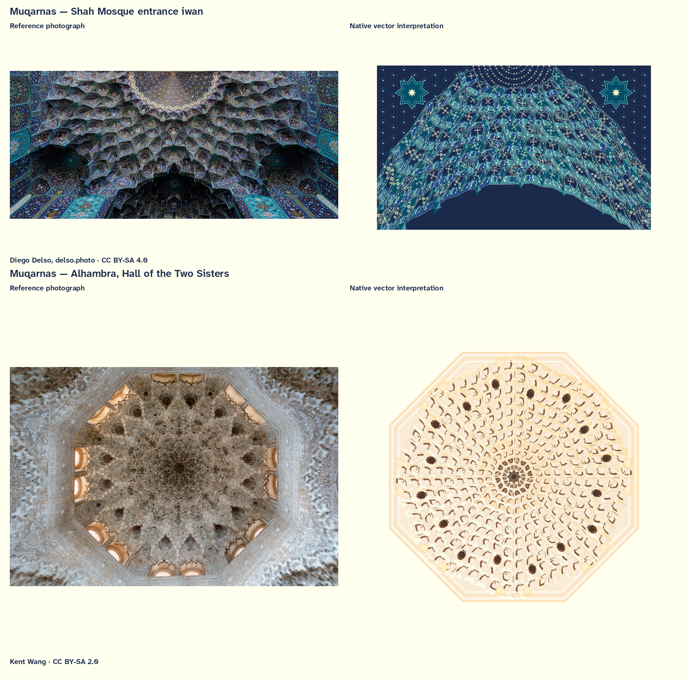

# Meta guilloche 2 — production plan and Review 5 muqarnas

The [2026-09-30 examples-review follow-up](20260930.make_examples_review_2.md)
connects the current native recipes and cameras to `make examples-review`,
replacing the earlier selected enrichment drawings at their existing plate
IDs. Its separate proposal covers shared legends and parameter-space plates
for every older and newer form.

2026-09-30. **Review 5 replaces the two ceiling plates with muqarnas studies of
the Shah Mosque entrance iwan and the Alhambra’s Hall of the Two Sisters.
The revised stills, details, source comparisons and PDF accompany the native
C++ implementation. The four verified full MKVs remain the Review 4 edit;
the new ceiling artwork has not been inserted into those files.**

[Two-plate comparison](20260929.meta_guilloche_2.muqarnas.png) ·
Muqarnas review ·
Full stills PDF ·
[Review 5 implementation and controls](#review-5--muqarnas-replacements-30-september-2026).

Make a longer draft of `guilloche-exploits-in-the-wild`, adding selections
from the native forms developed since Draft 2. Deliver compact MKVs using
the encoding approach from `glitch-motion-studies`. Keep the dedicated moiré
plates and expanded visual illusions together in one companion reel. Every
plate ends by expanding beyond the frame, replacing the previous collapse
to center.

The original film brief is the basis of this plan: extend the film,
combine moiré and expanded visual illusions in their own reel, change the
exit movement, add wisteria using Japanese ornamental designs, and use the
supplied Japanese willow photograph for
willow, develop the running vine toward the supplied vintage botanical
pattern, encourage complex branching and crested saguaro forms from both
supplied references, and revisit brain coral with deeper dimensional canyons,
irregular shapes, and less reliance on circles. Study El Lissitzky's
photomontage for the asymmetry passages. Add arabesque studies of the Jameh
Mosque's southern iwan and the Imam Mosque's entrance-portal ceiling.
Include Ponzo, Poggendorff, Hering,
Wundt, peripheral drift, and Kanizsa's triangle in the optical companion,
using the requested SendPoints book as a design reference. Use the **Izzi hue
palette for all colors in both films and the revised muqarnas studies**.
The selection list, companion title and durations below describe the edit,
with the two Review 5 ceiling replacements marked explicitly. This document
preserves the production brief and subsequent human revisions; the delivery
section records the encoded Review 4 results.
Use the [rendering workflow](../../visual_workflow/tool_guilloche.md) to
rebuild from the existing review recipes and production manifests.

## Two films, with all original plates accounted for

| Film | Retained Draft 2 plates | New selections | Picture duration, including opening | Frames at 30 fps |
| --- | ---: | ---: | ---: | ---: |
| `guilloche-exploits-in-the-wild`, Draft 3 | 54 | 35 | **14:54 / 894 s** | **26,820** |
| `moire-exploits-in-the-wild`, companion Draft 1 | 10 | 13 | **3:54 / 234 s** | **7,020** |

Each plate remains ten seconds / 300 frames. Each film has its own
four-second / 120-frame opening. Preserve the relative order of the retained
plates within each film; insert the new selections as specified below.
Across the two films, every original plate appears exactly once.

The routing rule follows the native source: move the ten plates generated
by `examples/moire-plates.cc`. Keep the guilloché constructions that also
produce interference, including `variant-lissajous-moire-compatibility`,
the orbital twins, and counter-orbit compositions. This retains the passages
praised in the previous playback review and gives the companion a clear
collection of dedicated moiré and optical studies.

Draft 2 remains the authority for original plate identities and motion:
production manifest,
[delivery record and playback notes](20260926.short_center_frame_moire_guilloche_praxis.md),
and [Draft 2 contract](20260926.short_center_frame_moire_guilloche.md).
Its source commit is `a35e0fcf9e5ffe4473c3c1ecce38cb7e9d93deb7`.

## New guilloché selections

The September 29 native collection contains 123 review plates and two
lenticular packets. Use its authored geometry and native generators:
[gallery](../../generative_patterns/guilloche-enrichment/index.html),
[manifest](../../generative_patterns/guilloche-enrichment/manifest.json),
[implementation record](20260928.meta_guilloche_implementation.md), and
[generator](../../../examples/guilloche-enrichment-plates.cc).

The table gives selection IDs for gallery-derived forms and the added
wisteria and mosque studies in playback order. Each row adds five plates after nine
retained original plates, except block B, which adds nine with separate mosque wall and ceiling
studies, and block D, which adds six with wisteria. This alternates the
established film with new passages, gradually moving from engraved geometry
into foliate, botanical, and reef forms. The insertion times include the
four-second opening. Anchor page numbers refer to the **September 26**
catalogue used by Draft 2.

The two ceiling IDs below include the Review 5 replacements. Their proposed
slots and the film durations are unchanged. The existing encoded main reel
and its production manifest still identify the earlier Review 4 ceilings;
the still-review manifest identifies the new subjects explicitly.

| Block | Insert after retained plate / original page | New passage | Selection IDs, in order |
| --- | --- | --- | --- |
| A — contours, waves, surfaces | 9 / p266 | 01:34–02:24 | `contour-asymmetric-dense`, `contour-limit-sparse`, `directed-wave-2`, `hobnail-asymmetric-dense`, `basketweave-asymmetric-dense` |
| B — woven and geometric ornament | 18 / p147 | 03:54–05:24 | `basketweave-diagonal`, `arabesque-star8-ornament`, `arabesque-hex6-ornament`, `arabesque-girih10-ornament`, **`arabesque-jameh-south-iwan` (accepted wall study)**, **`muqarnas-shah-entrance-iwan` (Review 5 ceiling)**, **`arabesque-imam-portal-ceiling` (accepted wall study; retained ID)**, **`muqarnas-alhambra-dos-hermanas` (Review 5 ceiling)**, `hobnail-limit-sparse` |
| C — engraving and interlacing | 27 / p249 | 06:54–07:44 | `flinque-lotus-finished`, `flinque-swirl-finished`, `flinque-eccentric-finished`, `foliate-asymmetric-dense`, `foliate-interlaced-vines` |
| D — foliage | 36 / p221 | 09:14–10:14 | **`foliate-running-vine` (vintage botanical reference revision)**, `foliate-palmette`, `feather-palm-detail`, `fan-palm-detail`, `ginkgo-detail`, **`wisteria-detail` (new form using Japanese designs)** |
| E — branching and layered forms | 45 / p160 | 11:44–12:34 | `cannabis-9-leaflets`, `papyrus-three-stems`, **`saguaro-detail` (uneven branched selection; crested alternative in review)**, **`willow-detail` (Japanese willow reference revision)**, `lettuce-detail` |
| F — reef finale | 54 / p185 | 14:04–14:54 | `fox-detail`, **`grooved-brain-detail` (revised canyon treatment)**, `sea-fan-detail`, `pink-tipped-anemone-detail`, `saddle-carpet-anemone-detail` |

Existing gallery IDs resolve to `plates/<id>.svg` and `json/<id>.json` under
the native gallery directory. The film's selected recipes and later human
revisions live separately in `outputs/meta-guilloche-2/recipes/`, with
reference-led constructions in
[izzi-svg-guilloche-meta.h](../../html/izzi-svg-guilloche-meta_8h.html).
Wisteria, the two mosque wall studies and the two muqarnas ceilings are additions;
their IDs do not imply assets in the original gallery. The frozen production
manifests identify each selected recipe, native source and hash. Catalogue
page numbers have changed since Draft 2 and must always carry their catalogue date.

Retain finished flinqué tint as a geometry treatment, with its color selected
from the Izzi hue palette. Apply that palette to original and new artwork,
using contrasting plates where they clarify overlapping structures. Foliate
remains vines and vegetal ornament; arabesque remains Islamic geometric
construction. The girih passage is the existing finite patch.

The user accepts the current flinqué designs and the remaining foliage.
Retain those native forms while applying the shared palette and motion
requirements. The explicitly requested plant revisions still apply. Develop
sparse and woven studies with one through four distinct line or ribbon
widths, as specified below. The user considers the reference feedback
sufficient for a trial; additional artistic references are not a prerequisite.

### Requested form revisions

**Add two arabesque studies from the requested mosque views.** The working
identification is Isfahan, Iran: the Jameh Mosque (Masjed-e Jameh) and the
Imam Mosque (also called the Shah Mosque). The user named the buildings and
views; the photographs below are selected working references for those views.
Record the precise pattern crop alongside each native recipe when developing
the samples.

- **`arabesque-jameh-south-iwan` — Jameh Mosque, view of the southern iwan.**
  Use [Bernard Gagnon's southern-iwan photograph](https://commons.wikimedia.org/wiki/File:Jameh_Mosque_of_Isfahan_-_Southern_Iwan.jpg)
  as the composition reference, supported by the
  [Texas Tech architectural image record](https://exhibits.lib.ttu.edu/s/archlib/item/14150).
  The photograph was retrieved and visually inspected on 2026-09-29:
  3918×2612 JPEG, SHA-256
  `6caaaa07edbcdd98da35cc4558d0ed22a4c8a4baa28dd90dfaf4dcd3d6d66d04`.
  Develop the larger, relatively open tiers of pointed recesses, their
  interlocking boundaries, and the geometric ornament around the enclosing
  arch. Preserve the hierarchy between broad architectural cells and fine
  surface ornament. Compose the selected iwan pattern vertically, retaining
  its central axis and depth through the successive recesses.
- **`arabesque-imam-portal-ceiling` — Imam Mosque, decorations of the entrance
  portal ceiling.** Use [Radosław Botev's entrance-iwan photograph](https://commons.wikimedia.org/wiki/File:Entrance_iwan_muqarnas_of_Shah_Mosque_Isfahan_2014_%282%29.jpg)
  and the [Kenyon College entrance-muqarnas record](https://digital.kenyon.edu/baly/847/).
  The photograph was retrieved and visually inspected on 2026-09-29:
  4000×3000 JPEG, SHA-256
  `692e25ed795ff9891d0791b7a36411e4d11da08cc0370f0d596c01ae3cd12cbb`.
  Develop the dense, layered muqarnas cells, angular and star-shaped
  junctions, faceted edges, and smaller ornamental fields within the cells.
  Keep the upward-looking portal-ceiling composition and the progression
  from larger lower recesses toward the finer tiers of the semidome.

Treat these as separate native constructions with their own cell layouts,
tier depths, facet shading, and ornament density. Build the visible relief
from connected geometry, with coherent occlusion and highlights. Map every
surface, recess, and accent to Izzi hue colors. Retain the film's text-free
artwork by selecting architectural geometry and nontext ornament from the
references. Expose controls for tier count, cell proportions, relief depth,
ornament density, and line weight; derive the motif topology from the chosen
reference crop before freezing those controls.

Review a structure/detail pair for each mosque beside its source view, at
full and phone sizes. Check recognizable cell organization, readable depth,
and the distinction between the two studies. Use restrained native motion
that preserves connected cells, followed by the shared expansion off the
page. Each study adds one ten-second slot in block B: twenty additional
seconds in the main reel. The three existing arabesque selections remain
useful comparisons for geometric clarity and ornament density.

**Study El Lissitzky's photomontage for asymmetry.** Apply this shared
direction to `contour-asymmetric-dense`, `hobnail-asymmetric-dense`,
`basketweave-asymmetric-dense`, and `foliate-asymmetric-dense`. Candidate
reference studies are [Record (1926), also known as Runner in the City](https://www.moma.org/collection/works/84035),
and [Self-Portrait (1924), known as The Constructor](https://www.moma.org/collection/works/83836).
MoMA describes the assembly of layered source images in both works. These
specific works and the following translation are proposed interpretations
of the user's artist reference. Revised asymmetry stills and restrained
alternatives have now been produced and inspected; human feedback remains open.

Develop deliberate differences in visual weight, scale, direction, and
overlap: a dominant displaced structure, smaller counterweights, directional
accents, and unequal areas of open space. Compare a restrained arrangement
with a stronger layered composition for each selected family. Preserve
recognizable contour, hobnail, woven, and foliate constructions while varying
their internal organization. Make the layers native geometry with Izzi hue
paints. Keep branch connections and woven crossings coherent during motion.

The delivery center remains the registration anchor during entry and development;
individual motifs and their visual weight can sit away from that center.
Fit the complete finite composition during its entry and middle passage,
then let the shared outward exit carry it beyond the page. Review both still
balance and moving relationships before selecting each ten-second recipe.
This revises four existing selections without adding slots or duration.

**Vary widths within the sparse and woven patterns.** Prepare four comparable
versions with **1, 2, 3, and 4 distinct widths**. Treat the one-width version
as the existing uniform-width comparison. The count describes how many
different widths coexist within a pattern; it is not a pixel range or an
instruction to resize the entire composition.

Start with `contour-limit-sparse`, `directed-wave-2`, `hobnail-limit-sparse`,
and `basketweave-diagonal`. Carry the same controls into the selected
asymmetric hobnail and basketweave where appropriate. Use line-weight
variation for contours, waves, and hobnail outlines, and actual ribbon-width
variation for basketweave. Preserve the weave's over/under order and adjust
crossing clearances to the participating ribbon widths.

For the initial comparisons, use relative width sets `[1]`, `[1, 2]`,
`[1, 1.5, 2]`, and `[1, 1.5, 2, 3]`, with a family-specific base width.
These ratios are proposed starting values. Assign widths in a deliberate,
repeatable rhythm among neighboring lines or strands, keeping every assigned
width class present and stable through the native motion. Hold layout,
palette, density, framing, and seed constant across each four-way comparison
so the effect of width variation is clear.

Expose and serialize the width count, ratios, assignment rule, and base
width in the native authoring controls. Review the four representative
families as a 16-sample comparison at full and phone sizes, with compressed
motion samples for line clarity and crossing behavior. Select one treatment
for each existing movie slot; the comparison variants do not increase the
reel counts or durations.

**Develop `foliate-running-vine` toward the user's
[Vintage Botanical Pattern reference, StockCake](https://stockcake.com/i/vintage-botanical-pattern_1920086_1251860).**
The page's [main image](https://images.stockcake.com/public/2/8/c/28c08689-e227-4564-be5c-07be16012b29_large/vintage-botanical-pattern-stockcake.jpg)
was retrieved and visually inspected on 2026-09-29: 512×512 preview,
SHA-256 `bbb8270cb681127217d1526abb03917509f51a0cef192fd6a2c17d98b2db5f1e`.

Use its sweeping, branching stems, looping tendrils, and broad pointed leaves
with serrated edges and visible veins. Develop substantial filled leaf
shapes with a clear midrib and finer side veins. Vary leaf size, angle, and
spacing along the stems, combining dense edge sprays with interior branches
and open gaps. Preserve the reference's balanced ornamental rhythm and
overlapping curves while allowing local asymmetry.

Build the richer leaf and stem structure in native vectors and compose it
for the tall delivery frame. Extend the branch network vertically rather
than stretching the square reference. Use Izzi hue greens for leaf depth,
a palette brown for stems, and the shared ivory backing. Animate connected
stem flex and smaller leaf rotations, keeping attachments intact, then
expand the whole composition beyond the frame. Review a structure/detail
pair beside the reference and inspect the compressed canary for legible
veins and separation between overlapping leaves. The revised running vine
keeps its existing ten-second slot; film counts and durations are unchanged.

**Use Japanese wisteria designs for the new `wisteria-detail` plate.**
Use the user-selected references below, superseding the earlier
museum-reference suggestions. The photograph and illustration were retrieved
and visually inspected on 2026-09-29:

- [Wisteria photograph, Flickr](https://live.staticflickr.com/5335/7180609706_6c4dc54329_b.jpg):
  use the long, tapering racemes, closely spaced small blossoms, uneven
  hanging lengths, and overlapping layers that form a dense flower curtain.
  Inspected image: 1023×682 JPEG, SHA-256
  `d439f02ff57619ec3905058be274c0332659364bfa46392e1853ed2b1e7822af`.
- [Wisteria illustration, iStock image 1490348069](https://media.istockphoto.com/id/1490348069/vector/this-illustration-shows-a-cluster-of-wisteria-flowers-on-a-checkerboard-purple-gradient.jpg?s=612x612&w=is&k=20&c=pED8Kvp56YuMhFqPyo12sEpNCs-sJ3wnOc7AGeP9pHM=):
  use the simplified light petal silhouettes, slender hanging stems,
  staggered cluster lengths, and open space beneath the flowering canopy
  as the graphic treatment reference. Inspected preview: 612×344 JPEG,
  SHA-256 `c58e3b758de55bb78eb8d81e1bdc2d58ee081bc280178ef0ae5d1d206df51d33`.
- **Chie Tanaka, “Wisteria Purple,” PIE Books** — additional reference,
  recorded as supplied by the user. The exact publication/page or artwork
  has not yet been located or visually inspected. Retain it alongside the
  two image references for the next design review; its specific visual
  treatment remains to be examined. All resulting colors still come from
  the Izzi hue palette.

Make a hanging flower curtain the defining native form. Concentrate branching
and floral density above, with individual clusters descending to varied
depths. Vary raceme length, taper, blossom spacing, overlap, and curvature;
retain slender stem connections and supporting leaf groups. Translate the
photograph's layered density into the illustration's clear, repeated petal
shapes, keeping gaps between clusters legible on the tall delivery canvas.
Compare a dense cascade and a more open arrangement before selecting the
existing ten-second wisteria slot. Counts and durations remain unchanged.

Build the flowers and stems as native vectors using the film's Izzi hue
palette and ivory backing. Use palette purples, pinks, and light accents
for blossom depth. The stock preview's checkerboard/gradient and watermark
are outside the artwork brief. Hanging flowers are central, superseding
their earlier optional treatment. Animate connected canopy sway with gentle
lag through the long clusters, then the shared expanding exit. Produce a
native structure/detail pair, authored controls, and a compressed canary
that preserves separate florets at phone size. Add the selected construction
to the native catalogue and film recipe.

**Revise willow using the user's Japanese willow photograph:**
[Dappled-Willow-2.jpg, Gardener's Apprentice](http://gardenersapprentice.com/gardeningtips/wp-content/uploads/2026/04/Dappled-Willow-2.jpg).
This direct image supersedes the earlier Google Images search link. The
photograph was retrieved and visually inspected on 2026-09-29: 1000×1000
pixels, SHA-256
`2df9789f612a3bffa6c623aa51c394856a81024a04b64eb2c898e509eb31c353`.

Base the native construction on its visible structure: a short exposed trunk,
a dense spreading crown, many slender upward and outward shoots, and small
elongated leaves clustered along those shoots. The canopy has an irregular,
feathery perimeter, pale cream and pink outer growth, and a darker green
interior. Preserve overlapping leaf sprays, varied branch angles and lengths,
and small gaps that reveal depth. Avoid a perfectly circular canopy outline.
This revises the existing long, hanging willow fronds into the branching and
leaf arrangement shown in the selected photograph.

Use the tree as the form reference, excluding the surrounding garden and
photographic background. Translate its light/dark and color relationships
through Izzi hue entries, with distinct inner and outer leaf layers and
readable leaf edges against the common backing. Animate connected branch
sway with smaller leaf-tip movement, then the shared expanding exit. Review
the reference beside a native structure/detail pair and the encoded canary.
The revised willow keeps its existing ten-second slot; counts and durations
remain unchanged. Record the final native recipe alongside the reference URL
and image hash.

**Expand `saguaro-detail` to encourage complex branching and crested forms.**

The later page-40 feedback selects the branched photograph as the main
silhouette: strongly unequal arm heights and attachment points, with no
broad crest obscuring the columns. Keep crested growth as an alternative.
Use both user-supplied references, retrieved and visually inspected on
2026-09-29:

- [Many-armed saguaro thumbnail](https://encrypted-tbn0.gstatic.com/images?q=tbn:ANd9GcQxg26O-DFDZzVoKGvxKPDAxEY7TtrPrycV279LDnu03w&s):
  183×275 JPEG; SHA-256
  `60b3d4f188f5547329eae1e7865ce9b80c6c2fe2127647efd7701d153ada58e6`.
  Use this small reference for its tall, densely branched silhouette and
  unequal arm heights and attachment levels.
- [Crested saguaro, National Park Service](https://www.nps.gov/sagu/learn/nature/images/crested-saguaro.jpg?maxwidth=650&autorotate=false&quality=78&format=webp):
  650×975 WebP; SHA-256
  `0e2b0a4b7f904cff00f3f873b654027a657d04d1b6efc352c74c1100adee6019`.
  Use the broad, folded, lobed crests, ribbing that fans through the folds,
  and the coexistence of crested growth with ordinary columnar arms.

Make varied, asymmetric silhouettes a central part of the native parameter
space: many arms, staggered attachments, unequal lengths and thicknesses,
curved elbows, secondary branching, and overlapping foreground/background
limbs. Include fan-shaped crests with uneven lobes, curled edges, ridges,
and recessed folds. Continue the trunk and arm ribs into the crests so the
surface remains connected and dimensional. Use variable-width contours,
filled surfaces, occlusion, and Izzi hue shading to distinguish the folds.

Expose controls for branch count and hierarchy, attachment height, arm
length/thickness/curvature, rib density, crest position and span, lobe
irregularity, and fold depth. Review at least a richly branched variant,
a crest-led variant, and a combined variant; complexity is encouraged in
the selected film recipe. Keep the structure legible at phone size by
preserving gaps between arms and clear contrast across crest folds.

Animate continuous arm curvature, rib spacing, and crest relief with stable
branch topology during the ten-second shot, then apply the shared expanding
exit. Review the native structure/detail pair against both references and
inspect the compressed canary. This revises the existing saguaro slot;
film counts and durations remain unchanged.

**Re-examine the brain coral's construction before animating it.** The current
`grooved-brain-detail` is a source reference, not the accepted final appearance.
Replace its dominant circular enclosure and regular rounded channels with
an irregular colony silhouette and a meandering network of deeper canyons.
Vary ridge width and height, canyon width and depth, curvature, and spacing;
allow asymmetric lobes, branching valleys, and uneven terraces. Smooth the
curves without turning the structure back into nested rings or repeated
circular cells.

Build dimensional cues into the native geometry: offset wall contours,
variable-width shaded flanks, narrow dark troughs, lighter ridge crests, and
occlusion where one ridge passes in front of another. Keep one coherent
lighting direction. Depth must remain readable in a still frame; a global
drop shadow, added concentric lines, or a moving camera alone will not
satisfy this revision. Use local relief and modest differential motion to
support the dimensional reading while keeping the canyon network connected.

Preserve the current brain-coral plate as a comparison reference. Review
several irregular silhouette/depth variants at full and small sizes, then
freeze one revised native recipe under the brain-coral selection. It keeps
one ten-second slot. Add public parameters and authoring/profile support for
the selected construction, with regression checks appropriate to topology,
bounds, and deterministic rendering. The running-vine, wisteria, Japanese
willow, saguaro, and brain-coral changes now have native review stills and
encoded motion samples. The production links below contain the comparison set.

The directed-wave selection supplies a flowing passage now. The separate
[Hamonshū V2 project](20260929.hamonshu-v2.md) has completed source crop
reviews but has not started algorithmic synthesis. Its brief also supersedes
the first water interpretations. Keep those older water interpretations and
uncategorized V2 crops outside this selection; future V2 geometry can enter a
later revision without blocking this film.

## Moiré and optical companion

The dedicated moiré plates, expanded visual illusion studies, and lenticular
passages belong to **one combined reel**, separate from the main guilloché
film. Export that complete reel in both orientations; the optical expansion
does not create a third film.

Move these ten original plates, in their existing relative order. Positions
are one-based in Draft 2; times include its opening. All page references in
this table belong to the September 26 catalogue.

| Draft 2 position | Original start | Original page | Native plate |
| ---: | --- | ---: | --- |
| 9 | 01:24 | 543 | `moire-m3-04-grid-interference` |
| 14 | 02:14 | 534 | `moire-m2-01-dot-grid` |
| 17 | 02:44 | 528 | `moire-m1-01-fine-linear-grid` |
| 22 | 03:34 | 524 | `moire-07-sine-curtain` |
| 26 | 04:14 | 522 | `moire-05-radial-parallax` |
| 36 | 05:54 | 530 | `moire-m1-03-radial-aperture` |
| 39 | 06:24 | 535 | `moire-m2-02-negative-positive` |
| 48 | 07:54 | 532 | `moire-m1-05-destabilized-texture` |
| 54 | 08:54 | 539 | `moire-m2-06-variable-grid` |
| 59 | 09:44 | 518 | `moire-01-linear-close-beat` |

These occupy 00:04–01:44 in the companion. Add thirteen ten-second passages
at 01:44–03:54, in this order. The five new illusion constructions extend
the earlier selection; peripheral drift already has a slot and appears once.

1. `current-interference-effect`
2. `leaf-interference-effect`
3. `facet-tones-effect`
4. `cafe-wall-effect`
5. `peripheral-drift-effect`
6. `ouchi-effect`
7. `ponzo-effect` — proposed new native construction.
8. `poggendorff-effect` — proposed new native construction.
9. `hering-effect` — proposed new native construction.
10. `wundt-effect` — proposed new native construction.
11. `kanizsa-triangle-effect` — proposed new native construction.
12. `lenticular-two` — a moving view-selection study derived from its two source views.
13. `lenticular-four` — the corresponding four-view study.

The first six have existing native optical constructions and paired control
plates. The next five have no existing treatments or gallery assets in the
September 29 collection and are planned native development. The eleven
optical passages occupy 01:44–03:34, followed by the two lenticular passages
at 03:34–03:54. They are not all moiré mechanisms, which is why this is a
moiré **and optical** companion. Preserve meaningful relative grating angles,
offsets, and tone orders when adapting their geometry for movement.

### Requested visual illusions

Use the user's reference, *Designing Graphic Illusions*, SendPoints
Publishing Co., Ltd, 2019, ISBN 9789887928355. Record the supplied publisher
site, [spbooks.cn](http://spbooks.cn), alongside the
[bibliographic listing](https://www.foyles.co.uk/book/designing-graphic-illusions/sendpoints/9789887928355).
The publisher site could not be retrieved in this session, and the book's
interior has not been inspected. The constructions below follow the user's
named effects and the linked demonstrations; they do not claim to reproduce
particular pages or designs from the book.

| Requested illusion | Native construction brief | Human review focus |
| --- | --- | --- |
| [Ponzo](https://michaelbach.de/ot/sze-shepardTerrors/index.html) | Place two equal-length bars at different positions within converging perspective guides. Preserve equal target lengths while adjusting guide angle, spacing, and context. | Apparent size difference is convincing while the targets remain geometrically equal. |
| [Poggendorff](https://michaelbach.de/ot/ang-poggendorff/index.html) | Draw collinear oblique segments interrupted by an opaque band; expose line angle and band width as controls. | The interruption produces apparent misalignment without actually offsetting the segments. |
| [Hering](https://michaelbach.de/ot/ang-hering/index.html) | Place straight parallel target lines across a radiating field. Keep targets straight while adjusting the contextual rays. | Targets appear to bow outward; the construction reads clearly in the tall composition. |
| [Wundt](https://www.psy.ritsumei.ac.jp/akitaoka/katachi2025.html) | Use opposing angular fans around straight parallel targets to produce the complementary inward-bowing effect. | A distinct inward bend is perceived, with comparable target geometry to the Hering study. |
| [Peripheral drift](https://michaelbach.de/ot/mot-snakesLum/index.html) | Retain `peripheral-drift-effect`; select Izzi hue colors by measured luminance and preserve the asymmetric spatial tone sequence. | Apparent drift survives the palette mapping and compression while the pattern itself is stationary. |
| [Kanizsa's triangle](https://michaelbach.de/ot/cog-Kanizsa/index.html) | Arrange three inward-facing disk sectors so their gaps imply an unpainted triangle. Control inducer size, spacing, and orientation; the central region uses the same ivory backing as its surroundings. | An apparent triangular surface and edges emerge without drawing a triangle outline or separate triangular fill. |

Develop effect/control pairs as review material for all five new treatments,
with public parameters, authored scenes, resolved metadata, and native
geometry checks. Controls remove or rearrange the inducing context while
preserving the targets. They do not add movie slots. Check equal lengths,
straightness, collinearity, and inducer alignment as applicable; these checks
establish construction accuracy, while human viewing establishes whether an
effect is convincing.

For these six requested illusions, allow the middle interval `[90,210)` to
remain steady so the intended perceptual effect can establish itself.
Peripheral drift must include that stationary interval. Any proposed context
animation must preserve the target geometry and be compared with the still
version. All six retain the shared entry and expanding exit at `[210,300)`.
Review the stills and compressed clips at full and phone sizes in both
orientations, preserving the Izzi hue palette throughout.

For the lenticular passages, use each packet's `authoring.json`, resolved
strip assignments, and source-view SVGs. Develop an animated view sweep with
a legible strip handoff, then apply the same outward exit as other plates.
These are proposed screen animations using existing native assets. The
calibration artwork stays in the review material; the movie does not imply a
physical lens/print demonstration. Both packets are linked from the gallery.

## Feedback coverage for this draft

Of the initial **46 new selections**, five have individual form-revision direction:
`foliate-running-vine`, `wisteria-detail`, `willow-detail`, `saguaro-detail`,
and `grooved-brain-detail`. Four more share the El Lissitzky photomontage
direction: `contour-asymmetric-dense`, `hobnail-asymmetric-dense`,
`basketweave-asymmetric-dense`, and `foliate-asymmetric-dense`. Six optical
selections now have explicit effect direction: Ponzo, Poggendorff, Hering,
Wundt, peripheral drift, and Kanizsa's triangle, with the SendPoints book as
their design reference. The arabesque family now has architectural reference
direction: two new mosque studies, reviewed alongside the existing star8,
hex6, and girih10 selections. Those three baseline selections still need
comparison feedback; the references do not establish an accepted final look.
All selections share the completely clearing outward-exit instructions and
the Izzi hue palette. The rejected gray Imam candidate is archived.

The user has accepted these **10** existing designs for their current forms:
`flinque-lotus-finished`, `flinque-swirl-finished`,
`flinque-eccentric-finished`, `foliate-interlaced-vines`, `foliate-palmette`,
`feather-palm-detail`, `fan-palm-detail`, `ginkgo-detail`,
`cannabis-9-leaflets`, and `papyrus-three-stems`. The four previously open
contour/wave and sparse/woven selections now have the explicit 1–4 width
variation direction. These decisions retain the earlier specific plant and
asymmetry revisions.

The following **12** have no further individual notes during this
film-planning session. Use their existing native constructions for the
trial, applying the shared palette and motion requirements. The user has
said the feedback is sufficient; these are later review topics, not requests
for more input before trying the draft.

| Group | Count | Selections without specific feedback | Useful human feedback |
| --- | ---: | --- | --- |
| Reef | 5 | `lettuce-detail`, `fox-detail`, `sea-fan-detail`, `pink-tipped-anemone-detail`, `saddle-carpet-anemone-detail` | Dimensional folds, branching, and tentacles; enough variation to distinguish the organisms. |
| Other optical | 5 | `current-interference-effect`, `leaf-interference-effect`, `facet-tones-effect`, `cafe-wall-effect`, `ouchi-effect` | Selection-specific direction and whether each intended effect remains convincing with the Izzi hue palette and animated treatment. |
| Lenticular | 2 | `lenticular-two`, `lenticular-four` | Legibility of the source views, strip handoff, and view-sweep pace. |

### Human review before the next movie draft

Proceed with the accepted designs and recorded revision briefs. Prioritize
the width comparisons, revised forms, mosque studies, and optical/lenticular
playback for the trial review. The
[existing gallery](../../generative_patterns/guilloche-enrichment/index.html)
remains the baseline for designs accepted as they stand and for selections
without further individual notes.

The five detailed form briefs, the arabesque family with its two mosque
additions, four asymmetry studies, and six named illusions have enough
direction to develop samples. Their resulting appearance still needs human review:
compare the hanging wisteria arrangements, Japanese willow crown, rich
running vine, branched/crested saguaro variants, irregular deep brain-coral
canyons, the two mosque studies beside the three baseline arabesques, the
proposed Lissitzky-inspired compositions, and the six illusion effect/control
comparisons, plus the sparse/woven width variants. Direction supplied is distinct from a rendered
result reviewed. Revised stills and encoded canaries have now been produced;
the user authorized the complete reels after those preparation steps.

For production, prepare a compact review set before assembling
the full films: representative stills at full and phone sizes, plus short
MKV canaries showing native motion and the complete outward exit. Optical
and lenticular effects especially need playback feedback after palette
mapping and compression. Record human feedback separately from automated
geometry, color, timing, and encoding checks.

## Color: Izzi hues throughout

Use `svg::spectrum<svg::palette_kind::izzi_hue>()`, backed by
`svg::izzi_hue_palette` in
the native palette table and
[explicit palette API](../../html/izzi-svg-color-palette_8h.html). Read named
colors through Izzi's enum-to-RGB mapping; browser/CSS names can have different
RGB definitions. Exclude the `color::none` sentinel from color selection.

The gray Imam candidate was rejected on PDF page 35. The latest direction
supersedes that temporary exception: use the reference's warm cream, orange
and shadow colors, selected from Izzi hues. Omit the blue and green tiled
frame from this study. All authored paints in both reels are again subject
to the same strict hue-palette check.

This applies to every authored stroke, fill, background, title, flinqué tint,
optical tone, lenticular view, highlight, and canyon shadow. It also replaces
the original plates' colors. The hue palette excludes the neutral
black/white/gray series, so it supersedes the old `#E6E6E6` backing.
Use `color::ivory` as the common backing and `color::bellflower` for the
opening titles. Keep the backing consistent through title fades, opening
gaps, cleared exits and all plate transitions.

| Passage | Proposed named palette selections |
| --- | --- |
| Running vine | `color::midori`, `color::duboisgreen5`, and `color::byakuroku` for leaf surfaces and veins; `color::kinsusutake` for stems against the shared `color::ivory` backing |
| Wisteria | `color::wisteria`, `color::redwisteria`, `color::lavender`, and `color::ivory` for the hanging blossoms; `color::midori` and `color::byakuroku` for supporting leaves |
| Japanese willow | `color::ivory` and `color::pink` for pale outer leaves, `color::byakuroku`, `color::seijiiro`, and `color::midori` for foliage depth, `color::kinsusutake` for the trunk; retain contrasting leaf edges against the backing |
| Complex saguaro | `color::midori`, `color::hiwamoegi`, and `color::byakuroku` for ribbed surfaces and crest highlights; `color::duboisgreen5` for recessed folds and overlapping arms |
| Brain-coral relief | `color::rurikon` for deep troughs, `color::hanada` and `color::asagiiro` for walls, `color::powderblue` for ridge highlights |
| Engraved and woven contrasts | Combinations of `color::rurikon`, `color::asagiiro`, `color::daylily`, and `color::ivory` |
| Optical tone sequences | Palette members selected and ordered by measured luminance to retain each construction's required dark-to-light relationships |

Freeze a palette mapping for every plate. Select shading bands and any
gradient stops from actual palette entries; do not introduce arbitrary RGB
values. The optical studies require explicit
replacement of their internal neutral fills, not just a new scene-level
stroke color. Audit those resolved paints as well as the source recipes.

Normal alpha compositing, title fading, antialiasing, and video compression
produce intermediate pixel values; the palette requirement governs authored
paint choices and gradient endpoints. Record each chosen enum name and its
resolved RGB value in the production manifest. Review contrast at full and
phone sizes, especially in thin colored strokes and the canyon depth bands.

## Movement: enter, develop, expand completely off the page

Apply the new exit to **all 112 plates**, including all 64 originals.
The user rejected the approximately 80%-cleared ending seen in
`archive-06.mkv`: continue until **100% of the artwork is off the page and
only the background remains**. One or two extra seconds are authorized if
needed. The implemented exit clears within the existing ten-second slots,
so the schedules and audio durations remain unchanged.

| Local frames | Seconds | Behavior |
| --- | --- | --- |
| `[0,90)` | 0–3 | Retain established entry on originals; give new finite motifs comparable emergence and growth. Rectangular fields cover the frame from their first frame. |
| `[90,210)` | 3–7 | Develop native contour, woven, engraved, botanical, reef or optical motion. Preserve reviewed controls. The six requested illusions may remain steady; peripheral drift requires that steady perceptual interval. |
| `[210,300)` | 7–10 | Keep enlarging the vectors and smoothly move the complete composition out through the right edge with a slight upward component. The last eleven frames contain only ivory background. |

Scale remains uniform in X/Y and strictly increases through the exit. The
existing envelope is `scale = start_scale * exp(log(exit_ratio) * u*u)`,
where `u = (local_frame - 210) / 89`. Outward camera travel starts smoothly
after the first fifth of the exit and finishes before its last frames.
A centered zoom alone leaves filled centers and crossing lines visible, so
outward translation is part of the complete exit. There is no collapse,
fade-out or visibility toggle. Geometry continues growing outside the page
while the clear background is visible.

Measure the actual native ink bounds, including geometry extending beyond
its nominal SVG page. Use those bounds to calculate enough travel to clear
the full viewport, plus a margin. Record the measured bounds and camera
translation for every clip. Test all native final frames for exact ivory
pixels and check every delivered plate's final encoded frame for a uniform
background, allowing only normal codec color conversion. A bounding box
outside the frame is not sufficient evidence by itself.

Keep the prior 85% normal motif-width limit, with the existing p469 90% and
p255 80% exceptions, during entry and development. The reviewed brain-coral
crop is a deliberate close study. Exit motion exceeds these limits.
Preserve aspect ratio throughout; source-page clipping must not truncate
native geometry before the delivery viewport does. Keep centered
registration during entry and development; the final exit intentionally
moves that registration offscreen.

Animate new forms through native parameters and shared vector deformation
before rasterization. Use smooth continuous changes with stable object
counts and path identities. Keep weave crossings, botanical attachments,
reef occlusion, and flinqué apertures coherent. For rectangular fields,
generate enough geometry and overscan to cover the full frame during entry
and development; the final exit must expose the background completely. Treat the finite girih patch, leaves, and reef motifs as
finite compositions rather than stretching them into fields.

Use the shared Izzi hue backing and two-times supersampling before final
1080p rasterization. Preserve text removal. The main opening remains the exact
title `guilloche-exploits-in-the-wild` in Atkinson Next Semibold: hold frames
`[0,90)`, fade to the backing during `[90,105)`, then hold the unobstructed
backing during `[105,120)`. Give the companion the same
opening structure using its title `moire-exploits-in-the-wild`.

## Sound and compact delivery

Retain continuous rain and sparse thunder using the existing source recordings
and the Draft 2 mix recipe.
Build a complete 894-second mix for the main film and a separate 234-second
mix for the companion. Extend/resequence clean source passages with the
existing crossfade approach; position sparse accents against the new timelines.
Record source offsets, gains, fades, and sample counts. Recalculate the final
gain for each film and measure the encoded deliveries, aiming for approximately
−20 LUFS and a true peak no higher than −2 dBTP.

At 48 kHz, the pre-encode mixes contain 42,912,000 samples per channel for the
main film and 11,232,000 for the companion. Account for MP3 encoder delay and
padding when checking delivered duration. A short codec tail is distinct
from a truncated picture or mistimed audio edit.

Use the compact settings documented in the
[glitch production record](20260926.glitch-motion-studies_praxis.md#encoding-and-review)
and implemented by the movie encoder
and clockwise export:

| Setting | Planned value |
| --- | --- |
| Container | Matroska `.mkv` |
| Picture | H.264 / `libx264`, 1080×1920, progressive, constant 30 fps, square pixels |
| Rate control | CRF 24, `medium`, `maxrate=3M`, `bufsize=6M` |
| Pixel/color format | 8-bit `yuv420p`, Rec.709, limited range; explicit conversion and matching stream tags |
| GOP | Closed 60-frame GOP, scene-cut insertion disabled, no B-frames |
| Audio | MP3 / `libmp3lame`, 128 kb/s, 48 kHz stereo |
| Horizontal companion for each film | 1920×1080, complete picture rotated 90° clockwise; same encoding profile and copied MP3 stream |
| Main-film size budget | At most **350,000,000 bytes per orientation** |
| Moiré-film size budget | At most **100,000,000 bytes per orientation** |

These budgets scale the compact approach to the proposed durations. The
glitch film delivered 191.6 MB vertical and 186.5 MB horizontal for 640
seconds; those are references, not predictions for this artwork. Dense
linework must be checked at the delivery bitrate before the full render.
Use the encoding profile alone; the glitch transformations are not part of
this edit.

Render directly into compact picture segments and assemble the new timelines.
Reuse verified original native geometry and motion controls, then render all
plates with the new palette and exits. The old flattened frames retain the
superseded colors, backing, and collapse, so they serve as review references.
Encode each final vertical segment once, avoiding accumulated lossy edits.
The horizontal export follows the established clockwise derivation from the
completed compact vertical film. No new full-length FFV1 copies are required.

Planned movie paths:

```text
outputs/guilloche-exploits-in-the-wild/draft-3/deliveries/
  guilloche-exploits-in-the-wild-draft-3-vertical.mkv
  guilloche-exploits-in-the-wild-draft-3-horizontal.mkv

outputs/moire-exploits-in-the-wild/draft-1/deliveries/
  moire-exploits-in-the-wild-draft-1-vertical.mkv
  moire-exploits-in-the-wild-draft-1-horizontal.mkv
```

Each package includes a download index, production and selection manifests,
resolved motion controls, mix record, contact sheet, verification results,
and `SHA256SUMS`. The four MKVs are the movie deliverables for this plan.

## Implementation sequence and review

1. **Prepare both edits and the requested native developments.** Resolve the
   54/10 original split from the Draft 2 manifest and write both complete
   schedules with exact frame ranges. Implement and review the vintage
   botanical running vine, the Japanese wisteria flower curtain, and the
   reference-based Japanese willow,
   complex branching and crested saguaro, and the deeper, irregular brain
   coral. Develop distinct native arabesque recipes from the Jameh southern
   iwan and Imam entrance-portal ceiling references. Develop the four
   selected asymmetry studies using the Lissitzky
   reference direction. Review the resulting compositions before freezing
   their recipes. Add Ponzo, Poggendorff, Hering, Wundt, and Kanizsa's triangle
   as native effect/control pairs, and review the existing peripheral drift
   with the new palette and stationary interval. Develop the 1–4 width
   controls and representative comparison set, retaining the accepted
   flinqué and foliage forms. Hash all
   35+13 new selections and the native implementation, retaining the original
   brain-coral reference for comparison. Keep the original seed
   20260926 for retained controls; use a separately recorded 20260929 seed for
   new stochastic variation. Freeze and record all palette mappings. Record
   the deliberate insertion order without reshuffling the original plates.
2. **Implement the exit and new native animation.** Adapt the existing
   renderer and
   native bridge through a separate
   Draft 3 path, preserving the earlier drafts. Add reproducible parameter
   recipes for the selected new forms and lenticular view sweeps. Replace
   all authored paints with explicit Izzi hue selections, including nested
   optical fills and title/backing colors. Keep all render windows within
   practical rasterizer bounds during large expansion.
3. **Render and inspect compact canaries.** Include a praised original
   rosette, a full-frame original field, asymmetric contour, basketweave,
   both mosque studies, sparse/woven width variants, finished flinqué,
   the revised running vine, wisteria, Japanese willow,
   the selected complex saguaro, the revised brain-coral canyons, other reef
   detail, dense interference, all six requested illusions, and a lenticular
   handoff. Review frames around
   209/210 and the entire final three seconds, with samples near 240, 270,
   and 299. Check that scale grows
   continuously, the exit reads clearly, detail survives compression, and
   source-page clipping never appears. Correct the canaries before scaling up.
4. **Render, mix, and package.** Assemble the two complete vertical films,
   produce the clockwise horizontal files, and write the delivery records.
   Continue through technical verification after the canaries pass.
5. **Verify the delivered movies.** Fully decode all four files; check exact
   video frame counts, 30 fps timestamps, dimensions, aspect ratio, codecs,
   Rec.709 signaling, duration, file size, and audio continuity. Compare
   horizontal samples against clockwise-rotated vertical frames with a lossy
   quality comparison; compressed pixels will not be identical. Verify that
   the copied MP3 stream is identical within each orientation pair.

The visual review also checks the complete plate inventory, title/backing
timings, absence of artwork labels, proportional scaling, center stability,
field coverage, and all 112 outward exits. Sample every plate and cut in the
encoded movies, with close inspection of fine linework and tint boundaries.
Distinguish intended optical interference from compression breakup and
unintended temporal stepping. Validate every resolved authored paint against
the actual Izzi hue palette, excluding the sentinel. Add focused checks for
the new schedule, palette mapping, and exit behavior; exercise the native
geometry checks relevant to any adapter changes.

Record technical verification, static frame inspection, and human playback
and listening as separate review results. A plan or sampled frames do not
establish completed playback review. Completion of the later production task
means four checked compact MKVs and their reproducible records, with the new
selections and expanding exits visible in the delivered files.


## Production progress

The original production brief is frozen in the
production plan snapshot.
The live plan records subsequent progress. The human-review revision is
frozen separately in review 2 production plan
and review 3 production plan.
The current pass is frozen in review 4 production plan.

The review index contains
**78 stills**: all 48 selected new plates, 16 width comparisons, six illusion
controls, and eight alternatives/comparisons. Thirteen additional native detail
views appear beside the cited image references.
The selected width recipes use three distinct widths; the one-, two-, and
four-width comparisons remain available for feedback.

The four mosque studies are stylized native interpretations of the specified
architectural views. The two accepted wall studies are retained, and each is
followed by a separate recessed ceiling/coffer pass.
The original brain coral, a shallower canyon variant, open wisteria, a
crested saguaro alternative, and restrained asymmetry arrangements
remain in the review set. The movies use the selected revised versions.

Palette audits passed for all review SVG paints. The native regression
checks passed for stable topology, deterministic output, palette membership,
illusion geometry and controls, unequal weave crossing clearances, and
JSON validation. Encoded canary frames were inspected around the transition
and through the expanding exits. These checks are separate from human
playback, listening, and artistic acceptance, which remain open.

The review-stills PDF
contains 44 landscape pages, including comparisons and reference/detail
pages. The page count, selected captions, and sampled page layouts were checked.


## Human review revisions — 29 September 2026

The first review is archived at `outputs/meta-guilloche-2/review-01/`.
The current working review applies the following human directions. Acceptance
of the first version is retained where stated; revised versions remain open
for human review and are not described as newly approved.

| Selection | Human feedback and current revision |
| --- | --- |
| Foliate asymmetric dense | Rejected uniform spacing, leaf size and repeated simple branches. Rebuild with uneven petioles, several leaf scales, unequal primary branches and tertiary forks. |
| Foliate running vine | Overall form accepted; vary leaf sizes and tendril radius, length and turns. |
| Foliate interlaced vines | Accepted. |
| Feather palm detail | Leaflets diminish progressively toward the tip. |
| Papyrus | Accepted. |
| Saguaro | Uneven arm heights retained. Latest feedback: arms still too far from the trunk; reduce the open gaps using both photographs. Make the trunk swell and pinch with unequal flanks, and let uneven ribs follow its surface rather than drawing perfect grooves or needle-like lines. Keep a crested alternative. |
| Willow | Accepted overall; taper **leaf size** toward branch tips, following the user's final clarification. |
| Wisteria | Keep the current direction; vary fuller flower packets, gaps and small trailing buds along racemes toward the user's Chie Tanaka direction. The cited book has not been visually inspected. |
| Lettuce coral | First version rejected; rebuild from the original photograph as thin upright open plates with wavy pale rims, deep interiors and overlapping walls. **Latest human review of the rebuilt version: “much better.” Retain this version.** |
| Fox coral | First version rejected; rebuild from the original photograph as thick inflated and ruffled tissue around deep open folds, with fine radial ribs. **Latest human review of the rebuilt version: “much better.” Retain this version.** |
| Grooved brain coral | Rebuilt irregular meander network received “much better” and now “the pattern is good.” Retain that network. Refine the crop and the visible perimeter: closer asymmetric framing, left/bottom continuation beyond the frame, and compression, curvature and shadow as the surface turns away. |
| Existing Jameh and Imam arabesques | Accepted as wall-pattern studies. Keep them and add a separate recessed ceiling/coffer study from each original photograph. |
| Jameh South Iwan Coffers | Current structure accepted; add scale variation from edges to center. Use wider, taller and deeper central coffers, tapering to smaller edge cells. |
| Imam Portal Coffers | Gray page 35 rejected. Use only the warm cream/orange/shadow center of the closer Smarthistory photograph; omit its blue and green frame. The selected region is confirmed. Use an onion-shaped envelope with an inner three-ledge pyramid, retaining triangular coffers curved inward like slices of a sphere viewed from inside. |

The new ceiling IDs are `arabesque-jameh-south-iwan-coffers` and
`arabesque-imam-portal-coffers`, inserted immediately after their corresponding
accepted wall studies in block B. This adds twenty seconds: **89 main plates,
894 seconds / 26,820 frames**, plus the unchanged **23-plate, 234-second**
optical companion. There are now **48 new selected studies** across the films.

The original lettuce and fox photographs are in the user's
[Citrus Reef reference article](https://www.citrusreef.com/blogs/news/types-of-coral-reef-species).
The two additional brain references were retrieved and visually inspected:
[Brain coral](https://upload.wikimedia.org/wikipedia/commons/5/56/Brain_coral.jpg)
and [Mozgovity koral](https://upload.wikimedia.org/wikipedia/commons/9/92/Mozgovity_koral.jpg).
Both show densely packed, irregular meanders with fine ribs across the crests;
the second makes the depth and shaded valley walls particularly clear.
Source images and hashes accompany the revised review; their pixels do not
appear in native artwork or the films.

Review 2 is archived at `outputs/meta-guilloche-2/review-02/`, including its
PDF, stills, native source and completed main movies. Review 3 applies the
three latest requests above. Saguaro now follows the top photograph on page
40 with unequal vertical columns and secondary arms; the selected version
has no broad crest obscuring the height differences. The Jameh structure
on page 33 retains its accepted arrangement while its cell scale increases
toward the center. The Imam study on page 35 removes tile flowers and shows
the recessed faces and ribs, using the stated interpretation of “gray part.”
At Review 3 the praised lettuce, fox and grooved brain corals were retained byte for byte.
These changes replace three existing slots and do not change reel timing.

### Review 4 — human revision requirements at that stage

The latest comments supersede the corresponding earlier decisions. “Great,
thanks” acknowledges progress. “Right selection” confirms the chosen central
reference region; neither is approval of artwork rendered afterward.

| Selection | What to preserve | Required refinement and review criterion |
| --- | --- | --- |
| Saguaro detail — PDF page 40 | Unequal arm heights and attachment points; upright branching; crested alternative. | Bring arms inward using the narrow gaps and overlaps in both photographs. Follow the lower photograph's irregular trunk width with unequal swellings, constrictions and shoulders. Rib courses and widths follow those contours; avoid perfect grooves and needle-like lines. |
| Grooved brain detail — PDF page 44 | “The pattern is good”: retain the generating meander network and irregular canyons. | Use closer asymmetric framing and continuation beyond the left/lower page. Turn the surface away at the visible perimeter, compressing groove spacing, foreshortening relief and deepening shadow. |
| Imam Portal Coffers — PDF page 35 | The confirmed central reference selection and triangular coffer shapes. Keep the accepted wall study separate. | Use only the cream/orange/shadow center of the [closer photograph](https://smarthistory.org/wp-content/uploads/2022/09/875455613_ba0bcf4111_o.jpg). Omit both blue and green outer frames. Use an onion/ogee envelope enclosing a three-ledge stepped pyramid. Model triangular cups with inward curvature, “as if” viewed from inside a sphere, plus bright rims, deep recesses and directional overhang shadows. Use warm Izzi hues. |
| Every clip ending — both reels | Continuous outward enlargement; all accepted entry and central artwork. | The approximately 80% exit in `archive-06.mkv` was rejected. Move 100% of the artwork off page until only background remains. Extra time is authorized if needed; current render fits ten seconds. |

The earlier requests for grays and a half-circle oculus are preserved in the
feedback history, then superseded by the rejected gray page 35 and the more
specific warm-center, onion-outline, three-ledge and concave-triangle
instructions. The gray candidate is archived in
`outputs/meta-guilloche-2/review-04-gray-candidate/` and is not the current
selected artwork or palette exception.

Saguaro now has tighter arms, asymmetric trunk swellings and varied ribs.
Brain coral retains its accepted network and wraps it around a rounded
surface; the selected midpoint uses a 1120-pixel camera width with deliberate
left/lower cropping and a larger native render window. The Imam construction
has three nested ledges and bowed triangular recesses with depth-dependent
warm palette shading. The supplied close photograph governs the structure;
the retained selection ID is not a claim about its architectural identification.

Review 3 artwork, source and movies are archived in
`outputs/meta-guilloche-2/review-03/`. The latest art refinements occupy the
same main-reel slots: Imam coffers **05:04–05:14**, saguaro **12:04–12:14**,
and brain coral **14:14–14:24**. Lettuce, fox, accepted wall studies, Jameh
coffers and all other selected artwork remain unchanged. All 112 movie
endings change to meet the new full-background requirement. Existing encoded
prefixes are retained where their art matches; changed endings are rendered
from native vectors and both complete orientations are rebuilt. This
preserves the ten-second slots and the existing audio mixes.

Refresh the selected stills, native details, reference page and 44-page PDF
together with the four MKVs. Check complete decode, exact frame counts and
timing, strict Izzi hue membership, encoded color metadata, clockwise
horizontal orientation, all clear-background endings, audio loudness and
audio stream identity. Artistic acceptance and full human playback/listening
remain separate from these technical checks.

### Encoded frame review

All 112 plates have encoded samples at their first, middle and last frame.
Their 300 recorded motion states match the current schedule, including the
outward camera translation. All exits strictly increase in scale and end
on uniform background. Seven retained main-reel plates and one retained
moiré plate triggered a 28 dB midpoint comparison flag. Native/encoded pairs
were visually inspected: their structure and placement remain, while the
compact H.264 files show softening or grain in the densest colored linework
and blended tints. These are recorded compression tradeoffs for human
playback review, separate from the full-resolution still and SVG review.
The revised coral and ceiling midpoint frames were also inspected after
encoding. See `outputs/meta-guilloche-2/encoded-review.json` and the adjacent
comparison images for the complete record.


## Review 4 delivery verification — encoded films

The review contains 78 stills, 13 detail views, and a 44-page PDF. Both
brain-coral photographs appear with the revised structure and detail on
page 44. Nine selected forms were revised and two separate ceiling studies
were added; the accepted wall studies remain in the main reel. The latest
pass further refines saguaro, brain-coral framing and Imam coffers. The other
86 main studies retain their geometry and midpoint artwork, including
lettuce, fox, the accepted wall studies and the Jameh coffer scale revision.
Both reels receive completely clearing exits; whole-clip byte identity with
Review 3 is no longer expected.

| Film | Duration | Vertical MKV | Clockwise horizontal MKV |
| --- | --- | --- | --- |
| Wild guilloche Draft 3 | 14:54 | 227.0 MB | 212.5 MB |
| Combined moiré and visual illusions Draft 1 | 3:54 | 54.7 MB | 52.5 MB |

All four current deliveries passed complete decode, exact picture frame count, frame
spacing, dimensions, aspect ratio, codec, Rec.709 and audio checks. Encoded
audio is identical within each orientation pair and stays below −2 dBTP.
Clockwise frame comparisons passed. All 112 plate identities and outward
motion sequences were checked; the observed compression tradeoffs are
recorded above. Full-resolution encoded frames 289 and 299 of all 112 plates
were checked in both orientations: every pixel belongs to the uniform
background, with only normal codec color conversion. The native last eleven
frames are exact ivory. A fresh keyframe at the first clear frame prevents
compression residue from the departing artwork. No extra seconds were needed.
Four focused native/schema tests passed for the current source. The current
geometry reuse audit matched all 43 unchanged enrichment recipes to the
archived renderer at progress 0, 0.37 and 1. The first 228 encoded picture
frames are preserved exactly in 111 clips; the warm Imam clip is fully
rendered from the current native construction. The palette
conversion optimization produced identical SVG bytes and paint mappings
in its comparison checks.

Download indexes: main reel,
moiré and illusions,
and review stills.
The delivery inventory,
main verification,
companion verification,
and 448-frame exit audit
record the current files and checks. The supplied human feedback and approvals
are preserved in the human-review ledger;
technical completion does not record human approval of the revisions or full playback.


---

redo arabesque coffer plates (2) based on the updated images found here, and adopt this terminology:
https://en.wikipedia.org/wiki/Muqarnas

## Review 5 — muqarnas replacements, 30 September 2026

The follow-up confirmed the two lead photographs on the linked page:
**Shah Mosque entrance iwan** and **Alhambra, Hall of the Two Sisters**.
Use those subject names and **muqarnas** for these ceilings. The relevant
structure consists of niche-like cells assembled in projecting tiers,
with smaller connecting pieces and changes of depth. “Coffers” no longer
names the new selections. [Terminology and supplied references](https://en.wikipedia.org/wiki/Muqarnas).

These are new procedural interpretations. Neither the tier counts nor the
cell plans below claim to be surveys of the buildings. The native grammar
retains artistic extensions in its geometric ornament, cell arrangements
and restrained relief motion. The two accepted wall studies keep their
existing identities. Earlier coffer renderers and recipes remain available
to reproduce the historical review.



Reference photographs: Shah Mosque by **Diego Delso, delso.photo**,
[Wikimedia cropped version](https://commons.wikimedia.org/wiki/File:Mezquita_Shah,_Isfah%C3%A1n,_Ir%C3%A1n,_2016-09-20,_DD_64_(cropped).jpg),
[CC BY-SA 4.0](https://creativecommons.org/licenses/by-sa/4.0/);
Alhambra by **Kent Wang**,
[Wikimedia original](https://commons.wikimedia.org/wiki/File:Alhambra_(51949919755).jpg),
[CC BY-SA 2.0](https://creativecommons.org/licenses/by-sa/2.0/).
The comparison scales the photographs without further cropping or color
adjustment. Their attribution and license links also appear in the HTML
and PDF. The comparison figure is distributed under CC BY-SA 4.0; the
photographic components retain their credited licenses. Source pixels are
used only in the comparisons, never in the native SVGs.

| Replacement selection | Replaces Review 4 ceiling | Authored courses / cells / projecting junctions | Existing ten-second slot |
| --- | --- | --- | --- |
| `muqarnas-shah-entrance-iwan` | `arabesque-jameh-south-iwan-coffers` | 7 / 152 / 77 | 04:44–04:54 |
| `muqarnas-alhambra-dos-hermanas` | `arabesque-imam-portal-coffers` | 11 / 572 / 278 | 05:04–05:14 |

**Shah:** keep the larger tiled half-dome above an increasingly articulated
field. The lateral courses return toward the side supports, so the lowest
edge frames an upward opening. Paired half-niches, narrower connectors,
projecting junctions and varied cell areas replace the earlier small set of
isolated recesses. Indigo and blue backs sit behind curved turquoise
surfaces, thin pale arrises and surface-following floral ornament.

**Alhambra:** build an octagonal enclosure around an eight-point crown.
Fine central cells grow toward broader peripheral niches. Sixteen larger
recesses interrupt the smaller field, while paired apertures and several
border courses establish the enclosure. Warm plaster paints, narrow brow
shadows, projecting junctions and sparse cool accents replace the previous
onion outline and three large ledges.

The remaining abstraction is visible in the comparison: the cell plans are
more regular than the photographs, the ornament is invented, and the Izzi
palette compresses the photographic range of plaster and shadow. The images
provide structural and expressive guidance, not a traced architectural plan.

### Native implementation

[izzi-svg-guilloche-muqarnas.h](../../html/izzi-svg-guilloche-muqarnas_8h.html)
contains the reusable construction and renderer. It exposes `spec`,
`construct`, `surface`, `project` and `resolve` in
`izzi::guilloche::muqarnas`. The existing
[meta header](../../html/izzi-svg-guilloche-meta_8h.html) dispatches the two new
IDs without aliasing the Alhambra to either old mosque name.

1. Build the tier plans before applying paint. Each cell has a closed rim,
   a course, a role and a displaced back; the roles are rendering categories,
   not a proposed historical classification.
2. Place rims on a common vault surface. Join each rim to its bowed interior
   and finite back surface. Recession increases distance from the viewer;
   the back does not collapse into a pyramidal point.
3. Project the relief and paint farther courses before nearer ones. Add
   brow shadows and projecting junctions, then retain the distinct large
   peripheral recesses in the Alhambra construction.
4. Shade sampled surfaces using only Izzi hue entries. Merge adjacent samples
   with the same shade and cover rasterizer seams with the same paint, so
   surface tessellation does not become a visible triangle grid.
5. Map tendrils, leaves and small geometric ornament onto the same curved
   surfaces. No photographic image, text, filter or external texture is
   required by either SVG.
6. Keep the plan, vertex counts and lighting-band identities fixed during
   the small relief motion. This avoids path changes and palette flicker.

```cpp
#include <izzi-svg-guilloche-muqarnas.h>

izzi::guilloche::muqarnas::spec s;
s.form = izzi::guilloche::muqarnas::layout::alhambra_dome;
s.tiers = 11;
s.depth = 1.0;
s.ornament = 1.0;
s.pendants = 1.0;
s.motion = 0.006; // 0 disables relief motion.
auto scene = izzi::guilloche::muqarnas::resolve(
    s, "muqarnas-alhambra-dos-hermanas", 0.5);
auto svg = izzi::guilloche::render_svg(scene);
```

The persistent C++ producer also accepts the two complete example recipes:
Shah
and Alhambra.
The review script reads these files directly.

| Recipe parameter | Default | Range and effect |
| --- | --- | --- |
| `muqarnas.tiers` | 7 Shah; 11 Alhambra | 4–14; `0` selects the layout default. Changes the number of courses. |
| `density` | 1 | 0.4–2. Changes subdivisions within courses. |
| `depth` | 1 | 0.2–2. Changes vault relief, niche recession and junction projection. |
| `muqarnas.ornament` | 1 | 0–2. Surface ornament amount; `0` omits it. |
| `muqarnas.pendants` | 1 | 0–2. Junction projection amount; `0` omits projecting junctions. |
| `muqarnas.motion` | 0.006 | 0–0.05. Fractional depth modulation over one cycle; `0` disables it. |
| `seed` | 20260929 in the examples | Deterministic selection of sparse plaster accents. |

Large combinations remain subject to a 64,000-path / 2,000,000-point budget;
exceeding it raises an error rather than silently omitting geometry.
Unknown nested `muqarnas` keys, invalid values and use with an unrelated
recipe ID are rejected by the producer.

### Review artifacts and reproduction

- Two-plate review and reference comparison.
- Shah SVG
  and enlarged detail.
- Alhambra SVG
  and enlarged detail.
- Updated 44-page review PDF,
  with the replacement structure/detail pages in the existing positions.
- Recipes, source hashes and artifact manifest
  and reference provenance.
- Review 4 archive,
  including its prior stills, recipes, references, PDF and native producer.

```sh
# Re-render the two studies from the tracked example recipes and cached photos.
python3 scripts/render-muqarnas-review.py

# Also refresh the complete still review, details, reference page and PDF.
python3 scripts/render-muqarnas-review.py --update-review

# Retrieve the hash-pinned originals if the local reference cache is missing.
python3 scripts/render-muqarnas-review.py --fetch-references
```

The full plate PNGs remain 1080 × 1920, with 270 × 480 phone previews.
Separate study crops preserve the native proportions in the comparison;
the wide iwan is not stretched to fill a portrait page. The update replaces
two entries within the 78-still / 13-detail review. It does not add film
slots or encode new complete MKVs. Rendered-art acceptance remains open.

### Verification

All four focused tests passed: the native meta suite, the new muqarnas suite,
and self-contained compilation of both public headers. The muqarnas checks
cover finite recessed backs, multiple cell roles and scales, common-surface
rims, deterministic geometry, stable path identities and vertex counts
during motion, disabled motion, ornament/junction controls and invalid bounds.
Six invalid producer-JSON cases were also rejected.

All 78 current SVGs passed the strict Izzi hue and no-text/no-raster audit.
The other 76 review entries retain byte-identical SVG, PNG and phone PNG
assets. Both accepted wall studies also match the archived native producer
at progress 0, 0.37 and 1. Reference originals, recipes, source headers,
binary and final artifact hashes were checked. SVG IDs and clip references
resolve. The PDF has 44 pages; the new structure/detail comparisons and
photograph credits occupy pages 33 and 35. Those layouts and the full-size
native/source comparisons were visually inspected.

Review 5 verification receipt
and preservation/input checks
record the evidence. These checks establish technical consistency; they do
not substitute for the user's assessment of the architectural interpretation.
