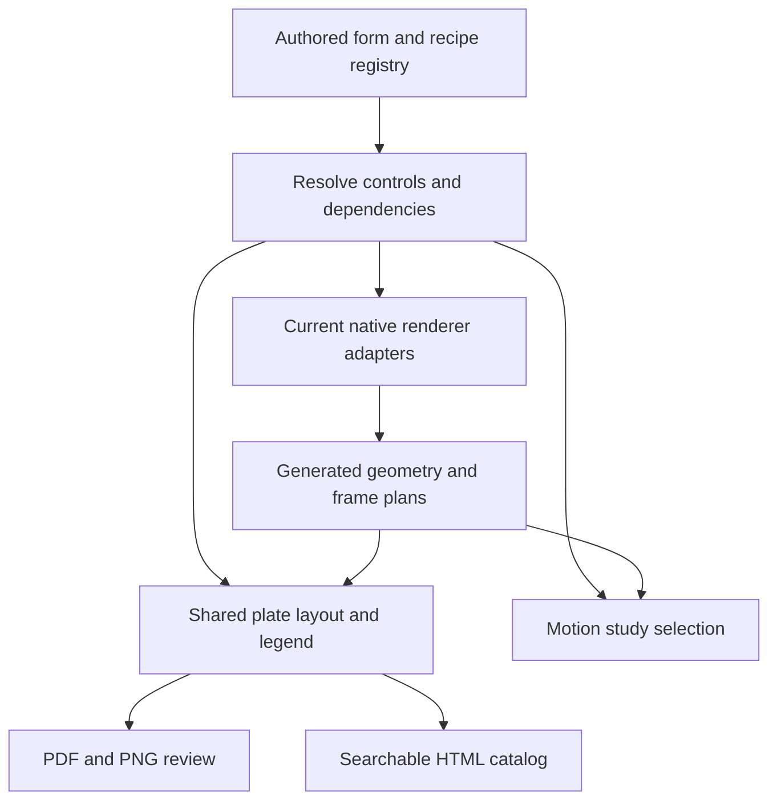

# Examples review 2: a consistent catalog across the Izzi library

2026-09-30. **Native implementation and review deliveries verified. Human
visual approval is pending.** The shared catalog now covers 360 forms in 31 families,
with 1,294 controls and 97 authored compositions. SVG/PNG plates and the HTML
review are rendered. All 12 continuous MKV deliveries pass complete decoding
and frame-count checks. Both PDF editions pass structural checks and
representative visual inspection.
The current delivery status is recorded in section 11.

**Implementation authorization and final design direction:** the user approved
the interleaved schedule with GPT-6.1-Sol/high implementation agents and Astra
coordination, then requested unattended work. Re-form the review for the full
depth and breadth of the current Izzi library. **There are no backward
compatibility requirements or expectations**, including old APIs, recipes,
defaults, plate IDs, layouts and ordering. Reuse working geometry and effects
where useful; do not build compatibility adapters or preserve interfaces solely
for their history. This direction supersedes earlier preservation requirements
in both this document and the screen-media plan.

The shared native catalog, control descriptors, layout and composition services
serve film, TV, satellite and VCR as well as the other example families. Implement
discovery and coverage checks with the registry. Prove a small chapter, connect
the media facade, then expand form and composition coverage in batches. Build
the complete book and horizontal/vertical reels after automated verification.
Save human-review candidates without treating unattended execution as human
approval of their appearance.

**Latest human direction:** reform the plates for consistency across the whole
Izzi library. Previous plates, layouts, titles, paths, IDs and page numbers are
not compatibility requirements. Replace, merge, rename or remove them as the
new design requires; the user can request a removed example again later.
Historical artifacts and review notes are useful evidence, not constraints on
the replacement catalog. Avoid parallel legacy presentation systems or alias
machinery whose only purpose is to preserve the old plate organization.

This builds on [Examples review 1](20260921.make_examples_review_1.md) and the
[meta-guilloche revisions](20260929.meta_guilloche_2.md). The user requests a
smarter organization of patterns and plates, fewer duplicates, consistent
titles/families/parameters, a coherent front-to-back progression, and a shared
format for “visualize the parameter space” plates. **Every older and newer
pattern form must have parameter-space coverage**, including every foliate,
coral and arabesque form. A family representative alone does not meet that
requirement for its other forms.

## 1. What the first review solved, and what remains

Retain the first review's searchable Atkinson legends, separate artwork/legend
areas, source links, embedded raster verification, two-run determinism checks
and input hashes. Give the new catalog useful canonical identities and retain
its own generated source SVGs for reproduction. Reusing old IDs or recreating
old plates is optional. These technical foundations do not, by themselves,
define what belongs in a pattern catalog or ensure that every renderer is reached.

The pre-redesign harness discovers top-level `examples/*.cc`, runs each program,
then sorts examples and SVG filenames. This makes the PDF an inventory of
executable output. Source-file organization determines the reader's sequence;
the same construction can appear in several programs with different titles,
parameters and layouts. New APIs and recipes living elsewhere can be omitted.

The first review also documented a concrete ordering problem: transition
filenames sorted the sample sequence as 0/12/18/24/6. Numeric parameters and
time require explicit ordering, not lexical filenames.

### Measured starting point

The pre-repair 2026-09-30 PDF and sidecar are retained in
`examples-review-fix/before/`.
These counts refer to that snapshot, not the September 21 export or a future
reorganized catalog.

| Observation | Evidence / implication |
| --- | --- |
| 771 SVG pages | The catalog has grown beyond the first review's 624 pages. |
| 313 pages with declared numeric parameters; 458 without | Observed ink/geometry legends are present, but most pages still lack authored control values. |
| 771 distinct raw SVG hashes | There are **zero byte-identical duplicate groups** in this snapshot. Visual or semantic duplicates need a different audit; simple file hashing will not shorten this edition. |
| 261 capability plates and 133 enrichment outputs | Two generators dominate the sequence; program size does not establish useful reader order. |
| No wisteria page | The current form was outside the normal examples execution path. |
| Brain coral on page 444 / `izzi-7f883410a6e5`: six paths | This is the older enrichment construction, not the revised native meander/canyon study. |
| Saguaro on page 477 / `izzi-70d35e66aa7e`: fourteen paths | The refined uneven branching and irregular trunk use the separate meta renderer. |

The starting inventory
records those measurements. Path counts diagnose which implementation ran;
they are not artistic quality scores.

### Immediate repair

`make examples-review` must compile and execute the current
`meta-guilloche-native.cc`, using
the committed review catalog.
That catalog retains 76 current recipe/camera selections, including the
Review 5 muqarnas pair, alternatives, controls and width studies. It contains
authored inputs, not cached drawings. Lenticular exports continue through their
existing native generator.

Replace older selected plates and add missing forms such as wisteria. The
immediate adapter currently writes existing paths to repair today's command;
the subsequent library-wide reorganization can change those paths and IDs.
Record the native executable hash and each recipe's progress/crop.
Changes to the worker, catalog, referenced scene JSON or shared headers must
invalidate the affected cache. A clean checkout must not need `outputs/`, an
old review directory, a saved binary, or `/tmp` references to render forms.

This adapter repairs coverage now. Move its authored selections into the shared
registry below during reorganization; it must not become a second catalog with
its own ongoing presentation rules.

## 2. Make one catalog the source for every presentation

Introduce an authored pattern registry and a generated resolved catalog.
Separate four identities:

| Identity | Meaning | Example |
| --- | --- | --- |
| Family | Shared construction or domain | `botanical`, `reef`, `arabesque`, `guilloche`, `film` |
| Form | A distinct supported construction | `botanical.wisteria`, `reef.grooved-brain`, `arabesque.muqarnas.shah-iwan` |
| Recipe | A reproducible parameter choice | Wisteria's accepted dense arrangement with seed 20260929 |
| Plate | A presentation of recipes | Baseline portrait, parameter grid, detail, or temporal comparison |

Use additional tags for overlapping concepts such as foliate, woven,
asymmetric, relief, periodic and optical. A form can have several tags while
having one primary place in the book. “Capability,” “latent,” “meta,” dates
and review-round numbers describe development history; they should not be
the reader's primary pattern-family taxonomy.

Each form record should provide:

- Stable form ID, human title, primary family, secondary tags and status
  (`current`, `experimental`, `proposed` or `retired`).
- Current renderer/algorithm version and an adapter to the native API.
- Baseline recipe and complete typed parameter definitions: label, units,
  bounds, defaults, valid discrete values and applicability conditions.
- Named variants, required examples and parameter-space study specifications.
- Default domain, palette, crop, camera, and a declared fitting policy.
- Reference citations and human feedback linked to exact artifact hashes.
- Optional provenance explaining a replaced recipe when it helps a reviewer;
  no mandatory historical-name or plate-ID compatibility map.

The generated catalog resolves defaults, hashes dependencies, records actual
dimensions, and supplies the same records to SVG, PDF, PNG, HTML and motion
review builders. Keep C++ APIs responsible for drawing geometry. The catalog
and plate builder own selection, labeling and composition.

Apply that separation across the entire library: legacy and recent pattern
generators, botanical/coral/architectural forms, optical and media effects,
Fuller forms, data visualizations and relevant drawing primitives all use the
same descriptors, composition services, layout profiles, legends and review
exporters. Domain-specific adapters supply meaningful controls and fixtures;
they do not design another footer, title system or parameter-grid grammar.
Replace older example programs and wrappers where necessary. Source-file or
development-era boundaries must not determine the reader's experience.

Prefer this shared registry and plate builder over moving every generator
into one large program. Existing native APIs remain usable, while discovery,
coverage and presentation gain a common contract. Avoid scanning human prose
or scraping titles to discover forms. Avoid a second manually maintained list
of parameters that can disagree with native validation.

## 3. Remove repeated presentations without losing useful evidence

Differentiate four cases before removing a page:

| Case | Treatment |
| --- | --- |
| Identical SVG bytes | Use one current artifact and discard repeated presentations. There are no such groups in the measured starting PDF. |
| Same resolved recipe, renderer, seed, domain, camera and time | Candidate for one canonical presentation even if incidental IDs or metadata differ. Verify geometry and paint before grouping. |
| Same form, meaningful different settings | Keep as distinct cells in a parameter plate, or as distinct plates when fine detail needs the space. |
| Similar appearance with different semantics | Keep a distinct comparison only when it demonstrates a useful difference. Consolidate redundant pages; controls, topology studies and temporal holds retain a role only when needed for interpretation. |

A semantic render key must include algorithm version, resolved controls,
seed, source identity where relevant, domain, camera, palette, time/cadence,
and rendering quality. A parameter-space cell also has a role and axis
coordinates. Reusing its drawing does not erase its comparison role.

There is a concrete example in the newly connected meta set. Its 76 selections
have 72 distinct parsed geometry/paint/camera signatures after excluding only
the added catalog metadata. Four pairs match exactly: `contour-limit-sparse`,
`directed-wave-2`, `basketweave-diagonal` and `hobnail-limit-sparse` each match
their `-widths-3` selection. These are intentional repetitions of the baseline
inside the one-through-four-width comparison. The
comparison audit
records the pairs. A shared width-study plate can use that baseline cell and
reference one underlying render, avoiding a redundant full page while keeping
the four comparison roles. This finding is separate from the zero raw-byte
duplicates in the older 771-page snapshot.

Use normalized SVG geometry/paint signatures and perceptual preview similarity
to find candidates, not to authorize deletion. Ignore incidental metadata only
when normalization is known to preserve clipping, masks, gradients, transforms,
text and referenced resources. Same filenames and same thumbnails are
insufficient evidence.

For each chosen consolidation, record the current canonical plate, reason and
comparison evidence. Old IDs need not resolve in the new catalog, and removed
plates need not have replacement pages or aliases. Use new identities when the
composition or presentation is re-formed. Keep historical human feedback tied
to its original artifact in the analysis; do not silently transfer its approval
to a new drawing.

The PDF should show current baselines, required parameter studies and useful
wild/crossover compositions. Remove obsolete implementations, redundant
alternatives and compatibility-only pages from the review. Diagnostics belong
in a test report unless they provide a useful visual explanation. A historical
appendix or a second compatibility volume is not required.

## 4. One title, family line and legend contract

Use a shared hierarchy on every review plate:

1. **Title:** readable form name, e.g. “Grooved brain coral.”
2. **Family and study:** “Reef · depth × layout seed” or “Botanical · branch density.”
3. **Artwork / grid:** with axis headers, value labels and baseline marker.
4. **Authored controls:** the values held fixed, seed, domain, palette and
   relevant time/camera settings. Each cell shows its changing values.
5. **Observed rendering:** ink widths, opacity, geometry counts and effects,
   using the first review's explicit measurement scope.
6. **Identity/provenance:** current canonical plate ID, page, recipe/form IDs,
   renderer version, and source/recipe links.

Use Atkinson Hyperlegible, consistent type sizes, full-opacity legend text,
white legend background and predictable margins. Keep the artwork palette
independent from annotation colors. Continue using the requested Izzi hue
palette for the meta studies; retain explicitly named diagnostic palettes
where a study's purpose requires them.

Keep authored parameters separate from observed SVG properties. A nominal
stroke width is not necessarily its transformed screen width, and paint
opacity is not final pixel opacity. Show units and discrete values, distinguish
seed from continuous controls, state rounding and clamping, and record full
precision in the manifest. A long palette should use named swatches and a
compact summary; raw color lists should not overwhelm the drawing.

Attach complete structured metadata to each plate and cell. Do not rely on
recognizing `name=value` text as the primary source of parameter data. Preserve
that extraction as a legacy fallback while forms migrate. Explicitly display
unsupported/unrecorded settings instead of guessing values from an image.

## 5. Standardize “visualize the parameter space” plates

Parameter studies need a comparison contract, not just a repeated page border.
Every current form, old or new, must declare at least one meaningful study.
Use the same small set of layouts throughout the book:

| Study | Shared layout and rules |
| --- | --- |
| Two continuous/discrete controls | 3 × 3 grid, ordered low / baseline / high on each axis, baseline marked at its actual coordinate. Each cell is one resolved recipe. |
| One effective control | Four- or six-cell strip with exact ordered values; include and mark the baseline. Use the four-cell version for width counts 1, 2, 3, 4. |
| Two independent one-variable sweeps | Two labeled rows, each using the same baseline and varying only its named control. Do not describe this as a full two-dimensional interaction grid. |
| Categorical variants | Equal-size cells with named categories; no invented numeric distances between them. |
| Temporal/material state | Ordered frames with rate, time and hold information; explicitly a temporal study, separate from static parameter-space coverage. |

Use a common outer art frame, shared cell padding and the common legend.
Retain an optional detail companion for dense coral, foliage and muqarnas.
Make layout profiles reusable across older guilloche/Fuller/Hamonshu/glitch
plates and the new forms; migrate their data, not their hand-positioned labels.

Required comparison rules:

- Hold seed, domain, crop, palette, quality and unrelated controls fixed.
  Vary seed only on an explicitly labeled seed axis.
- Compute one fitting transform for the whole comparison when geometry can
  expand. Independent per-cell auto-fit can hide a scale or amplitude change.
  Mark an intentional crop, and distinguish world-space from displayed size.
- Pick values within native bounds that cause useful differences. Integer
  counts and categorical values need valid discrete selections. A no-op axis
  is a coverage failure, not a finished parameter-space plate.
- Name coupled controls honestly. Current wisteria density affects both
  cluster and flower populations; it must not be labeled as an isolated
  flower-count experiment.
- Keep one baseline recipe as the reference across overview, grid, detail and
  motion chapters. Show a baseline cell consistently without repeating a
  separate full-page baseline for every sweep.
- Retain per-cell recipe hashes, axis coordinates and generated bounds.
  Test parameter isolation in resolved inputs and check that selected values
  produce a meaningful output change. Pixel similarity alone is insufficient.

### Coverage of new foliate, coral and arabesque forms

These are required study directions, subject to native control design and
range verification. They are not assertions that every proposed knob exists.

| Forms requiring their own coverage | Useful studies / current gaps |
| --- | --- |
| Wisteria | Current coupled density, arrangement variant and seed; later separate cluster-length variation, cluster fullness and trailing taper. |
| Running vine and asymmetric foliage | Leaf-size variation, stem/branch spacing, tendril length and branching hierarchy. Running vine currently uses seed while several generic recipe fields are inactive; expose meaningful controls before claiming those axes. |
| Interlaced vines, palmette and other retained foliate forms | Branch count, curvature, leaf size and interlace/clearance where applicable; each named form gets its own entry and study. |
| Willow | Branch density and leaf-tip taper, with fixed seed and crown framing. Density is active; additional taper controls need an explicit native interface. |
| Feather palm | Frond/leaflet density and terminal taper. Its current drawing function ignores the generic recipe controls, so varying generic density/depth would make a misleading grid. |
| Fan palm, ginkgo, cannabis and papyrus | Native form-specific counts, spans, leaflets or stems; validate applicability separately for each form. |
| Saguaro | Branch-height spread, trunk/arm width variation and arm clearance, plus the named crested alternative. Current generic density/depth do not parameterize those structures. Use the reviewed anatomy as a visual reference when designing meaningful controls and new baseline recipes. |
| Lettuce coral and fox coral | Fold depth, rim/rib variation and separation of lobes; separate plates for the two distinct constructions. Current folded-coral geometry is largely fixed by its named form; generic density/depth sweeps would not establish control coverage. |
| Grooved brain coral | Active relief depth and network seed, plus a separate crop/perimeter study. Keep the reviewed irregular network and distinguish geometry changes from camera changes. |
| Sea fan, pink-tipped anemone and saddle-carpet anemone | Branch/tentacle counts, spread, curvature and detail settings, using only the controls supported by each native form. |
| Star-8, hex-6 and girih-10 arabesques | Pitch/count and clearance, construction versus ornament as a categorical comparison. Each recipe requires a page. |
| Jameh south-iwan and Imam portal wall studies | Active relief depth, plus explicit tiling/proportion controls where exposed. Keep the two reference-derived constructions identifiable. |
| Shah entrance-iwan and Alhambra muqarnas | Existing tiers, density, depth, ornament and pendant controls, using separate comparisons with shared cameras. These are the current Review 5 ceiling selections. |
| Superseded Review 4 coffer constructions | Remove from the current review where the Review 5 constructions replace them. Reintroduce only if they contribute a distinct useful study or the user requests them again. |

### Coverage of older forms

Apply the same requirement to the full existing pattern inventory, including
roulette/rose/lobed contours; waves and Hamonshu water forms; Grignani ribbons;
rosette, sunburst, band, barleycorn and fish-scale families; medallion, vignette
and flinqué; hobnail and basketweave; older organic forms; moiré and optical
illusions; surface-tension forms; lenticular constructions; and current film /
video-glitch families. Include every named form or supported variant that
has a distinct construction, not merely one representative per family.

Fuller forms and data-backed visualization forms should use the same plate
and legend contract where they visualize controls. Their data/fixture
dimensions must be distinguished from artistic parameters. Basic API smoke
examples and schema/transport CLIs belong to the diagnostic inventory;
they should not masquerade as additional pattern forms.

Build a machine-readable coverage table:

`form_id → status → baseline_recipe → parameter_studies → active_axes → plate_ids → checks → human_review`

For a form missing useful controls, record the missing native API work and
implement it before declaring coverage complete. Do not satisfy the requirement
by changing unused fields, relabeling identical cells, or exempting older
forms because their original generator is inconvenient. Re-form older supported
algorithms into the new contract instead of retaining their old plates. Retired
recipes do not require a historical volume; record deliberate retirement so a
coverage check can distinguish it from accidental omission of a supported form.

## 6. Wild studies and crossovers for every family

Extend the “in the wild” approach beyond guilloche to every current family,
including foliate/botanical forms, coral, arabesque, optical constructions and
media effects. Each family needs both standalone wild studies and crossovers.
This complements the requirement for parameter-space coverage of every form;
a wild composition does not replace a controlled parameter study.

### Recreate the method behind the praised examples

Start from the actual human-reviewed lineage, not from a generic instruction
to increase randomness. The
[original playback review](20260926.short_center_frame_moire_guilloche_praxis.md#human-playback-review--draft-2-requirements)
marks three passages **“Perfect; preserve this plate.”** Their recipes,
original/Draft 2 motion controls, source hashes and decoded review frames are
recorded in the [wild lineage evidence](20260930.make_examples_review_2.wild-lineage.json).
The page numbers and IDs below identify historical evidence. They do not
require matching IDs or replacement pages in the new catalog.

| Reviewed passage | Construction and active motion worth transferring |
| --- | --- |
| 02:55, historical page 445, `izzi-3d8190459c67` — `wild-01-variation-05-counter-orbit` | Seed 11105. An eightfold central roulette, a close-scale/phase companion, a Lissajous field and smaller lateral satellites with opposing repeat direction. Native ink groups counter-rotate with orbit amplitude 17.59974°; odd groups use −0.65 of the amplitude. |
| 04:54, historical page 425, `izzi-394d13e6bb65` — `variant-lissajous-moire-compatibility` | Seed 20260809. Two deliberately different Lissajous families, 11:10 and 12:11, with small differences in phase, aspect and opposite rotation steps. `shape_handoff` uses ±5° turns, ±4% scale, staggered opacity and a brief 3-pixel registration displacement measured at reference width 720. |
| 05:05, historical page 441, `izzi-3db758a34f44` — `wild-01-variation-01-centered-dual` | Seed 11101. A fourfold central pair and a Lissajous field with smaller upper/lower satellites. Native ink groups counter-rotate with orbit amplitude 23.16333° and the same odd-group ratio. |

Inspection of the decoded frames at those timestamps confirms layered,
readable line groups and smaller companion forms. The two wild-01 examples
use ink opacities 0.29 / 0.275 / 0.24 and widths 0.72 / 0.68 / 0.64 before
composition transforms. The Lissajous example has only twelve paths and much
stronger per-line opacity: density or transparency alone is not the common
recipe. The useful shared method is **related but nonidentical constructions,
a clear composition, visible interaction and distinct group motion**.

The recipe implementation is in
[`guilloche-plates.cc`](../../../examples/guilloche-plates.cc), especially
`make_wild_duotone_111_variation`, `make_lissajous_variant` and the review
export that removes inscriptions and halves wild-01 ink. Motion is in
[`izzi-svg-reference-motion.h`](../../html/izzi-svg-reference-motion_8h.html).
Its smooth middle envelope is `sin²(πu)` for normalized middle-shot progress.
Copy the controls used by the selected system; the receipts also contain
generic values that an orbit or handoff branch does not use. Those inactive
values must not become fictitious parameter axes in the new studies.

No exact “delightful” label was found in the inspected wild production/review
records or guilloche documentation. The existing “delightful” keyframe notes
refer to a separate AI Blade Runners lineage and are not evidence of approval
for these patterns. Preserve that distinction; attach any later located wild
review to its exact artifact and recipe.

Recreate the method through reusable **composition and motion recipes**:

1. Establish a primary form, a related companion and optional smaller
   satellites. Vary counts, scale, spacing and symmetry deliberately; keep a
   clear hierarchy and usable negative space. Use shared per-instance seeds
   across frames, with small deterministic deviations rather than framewise
   random rearrangement.
2. Introduce a small structural difference between related groups—pitch,
   curvature, scale, phase, branching or placement—so their overlap develops
   an interaction. Sweep one difference at a time before combining controls.
   Use translucent linework where appropriate, or spaced/cutaway layers for
   filled forms whose opaque paint would otherwise hide their companions.
3. Assign distinct groups to counter-motion or a staggered handoff. Start from
   the reviewed amplitudes/envelope, scaled to the native domain, then compare
   restrained, reference-strength and stronger variants. Preserve a fixed
   camera across the comparison so framing does not disguise the differences.
4. Resolve current native geometry for every frame and apply geometric motion
   before rasterization. Apply a selected film/video mechanism at its documented
   stage after the composed scene where required. Record the composition graph
   and actual active controls, rather than treating every layer as the same
   kind of effect.
5. Compare the available source evidence, the new single-family translation,
   and the two-/three-family extension with component controls and synchronized
   temporal samples. Review hierarchy, overlap, perceptible motion and each
   family's contribution separately. The prior praise is a starting point;
   acceptance of the new result remains a new human review.

Initial translations should be concrete:

| New study | Translation of the reviewed method |
| --- | --- |
| Foliate / wisteria wild | Use unequal hanging cluster groups and a smaller companion group, varying top-to-bottom fullness and trailing length. Counter-sway branch carriers or stagger their reveal while retaining hanging racemes and irregular cluster sizes. Do not force the flowers into identical circular rosettes. |
| Arabesque wild | Combine a dominant star/girih construction with smaller rotated or offset companions; vary symmetry order and near-registration before adding motion. Keep reference-derived wall and muqarnas scenes identifiable, with their relief and focal arch preserved in reference studies. |
| Coral wild | Arrange unequal lobe/network patches at multiple scales with deliberate gaps or cutaways. Use differential relief or a restrained handoff while preserving the irregular canyon or fold construction; do not revert brain coral to repeated circles. |
| Optical illusion × barleycorn | Use the illusion's stable spatial framework as the primary composition and a slightly detuned barleycorn field as the interacting layer. Compare component controls, restrained counter-motion and handoff; verify that the intended illusion remains legible. |
| Glitch × wave × wisteria | Build a wave field beneath unequal wisteria clusters, with distinct phase/sway timing, then add one documented glitch mechanism at controlled strength. Compare its components and the full scene at matched timestamps; keep enough intact intervals to read all three forms. |

Use the requested Izzi hue palette for new translations, preserving useful
contrast relationships rather than copying the historical RGB colors blindly.
Transfer the praised middle-shot behavior; **do not restore the older collapse
to the center**. Current wild clips expand completely out of view until the
frame is entirely background, allowing the approved extra second or two when
needed. Historical review evidence can stay in the analysis; the new catalog
does not need to retain or reprint those source plates.

### Required family coverage and variation dimensions

Use these explicit dimensions for wild variations:

| Dimension | Required variation and recorded controls |
| --- | --- |
| Multiples of forms | Repeat several instances of one form and arrange multiple distinct forms within the same family. Record instance count, form IDs, per-instance seeds, scale and size variation, spacing, overlap and hierarchy. A change of seed alone does not make a new form. |
| Composition | Compare arrangements such as a border with an open center, a field, an offset cluster, a directional sweep or nested/framed regions. Record placement, density gradients, layering, crop and negative space. |
| Symmetry | Compare bilateral, radial/rotational, translated/repeated and deliberately asymmetric arrangements, with symmetry order/axis and the amount of departure recorded. Do not make every instance the same size or equally spaced by default. |
| Motion | Where supported, vary motion of individual forms and of the composition: growth/reveal, drift, phase offsets, rotation, scale, camera motion and timing. Record duration, rate, easing, phase and exposure. Provide labeled temporal samples and a linked clip; a single still cannot demonstrate motion. |

Require at least two distinct standalone wild recipes per family, spanning
multiple dimensions rather than repeating one layout in different colors.
Across a family's studies, show multiplicity, composition and symmetry choices;
include motion when a native animation or composition/camera adapter supports
it. Where motion support is missing, record the adapter work explicitly before
claiming that dimension complete. Preserve reference-derived characteristics
as visual reference points when designing new baselines, while allowing wild
recipes to make deliberate, labeled departures. Exact old default values and
arrangements are not compatibility requirements.

Require each family to participate in at least one **two-family crossover**
and at least one **three-family crossover**. Count distinct registered family
IDs, not layers, instances or parameter settings. Several botanical forms
together remain a one-family wild composition. A single crossover can satisfy
participation for all its contributing families, but its plate appears only
once and is cross-indexed from each family. Its identity is a composition
recipe using the existing family IDs, with a `crossover-2` or `crossover-3`
presentation role; standalone wild studies have a `wild` role.

Initial requested examples:

- **Two families:** optical illusion × barleycorn. Register the particular
  illusion and barleycorn form, with their primary families resolved by the
  catalog; keep the illusion's necessary spatial cues legible.
- **Three families:** glitch × wave × wisteria. Register a specific media-glitch
  family and mechanism, wave form and botanical wisteria recipe. Record which
  elements form the scene and where the glitch acts in the rendering sequence.

The family registry must make those distinctions explicit: “glitch” is an
umbrella until a film, VCR or other implemented mechanism is selected;
“barleycorn” and “wisteria” are concrete forms. Resolve the selected forms to
their primary families and reject a two-/three-family label if the distinct
family count is wrong. Keep the human-readable form combination in the title.

Give each crossover one stable recipe/plate identity and a structured record:
`family_ids`, `form_ids`, component recipe hashes, composition graph, layer
order, shared palette, instance count, transforms, masks, blend/interaction
rules, symmetry and motion settings. Distinguish overlay, clipping/masking,
spatial interleaving, geometry modulation and temporal/post-process effects;
record the actual operation instead of merely listing three names.

Show component controls beside the combined result with the same seed,
camera and palette: A / B / A+B for two families; A / B / C / A+B+C for three.
Use shared layouts and legend rules, retaining optional detail and temporal
companions. Reuse existing component artifacts and cross-reference their IDs
instead of publishing identical standalone pages again. Check that every
component visibly contributes and that masking, opacity or effect strength has
not eliminated one family. Technical composition checks do not replace human
review of legibility, visual distinction or the intended illusion.

The generated coverage report must include:

`family_id → wild_recipes → variation_dimensions → two_family_crossovers → three_family_crossovers → plates/clips → checks → human_review`

Automatically include registered wild/crossover recipes on the next
`make examples-review` invocation. Treat missing family participation or
undemonstrated required dimensions as coverage gaps. Do not create the full
combinatorial product of all forms: curate legible, reproducible combinations
while maintaining the minimum coverage for every family.

## 7. A coherent reading order

Define section and form ranks in the catalog. Within each form use an explicit
role and numeric sample order. Suggested main-book progression:

1. An Izzi logo title page with build date and source versions, then contents,
   navigation, legend key, parameter-study conventions and a short index of
   newly revised forms. Record project version, Git revision and working-tree
   state, native/authored-input fingerprint and review generator/catalog
   hashes; retain full provenance in the PDF sidecar. Count the title page in
   physical page numbering so printed plate legends match the PDF viewer.
2. Foundational curves and repeat structures: contours, waves, ribbons,
   radial forms and simple periodic fields.
3. Engraved and interlaced patterns: guilloche, flinqué, hobnail, basketweave
   and geometric arabesques.
4. Organic forms: foliate and other botanical structures, then reef forms,
   followed by architectural relief and muqarnas.
5. Optical behavior: moiré, illusions, lenticular constructions and their
   required controls.
6. Time-dependent patterns and media effects: evolution, transitions, film
   and VCR studies; future screen-media families enter when implemented.
7. Applications, type/inscription and data visualization, followed by any
   diagnostics that materially help explain the current library.

Within a form: baseline → parameter studies → detail/domain proof → categorical
alternatives → temporal behavior → reference/acceptance notes. Follow a family's
forms with its wild studies and links to shared two-/three-family crossovers;
collect each crossover once in an indexed composition section. Keep controls
adjacent to their effects. Use bookmarks and a clickable contents page; offer
filters by family, form, role, parameter and revision in the HTML companion.
Do not make the main review depend on reading hundreds of earlier pages.

Build one coherent current review from the registry and render cache, with a
machine-readable coverage report and an optional “changed since” supplement.
Record exclusions so curation cannot hide a missing supported form or a broken
generator. A second book preserving the old inventory is not a deliverable.

## 8. Implementation order and acceptance

1. **Repair current-form discovery.** Complete the meta adapter, committed
   recipes, dependency tracking and full examples rebuild.
   Verify the revised foliage/coral/saguaro geometry and both muqarnas forms.
2. **Inventory and registry.** Enumerate supported forms across the entire
   library. Map useful examples to forms, recipes and roles; replace or remove
   the rest. Publish unmapped algorithms and parameter-coverage gaps. Define
   the new catalog without old-plate or ID compatibility obligations.
3. **Structured legends and shared layouts.** Migrate a representative older
   guilloche form, a new botanical form, coral and arabesque; compare the
   proposed standard layouts and baseline markers before bulk migration.
4. **Complete parameter coverage.** Expose missing native controls and design
   coherent recipes informed by prior human feedback; deliver meaningful
   parameter-space plates for every old and new form. Add wild studies and two-/three-family crossover
   participation for every family, including multiplicity, composition,
   symmetry and motion dimensions. Freeze both coverage matrices before
   pagination.
5. **Curate order and consolidate.** Apply explicit family/role/sample ordering,
   and remove repeated presentations. Generate the contents, bookmarks and
   dated/versioned Izzi logo title page. The user has explicitly approved
   removing the four identified baseline/width-count-3 repeats and permits
   further re-formation/removal of old plates. Keep useful comparison roles;
   old ID aliases and a historical page crosswalk are unnecessary.
6. **Verify and publish the candidate.** Render complete PDFs and the changed
   supplement; inspect final encoded/rasterized pages and retain human review
   separately from technical checks. Baseline promotion remains explicit.
7. **Forward-looking foundations.** Put in checks so that new algorithms,
   families, changes are automatically included on invocation of
   `make examples-review`.

Develop the checks in item 7 alongside the registry in item 2, and extend them
as each family migrates. Make the requirement enforceable on every invocation: discover native
algorithm registrations and compare them with the resolved catalog; require
every current family, form and distinct supported construction to have a
baseline and meaningful parameter-space coverage, plus required family-level
wild/crossover participation; and invalidate affected
renders when implementation, recipes, references, layout or dependencies
change. A new registered form should enter the shared review pipeline without
another hand-maintained generator list. An unregistered implementation,
missing renderer adapter, missing study, ineffective axis or stale render must
produce an actionable failure before publication, rather than silently
disappear from the review. Report newly discovered, changed, consolidated and
uncovered forms alongside the current artifact inventory. Add regression
checks that introduce a new family/form and change an existing implementation,
then verify inclusion and fresh rendering on the next invocation.

Use the same native descriptors for public algorithm/variant dispatch,
parameter schemas and catalog discovery (for example, a worker's `--catalog`
output). Registration supplies its baseline and study recipes once; the
review builder consumes that inventory automatically. A new public dispatch
case must not bypass the descriptor/coverage contract. Track renderer source
ownership and dependencies so added or changed implementations with no mapped
descriptor are reported, while helpers are explicitly attributed to their
owning forms. Compare native descriptors, resolved recipes and delivered
plates on every invocation, including cache-resume runs. This is a required
implementation foundation, not a claim that today's top-level `.cc` scan can
infer arbitrary new algorithms or artistic controls from C++ source alone.

Acceptance requires current code and authored inputs in every render receipt;
no dependence on prior output directories; both isolated runs reproducible;
one consistent presentation contract across the library; every supported
registered form covered; required wild studies and two-/three-family crossover
participation for every current family; no ineffective parameter axes; unique
current identities; ordered numeric samples; readable titles and legends;
shared comparison scales; all current SVG/PDF/PNG paths linked; actual raster
resources verified; and no hidden generation/render failures. Reproducing the
previous plate count, artwork, defaults, filenames, IDs or pagination is not
an acceptance condition.

The first review's remaining suggestions still apply: cache PDF pages by
artwork, layout, fonts, raster resources and renderer versions; add collision,
blank-page and unintended-clipping checks; provide a portable source/recipe
bundle. Cache keys must include catalog selection and order as well as the
native inputs, so cached pages cannot reintroduce stale labels or pagination.

Track technical status and human feedback independently. A review of one
artifact, such as the film horizontal reel's high pass, attaches to that
artifact and its hash; it does not silently approve a new parameter grid or a
different presentation.

## 9. Historical immediate repair — 2026-09-30

Before the library-wide redesign, the command was repaired to reach current
native meta forms and verified through full PDF export. The counts and page
numbers in this section describe that superseded repair, not the replacement
book produced by the new pipeline.

- Historical `izzi-examples-2026-09-30.pdf`:
  **808 pages**, comprising an Izzi logo/date/source-version cover and **807
  artwork plates**. The four reviewed repeated presentations are consolidated.
- Historical plate sidecar:
  current page numbers, legends, source links, hashes and cover provenance.
- [Verification receipt](20260930.make_examples_review_2.verification.json):
  19 regression tests, 443 existing artwork checks, 807 searchable plate IDs,
  1,614 source links, correct physical page numbering and verified visible
  raster resources. All previews pass; no render placeholders remain.
- All **76 current meta recipes** match the latest retained review geometry,
  paint and camera, and their two isolated runs are identical. They are
  produced by a worker compiled from current source and committed authored
  inputs, without reading old generated SVGs or saved binaries.
- Final PDF spot checks cover the title page, the consolidated basketweave
  width study, brain coral, muqarnas, saguaro and wisteria. These are technical
  and visual implementation checks, not new human artistic approval.

Historical page references were wisteria **536**, saguaro **510**, grooved brain coral
**461**, lettuce coral **483**, fox coral **455**, Shah entrance-iwan muqarnas
**492**, and Alhambra muqarnas **491**.

That rebuild had the same eight pre-existing example failures as the starting
inventory: compilation of `fuller-studies`, and invocation/runtime failures in
`film-decay-plates`, `geojson-matrix-render`, `line-graph-4`,
`movement-camera-preview`, `visualization-chord-swarm-aggregate`,
`visualization-chord-swarm-record` and `visualization-render`. The receipt and
build manifest list them explicitly. The meta repair and PDF checks pass;
those gaps were recorded for the subsequent library-wide inventory work.

This repair happened to retain prior paths and adds four interim comparison
aliases. That is a record of the repair, **not a compatibility requirement**
for the new catalog. Replace that organization as needed under the latest
human direction. The shared registry, parameter-space studies, wild selections
and two-/three-family crossovers below replace that interim organization.

## 10. Native implementation record

The replacement catalog contains **360 forms, 31 families and 1,294 controls**.
Three discovered native workers declare the geometry, additional library forms
and screen-media forms. Native declarations supply dispatch, bounds, baselines,
parameter studies and temporal capabilities; Python resolves recipes and
provides the shared presentation. The
[review guide](../examples-workflows.md) documents the implemented workflow.

Every family participates in **two wild compositions** and in two- and
three-family crossovers. The authored set contains **62 wild, 18 two-family
and 17 three-family compositions**. Sparse/woven studies explicitly sample
one, two, three and four widths. The current botanical, coral, wall-ornament
and Shah/Alhambra muqarnas algorithms share the same parameter-study contract
as the older forms. Derived color studies identify transformed Izzi inputs;
authored compositions use the exact native hue palette.

The redesign removes 20 repeated Hamonshu constructions and a duplicated TV
digital-receiver example. TV and satellite share the transport construction;
continuous picture damage and intermittent transport loss now have distinct
native timing and historical-source behavior. Two equal-baseline pairs remain
for a demonstrated reason: zero-angle rotation and skew are both identity,
and an intermittent torn-sheet effect can be inactive at the baseline time.
Their nonneutral studies differ in both geometry and painted pixels.

Validation also exposed an invisible native chord edge: a two-point polyline
had opaque fill and transparent stroke. The native chord emitter now paints
the intended weighted stroke; its regression checks the resulting pixels.
Dependency tracking includes compiler/system headers, renderer libraries,
fonts and fontconfig policy. A source/form discovery regression proves that
new registrations enter the catalog and header changes invalidate renders.

The canonical Izzi logo, date and source versions appear on the cover. SVG,
PNG, searchable HTML and Letter PDF use the same plate order and identities.
Obsolete manifest-owned exports are removed after successful export, while
the render cache and user files remain intact. Native media reel chapters
compare current clean input with processed output in both orientations;
receiver histories and native versus encoded time are explicit. Wild endings
retain their geometry and effects while expanding completely off the camera.

Human acceptance remains pending for these new artifacts; prior approval of a
different reel or still does not transfer.

## 11. Delivery status

Completed 2026-09-30. Technical verification is complete; human review is pending.

Native coverage passes for **360 forms, 31 families, 1,294 controls and 230
classified source surfaces**. The current book has **1,228 plates**, plus the
logo cover and two contents pages, for **1,231 pages**. All canonical SVG/PNG
pages and the searchable HTML review
are present. Both PDF editions are exported. The
compact review PDF
is 123.9 MiB and passes actual-PDF inspection: 1,231 Letter pages, 1,228
searchable plate IDs, 1,260 valid URI links, 1,231 outlines and 74 sampled
lossless artwork crops. Eleven actual PDF pages were visually inspected.
The full vector PDF is
8.9 GiB and passes the same complete page, searchable-ID, link and outline
checks. Its embedded fonts are Atkinson Hyperlegible Next Regular and Bold;
ten actual PDF pages were inspected without observed clipping or layout defects.
The CRT sampling comparison
confirms that the editions use identical source geometry, state and solid
colors. Subpixel scanlines can change apparent color when a PDF viewer
rasterizes them. The compact lossless artwork data is exact; arbitrary viewer
rasters are not a pixel-identity guarantee.

All **184 motion chapters** are rendered. The following playlists are complete
in horizontal and vertical orientations, using H.264 Matroska at 24 fps:

| Playlist | Chapters | Duration per orientation |
| --- | ---: | ---: |
| Complete library motion | 184 | 36:48 |
| Screen glitch | 38 | 7:36 |
| Film | 20 | 4:00 |
| VCR | 6 | 1:12 |
| TV-broadcast | 6 | 1:12 |
| Satellite | 6 | 1:12 |

The complete library reels are available as
horizontal
(127.9 MiB) and
vertical
(116.1 MiB). The reel manifest
records all 12 deliveries, chapter order, dimensions, durations, frame counts,
hashes and complete-decode PASS results.

The endpoint audit passes for
98 chapters and 196 decoded final frames. Wild/crossover source artwork is
exactly white after expanding off the camera; the standalone CRT processed
picture ends black. One reviewed H.264 exception has two pixels at 5/255 error
against a 4/255 interior bound; the receipt binds that exception to the exact
movie hash and coordinates, without relaxing the global tolerance. Four
assembled-reel samples
match their standalone chapter frames pixel for pixel. Actual decoded
wisteria, saguaro, coral and film–wave–wisteria frames were also inspected.

The smaller `.review.pdf` exporter and full delivery pass verification. It
uses lossless 100 dpi artwork crops from verified PNGs while
retaining vector annotations, source links and outlines. `make examples-review`
now exports this smaller edition by default; `make examples-review-vector`
also requests the full vector PDF. This keeps routine review builds from
repeating a multi-gigabyte vector export. `make examples-review-compact`
rebuilds only the smaller copy from a finalized complete review. Default builds
need only the finalized SVG/PNG/coverage receipts; when a vector PDF is present
in `exports.json`, its hash is also verified and it cannot be overwritten by
the compact exporter. A permanent compact-export regression covers artwork,
annotations, links, page completeness and stale-input/overwrite failures.

The [final verification receipt](20260930.unified-review.verification.json)
records artifact hashes, coverage, targeted test results, PDF inspections,
movie decoding, endpoint checks and implementation limits. Both PDF reports,
the reel manifest and endpoint receipt are linked from that record. The
native implementation and delivery checks are complete; technical verification
does not constitute human approval.
