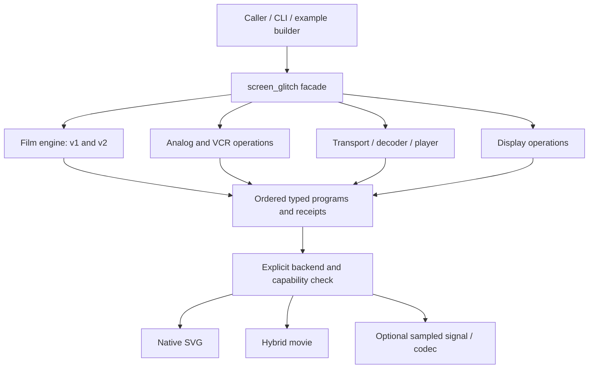

# Unified screen media glitch API

2026-09-30. **Native implementation and review deliveries verified. Human
visual approval is pending.** The common facade, 38 media forms and shared review
presentation are implemented. All 12 library/media reels pass complete decoding
and frame-count checks. Both PDF editions pass structural checks and
representative visual inspection.

**Final human direction:** implement this together with the
[library-wide examples review](20260930.make_examples_review_2.md), using
GPT-6.1-Sol/high implementation agents and Astra coordination. Film, TV,
satellite and VCR use the same facade, catalog and review presentation services.
**There are no backward compatibility requirements or expectations.** Old APIs,
recipes, numeric defaults, plates, IDs, page numbers and layout arrangements may
be replaced. References below to preserving old entry points or import
compatibility are superseded: reuse useful engine code and test the new intended
semantics. The completed film work is available for reuse.

The newer examples-review contract governs presentation: typed native controls,
appropriate parameter grids/strips, temporal studies, common legends and
cross-indexed compositions. Page 748 is historical design evidence, not a fixed
6-by-2 shell imposed on every study. Implementation proceeds through shared
foundations, a small review chapter, the facade, broad coverage and final
PDF/reels. Recordings and source-match claims still require actual evidence;
new artistic receiver interpretations must identify their evidence limits.

Unify discovery, recipes, composition, documentation and example presentation
under four categories: **film**, **VCR**, **TV-broadcast** and **satellite**.
Continue the approved [Decasia 2 implementation](20260930.decasia-2.md), including
Forbidden Quest as film source 7. The facade reuses that engine work without
compatibility imports for old recipes.

Human direction also fixes the identity format: use
**`plate <current-id> | page <current-page>`** consistently. The cited
`plate izzi-f0142a8059e5 | page 748` was the composite-color example in the
earlier review. Its page and identity are historical design evidence; the new
catalog supplies current identities and pagination.

## 1. Catalog and boundaries

| Category | Required coverage | Reuse and next work |
| --- | --- | --- |
| `film` | Decasia's six sources; Forbidden Quest source 7 and its sub-sequences; film wear, scratches, dust/flecks, density loss and surviving picture. | Reuse the versioned film material programs, geometry, source response and independent material clock. Use one film section; retain no separate compatibility entry in the new facade. |
| `vcr` | Composite color repeated transfer and leakage; successive copy generations; tracking offset; sync drift; FM thresholds; multipath ghost echoes. | Collect the requested controls in one VCR section, reusing the existing primitives. Identify the actual signal stage behind each preset rather than implying every artifact originates in the tape mechanism. |
| `tv_broadcast` | Transmission errors; snow; old CRT power-off collapse to a center dot; four additional candidates below. | Separate received-signal faults from receiver/display behavior. Reuse ghost, sync and digital transport components where appropriate. |
| `satellite` | MPEG compression glitching; weather interference; four additional candidates below. | Distinguish analog FM reception, digital satellite television and video delivered over satellite internet. Share transport/decoder components with digital terrestrial television. |

The four categories are navigation and preset groupings. A shared operation
can appear in more than one group without a second implementation. For example,
a broadcast echo can be recorded onto tape, then degraded by successive VCR
copies. Its order and origin belong in the recipe.

The implementation separates engine types from the new composition document:

- `svg::video_glitch`, `izzi.video-glitch/1`: seven historical vector families.
- `svg::video_glitch::film`, `izzi.video-glitch/2`: film recipes with explicit
  `film-field-v1` or `film-field-v2` selection.
- Facade: **`svg::screen_glitch`**, with the versioned
  **`izzi.screen-glitch/1`** composition document. The native and JSON headers
  now exist; the [entry guide](../../generative_movement/screen-glitch.md)
  describes their implemented contract and limits.

## 2. Evidence rules

Base new classifications on **historical descriptions, original engineering
reports, equipment documentation or actual recordings of faults**. Generated
glitch demonstrations, shader tutorials, stock-effect clips and AI recreations
are not canonical evidence. Procedural outputs and deliberately impaired test
encodes are useful implementation tests, labeled separately from references.

For each source, record the author/operator, publication or recording date,
URL or local path, access date, equipment/service and signal path if known,
exact page/figure or frame/PTS interval, source hash when locally available,
and what the source actually establishes. Use these evidence statuses:

| Status | Meaning |
| --- | --- |
| `recorded_observation` | An actual captured fault has been inspected; retain the full onset, affected interval and recovery. |
| `historical_description` | A primary source describes the behavior; exact timing and appearance may still need a recording. |
| `inferred_mapping` | A proposed visible response follows from documented behavior at another stage; identify the inference explicitly. |
| `pending_reference` | A requested form needs better evidence before claiming a source match. |

The sources linked below support planning. No new provider-specific fault
recording has been downloaded or visually validated for this plan. A provider
help page supports the reported failure condition; it does not establish an
exact macroblock pattern, recovery duration or screen graphic.

## 3. Film and VCR consolidation

### Film

Use the Decasia 2 source-to-variant inventory as the film catalog, including
all seven sources and the Forbidden Quest sub-source analysis. Retain the
accepted density-flutter paleness, material holds, independent scratch
lifetimes and source retention. Register useful material programs in the new
typed facade. Keep their independent material clocks; choose review defaults
for the new shared source fixture and presentation.

Film-wear passes and VCR copy generations are different histories. A film
scratch follows its material, while copy generation transforms the result of
the preceding transfer. Preserve both identities when composing them.

### VCR

| Requested group | Behavior and controls | Evidence and implementation requirement |
| --- | --- | --- |
| Repeated composite transfer / leakage | Generation count; luma/chroma leakage; chroma registration; decoder response; bandwidth loss. | Start with the existing composite-color plate and supplied generation-loss recording. Preserve the distinction between a vector interpretation and a sampled composite encoder/decoder. |
| Successive copy generations | Integer generation, per-copy registration/jitter/dropout, detail loss and accumulated echo spread. | Apply each transfer to the previous result. Preserve prior pass seeds when increasing the count; time in the reference clip is not a calibrated generation number. |
| Tracking offset | Signed offset, noise-band height, travel, tearing, dropout, onset and relock. | Reuse the supplied tracking-error recording and inspect adjacent fields/frames. Distinguish tracking disturbance from a broadcast reception failure. |
| Sync drift | Horizontal/vertical timing error, phase, line pairing and recovery. | Reuse the sync primitive, with a declared tape/playback or downstream receiver stage. |
| FM thresholds | Signal degradation envelope, impulse/streak density, width, polarity behavior and recovery. | Keep a VCR catalog entry as requested. Require tape-specific evidence before claiming a calibrated VCR FM preset. The existing NASA reference documents **analog satellite FM-TV**, so its appearance and thresholds cannot be silently relabeled as VHS. |
| Multipath ghost echoes | Same-scan delayed replicas, delay/gain/polarity and slow drift. | Reuse the echo primitive for an RF/composite signal recorded through a VCR; distinguish propagation/cable echoes from a trail of previous movie frames. |

The [existing study](20260926.glitch-motion-studies.md) identifies the local
VHS files and their hashes. Its engineering sources include
[BBC RD 1984/20](https://downloads.bbc.co.uk/rd/pubs/reports/1984-20.pdf) for
color-decoding work and
[NASA's FM-TV threshold investigation](https://ntrs.nasa.gov/api/citations/19720018135/downloads/19720018135.pdf)
for the observed progression from white streaks in dark picture regions to
mixed-polarity impulses at poorer reception. Keep those distinct provenances.

## 4. Proposed TV-broadcast set

Three requested groups plus **four additional candidates**. Analog and
digital responses must declare their signal mode; CRT shutdown is a display
event even when it is selected from the TV-broadcast catalog.

| Group / proposed preset | Visible behavior and proposed controls | Primary evidence and limits |
| --- | --- | --- |
| **Required: transmission error** / shared digital receiver studies | Intermittent damage and loss/recovery. Analog presets disturb level/sync; digital TV and satellite share the picture-damage and transport-burst/recovery constructions below. Present shared decoder studies once instead of duplicating them under a TV label. | The BBC's [2003 reception demonstrations, PDF p. 9](https://downloads.bbc.co.uk/rd/pubs/whp/whp-pdf-files/WHP069.pdf#page=9) describe analog degradation and digital breakup beyond reception tolerance. Digital error shape requires a declared decoder policy. |
| **Required: snow** / `weak-signal-snow` | Moving fine noise mixed with a progressively less readable picture; noise level, spatial bandwidth, temporal correlation, signal envelope and optional receiver muting. | The same [BBC report](https://downloads.bbc.co.uk/rd/pubs/whp/whp-pdf-files/WHP069.pdf#page=9) describes grainy noise increasingly obscuring analog reception. Noise is a receiver/signal phenomenon, not film grain. |
| **Required: CRT power off** / `crt-power-off` | Picture contracts as horizontal/vertical sweep decays, reaches a small center spot and fades completely. Independent horizontal/vertical decay, beam intensity, phosphor persistence and final black duration; include a line-then-dot variant only with matching evidence. | Historical receiver patents [US4488181](https://patents.google.com/patent/US4488181) and [US5184225](https://patents.google.com/patent/US5184225) describe sweep collapse, residual beam energy and suppression circuits. They support the mechanism, not one universal shutdown curve; obtain a real old-set recording to tune the requested center-dot version. |
| **Additional 1: multipath reception** / `broadcast-ghost` | Displaced replicas of the current scan, with independently weighted paths and slowly varying delay. | Canada's [1978 ghosting investigation](https://publications.gc.ca/site/eng/9.880586/publication.html) provides the historical study. Reuse the VCR-accessible echo operation with broadcast provenance. |
| **Additional 2: impulsive interference** / `ignition-bursts` | Short bursts of dots and horizontal marks; burst spacing, width, density and recovery. | The [BBC reception report](https://downloads.bbc.co.uk/rd/pubs/whp/whp-pdf-files/WHP069.pdf#page=9) describes appliance/ignition interference and its differing analog/digital results. Keep irregular bursts distinct from continuous snow. |
| **Additional 3: co-channel beat patterns** / `cochannel-beat` | Moving horizontal, vertical or diagonal interference stripes; carrier offset, relative level, scan timing and drift. | [BBC RD 1962/26, §§1–2](https://downloads.bbc.co.uk/rd/pubs/reports/1962-26.pdf#page=5) relates pattern direction/spacing/movement to interfering-carrier and scan frequencies. Start with the documented unmodulated-interferer case; a second visible program needs separate evidence. |
| **Additional 4: vertical hold loss** / `vertical-roll-relock` | Coherent picture roll, a moving blanking boundary and recovery to stable registration; frequency error, phase, lock envelope and field pairing. | G. L. Jepson's [“Frame Synchronisation,” Practical Television, September 1954, printed p. 158](https://www.worldradiohistory.com/UK/Practical-Television/50s/Practical-Television-1954-09.pdf) describes frame slipping when synchronization fades. Reuse the sync planner with an explicit wrap/blanking policy. |

For the CRT event, target the completed picture before adding external review
captions. End with **100% of the active screen black**, with no residual spot.
Do not apply the guilloche reel's expand-off-page ending to this explicitly
requested CRT collapse. The horizontal and vertical collapse need not share
a duration; spot suppression in some sets means the effect is receiver-specific.

## 5. Proposed satellite set

Two requested groups plus **four additional candidates**. These combine
documented failure conditions with explicitly proposed visual mappings.

| Group / proposed preset | Visible behavior and proposed controls | Primary evidence and limits |
| --- | --- | --- |
| **Required: MPEG compression glitching** / `mpeg-picture-damage` | Two modes: low-bitrate quantization/block/ringing loss, and corrupted or missing coded-picture regions with propagation until recovery. Record codec, block/slice organization, reference-picture structure, affected interval and concealment. | [ITU-T G.1080, Appendix IV](https://www.itu.int/rec/dologin_pub.asp?id=T-REC-G.1080-200812-I%21%21PDF-E&lang=e&type=items) documents how coded-picture loss and prediction affect the duration of visible damage. [ITU-T J.1630, Table II.1](https://www.itu.int/epublications/publication/itu-t-j-1630-2024-06-end-to-end-network-characteristics-requirement-for-video-services-over-integrated-broadband-cable-network) distinguishes compression blockiness and transport-related picture problems. Neither establishes a provider-specific decoder pattern. |
| **Required: weather interference** / `weather-fade` | A time-varying reception condition drives a selected receiver: analog noise/threshold impulses; digital breakup/freeze/unlock; or reduced IP throughput/outage. Expose fade shape, duration, burstiness and recovery. | [DISH signal-loss documentation](https://support.dish.com/troubleshooting/signal-loss) and [DIRECTV error 771](https://www.directv.com/support/article/000082157) identify severe-weather interruption. [Hughesnet's weather explanation](https://my.hughesnet.com/support/faq/228/) includes storms at a remote gateway. Do not place animated rain over the picture as evidence of link impairment. |
| **Additional 1: solar transit interference** / `sun-transit-outage` | A bounded interference envelope degrades and restores a geostationary link; duration, envelope and receiver response. | [Intelsat's Sun Interference Background](https://my.intelsat.com/resource/si/Sun_Interference_Background.pdf) describes solar RF noise behind a geostationary satellite causing degradation or outage. This supports a GEO preset; do not assign the same seasonal geometry to Starlink. |
| **Additional 2: obstructed or mispointed dish** / `dish-link-interruption` | Intermittent or sustained link loss and reacquisition; obstruction occupancy, movement, margin envelope and recovery. | [DISH](https://support.dish.com/troubleshooting/signal-loss) documents blocked views and moved/damaged dishes. [Starlink's obstruction explanation](https://starlink.com/en-kr/support/article/d79d6c7f-b871-78fb-8083-a11f41b45eeb) documents obstructions and path switching. Provide GEO and LEO timing profiles; ordinary satellite switching is not itself a visible glitch. |
| **Additional 3: transport discontinuity and decoder recovery** / `transport-burst-recovery` | A burst of lost/repeated transport units causes localized stale regions, picture hold or blanking, followed by decoder recovery. Separate failure scheduling from the chosen concealment appearance. | [ETSI TR 101 290 V1.2.1, §5](https://www.etsi.org/deliver/etsi_TR/101200_101299/101290/01.02.01_60/tr_101290v010201p.pdf) defines transport sync/continuity checks; [ITU-T G.1080, Appendix IV](https://www.itu.int/rec/dologin_pub.asp?id=T-REC-G.1080-200812-I%21%21PDF-E&lang=e&type=items) documents error propagation and concealment dependence. Reuse the required MPEG group’s decoder component; this is an event pattern, not a duplicate codec engine. |
| **Additional 4: satellite-internet playback stall** / `ip-buffer-drain` | Throughput falls, the player buffer empties, playback holds, and recovery resumes or skips according to policy. Optional lower-resolution recovery is a separate adaptation choice. | [Hughesnet](https://my.hughesnet.com/support/faq/228/) and [Starlink](https://starlink.com/en-150/support/article/64009737-3768-0003-2838-4786c5a850ea) establish interruption conditions. Mapping them to a player's buffer state is an **inference**, supported generally by the streaming discussion in [ITU-T J.1630](https://www.itu.int/epublications/publication/itu-t-j-1630-2024-06-end-to-end-network-characteristics-requirement-for-video-services-over-integrated-broadband-cable-network). Obtain an actual playback recording before selecting provider/player-specific timing. |

Keep provider names in reference metadata and evidence-backed profiles.
DISH/DIRECTV satellite television, Hughesnet internet and Starlink internet
are different delivery paths. A transport or reception fault does not by
itself determine the final visible artifact. Reliable delivery may stall a
player instead of exposing corrupt MPEG blocks. Weather severity is not a
direct block-size control.

Retain the existing `satellite-threshold` recipe as an **analog FM** legacy
profile. Its NASA evidence is useful here and accessible through the requested
VCR catalog grouping, but it does not describe modern digital satellite
television. Provider logos, branded error screens and loading spinners are not
required pattern geometry; use neutral loss/hold states unless a specific
recorded interface becomes part of the approved study.

## 6. Proposed API and processing model

### Why a facade fits this project

A **facade** is one public entry point that coordinates several specialized
implementations. Here, `svg::screen_glitch` provides discovery, validated
composition recipes, time planning and render dispatch. Film material, VCR
transfer, signal reception, decoding and CRT display behavior keep their
own types, controls and implementations behind that entry point. Calling a
film operation through the facade should reach the same versioned film engine
that a direct film caller uses.

This is the preferred design for Izzi because there are already working APIs
with different source models. The
[historical video API](../../html/izzi-svg-video-glitch_8h.html) operates on its
vector primitives; the [film API](../../html/izzi-svg-film-decay_8h.html) preserves
filled/stroked scenes, clips, source samples and an independent material clock.
The existing movie bridge already
delegates film composition to the film adapter. A facade extends that reuse
while preserving the richer film source model. New authored work uses the
facade contract; old caller compatibility is not an acceptance requirement.

It also matches the proposed catalog: a ghost operation can be available in
VCR and TV-broadcast, while MPEG recovery can serve terrestrial and satellite
television. Categories describe how a person finds a preset. Engines describe
how it is processed. Sharing an engine keeps fixes, bounds and tests together;
category-specific evidence and defaults remain separate named profiles.



The dependency should point from the facade and adapters to the existing
engines. A film header must not acquire a dependency on a codec library simply
because satellite presets exist. Optional sampled-signal/codec implementations
advertise their capabilities when available; a missing capability produces an
actionable validation error before a render begins.

### Responsibilities and limits

The facade owns the **composition contract**: stage IDs and order, typed
parameters, source connections, clocks, aggregate budgets, capability checks
and a trace that connects the user's recipe to each engine's work. Engines own
the **effect semantics**: material geometry, transfer behavior, receiver state,
decoder concealment or display response. Renderers own their declared output
representation and record any explicit conversion between representations.

The facade document records its own version, complete typed controls and
operation identity. Specialized engine evaluators remain implementation
building blocks. Refactoring them requires checks for the intended source,
paint, timing and material semantics, without legacy import or alias machinery.

For example, a recipe could apply Decasia `pale-cavities`, then three VCR copy
generations, then a CRT shutdown. Planning at a particular presentation time
would resolve the film material hold and required source samples, apply each
copy to the preceding copy's output, and finally resolve the display envelope.
The film's two-tick holds do not become a VCR or CRT clock. Reversing the stage
order is a different recipe and cache identity. Review labels are placed after
the active picture is processed so that the shutdown can reach an entirely
black screen while its explanatory caption remains readable.

Use stable stage IDs for seed derivation and copy-pass IDs for generation
history; inserting an unrelated later stage must not reseed earlier stages.
The trace should identify which stage requested each source time, required
history/checkpoint, capability or resource allocation. If real MPEG decoding
is requested with a strict native-only backend, validation should name that
stage and the unsupported capability. A native artistic interpretation can be
selected explicitly as a different operation/profile.

The common frame program is an ordered collection of typed stage programs,
not one universal pixel filter or one shared set of effect parameters. This
preserves details such as film alpha/clip semantics and decoder picture
dependencies. Repeatability claims apply to the pinned backend, operation
versions and dependencies; the facade does not make different codecs or
renderers bit-identical.

### Alternatives and tradeoffs

| Option | Where it is useful | Why prefer the facade for this work |
| --- | --- | --- |
| Keep four independent public APIs and coordinate them in scripts | Small studies using one medium; direct expert access to an engine. | Mixed reels and recipes would repeatedly implement ordering, time conversion, source requests, budgets and manifests. A facade gives those cross-medium rules one owner while keeping direct APIs available. |
| Replace everything with one large screen-glitch engine | A small prototype with few effects and one representation. | Film geometry, analog scanning and stateful decoding need different models. Combining them makes unrelated changes and dependencies harder to isolate and duplicates exercised engine behavior. |
| Force every effect into one generic filter interface and common parameter bag | Rapid experimentation with uniformly sampled images. | It loses typed units, native scene structure, independent clocks and decoder history unless those are reintroduced as exceptions. Typed stage programs retain those distinctions and reject incompatible requests early. |
| Add only a shared catalog and documentation index | Useful as the first delivery step and sufficient for discovering individual effects. | It unifies names and presentation but leaves mixed-stage execution, capability checking and provenance to every caller. The facade adds those responsibilities where composition actually needs them. |
| Start with a general plugin graph and runtime discovery system | Future third-party engines, branching compositions and dynamic deployment. | Current requirements are covered by an ordered pipeline with explicit adapters. A graph/plugin system introduces registration, serialization, scheduling and dependency rules before there is evidence they are needed. Stable stage IDs and typed boundaries leave room to add it later. |

The facade has costs: an additional schema, adapter maintenance, dispatch
overhead and another layer to debug. Its value depends on keeping it small and
making its plans inspectable. Avoid copying engine algorithms or their default
tables into the facade. Reference their versioned control metadata and test
the delegated operations against their engines. Declare conversion boundaries so a mixed
pipeline does not repeatedly rasterize and re-import artwork without the
caller knowing.

The choice is justified by engine reuse, mixed-media composition and shared
review requirements; it is not a claim that a facade is always the best API.
If the prototype needs numerous effect-specific exceptions in the coordinator,
revise the stage contract before expanding it. Consider a graph only when an
approved use case requires branching, feedback or independently reusable
subcompositions that an ordered pipeline cannot express clearly.

### Prototype acceptance criteria

Prove the design with one film stage, one VCR transfer and one receiver/display
event. Delegated operations must satisfy their declared native semantics;
mixed-stage order must produce the declared result; shuffled seeks
and resumed evaluation must preserve stage state; and unsupported backends
must fail before rendering. Adding a second catalog profile for an existing
operation must reuse its implementation and control metadata. New examples
must use the shared library plate builder and carry the same recipe/trace
identities into PDF and movie receipts. These checks demonstrate the claimed
benefits rather than relying on the facade name alone.

### Interface sketch

The facade should resolve a composition into an inspectable, ordered frame
program. Catalog selection, processing stage and rendering capability remain
separate fields.

```text
document
  schema, seed, source descriptors, output clock, resource limits
  signal profile: analog / digital broadcast / satellite IP / native artwork
  stages[]
    stable id, catalog category, operation, operation version, target
    parameters, event envelope, own clock, evidence/profile id
  strict typed controls; unsupported schemas fail explicitly

plan(document, absolute time)
  ordered operations + exact source requests + event/material identities
  copy history + receiver/decoder/player state + declared capabilities

render_native(program, native scene)
render_hybrid(program, decoded source samples)
```

This is an interface sketch, not a promised compile-ready API. Specify the
types and schema before implementation, using a minimal prototype containing
one film stage, one VCR transfer and one receiver/display event.

### Shared components

| Component | Responsibility |
| --- | --- |
| Source and geometry | Preserve filled/stroked native paths, clips, alpha and layer identity. Do not reduce the film API's scene model to the older stroke-only adapter. |
| Clock planner | Rational presentation time; reference/material time; line/field timing; copy-pass identity; decoder picture order; playback-buffer time. Do not equate 30 fps output with NTSC or impose Decasia holds on electronic noise. |
| Event scheduler | Stable onset, duration, recurrence, quiet periods and recovery derived from absolute time/IDs. Seeking and resumed renders reproduce the same state. |
| Analog primitives | Correlated noise, line displacement, sync/blanking, current-scan echo paths, composite leakage and separately parameterized FM impulses. |
| Film primitives | Reuse Decasia 2 regions, boundary structure, source density/veil, wear and persistent material identities. |
| Digital receiver | Transport availability, lost-unit schedule, coded-picture dependencies, concealment and reacquisition. Keep this distinct from compression quality. |
| IP/player model | Throughput and buffer occupancy, stall/resume, live-edge skip and explicit adaptation policy. Network latency alone is not a glitch. |
| Display model | CRT sweep contraction, beam envelope and phosphor decay; optional loss blanking. Display effects follow signal/source processing. |

A useful ordered example is film damage → recorded VCR generations →
transmission impairment → receiver/decoder → display shutdown. Recipes may
choose other orders deliberately; store and show the order. Never process an
unrequested CRT shutdown merely because a satellite signal disappears.

Declare backend capability before rendering:

- **Native SVG:** film geometry/density, band displacement, geometric ghosts,
  noise marks, clipping and CRT contraction where representable.
- **Hybrid movie:** those same planned operations applied to actual decoded
  source pixels, preserving explicit crop/alpha/color policies.
- **Sampled signal/codec path:** optional, explicitly selected for effects
  that require signal filtering or real codec/transport behavior. Pin encoder,
  decoder, settings and dependencies. Native block-shaped art is a labeled
  interpretation, not an MPEG decoder or packet-loss reconstruction.

Reject unsupported strict-native requests and exceeded budgets. Do not
silently substitute raster filters or allocate an unbounded decoder history.
Stateful decoding/player behavior needs bounded checkpoints or deterministic
precomputed events, with reproducible random-access evaluation.

### Contract requirements

Use complete typed controls, units and finite bounds, strict duplicate/unknown
key rejection and explicit operation versions. Inactive controls must be
rejected or reported as inactive, not silently accepted as meaningful.
Keep measured values distinct from normalized artistic proxies.

Cache keys include the ordered stage list, versions, resolved controls,
source identities/requests, active domain, color/alpha policy, all relevant
clock identities, decoder history/checkpoint identity and backend version.
Zero amount and generation zero preserve exact source identity. End-of-source,
crop padding, audio and event endings have separate explicit policies.

## 7. One example format

The later library-wide direction replaces the historical page-748 dimensions,
fixed six-by-two grid and ID rules. Film, VCR, TV and satellite now use the same
native descriptors and presentation services as every other library family:

1. **850 × 1100 logical pages**, exported as Letter PDF pages, with a consistent
   title, family, study role, artwork area and legend. Four-cell studies use
   two-by-two layouts, six-cell studies use three-by-two layouts, and paired
   numeric axes use three-by-three grids. Larger studies continue over labeled
   pages after validation of the complete comparison.
2. The legend shows declared axes, fixed controls, seed, palette, frozen camera,
   observed geometry/paint and source links, followed by
   **`plate <current-id> | page <actual-page>`**. Physical PDF page numbers
   include the dated Izzi logo cover and contents. Old plate IDs and page
   positions impose no compatibility constraint.
3. Native registrations own parameter bounds, baseline values, studies and
   temporal capabilities. The shared builder derives labels from resolved
   recipes and checks both native geometry and rasterized changes. A time
   study does not replace missing static control coverage.
4. Fixed-source comparisons hold camera and unrelated controls constant.
   Explicit study contexts activate conditional controls. Larger-domain or
   source changes are declared, and artwork keeps its proportions. Historical
   reference photographs and recordings remain evidence with their own
   provenance, rather than being presented as generated native output.
5. Parameter pages, wild compositions, two-/three-family crossovers and
   temporal pages share typography, margins, legends and source identities.
   Each distinct composition appears once and is indexed from its families.
   Reuse native construction code, with no compatibility adapter for the old
   example generator.
6. Export SVGs, canonical PNGs, searchable HTML, PDF, complete cell recipes,
   source traces and manifests. The PDF's `.plates.json` receipt identifies its
   current canonical manifest and file hash. Remove obsolete manifest-owned
   exports after a successful rebuild.

Use the Izzi hue palette for authored color examples. Film reference matches
retain canonical monochrome/tones; preserve the actual reference colors in
source pages. Use one agreed diagnostic source per comparison, including
fine lines, flat tones, dark/light regions and saturated boundaries where
relevant. Changing the test source is a separate declared axis.

The earlier
[`video-glitch-plates.cc`](../../../examples/video-glitch-plates.cc) example
remains historical evidence for the requested descriptive legend and identity
format. The current shared implementation is documented in the
[library review guide](../examples-workflows.md).

## 8. Review artifacts and verification

For each approved variant, deliver a standardized parameter plate, temporal
states showing onset/peak/recovery, source evidence, a readable detail/domain
comparison, and a complete motion chapter. Share a catalog/index across all
four categories, with per-category reels and one combined **compact H.264
MKV in each orientation: horizontal 1280 × 720 and vertical 720 × 1280**.
Use identical chapter order, duration, seeds, frame plans and plate IDs in
both. Reflow the source/effect comparison side by side for horizontal and
top/bottom for vertical; retain picture proportions and readable labels.
Retain book SVGs and recipes, exact frame hashes and history receipts, catalog
and composition inputs, sampled PNGs and renderer sources. Per-frame movie
SVGs and supplied history sequences are temporary rendering inputs and are
removed after their chapter completes.

Start with twelve-second chapters where that interval can show the behavior.
Extend chapters for slower recovery instead of clipping the event. Display
the true time scale; any compressed demonstration of a minutes-long solar
outage is an explicitly accelerated study. Film chapters retain their own
reference holds. CRT chapters must include the fully dark end state.

The original TV proposal has seven mechanisms and the satellite proposal six.
Digital transmission error is now one shared TV/satellite construction rather
than a duplicated family-label example. The resolved media catalog contains
20 film, six VCR, six TV and six satellite forms. Record their coverage and
duration/frame totals in the delivery manifest.

Required checks:

- The new facade delegates to native film and analog engines with explicit
  controls, source/paint semantics and stage order. No legacy import or output
  compatibility gate applies.
- Strict schemas, units/bounds, source requests, zero identity, ordered
  composition and aggregate geometry/memory budgets are exercised.
- Absolute-time, shuffled, reverse, chunked and resumed evaluation agree;
  copy histories preserve prefixes; decoder checkpoints recover correctly.
- Native complete-SVG and typed-source checks use declared fixtures, including
  clipping, alpha, geometry and color response. Unavailable hybrid/codec
  capabilities fail explicitly; they are not claimed as implemented backends.
- Analog snow/impulses, FM threshold marks, digital picture loss and IP stalls
  have distinct tests and reference labels. Wrong-stage combinations do not
  pass as calibrated presets.
- Every delivered plate uses the shared library layout, unique current ID, actual
  page number, searchable footer and complete recipe/legend manifest. Compare
  representative film, VCR, TV and satellite pages visually before batch export.
- Both orientations have matching timelines and plate references, with
  encoded previews checked for readable labels and preserved picture bounds.
- Every movie decodes completely at its declared rate/duration, all source
  requests are within their policies, and compressed previews preserve fine
  structure and timing. Check shutdown endings against the actual final pixels.

Record automated validation, assistant inspection and human source-match
feedback separately. Documentation-only evidence can justify a candidate;
it cannot establish a measured match to an uninspected recording.

## 9. Implementation and documentation sequence

1. **Finish current film work.** Deliver Decasia 2/source 7 under its existing
   authorization, incorporating the standardized plate presentation.
2. **Consolidate the reference catalog.** Map all existing film/VCR references,
   inspect the historical material linked here, and obtain suitable real
   CRT shutdown and satellite receiver/player recordings. Record gaps without
   replacing them with generated references.
3. **Specify the facade.** Finalize types, strict recipe validation, stage order,
   capability declarations, clocks and reference/profile metadata. Build a
   small mixed-stage proof before committing to the whole schema.
4. **Unify plate generation.** Share the existing layout/footer/identity logic,
   migrate the film/VCR examples and verify the four-category example shell.
5. **Implement TV forms.** Snow, impulsive interference, co-channel beats,
   roll/relock and ghosts first; add the source-tuned CRT shutdown and explicit
   analog/digital transmission modes.
6. **Implement satellite forms.** Define MPEG damage and transport recovery,
   then connect weather, solar and obstruction envelopes to declared receiver
   profiles. Add an independent IP/player-buffer model for internet examples.
7. **Deliver review and guide.** Publish one screen-glitch entry guide with
   four category sections, a shared control reference, provenance catalog,
   the facade rationale and alternatives above, native composition
   examples, capability diagnostics, standard
   plates/PDF and complete compact reels. Explain stage order, capability
   errors and how to read a resolved plan. Link legacy guides to it while
   retaining their version-specific documentation.

Proposed code areas are `src/izzi-svg-screen-glitch.h` and its JSON companion,
small shared planner/registry components, TV receiver/display operations,
digital transport/player operations and explicit adapters. Keep film geometry
in the film headers and reuse existing video primitives. Avoid a single large
header containing every signal, material and decoder implementation.

The native facade, receiver models and shared worker are implemented, and the
complete catalog passes coverage. All horizontal/vertical reels are rendered
and verified. Both PDF editions pass their final structural checks and
representative visual inspection. Native implementation and technical delivery
are complete alongside the examples-review plan; human approval is pending.
The [entry guide](../../generative_movement/screen-glitch.md) documents the
current API. Primary-source evidence and missing recordings are recorded in
`references.json`.
No new CRT or provider-specific recording match has been approved.

## 10. Native implementation record

The common facade is implemented in `izzi-svg-screen-glitch.h`, with strict
`izzi.screen-glitch/1` serialization in its JSON companion and receiver/display
models in `izzi-screen-receiver.h`. Typed stages preserve their own controls,
seeds and rational clocks. Ordered evaluation resolves historical source
requests through the preceding stages; a later receiver hold does not silently
replace its source with the current input. Complete SVG paint, alpha, clips and
definitions remain available through film and analog processing.

The discovered media catalog has **38 forms and 605 controls**:

| Family | Forms | Controls |
| --- | ---: | ---: |
| Film | 20 | 496 |
| VCR | 6 | 28 |
| TV-broadcast | 6 | 28 |
| Satellite | 6 | 53 |

Digital TV and satellite share the transport construction. The duplicated TV
review alias is removed, while typed TV receiver stages remain supported.
Continuous picture damage and transport bursts now differ in their actual
loss schedules and historical pictures. Bursts use bounded 0.55-second loss
windows on a two-second event cadence, with clean gaps and a final loss window
feeding recovery. These timings are explicitly experimental proxies. Later
bursts retain their own preceding valid picture rather than the first event's
picture; overlapping windows and ordered-stage histories have regressions.

All media use the library's common parameter, temporal, wild and crossover
presentation. Native movie chapters show current clean input and processed
output, arranged horizontally or vertically with the same camera and native
clock. All 38 neutral routes have been checked against the native diagnostic
source at two times. Decoded CRT and receiver comparison proofs pass in both
orientations. Labels and receipts distinguish native time, encoded time and
historical source requests.

`screen-glitch-complete` and the per-media reels contain native diagnostic
comparisons. `library-motion-complete` also includes every authored wild and
crossover chapter.

The [entry guide](../../generative_movement/screen-glitch.md) documents the
facade rationale, typed example, source histories, capability errors and
rendering limits. The backend delivered here is native SVG; sampled RF and
real corrupted-codec decoding remain unavailable capabilities. Existing film
and VCR recording observations retain their provenance. The MPEG study
implements native concealment and source history; low-bitrate quantization
and ringing remain unimplemented. New receiver/display
studies use documented mechanisms and labeled native interpretations, without
claiming newly measured CRT or provider-specific source matches. Human visual
acceptance of this unified edition remains pending.

## 11. Delivery status

Completed 2026-09-30. Technical verification is complete; human review is pending.

The native media set contains **38 forms and 605 controls**. Every media family
uses the same catalog, legends, parameter studies and composition services.
The complete screen-glitch reel contains all 38 native comparisons, lasting
**7:36** in each orientation:
horizontal
(34.6 MiB) and
vertical
(34.8 MiB).

Separate film (4:00), VCR (1:12), TV-broadcast (1:12) and satellite (1:12)
playlists are delivered in both orientations. All media wild/crossover chapters
appear in the complete library motion reels (36:48), alongside the rest of
the library. The manifest
records all 12 deliveries with frame counts, dimensions, source snapshots,
hashes and complete-decode PASS results.

The final endpoint audit passes for 98 chapters and 196 decoded final frames,
including the CRT terminal black frame. Its single reviewed H.264 two-pixel
exception is documented in the
[examples-review delivery record](20260930.make_examples_review_2.md#11-delivery-status).
Actual assembled-reel samples match standalone chapter frames pixel for pixel.
The updated SVG/PNG/HTML review is
available, along with the verified
compact PDF
(1,231 pages, 123.9 MiB). Its final checks cover Letter sizing, all plate IDs,
links/outlines, embedded annotations and sampled lossless artwork. The full
vector PDF also passes complete structural checks and representative visual
inspection. The [final verification receipt](20260930.unified-review.verification.json)
records both PDFs, all reels, targeted tests, source hashes and implementation
limits.

Unimplemented backend capabilities and evidence limits remain explicit in
section 10 and the entry guide. These native interpretations do not claim new
hardware or provider-specific recording matches. Human review is pending.
