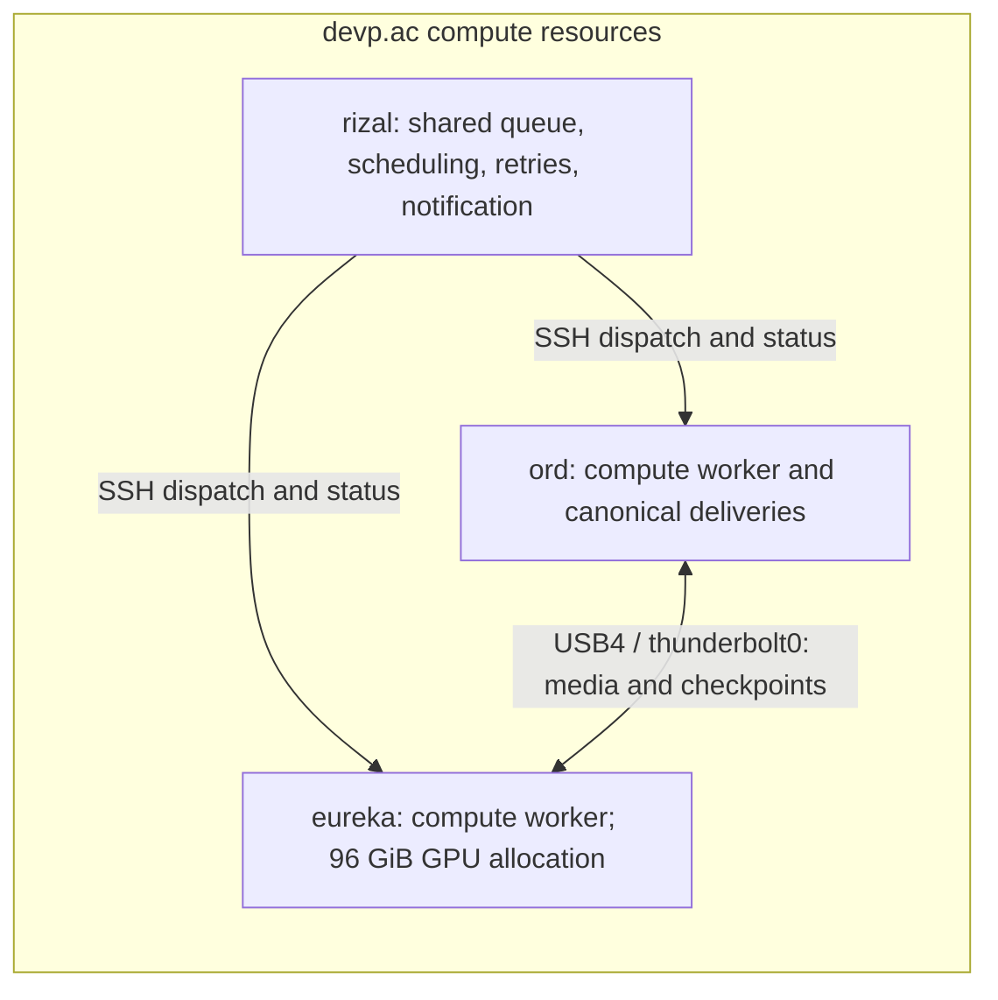

# Decasia agesia production and delivery record

**Completed October 3, 2026 at 6:43 a.m. Pacific.** All eight 4K deliveries
are verified on ord: normal and half-speed, vertical and horizontal, each
as a lossless MKV and a 10-bit HEVC MP4. The normal vertical HEVC is also
on rizal, with its transferred SHA-256 verified. See the
[final delivery record](#final-delivery-record-october-3-2026) for sizes,
locations, and verification evidence.

**Version 2 requested October 3, 2026:** one vertical, normal-speed variant,
with blue `rgb(0,0,255)` alpha selecting film algorithms without repeats,
and red `rgb(255,0,0)` beta. After the 60-second review, the human approved
the full render with pool-2 rotated 90° for the vertical: all 20 film
algorithms once, all 18 video algorithms once, then two random TV
broadcast/satellite fills. See [the current version 2 full plan](20261003.decasia_agesia_version_2_full.md)
and [the preserved review history](20261003.decasia_agesia_version_2.md).

The original brief and successive proposals below preserve the requested
iteration history. The approved draft 4 sequence, canonical-only gaps,
90° horizontal rotation, and devp.ac compute topology govern the finished
film; earlier white backgrounds, moving panels, and extra effects were
superseded during review.

## Original human brief

Make one new vertical short, under the project title "decasia <-> agesia".
Each short is both 4k vertical and 4k horizontal.

Background is sourced from this video (looped if longer than 60s)
/home/bkoz/mounts/visual/film.alphabetical_director/de_kosnik,b/pool-kink/houston.2025/AGC_VID_20251221_houston_sunset_2.mp4

Also use font resources from:
https://www.brailleinstitute.org/freefont/

Use these samples looped or combined for audio track:
/home/bkoz/src/izzi/resources.rizal/blade-runner/seed-audio-nature/01-Rain,_Thunder.mp3

See previous formulations:
20260926.short_center_frame_moire_guilloche.md

Background is white.

Frames are always composited using the svg vector format and then
high-resolution rendered via inkscape to png via maximum quality.

Colors are black, cyan, magenta, yellow, mixed "as if" using subtractive color mixing instead of the default for RGB (additive color mixing). So, an overlapping yellow vector image x cyan vector image == yellow in the intersection.

Take the list of screen glitch API passes, both film and video, and make a master list of screen_glitch elements, and name that screen_glitches.

Then, to compose the short use the following algorithm:

1) the alpha-channel motion comes from the list of screen_glitches, picked once and only once randomally. When all of the elements in screen_glitches have been picked and proccessed, then that is the end of the short. The alpha-channel motion color is black. Do this for 4 sec.

2) the beta-channel motion comes from a random selection from screen_glitches, can repeat. The beta-channel motion color is cyan. Do this for a number in the range [4.0, 6.0] seconds, picked at random.

3) the tetra-channel motion comes from a random selection from screen_glitches, can repeat. The tetra-channel motion color is yellow. Do this for a number in the range [4.0, 6.0] seconds, picked at random.

4) the quattro-channel motion comes from a random selection from screen_glitches, can repeat. The tetra-channel motion color is magenta. Do this for a number in the range [4.0, 6.0] seconds, picked at random.

At the end, there is a 3 second fade to an all-white frame.

Suggest 1-5 new ways to create motion and variation in the various frames, in addition to using the previous motions from short_center_frame_moire_guilloche are fine.

Append analysis, suggestions, staged plan below with any human decisions highlighted. Also Append a list of screen glitch api elements.

## Analysis and unattended proposal for decasia <-> agesia

This proposal makes one film with extremely wild, overlapping compositions
and movement that begins at frame center, then spreads through variable
parts of the picture at **1–150% of frame size**. It incorporates the human
directions: **overlapping channels creating new compositions**, **extremely
wild combinations**, **all movement starts at center-frame**, and **high
quality vector artwork in the MKVs**, using the audit-usage short as the
quality reference. The color-mixing rule applies to every combination.
Production has not started.

The earlier guilloche project supplies reproducible native motion, audio
logging, and delivery practices. Its center framing, gray background, title
timing, and 1080p sizes do not carry into this film. The new picture uses a
white canvas, black/cyan/yellow/magenta ink fields, and the supplied sunset
footage.

### Sources and available tools

- The sunset file is accessible: **1920×1080, 30 fps, 120.503556 seconds**,
  with a stereo audio stream. Proposed use: continuous moving picture,
  looping when the film exceeds the source duration; use the rain/thunder
  recording for the soundtrack.
- `01-Rain,_Thunder.mp3` is accessible: **3603.791250 seconds**, stereo,
  44.1 kHz. It can cover the proposed film without an audio loop. Decode
  to 48 kHz before mixing.
- Inkscape, FFmpeg, ffprobe, and the C++ compiler are installed.
  The explicit font file
  `/home/bkoz/.fonts/atkinson_hyperlegible.2026/AtkinsonHyperlegibleNext-SemiBold.otf`
  exists. Resolve the font from that file and outline title glyphs rather
  than relying on font substitution. Braille Institute identifies Next
  as a member of its Hyperlegible family:
  [official font resource](https://www.brailleinstitute.org/freefont/).
- The [current catalog](../../generative_movement/screen-glitch-catalog.json)
  has **38 forms: 20 film, 6 VCR, 6 TV-broadcast, and 6 satellite**.
  The underlying analog API also exposes the historical `film-damage`
  pass, which is absent from that catalog. The proposed master list
  `screen_glitches` therefore contains **39 distinct elements**.
- The common [screen API](../../generative_movement/screen-glitch.md) supports
  native SVG composition, deterministic clocks, source history, and receipts.
  Some operations require typed paths or lines. Native receiver effects
  model visible damage; real codec decoding is unavailable.
- Approximately **284 GiB** is currently available on the output filesystem.
  Two uncompressed 4K RGB frame sequences at the proposed duration would
  consume approximately 237 GB before supersampling and other artifacts.
  Stream or render bounded chunks; estimate master sizes from canaries.

### Human decisions and proposed defaults

**Human decisions already supplied:** overlap the channels, create extremely
wild compositions, allow movement over variable parts of the frame at
1–150% size, and begin every movement at frame center. Require high quality
vector artwork in the MKVs. Apply the color-mixing model to all overlaps.

Proposed sizing convention: artwork width as a percentage of delivery-frame
width, measured before the final canvas crop, with one scale factor for both
axes. Native fields can match the canvas aspect ratio; other motifs retain
their proportions. Each new pass begins with its motion anchor at
`(W/2,H/2)` and an initial 1% size, then follows a logged scale trajectory
bounded by 1–150%. Subsequent drift can reach edges, corners, and overscan.
Distribute sizes across small, medium, full-frame, and oversized fields,
with different roles in each simultaneous composition. A later motion
episode inside a pass also begins from the center; outgoing passes can
keep moving while new ones begin. The title is a separate readable overlay.

The following choices remain **proposed unattended defaults**, not recorded
human approvals. A production run can use them explicitly unless superseded:

| Choice | Proposed default |
| --- | --- |
| Master list | All 38 current catalog forms plus historical `film-damage`, giving 39. Do not count aliases, control studies, or repeated presets as extra elements. |
| Channel timing | Start black, cyan, yellow, and magenta together at each four-second cycle boundary. Black ends after four seconds; each colored pass independently lasts four to six seconds. |
| End condition | Finish the last black pass, then fade the complete still-moving composition to white over three seconds. The final colored passes finish naturally within that fade. |
| Canvas | White across the whole frame. Translate the moving sunset into monochrome coverage and channel ink separations, preserving its moving structure while using the requested ink palette. |
| Orientation | Render 2160×3840 vertical and 3840×2160 horizontal from the same timeline and normalized motion. Compose each to fill its canvas; preserve source proportions with cover and crop. |
| Frame rate and seed | 30 fps, initial logged seed `20261001`, separate stable random streams for order, channel selection, durations, and movement. Freeze the resolved schedule before rendering. |
| Title | Exact text `decasia <-> agesia`, in Atkinson Hyperlegible Next Semibold, as a brief vector overlay within the first black pass. No extra opening seconds; log exact title frames. |
| Color overlap, confirmed by human | One global subtractive-style ink coverage rule for black, cyan, magenta, and yellow, including all partial and multiple overlaps. Cyan + yellow = green. |

**Human correction confirmed:** cyan + yellow = green. Use one consistent
subtractive-style model for all colors, with no special cases. This
supersedes the original yellow × cyan = yellow example. Cyan + magenta =
blue; magenta + yellow = red; cyan + magenta + yellow = black; black
darkens every mixture. Apply the same rule to partial and multiple overlaps.

For a reproducible SVG implementation, treat each pass as coverage of its
named ink. Combine overlapping coverage of the same ink by
`1 - product(1 - coverage_i)`. For aggregate cyan, magenta, yellow, and black
coverages `C,M,Y,K`, calculate `R=(1-C)*(1-K)`,
`G=(1-M)*(1-K)`, and `B=(1-Y)*(1-K)` on white.
Specify the component space consistently in SVG filters; proposed default
is linear RGB, with one conversion to the delivery color space.
This is an ideal artistic coverage model, not a spectral simulation of
physical ink. Use SVG masks and arithmetic filter primitives before
Inkscape rasterization. Check every pair, triple, and four-ink case,
partial coverage, same-ink accumulation, and layer-order permutations.
Black should darken overlaps without making every composition opaque;
bound its coverage and vary it spatially. White remains visible where ink
coverage is zero.

**Human decision highlighted: footage placement.** The proposed sunset
treatment becomes moving ink structure across the canvas rather than an
untreated full-color rectangle. This reconciles the source footage, white
background, and restricted ink colors. Include a representative canary so
the visual consequence is reviewable.

### Overlapping timeline

Let `N = len(screen_glitches)`. Shuffle the master list once for the black
channel. At cycle `i`, beginning at `4*i` seconds:

1. Start black `alpha[i]` from the shuffled list for exactly **120 frames**.
   Each master element appears once and only once in this black schedule.
2. Independently select cyan `beta[i]`, yellow `tetra[i]`, and magenta
   `quattro[i]` from the entire master list, with replacement.
3. Begin each new pass's spatial motion at the frame center, using its
   independent 1–150% scale and outward trajectory. Independently choose
   each colored duration as an integer number of
   frames uniformly from **120 through 180 inclusive**, then record its
   duration in seconds. Channels are composition roles, distinct from the
   SVG transparency channel.
4. Keep outgoing colored passes alive while the next cycle begins. Give
   them distinct stage IDs, local clocks, seeds, and spatial motion.
   Up to **seven passes** can coexist: one black and two of each color.
   Use spatial handoffs and ink coverage envelopes rather than fading the
   entire picture between cycles.
5. Use global footage time continuously across cycles. A receiver hold or
   historical-source request resolves the corresponding actual source
   time; it must not silently use the current frame.

With 39 elements, black coverage occupies frames **[0,4680)**, or 156 seconds.
The final three-second fade occupies **[4680,4770)**. Proposed delivery is
**4770 frames / 159 seconds / 2:39** in each orientation. The last colored
passes end by frame 4740, within the fade. Define the fade so the last
delivered frame is exactly opaque white.

If the historical pass is excluded, the same rule gives **4650 frames /
155 seconds / 2:35**. The master list is frozen in the manifest, so catalog
changes cannot alter a resumed render.

### Five ways to make the combinations wild

1. **Colliding fronts launched from the center.** Grow film veils, cavities,
   tears, and recovery fronts outward from the shared origin along
   independent directions. Bend, split, and send them back across different
   regions, exposing moving sunset fields as they collide.
2. **Large changes in registration and scale.** Combine broad colored
   fields with fine native lines, rapid but continuous zooms, strong
   counter-rotation, shear where deliberately authored, and large lateral
   drift. Start each pass at the center; choose its size from 1–150% and
   use large fields and overscan for compositions that reach the edges.
3. **Different clocks in the same picture.** Give each channel independent
   forward motion, reverse motion, held material frames, and fast recovery.
   Combine a tearing black field with rolling cyan, delayed yellow ghosts,
   and fragmented magenta history. Record actual source-time mappings.
4. **Traveling interference and broken scan fields.** Sweep dense line
   families, bands, and islands through the full frame at different angles
   and rates. Let their overlaps produce moving ink intersections while
   native tears and tracking offsets break their registration.
5. **Composition changes during the overlap.** Move outgoing colored
   islands into incoming fronts, exchange broad and fine structures,
   and send several displaced copies across the canvas. Use large changes
   in density and occupancy to create distinct pictures from the same
   source rather than four identically moving recolorings.

Use the earlier project's native phase drift, radial ripples, breathing
strokes, and counter-orbits as additional ingredients. Assign contrasting
motion roles within each cycle. Keep selection randomness intact; improve
an accidentally inert composition through logged parameters and geometry,
rather than resampling black forms or covertly changing the schedule.

### Vector artwork quality requirement

The human comparison concerns **vector artwork quality** in the audit-usage
short. Use that as a visual reference rather than assuming a codec label or
larger canvas guarantees improvement.

The inspected audit-usage version-2 pipeline rasterizes vector PDF artwork
with Ghostscript at 300 dpi, using graphics/text antialiasing and Lanczos
reduction where needed. Its MKV is 1080×1920 at 30 fps, encoded as HEVC
4:2:0; its script uses `libx265 -preset slow -qp 18`.
The earlier center-frame guilloche script uses librsvg/Cairo at 2× and area
reduction. These are observed pipeline differences, not proof of what
caused the weaker result.

For this film, render composed SVGs through **Inkscape**, including masks,
filters, and ink mixing, at a minimum of 2× the final 4K dimensions.
Set filter rasterization resolution explicitly and verify it on the
heaviest filter regions; a large PNG alone does not establish that SVG
filters were sampled sufficiently. Compare 2× and 4× crops of fine lines,
curves, dense intersections, and fast motion before fixing production
sampling and the downsampling filter. Inspect native SVG artwork beside
its final-size PNG and decoded MKV at matched magnification.

Use **FFV1 v3 lossless RGB**, preserving every color component without
chroma subsampling, with full-range and color metadata matching the actual
PNG pipeline. Verify byte-identical decoded RGB against encoder input,
so encoding cannot blur or alter the vector artwork.
Reject unintended missing lines, visibly degraded curves, haloing, clipped
filter regions, muddy ink intersections, and sampling artifacts.
Keep intentional glitch distortion distinct from renderer or encoder
damage. Test quality through motion sequences as well as still crops.

Vector-generation detail and contrast matter alongside sampling. At 1%
size, shapes can become subpixel even in 4K; retain their native SVG
definition but avoid spending the entire pass at unreadable scale.
Use explicit density and stroke trajectories as the forms grow, record
them, and keep strong fine/coarse contrast during the wild overlaps.
Canary measurements and decoded comparisons support a technical quality
claim; superiority to the audit-usage artwork remains a visual judgment.

### Staged unattended work

1. **Freeze inputs and production settings.** Save the 39-element list,
   shuffled black schedule, all repeated colored selections, frame ranges,
   motion recipes, color table, source/font/code hashes, tool versions,
   source clock mappings, and explicit defaults under
   `outputs/decasia-agesia/draft-1/`. Preserve existing drafts and unrelated
   repository changes. Record the exact title separately from the path slug.

2. **Build the native composition adapter.** Reuse the screen facade and
   native worker where applicable; add a project-specific driver for typed
   geometry, the legacy pass, exact frame clocks, and moving-source history.
   Generate native vector fields with independent channel controls,
   center-origin motion, and logged 1–150% size trajectories.
   Keep video samples as embedded source images in composed SVGs and use
   native paths, masks, clips, and documented filter operations for the
   motion. Each frame must exist as a complete reproducible SVG composition
   before Inkscape rendering. Do not assume markup input supports typed
   path deformation; implement the required typed source explicitly.

3. **Render and inspect canaries automatically.** Exercise all 39 forms,
   a boundary with seven simultaneous passes, moving-source holds,
   opposite clock directions, broad/fine interference, both orientations,
   1% and 150% size extremes, center starts, the source-loop seam, title,
   and final fade. Produce labeled contact sheets and short review clips.
   Check movement through assigned regions and visible contribution
   from each channel. Verify the global color rule with overlap swatches.
   Compare full-resolution decoded MKV vector details with the audit-usage
   reference for clean edges, preserved lines, and color intersections.
   Technical checks cannot establish human aesthetic approval; record that
   distinction and continue after objective canary checks pass.

4. **Benchmark and render the full film.** Use Inkscape for every composed
   frame, initially at 2× delivery dimensions: **4320×7680** vertical and
   **7680×4320** horizontal. Test representative fine structures at 4×;
   increase sampling if the comparison reveals material aliasing.
   Pin PNG bit depth, antialiasing, color handling, and downsampling in the
   manifest. Benchmark the heaviest overlaps and source history before
   estimating elapsed time, worker count, memory, or storage.
   Render bounded chunks with conservative concurrent workers, record
   hashes/receipts, and encode completed chunks. Retain reproducible SVG
   sources or source bundles, controls, and canary PNGs; delete temporary
   high-resolution PNG chunks only after verified lossless encoding.
   Resume only chunks whose input and settings hashes still match.

5. **Mix audio and create deliveries.** Select one logged continuous
   rain/thunder passage covering the film; add short edge fades and the
   final three-second fade. Proposed target: **−20 LUFS integrated,
   at most −2 dBTP**, with no added thunder samples by default.
   Measure the finished mix and record offsets, gains, fades, and loudness.
   Produce two **FFV1 v3 RGB MKV masters**, with **48 kHz, 24-bit stereo
   FLAC**, plus smaller MP4 review copies. Upscale the 1080p source through
   the composition pipeline; the native vectors are rendered at 4K.

6. **Verify and report.** Decode both masters and verify exact dimensions,
   constant 30 fps, 4770 frames, matching audio samples, expected title
   frames, the final opaque white frame, source clock behavior, unique
   black coverage, all colored durations, center-origin motion, and
   pre-crop scale trajectories within 1–150%. Verify decoded RGB frame
   hashes against the final PNG-to-encoder input for every frame. Check zero-ink white areas
   against reference swatches and exercise the specified color table.
   Measure motion and changed-pixel coverage in a grid spanning corners,
   edges, and center over each cycle, against that cycle's assigned spatial
   extent; distinguish intended source holds from inert compositions.
   Small compositions need not change every corner. Verify broad and
   oversized compositions actually move across their intended regions. Check channel contributions using diagnostic
   renders and assess visual diversity with contact sheets.
   Finish with paths, duration, file sizes, hashes, technical receipts, and
   any remaining aesthetic questions.

Each stage records progress and failures. Retry transient process failures
within a bounded limit; deterministic validation failures retain their
artifacts and stop the dependent stage. An unattended run must not replace a
failed requested element, silently shrink the master list, change the color
rule, or fall back to a different rasterizer. This document proposes the
production work; appending it does not start the full render.

### Master list of screen glitch API elements

The proposed `screen_glitches` list contains the following 39 identities.
Rows 1–38 are current catalog IDs. Row 39 is a project adapter identity for
an existing analog API pass, not a claim that the catalog already contains it.

| No. | Element | Native operation |
| --- | --- | --- |
| 1 | `film/pale-cavities` | `film-material` |
| 2 | `film/gray-membranes` | `film-material` |
| 3 | `film/cellular-foam` | `film-material` |
| 4 | `film/sparse-cavities-membranes` | `film-material` |
| 5 | `film/membranes-foam-lace` | `film-material` |
| 6 | `film/full-blister-mixture` | `film-material` |
| 7 | `film/broad-veil` | `film-material` |
| 8 | `film/scalloped-density-front` | `film-material` |
| 9 | `film/pale-regional-veil` | `film-material` |
| 10 | `film/relief-trace` | `film-material` |
| 11 | `film/abrasion-field` | `film-material` |
| 12 | `film/thin-tear` | `film-material` |
| 13 | `film/torn-sheet` | `film-material` |
| 14 | `film/connected-survivor-window` | `film-material` |
| 15 | `film/fragmented-survivor-islands` | `film-material` |
| 16 | `film/soft-advancing-front` | `film-material` |
| 17 | `film/wandering-aperture` | `film-material` |
| 18 | `film/fine-flecks` | `film-material` |
| 19 | `film/regional-fading` | `film-material` |
| 20 | `film/perforated-picture` | `film-material` |
| 21 | `vcr/generation` | `analog-chain` |
| 22 | `vcr/tracking` | `analog-chain` |
| 23 | `vcr/sync` | `analog-chain` |
| 24 | `vcr/ghost` | `analog-chain` |
| 25 | `vcr/composite-color` | `analog-chain` |
| 26 | `vcr/fm-threshold` | `analog-chain` |
| 27 | `tv-broadcast/weak-signal-snow` | `analog-reception` |
| 28 | `tv-broadcast/ignition-bursts` | `analog-reception` |
| 29 | `tv-broadcast/cochannel-beat` | `analog-reception` |
| 30 | `tv-broadcast/vertical-roll-relock` | `analog-reception` |
| 31 | `tv-broadcast/broadcast-ghost` | `analog-reception` |
| 32 | `tv-broadcast/crt-power-off` | `crt-shutdown` |
| 33 | `satellite/mpeg-picture-damage` | `native-receiver` |
| 34 | `satellite/weather-fade` | `native-receiver` |
| 35 | `satellite/sun-transit-outage` | `native-receiver` |
| 36 | `satellite/dish-link-interruption` | `native-receiver` |
| 37 | `satellite/transport-burst-recovery` | `native-receiver` |
| 38 | `satellite/ip-buffer-drain` | `player-buffer` |
| 39 | `legacy/film-damage` | `analog-chain`, with `svg::video_glitch::film_damage` |

The six VCR IDs already cover the analog API's `vhs-generation`,
`vhs-tracking`, `sync-loss`, `ghost`, `composite-color`, and
`satellite-threshold` types. Do not add those aliases a second time.
The generic operation `codec` is unavailable and is not a selectable
screen-glitch element. Controls and studies of a form vary its appearance;
they are not additional master-list entries.

## Production approval and YouTube delivery

The human approved the proposal and defaults above, including overlapping
compositions, center-origin movement at 1–150% size, consistent global
subtractive-style mixing, and the vector artwork quality requirement.
Proceed with production and both lossless 4K MKV masters.

Also produce a YouTube upload copy within **0.5–1.0 GB**, using the highest
quality achievable in that size. Target **0.98 GB in decimal bytes**, leaving
room below the upper limit. Compare demanding encoded vector scenes with
their master before selecting final settings. Produce upload copies for
both orientations. Verify actual size, decoded frame count, color conversion,
and audio after encoding. YouTube recommends MP4, H.264, stereo 48 kHz audio,
and BT.709 for SDR uploads; its 4K bitrate guidance is a recommendation,
not an upload bitrate limit:
[YouTube upload encoding settings](https://support.google.com/youtube/answer/1722171?hl=en).

## Confirmed production corrections

**Human instruction:** use the canonical full-color video footage as the
background. This supersedes the white production canvas and proposed
monochrome footage treatment above. Composite the animated ink fields over
the continuously playing footage, with proportional cover/crop for each
orientation. Retain the specified three-second fade to white at the end.

**Human instruction:** use HEVC for the YouTube copies and maximize quality
within 0.5–1.0 GB. Target approximately 0.985 GB per orientation, with slow
two-pass encoding and verified actual file sizes. Preserve the lossless
RGB MKV masters independently of the upload conversion.

The implementation uses native typed vector sources for film and analog
passes, and moving vector history for receiver effects. The canonical
footage is composited once per frame beneath these ink fields, which avoids
repeated image filtering without reducing vector sampling. Ink multiplication
is pinned to sRGB component space in the SVG composition; the global rule
has no special cases. Zero overlay coverage reveals the canonical footage.

## Human playback review before the long render

The human asked where the review canaries were and then instructed: “before
you do a long render, do the first 60 seconds for human review”. The full
render and its unattended continuation were stopped. This instruction
supersedes the earlier unattended production approval until playback review
is complete.

Produce the actual opening 60 seconds in vertical 1080 × 1920 at 30 fps,
using the frozen production schedule, canonical footage, native geometry,
global ink mixing, and original audio. Provide a lossless RGB/FLAC MKV and
a high-quality 10-bit HEVC MP4 for playback. The review cutoff does not add
a new composition or the full film's final white fade. Existing 4K canaries
remain the fine-detail review references. Verify all 1,800 lossless frames,
audio samples, and HEVC decoding. Wait for human playback feedback before
resuming the full 4K render and final 0.5–1.0 GB YouTube exports.

Review artifacts: `outputs/decasia-agesia/draft-1/review-60s/`.
Canaries: `outputs/decasia-agesia/draft-1/canaries/contact-sheet.jpg` and
`outputs/decasia-agesia/draft-1/canaries/sampling-detail.png`.

## Draft-2 human corrections

**Human rejected draft-1.** Its added wave/orbit source artwork was not
requested. Do not continue draft-1 production.

**Human instructions:** generate another 60-second review and wait for human
feedback. Use only screen API glitches and the canonical video background.
All overlays fit the screen without compositor distortion or movement; the
motion comes from the glitches themselves. Compose the alpha (black), beta
(cyan), tetra (yellow), and quad (magenta) channels in the existing schedule.
No new artwork, motifs, titles, or compositor animation. **Do not add things
unless explicitly requested.** Retain the explicitly requested soundtrack.

Match the subtractive example on the right of the supplied
[color reference](https://cdn.mos.cms.futurecdn.net/6FSgP38XcxfqQuiYicQx5Z-1200-75.jpg.webp).
Use one continuous, order-independent CMY coverage equation calibrated to
the reference's primary and overlap colors; black darkens globally. The
canonical footage remains visible where glitch coverage is zero.

Draft-2 film overlays use the screen API's native material fields on a
uniform exposure carrier used only to measure coverage; no carrier picture
appears in the film. Video/receiver passes use the actual canonical footage
and its historical frames. Both paths produce only screen API damage.

Produce the 60-second vertical review at 1080 × 1920, 30 fps, with
Inkscape supersampling, a lossless RGB/FLAC MKV and a 10-bit HEVC playback
copy. Stop at 60 seconds and wait for feedback. Artifacts are isolated in
`outputs/decasia-agesia/draft-2/`.

## Draft 3 staged cyan magenta yellow review

This section records the delivered draft 3. The human subsequently identified
its continuity failure; the draft 4 definition below supersedes this schedule.

The human requested alpha, then alpha × beta, then alpha × beta × tetra,
using cyan, magenta, and yellow respectively. Quad is omitted. Keep the
existing native effect forms, seeds, clocks, and four-second cycle starts.
The canonical footage, screen API sources, reference subtractive palette,
fixed screen placement, supersampling, and requested soundtrack continue.

The human corrected the hold: all three remain together for 4–8 seconds,
then alpha exits over two seconds, beta exits over two seconds, and tetra
exits over two seconds. The review uses a six-second hold within that range:
alpha alone at 0–4 seconds, alpha × beta at 4–8, all three at 8–14, then
alpha fades out at 14–16, beta at 16–18, and tetra at 18–20. Channel coverage
fades uniformly after same-color pass aggregation, preserving subtractive
mixing throughout the exit.

The selected review is one 20-second sequence. No repetitions or extra
artwork are added. Produce vertical 1080 × 1920 at 30 fps, a lossless RGB/FLAC
MKV and a 10-bit HEVC MP4, then stop for human feedback. Draft 3 artifacts
are isolated in `outputs/decasia-agesia/draft-3/review-20s/`.

## Draft 1 through 4 iteration record

**Current human instruction:** draft 4a is normal speed and draft 4b is
half speed. Each pattern must continue after the next layer is added. The
latest draft 4 schedule below governs; the earlier drafts are historical
iterations, not approved instructions for further rendering.

### Draft 1

Delivered a 60-second vertical review at 1080 × 1920, 30 fps, with the
canonical sunset footage, the requested rain/thunder soundtrack, and
black/cyan/yellow/magenta channels. Its compositor moved and resized panels
from the center and used additional wave/orbit source artwork. The human
rejected that result: decasia must use only screen API glitches over the
canonical footage. Movement belongs inside the glitch, rather than in a
sub-screen moving across the frame. The human also required overlays to
fit the screen without distortion and requested the subtractive example
on the right of the supplied color reference.

Review files: `outputs/decasia-agesia/draft-1/review-60s/`. Preserve them as
iteration evidence; do not resume their production pipeline.

### Draft 2

Delivered a 60-second vertical review at 1080 × 1920, 30 fps. Removed the
additional artwork and compositor motion. The only image sources were the
screen API damage and canonical footage. Alpha was black, beta cyan,
tetra yellow, and quad magenta; all four channels began together and their
patterns continued to be replaced on the original four-second cycle.
The continuous CMY mixing model was calibrated to the right-hand reference,
with black darkening the result. Lossless RGB frames, audio samples, and
the 10-bit HEVC playback copy were verified.

**Human feedback:** “that's closer.” The next request reduced the composition
to alpha/cyan, beta/magenta, and tetra/yellow, with cumulative entry and
sequential two-second exits. The standing rule is: **do not add things
unless explicitly requested**.

Review files: `outputs/decasia-agesia/draft-2/review-60s/`.

### Draft 3

Delivered one 20-second vertical review at 1080 × 1920, 30 fps. Its visible
channel schedule was alpha alone at 0–4 seconds, alpha × beta at 4–8,
all three at 8–14, followed by alpha's exit at 14–16, beta's at 16–18,
and tetra's at 18–20. Quad and black ink were omitted. This followed an
initial proposed 60-second schedule that the human corrected before the
video render; that initial proposal was not delivered as a complete film.

The error was preserving the old pattern replacement schedule: alpha,
beta, and tetra each changed form on the original four-second cycle. Thus
adding a channel did not retain the same underlying pattern instances.
The first two holds were also at the lower edge of the requested range.
The human clarified that each stage must hold for 4–8 seconds while all
previous layers continue, and that the remaining layers must continue
through each two-second exit. The verified pixels and audio did not establish
that this creative requirement had been met.

Review files: `outputs/decasia-agesia/draft-3/review-20s/`. Preserve this
superseded iteration.

### Draft 4a normal speed

**Human correction:** hold alpha alone for 4–8 seconds; keep that same alpha
running and add beta as the next layer for 4–8 seconds; retain both and add
tetra as the top layer for 4–8 seconds. Then remove alpha over two seconds
while beta and tetra continue, remove beta over two seconds while tetra
continues, and finally remove tetra over two seconds.

Implementation choice within the permitted range: use six seconds for
each hold. This produces one 24-second review, with no repeated sequences.
There is exactly one persistent pattern instance per channel. Its form,
seed, full-screen placement, and native clock remain continuous from entry
until exit; adding or removing another layer does not replace or restart it.
Logical layer order is alpha, beta, then tetra above both. The existing
subtractive coverage model mixes their cyan, magenta, and yellow colors.

| Normal interval | Layers and action |
| --- | --- |
| 0–6 seconds | Alpha alone, cyan. |
| 6–12 seconds | Same alpha continues; add beta above it, magenta. |
| 12–18 seconds | Same alpha and beta continue; add tetra above both, yellow. |
| 18–20 seconds | Alpha fades out over two seconds; beta and tetra continue. |
| 20–22 seconds | Beta fades out over two seconds; tetra continues. |
| 22–24 seconds | Tetra fades out over two seconds, revealing canonical footage. |

Use existing native forms and seeds: alpha uses `film/perforated-picture`,
beta uses `film/full-blister-mixture`, and tetra uses `tv-broadcast/crt-power-off`.
The visibility canaries showed that the ghost and abrasion beta options were
too faint against this footage. The existing native full-blister pattern
makes the added magenta layer and its subtractive overlaps clearly visible. Extend each instance through its
scheduled lifetime instead of creating new four-second forms. Native glitch motion
continues within each fixed full-frame layer. No extra artwork, titles,
compositor movement, white ending, or additional pattern instances.

### Draft 4b half speed

**Human instruction:** produce the same composition at half speed.
The entire 24-second normal sequence becomes 48 seconds: the footage,
internal glitch animation, entry timing, and fades all slow by two.
At 30 fps, repeat each normal lossless frame exactly twice; do not generate
new compositions or interpolate new artwork. Time-stretch the same
soundtrack by two while preserving pitch.

| Half-speed interval | Layers and action |
| --- | --- |
| 0–12 seconds | Alpha alone. |
| 12–24 seconds | Same alpha continues; add beta. |
| 24–36 seconds | Same alpha and beta continue; add tetra. |
| 36–40 seconds | Alpha exits; beta and tetra continue. |
| 40–44 seconds | Beta exits; tetra continues. |
| 44–48 seconds | Tetra exits. |

### Draft 4 delivery and review gate

Draft 4a and 4b review copies are complete and verified at 1080 × 1920,
30 fps, using the existing maximum-quality Inkscape supersampling. Each has
a lossless RGB/FLAC MKV and a high-quality 10-bit HEVC MP4, using the
draft 2/3 encoding settings. They are stored in `outputs/decasia-agesia/draft-4/review/`, with `a-normal`
and `b-half-speed` in their filenames. The source script is
`scripts/render-decasia-agesia-draft-4.py`.

Verify every normal frame and the audio; inspect every frame's screen API
receipt to establish that layer identity, form, and native clock continue
across the three holds and exits. Verify that the half-speed master repeats
every normal frame exactly twice, that its duration is exactly 48 seconds,
and that both HEVC files decode without errors. Preserve all earlier drafts.
Human playback approval has now been received. Full production is authorized
with the small canonical-footage gap change recorded below.

**Human-selected production worker: ord.** After draft 4 playback review
passes, use ord for the long render. The read-only SSH preflight confirmed
32 CPUs, approximately 125 GiB total RAM, and the installed Inkscape, FFmpeg,
HEVC/FFV1 encoders, zscale filter, compiler, RapidJSON headers, Pillow, and
NumPy. The missing `fontTools` dependency has been supplied as the existing
local version 4.62.1 inside the isolated worker, with no system package changes. Record: `outputs/decasia-agesia/draft-4/ord-preflight.json`.
The human subsequently approved the full render; the worker pipeline is
running under the approval below.

## Approved full render on ord

**Human approval:** “ok i like draft 4” and, with the canonical gap change,
“approve the full render, begin”. **Retain both a (normal speed) and b
(half speed) outputs.** This approval supersedes the earlier review gate.

Keep the approved draft 4 sequence: six seconds of alpha alone, six seconds
with the same alpha plus beta, six seconds with both continuing plus tetra,
then their sequential two-second exits. After tetra clears, show only the
continuously playing canonical footage for a random 2–6 seconds before the
next sequence begins. Do not add overlays or freeze the footage during gaps.
There is no extra gap after the final sequence, since no next pattern follows.
Half-speed playback doubles the entire film, including the gap durations.

Use the original 39-form alpha catalog once each in its frozen shuffled order.
Each sequence selects one beta and one tetra from the existing catalog and
keeps those pattern instances continuous through the holds and exits.
The opening sequence exactly matches the approved draft 4 forms and seeds;
subsequent sequences use the original catalog selections and seeds.
Gap durations are reproducible integer frame counts from 60 through 180
at 30 fps, using random seed 20261005. This schedule totals **32,297 normal
frames**, **1,076.5667 seconds (17:56.57)**, or **2,153.1333 seconds (35:53.13)**
at half speed. The canonical source loops as needed, with proportional
cover/crop and no distortion.

Produce the vertical film at 2160 × 3840. **Human correction, October 2:
do not render separate horizontal artwork; use FFmpeg to rotate the vertical
film by 90°.** Derive horizontal 3840 × 2160 playback clockwise from the
same vertical pixels, preserving both a and b. Use `transpose=clock` for
the horizontal lossless RGB/FLAC MKVs. Derive the horizontal HEVC copies
by stream-copy remux with a −90° display rotation, preserving the vertical
HEVC bitstream and its quality without another HEVC encode. These MP4s
have 2160 × 3840 coded dimensions and 3840 × 2160 displayed dimensions;
the horizontal MKVs have physical 3840 × 2160 frames. This correction
supersedes the previous separate horizontal Inkscape render and encode.
Preserve lossless RGB/FLAC MKVs for a and b in each orientation.
The half-speed lossless MKV retimes the identical encoded RGB frames to
15 fps without generating new artwork or storing redundant duplicate frames.
Both HEVC playback/upload variants are 30 fps; the half-speed version repeats
each original frame twice. This retiming was verified for exact decoded
pixels, duration, and 30 fps frame pairing before worker launch.

Each final HEVC upload copy must be 0.5–1.0 GB, targeting approximately
0.985 GB. Encode the vertical copies with 10-bit HEVC, veryslow two-pass
encoding, proper BT.709 conversion, and stereo 48 kHz AAC. The rotated
horizontal copies retain those encoded video and audio streams. The lossless masters are independent of
that upload size limit. Preserve the original rain/thunder processing and
verify that the opening 24 seconds match the approved review's PCM samples
exactly; extend it continuously for the full film. Time-stretch the same
soundtrack at half speed while preserving pitch.

The worker workspace is
`ord:/home/bkoz/izzi-decasia-20261001-draft-4-full/`.
The frozen artwork plan is `outputs/decasia-agesia/full/production.json`;
the original renderer is `scripts/render-decasia-agesia-full.py`. Preserve
that manifest and its completed vertical checkpoints. The October 2 delivery
override is `outputs/decasia-agesia/full/rotation-delivery.json`, implemented
by `scripts/finish-decasia-agesia-rotated.py`; it replaces the pending
horizontal artwork render while retaining completed vertical work. Use eight
independent workers only for the vertical artwork render, with the task's
existing Inkscape quality and supersampling settings.
Check actual 4K canaries before entering the frame render, then verify every
lossless frame, every layer's continuous identity and clock, all canonical-only
gaps, audio samples, HEVC decoding, durations, dimensions, and upload sizes.
Keep checkpoints and receipts for resumability. Delete only regenerable SVG
intermediates and verified video chunks as needed to conserve worker storage;
retain all earlier draft artifacts and the final a/b masters and upload copies.

Worker state and logs are under `outputs/decasia-agesia/full/` on ord;
final artifacts are under `outputs/decasia-agesia/full/deliveries/`.

**Full worker launch confirmed:** ord PID 26183, detached
from the SSH session and using eight rendering workers. Actual 4K canaries
passed in both orientations. The first 8 production
chunks (240 frames) passed lossless RGB verification.
The review helper's captured export defaults were corrected to production
dimensions before any chunk was accepted. Local launch and status records:
`outputs/decasia-agesia/full/ord-launch.json` and
`outputs/decasia-agesia/full/ord-status.json`. Live worker status is
`outputs/decasia-agesia/full/pipeline-state.json` in the isolated ord workspace.
The full outputs are still rendering; completion requires the final master
and upload verification records.

### October 2 delivery correction and completion notification

The complete vertical normal and half-speed lossless masters have passed
all 32,297-frame RGB, audio, persistent-layer, and canonical-gap checks.
At the time of the human correction, the vertical normal HEVC first pass
was running; preserve that encoding work when switching delivery pipelines.
There is no authorization to perform a separate horizontal artwork render.

An ord rotation canary verified four decoded HEVC frames: stream-copy
remux with a −90° display matrix produces exactly the same RGB frame
hashes as a clockwise transpose. Before accepting the full horizontal
masters, compare every decoded frame against the transposed vertical
source and verify unchanged audio and durations. For each horizontal MP4,
verify the display matrix, decoded display dimensions, packet preservation,
error-free decoding, duration, and the 0.5–1.0 GB size bound. Preserve the
original vertical master receipts; record the rotation override alongside
the final delivery verification.

The local desktop completion watcher checks ord every five minutes and
alerts when all eight outputs and their receipts are present and verified,
or when the worker records a failure. It runs as the user service
`decasia-agesia-completion.service`. Its status record is
`outputs/decasia-agesia/full/completion-notification.json`; the watcher is
`scripts/watch-decasia-agesia-completion.py`. The earlier 3–5-day estimate
included a separate horizontal render and two additional HEVC encodes;
it is superseded by this rotation workflow. Refresh the estimate from the
remaining vertical encoding speed after the handoff.

**Rotation handoff confirmed, October 2 at 11:27 a.m. Pacific:** the
detached successor is ord PID 995083. The original controller (PID 26183)
is paused so it cannot begin the superseded horizontal render; the existing
vertical HEVC first-pass encoder (PID 991102) remains active. The successor
will retain that completed first pass, retire the original controller, and
finish the remaining vertical encoding and rotated deliveries. The frozen
artwork manifest and both verified vertical masters are unchanged.

The four-frame delivery-code canary passed exact clockwise RGB pixel
comparison, physical horizontal MKV dimensions, half-speed timing and
pixel preservation, HEVC packet preservation, and decoded display rotation.
Receipts are under `outputs/decasia-agesia/full/rotation-preflight/`;
successor logs are `outputs/decasia-agesia/full/finish-rotation-ord.log` on
ord. At approximately 1.24 encoded frames per second, estimate **36–48
hours remaining** for the complete set from this handoff, roughly late
October 3 through October 4 Pacific. This is an estimate; the remaining
second-pass speed and full rotation verification can change it. The desktop
completion watcher remains active.

## Revised compute topology: devp.ac

**devp.ac** names the collective compute resources: rizal as the control
plane, with ord and eureka as compute workers. This is the human-selected
name for the group; the individual hostnames remain rizal, ord, and eureka.

**Human instructions, October 2:** offload work to eureka; its GPU is
configured for 96 GB; use the direct USB4/Thunderbolt file-transfer link;
allow ord and eureka to steal ready work from each other; **rizal is the
control plane**. This topology supersedes a permanent assignment of normal
encoding to ord and half-speed encoding to eureka. It also supersedes the
single sequential ord delivery successor once the shared queue is active.

Rizal owns a durable dependency queue in
`outputs/decasia-agesia/full/work-queue.json` and the coordinator user service
`decasia-agesia-work-queue.service`. One worker loop for each compute host
claims the next ready stage from that shared queue. A host is free to take
work previously expected to run on the other host; there is no permanent
a/b assignment. Claims are exclusive, completed jobs retain their receipts,
and prerequisites gate dependent work. Record job ownership, attempts,
timestamps, and failures on rizal. Preserve the in-flight ord first pass
and completed lossless masters. Use completed artifacts rather than
restarting encoding or artwork rendering after the topology change.

Ord remains the canonical artifact store:
`ord:/home/bkoz/izzi-decasia-20261001-draft-4-full/`.
Eureka uses an isolated workspace:
`eureka:/home/bkoz/izzi-decasia-20261001-eureka/`.
Rizal's workspace is `/home/bkoz/src/izzi/`. Keep system installations and
unrelated workspaces untouched. Eureka has 32 CPUs, approximately 32 GiB
of host-visible RAM, and a verified GPU allocation of **103,079,215,104
bytes (96 GiB)** on its AMD Strix Halo GPU. These memory pools are distinct
for scheduling purposes. The approved highest-quality `libx265` two-pass
encode uses CPUs; retaining that encoder avoids changing the quality target
merely to use GPU memory.

The direct link is up on `thunderbolt0` at both ends:
**ord 169.254.4.107 ↔ eureka 169.254.31.134**. Eureka's route to ord's link
address explicitly selects `thunderbolt0`. Direct SSH authentication was
verified using the existing agent forwarded for the transfer session.
Transfer masters, pass statistics, and finished outputs directly between
workers with authenticated resumable rsync over these addresses. SSH
commands and small status records originate on rizal; large media must
not travel through rizal. Verify transferred source and output hashes;
publish final files and receipts atomically on ord.

Queue stages cover the preserved normal first pass, normal second pass,
half-speed first and second passes, the clockwise lossless master rotation,
half-speed retiming, each rotated HEVC delivery and its verification, and
final aggregation. Each completed first pass publishes the statistics and
log needed to run its second pass on either worker. The completed RGB
masters are the common source; no horizontal artwork is rendered. Keep
whole-film two-pass HEVC analysis so the file-size allocation and quality
remain consistent. Rotation and verification become separate eligible
jobs, allowing an idle host to claim them while the other host encodes.

Retain the existing 4K resolutions, normal/half-speed timing, CMY mixing,
canonical-video gaps, audio, lossless RGB guarantees, and 0.5–1.0 GB HEVC
size bounds. A horizontal MP4 remains a quality-preserving 90° stream-copy
rotation; a horizontal MKV contains physically transposed lossless frames.
Require both speeds in both orientations, each as MKV and MP4: eight final
outputs. Final completion is recorded only after all prerequisite receipts,
checksums, decoded pixels, audio, durations, rotation, and size checks pass.

Rizal's existing desktop watcher will notify on the verified complete set
or a recorded pipeline failure. The sequential 36–48-hour estimate is
superseded by this parallel topology; publish a new estimate after measuring
the two workers' actual progress. Deployment and transfer progress must
remain recorded separately from successful output completion.

**Shared queue deployment confirmed, October 2 at 11:53 a.m. Pacific.**
Rizal's `decasia-agesia-work-queue.service` is active (initial coordinator
PID 754008). It claimed the existing normal first pass for ord and the
half-speed first pass for eureka. The old waiting sequential caretaker was
retired without stopping ord's active FFmpeg process. The source transfer
used the direct USB4 addresses: 74,818,437,591 bytes transferred in about
117 seconds (reported average approximately 609 MB/s), then matched
SHA-256 `d91d023232801562b2c612e03fe576eb275bde3b5d78982fa97a6f12c6068cce`.
Eureka's half-speed encoder is active; both hosts are now computing.

The coordinator is `scripts/coordinate-decasia-agesia.py`; the remote stage
runner is `scripts/run-decasia-agesia-queue-job.py`. There are nine queued
stages: `a-pass-1`, `b-pass-1`, `a-pass-2`, `b-pass-2`,
`horizontal-a-master`, `horizontal-b-master`, `horizontal-a-hevc`,
`horizontal-b-hevc`, and `finalize`. Each second pass waits for its own
first-pass statistics; the half-speed horizontal master waits for the
clockwise normal master; each horizontal HEVC waits for its verified
vertical HEVC; final aggregation waits for all delivery stages. Apart from
the already-running adopted first pass, every stage is eligible on either
worker. Worker stage locks prevent duplicate execution. The queue records
the frozen artwork-manifest hash and coordinator/runner/helper code hashes.
Each successful stage atomically publishes its artifact checksums and
receipt on ord. Eureka retains the half-speed input cache and drops only
regenerable local large copies after their canonical ord copies are verified,
keeping within its available disk space.

Validation passed prerequisite gating, exclusive claims, and stealing in
both directions (ord taking a ready eureka second pass, and eureka taking a
ready ord second pass). Both remote runners imported successfully; the
earlier four-frame rotation/retiming/packet canaries still pass. Whole-film
encoding and final delivery verification remain in progress.

The repository overview is updated in `docs/workflows.md`, with dependency
records in `docs/dependencies.md`. Read rizal's queue for current stage
ownership and logs `outputs/decasia-agesia/full/<host>-<stage>.log` for
execution details. Eureka's transfer log is
`outputs/decasia-agesia/full/usb4-transfer.log` in its isolated workspace.

**devp.ac completion estimate, October 2 at 12:24 p.m. Pacific:** allow
approximately **24–30 hours remaining**, placing the complete verified
delivery set on October 3 in the afternoon or evening Pacific. Ord's
preserved first pass was at 32,173 of 32,297 frames (about 1.23 fps).
Eureka's half-speed first pass was at 3,604 of 64,594 frames, averaging
about 1.98 fps over thirty minutes. At that rate, the remaining half-speed
first pass plus its second pass account for roughly 17.5 hours; rotation,
decoding checks, and final publication add time while other work overlaps.
Normal-speed HEVC is estimated in 8–10 hours. Second-pass throughput,
queue ownership, and full verification can change these estimates; the
verified-completion desktop alert remains the final completion signal.

## Final delivery record October 3 2026

The devp.ac queue completed all nine stages on their first attempts at
**2026-10-03 06:43:12 Pacific (13:43:12 UTC)**. The shared queue ran for
approximately **18 hours 52 minutes** after its October 2 launch. Ord
completed the normal encode and both physical horizontal masters; eureka
completed both half-speed HEVC passes, the horizontal half-speed HEVC,
and final aggregation. Rizal retained control of the dependency queue.
Earlier completion estimates are historical; the delivery set is complete.

The canonical files are in
`ord:/home/bkoz/izzi-decasia-20261001-draft-4-full/outputs/decasia-agesia/full/deliveries/`.
The naming convention is
`decasia-agesia-full-{vertical|horizontal}-{a-normal|b-half-speed}-{lossless.mkv|youtube-hevc.mp4}`.

| Orientation | Speed | Duration | Lossless MKV size | HEVC MP4 size |
| --- | --- | --- | --- | --- |
| Vertical | a normal | 17:56.57 | 74,602,620,474 bytes | 983,532,034 bytes |
| Vertical | b half speed | 35:53.13 | 74,818,437,591 bytes | 980,270,313 bytes |
| Horizontal | a normal | 17:56.57 | 74,994,509,885 bytes | 983,532,034 bytes |
| Horizontal | b half speed | 35:53.13 | 75,210,329,733 bytes | 981,173,073 bytes |

Every HEVC file satisfies the requested 0.5–1.0 GB limit. Normal HEVCs
contain 32,297 frames at 30 fps; half-speed HEVCs contain 64,594 frames at
30 fps. Lossless half-speed MKVs preserve the same 32,297 RGB frames at
15 fps with the pitch-preserving stretched soundtrack. Horizontal MKVs
have physically rotated 3840 × 2160 pixels. Horizontal MP4s retain the
vertical 2160 × 3840 coded pixels and encoded packets, with a −90° display
matrix producing 3840 × 2160 clockwise playback.

The final `verification.json`, `vertical-master-verification.json`, and
`horizontal-master-verification.json` are in the ord deliveries directory.
Each MP4 has a matching `.verification.json`; stage receipts are under
`queue-results/`. These records establish persistent native layer identity,
canonical-only gaps, exact lossless RGB and audio, half-speed pixel identity,
clockwise transpose comparisons, unchanged rotated HEVC packets, complete
error-free decoding, durations, dimensions, upload sizes, and SHA-256.
An October 3 follow-up confirmed the eight files still match their recorded
byte counts. Full completion was reported by the desktop watcher at
**6:48 a.m. Pacific**.

The normal vertical HEVC was copied to rizal at
`/home/bkoz/src/izzi/outputs/decasia-agesia/full/deliveries/decasia-agesia-full-vertical-a-normal-youtube-hevc.mp4`.
Its size is **983,532,034 bytes**, and its SHA-256 is
`132108d9f4d98e8fda47b8772b123265663126f05aaee9d1298f6f773e346981`.
The transfer was verified on October 2 at **8:48 p.m. Pacific** and recorded
in the adjacent `.rizal-transfer.json`; the matching production verification
receipt is retained there as well. Only this requested HEVC copy was
transferred to rizal; the complete eight-file delivery set remains on ord.
