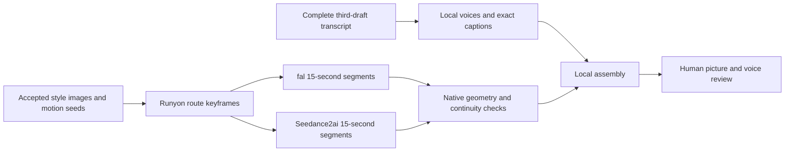

# Here Lies Trouble — stage 3: full transcript and transferable video method

**Active successor:** [stage-4 production details](20261026.here_lies_trouble_stage_4_production_details.md)
contains the current cast, credit-funded next round, and motion plan.

Recorded: 2026-10-25, America/Los_Angeles.
Status: `THIRD-DRAFT-GRAMMAR-PASS-COMPLETE; FOUR-VOICES; TWO-PROVIDER-30S-CANARY-COMPLETE; BOTH-VISUALLY-ACCEPTED`.

Standalone workflow reference:
[`20261025.fal.ai_stage_3_production_details.md`](20261025.fal.ai_stage_3_production_details.md).

Exit checkpoint: [resume note](20261025.fal.ai_stage_3_resume.md) and
[machine-readable state](20261025.fal.ai_stage_3_state.json), saved
2026-10-25 at 21:49 Pacific. The state records completed jobs, source
identity, local artifact checksums, and the remaining production sequence.

The two 30-second canaries are complete at native **1080×1920, 24 fps**.
Both use the same locally synthesized opening, with all 67 words and exact
captions. The selected vocal option scored zero word errors in local ASR.
All 191 turns remain in the current third draft. The user subsequently
authorized speaker-label assignments, removal of the stray `B`, and a
targeted filler-"like" cleanup, followed by a minimal grammar pass. The
accepted canary and its original source snapshot remain intact; its first
four dialogue turns are unchanged.
Full episode rendering remains the proposal below.

**Human review update, 2026-10-25:** “hey that comparison looks great at both”.
Both displayed canaries are visually accepted. Their shared Runyon frame,
style inputs, motion method, and local assembly become the visual baseline
for the full episode. This feedback expresses no provider preference or
separate judgment of vocal performance.
The review record
binds the acceptance to the reviewed media hashes.

- Side-by-side comparison, with shared audio.
- fal.ai vertical canary.
- Seedance2ai vertical canary.
- Selected vocal option
  and exact subtitle sidecar.

## Scope and source of truth

Produce **one continuous episode containing the complete canonical text in
its original order**. The full-text instruction excludes an abridged short;
the later, explicitly authorized stabilization edits are recorded below.
Runtime follows the complete revised dialogue; the old ten-episode plan
and 165-second episode target do not apply.
The authorized preliminary test is 30 seconds through **each** provider,
followed by a proposal for the full 1080p vertical production. Vocal options
were also reassessed. No subscription cancellation is part of this run.

- Canonical path, exactly as supplied:
  **Here Lies Trouble / Runyon Canyon Mullholand Drive**.
- Canonical transcript:
  `here-lies-trouble.20261024.third-draft.txt`.
- SHA-256: `576ddf1f071aa1b43f1dc3ef17a3078915ce9754aae81046d7301f0fee17a02f`.
- Measured: 45,015 bytes, 595 logical lines, 191 speaker turns; 7,950
  whitespace-delimited dialogue tokens. Including title, directions, and
  speaker labels, the file has 8,342 whitespace-delimited words.
  These are reproducible counts, not measured
  performance duration.
- Four labels only: SPEAKER 1 has 50 turns, SPEAKER 2 has 54, SPEAKER 3
  has 43, and SPEAKER 4 has 44. The seven unknown turns were assigned
  3, 4, 3, 4, 3, 4, 3 in source order; the confirmed stray `B` was removed.
- The filler pass removed 171 uses of "like" (299 → 128), preserving
  meaningful comparisons, preferences, and quoted reactions. Adjacent
  punctuation and five small false-start/grammar repairs were recorded.
  No speaker turn or substantive passage was removed.
- The third draft adds a minimal grammar pass: 191 local corrections on
  90 lines, preserving all turns and the four speaker assignments. The
  second draft remains unchanged; uncertain recognition errors and names
  are retained in the text and flagged in the
  grammar-edit record.

The current lossless ledger
reconstructs the third draft byte for byte. The
speaker-edit record
and filler-edit record
retain the exact changes and prior-version hashes. The accepted canary's
original ledger
and source snapshot
retain original hash `504e3b1460daf44f4d18a8ecb3e15ef5f430c7b781358b9cc493199d4651dfb2`.
The 30-second canary text
contains **the first four consecutive turns, all 67 words**, ending with
“They deserve a lot more.” Subsequent turns remain in the full ledger; the
canary is a test window, not an editorial cut of the production.

## Status inherited from stage 2

The controlling historical review is
[`20260817.fal.ai_stage_2.md`](20260817.fal.ai_stage_2.md), including its later
human corrections. The earlier run-results file initially called invented
dialogue a pass; the later human rejection supersedes that assessment.

| Item | Historical finding | Stage 3 disposition |
| --- | --- | --- |
| Preferred image package | Accepted Neon Addict stills; the user described the earlier image-generator + Seedance combination as delightful | Reuse those exact image inputs and their visual grammar |
| Qwen Runyon chain | Animals accepted, background rejected; warmer/brighter palette drift | Excluded as the style master |
| fal geometry and duration | 1080×1920, 24 fps; 15-second jobs worked | Rechecked the archived chain: 30.209161 s, H.264/AAC, 1080×1920, 24 fps |
| Seedance2ai geometry | Requested 1080p returned 720×1280; requested 720p returned 496×864 | Preserve this as August evidence; retest the current service |
| Provider dialogue | Invented or only partly matched canonical speech | `generate_audio=false`; exact-text audio and captions assembled locally |
| Canonical words | Earlier recording slices and April/August drafts | October 24 transcript replaces those as the text authority |
| Production size | Ten 165-second episodes | One full-text episode, duration measured after local synthesis |

The archived Seedance motion canary was also re-probed locally: 496×864,
24 fps, 5.041667 seconds. It is not a native 720p or 1080p proof.

## Style inputs and seed provenance

The accepted stills' hashes were checked against
`sample_plan.json`.
All three match. Their source dimensions are 941×1672; this is the input
geometry, not a claim about the generated video's resolution.

| Input | SHA-256 | Role |
| --- | --- | --- |
| `sample-01-frogtown-source.png` | `78b79a6f1cb67162293c7ff901ca53d90a4d7c44d179b649d4d9103b95b86d42` | Four-animal cast, silhouettes, print palette |
| `sample-02-arts-district-source.png` | `951b04f5883fb2da8b1d395937091cfa8e25c53449e5ec138308506ad5d258cc` | Retained palette evidence |
| `sample-03-griffith-park-source.png` | `b49ef29b42afe19a53a5a8ee60049b2c373bcfdcade6597ee147da9661ca0864` | Oversized botanical forms, dry hills, basin, negative space |
| Filtered Neon Addict review | `448d1692e3b72aed4b7fda8634bfb3386a4d4baa32621b4b1e5df16840fd3150` | Accepted style decisions |
| `resources.static/neon-addict.pdf` | `b7be2275110f382f6420db8d62f17e6b0f5f67fb0619f2c5dc6d2db98af4a5d0` | Original style input |
| Local motion-aesthetic seed records | `43d9f80b47eed195b6fc9b82d04eac50d77586630ae6f27b72e5b96f338d2ca6` | Weighty walking, holds, independent environmental motion |

Keep exactly one unicorn, albatross, dog, and cat. Preserve off-white tactile
paper, economical black contour, engraved oversized plants, cyan disks,
chartreuse/yellow scrub, sparse magenta and coral, and large quiet areas.
Apply the same treatment to the whole environment. The lower fifth remains
available for locally rendered captions. Avoid photorealistic scenery,
three-dimensional mascots, warm palette drift, embedded typography, and the
known pink spike on the cat's back.

The new Runyon frame
was generated with the built-in image tool from the exact Frogtown and
Griffith references. A second, targeted image edit removed the recurring cat
spike. The user has now accepted the frame's appearance in both canaries;
it is the baseline for subsequent route frames. Its fictionalized
trail composition is not a surveyed route map.
Selected-frame SHA-256:
`69bac64a0ac720dac06ea964f102a6fe5ded0a71cbb461674c9dda5604bf0777`.
Both exact image prompts and the reference paths are retained in
`keyframe-prompts.json`.

The historical `gpt-5.6-sol-max` label is retained as **user-reported
provenance**, not an invented image-model identifier. The accepted stills do
not record their original numerical image-generation seeds. The current
image tool does not expose a seed control. Exact still-generator seed replay
therefore cannot be claimed; exact reference-image reuse can.

Motion requests reuse the recorded seeds `2026081201` and `2026081202` from
the accepted group-walk and conversation canaries. They retain the same
motion grammar, adapted to this route and 15-second segments. The current
fal narrative documentation mentions seed control while its generated input
schema omits `seed`; this run includes the historical field and checks the
returned seed rather than assuming it was honored. Seed equality across
providers does not guarantee identical stochastic outputs.
[fal schema](https://fal.ai/api/openapi/queue/openapi.json?endpoint_id=bytedance/seedance-2.0/image-to-video).

## Current provider evidence and the 30-second comparison

“Seedance” here means **seedance2ai.io, the existing reseller account**.
fal also runs the ByteDance Seedance model. This is a provider comparison,
not a claim that fal uses a different underlying model.

The current Seedance2ai documentation advertises 4–15-second jobs and a
`GET /api/v1/balance` endpoint. This supersedes the old *documentation*
finding of a ten-second ceiling and no balance API. Native 1080p delivery
has now been measured on both fresh clips. Its example credit charges are
illustrative, not quotes.
[Seedance2ai developer documentation](https://www.seedance2ai.io/developers).

A live, read-only balance request returned **8,020 credits**, of which
6,000 were subscription credits, expiring `2026-11-13T00:00:00.000Z`.
The remaining 2,020 are not proof that the historical 2,000-credit goodwill
grant was credited; that attribution requires account history.
After the two completed jobs, the balance is **6,220 credits**, including
4,200 subscription credits with the same expiry. The measured decrease of
1,800 matches the two task receipts, with no refunds.
Balance after the run.

The fal key exists under the local alias `fal.ai.key`. The initial check of
`fal.key` alone was insufficient; the alias is now supported by the runner.
No key contents are written to the plan, commands, or run manifests.

| Control | fal.ai | seedance2ai.io |
| --- | --- | --- |
| Model route | `bytedance/seedance-2.0/image-to-video` | `/api/v1/video/seedance2`, image-to-video, pro, standard channel |
| Starting frame | Same uploaded image, verified by HTTP SHA-256 | Same URL and bytes |
| First segment | 15 s, 9:16, 1080p, seed 2026081201 | Same duration, ratio, resolution request, and seed |
| Second segment | Uploaded PNG of its own segment 1's final decoded frame; 15 s; seed 2026081202 | Provider-returned last-frame JPEG, checked against the decoded frame; 15 s; same seed |
| Motion instructions | Same motion prompt | Same prompt |
| Sound | Silent provider output; shared local dialogue | Same |
| Budget scope | Two jobs; $20.46 quoted at $0.682/s | Two jobs; 900 credits each, 1,800 charged in total |
| Retries | No automatic paid rerolls or uncertain POST retries | Same; stable idempotency key per segment |

fal's currently displayed 1080p rate is $0.682 per second. Audio generation
does not lower that rate when disabled. Treat the amount as a published-rate
estimate until billing is reconciled.
[fal I2V pricing](https://fal.ai/models/bytedance/seedance-2.0/image-to-video),
[fal API](https://fal.ai/models/bytedance/seedance-2.0/image-to-video/api).

**Fresh cost correction:** Each Seedance2ai segment charged **900 credits for
15 seconds**, or **60 credits/second**, versus August's observed 24. The
full-production estimate below uses 60, not the obsolete rate. This remains
specific to this request's pro/standard/1080p configuration.

The renderer preserves provider originals. Assembly uses 360 frames from
each 24 fps segment to make exactly 30 seconds, removing only excess
generated video frames. No dialogue is shortened, stretched, or dropped.
Source and final dimensions are recorded separately. A low-resolution
provider result is never upscaled and relabeled native 1080p.

### Canary results

All four provider originals measure **1080×1920, 24 fps, 15.041667 s**.
Both first clips return seed `2026081201`; both continuation clips return
`2026081202`. The August native-resolution defect is **not reproduced** by
either current Seedance2ai clip. No upscaling was used.

| Provider | Segment 1 request | Segment 2 request | Final delivery | Cost evidence |
| --- | --- | --- | --- | --- |
| fal.ai | `01a17553-1643-7732-badd-be7e485b17e8` | `01a17559-d24f-72e3-b4e0-67525bcbc137` | 30.000 s, 720 frames, 1080×1920 | $20.46 at the published rate; account billing not independently reconciled |
| Seedance2ai | `sd2_bMazyw8PnxYG` | `sd2_ZOkxBDXJRzq9` | 30.000 s, 720 frames, 1080×1920 | 1,800 credits charged; balance decrease agrees |

Both delivery files contain the **same encoded audio bytes**, 48 kHz stereo,
with all four turns intact. The comparison has two native-sized panels on a
2160×1920 canvas and one copy of that audio. Provider originals, receipts,
request parameters, input/output hashes, and separate delivery manifests
are retained. Exactly four paid jobs were submitted, with no paid rerolls.

Inspection of the fal filmstrip
and Seedance filmstrip
shows the recognizable four-animal cast, changing limb poses, cyan disk,
print palette, and clear caption area. The fal sequence advances through
background compositions faster and introduces prominent cacti; Seedance
holds the initial canyon view longer before larger rock faces enter. These
are different sampled results despite matching seeds, not proof of a
general provider quality ranking.

The fal join
and Seedance join
show frames 358–361 around the 15-second boundary. Neither shows an obvious
spatial reset in those samples. Both animate the albatross in sustained
flight rather than the requested low balancing hop. Magenta flowers can
overlap the cat's silhouette, resembling the known back artifact; the
12.5-second Seedance frame
is a concrete engineering observation. The user's subsequent positive
review accepts both canaries visually; retain these observations as useful
guidance for later shots rather than reopening that acceptance.

Two transport findings matter for portability:

- Seedance's media CDN returned HTTP 403 to Python urllib; the repository's
  established curl download succeeded for the same returned URL. The runner
  now uses curl for media downloads, without sending API credentials.
- fal's storage token endpoint returned HTTP 403 when staging Seedance's
  continuation frame. No new render was submitted during that failure.
  Seedance's own `last_frame_url` provides the continuation input instead.
  Its JPEG is the same size as the decoded PNG; measured SSIM is 0.969577,
  mean absolute RGB difference 3.036/255. This is a recorded encoding
  difference, **not byte-identical input parity for segment 2**. The runner
  verifies dimensions and SSIM before using that URL. A provider-independent
  object store is preferable for stricter future experiments.

## Vocal reassessment

The new opening explicitly says Runyon Canyon; the old recording opens at
Manuela. MeanVC2 changes timbre, not words, so reusing that recording cannot
faithfully perform this revised opening. Text-driven local synthesis is the
appropriate canary path. Provider-generated dialogue remains excluded.

Three local Kokoro options use the exact same four turns:

| Option | Stable stock voices for Speakers 1–4 | Purpose |
| --- | --- | --- |
| `legacy-bank` | af_river / am_echo / bf_emma / af_heart | Previous three-voice palette plus a distinct fourth stock voice |
| `coherent-us` | af_bella / am_echo / af_nicole / af_heart | Consistent US English voice palette and distinct turn identities |
| `coherent-us-precise` | Same as coherent-us | Explicit phonemes for Runyon and stressed “were”; canonical text untouched |

These are provisional stock voice assignments to transcript labels. They
are not identifications of recorded people or final animal casting. The
prior random engineering-window voice changes are not reused.

Each turn is synthesized separately at native 24 kHz and natural speed,
then placed in the same 30-second timeline with breathing room. Nothing is
truncated or accelerated to fit. Delivery is 48 kHz stereo; resampling does
not create native 48 kHz source detail. Both providers receive the same
locally assembled track and exact captions, making the video comparison
independent of voice-provider variability.
Caption phrases preserve the complete word sequence; their timing is
interpolated within measured turn durations, not a word-level forced
alignment. The full production should align words to its measured audio.

All three options were transcribed locally with Whisper small using the
same VAD configuration and no supplied transcript prompt. After lowercase
and punctuation normalization only, the legacy option has 3 word edits
(4.48% WER), the coherent-US option 2 (2.99%), and the precise option **0 of
67 (0% WER)**. Runyon and “were” are recognized correctly in the precise
option. It is the engineering selection used identically in both canaries.
The verification record
retains all recognized text and counts.

An initial check without VAD hallucinated an extra sentence over the final
silence; it was retained as diagnostic evidence, not used to rewrite the
source or add speech. VAD-aware verification avoids that artifact. ASR is
still a diagnostic; recognition alone cannot certify naturalness or every
phonetic detail. Final listening remains a human decision.

Measured loudness: legacy −16.19 LUFS / −4.50 dBTP; coherent-US −16.14 /
−4.50; precise −16.15 / −4.49. All are 30 seconds with headroom. No ambience
is added to the voice comparison; a trail ambience bed can be evaluated
after dialogue acceptance.

Higgs v2 remains a candidate for more expressive delivery using clean
single-speaker synthetic references and conservative decoding. The existing
Eureka worker was not reachable in a bounded LAN check, so this run does not
claim a new Higgs comparison. The historical multi-speaker reference clips
caused garble; a future Higgs test should use clean individual references,
the same canonical text, and the same fidelity checks. Do not infer that a
newer hosted voice model is automatically better or necessary.

## Proposal for the complete 1080p vertical episode

The full text determines duration. At 130–170 spoken words per minute,
7,950 dialogue tokens imply about **47–61 minutes before additional pauses
and title material**. These are planning scenarios, not a request to speed
up, edit, or compress the text. First synthesize all turns locally and
measure their complete duration, then obtain a production quote.

| Reading scenario | Dialogue duration | 15 s jobs, rounded up | fal at $0.682/s | Seedance2ai at observed 60 cr/s |
| --- | ---: | ---: | ---: | ---: |
| 170 words/min | 46.8 min | 188 | $1,923.24 | 169,200 credits |
| 150 words/min | 53.0 min | 212 | $2,168.76 | 190,800 credits |
| 130 words/min | 61.2 min | 245 | $2,506.35 | 220,500 credits |

A working allowance of **56 minutes** including pauses is 224 × 15 s
jobs: **$2,291.52** at fal or **201,600 credits** at the current Seedance2ai
observation. A 15% planning reserve gives approximately $2,635.25 or
231,840 credits. These exclude already-spent canary costs, image-tool
billing, storage, and any changed provider rate. Do not subtract the
30-second canary until its picture and voice are actually accepted for
production. No full-render purchase or submission has been made.

The [production cost-saving review](20261025.fal.ai_stage_3_production_details.md#cost-saving-review--2026-10-25)
compares direct BytePlus standard 1080p (approximately $1,257.38 for the
same 56-minute illustration), fal Fast 720p, subscription/credit economics,
and reuse. No published off-peak discount was found for the tested services;
Seedance 2.0 is excluded from BytePlus Flex. Direct BytePlus is a candidate
for a separate quality comparison, not an accepted provider baseline.

Execute the production in this order:

1. **Freeze exact text and coverage.** Use the authorized transcript
   revisions through the third draft, its four speaker labels, all 191
   turns, and its current source hash.
   Retain all subsequent source spans and record the treatment of directions.
2. **Render and verify the entire local dialogue first.** Keep stable
   speaker voices. Split long turns into synthesis-sized chunks with
   contiguous source offsets; concatenating all chunk text must reconstruct
   every turn exactly. Reject engine token truncation. Regenerate a faulty
   performance instead of rewriting its source words.
3. **Measure the audio timeline.** Align exact captions and plan shot
   boundaries around the intact speech. Dialogue can cross picture cuts.
   Determine duration and funding from this measured timeline.
4. **Fix the route/style frames.** Develop successive canyon, switchback,
   and ridge/road compositions from the same accepted visual inputs. Give
   the environment the same ink and print treatment as the animals.
5. **Render short continuity groups.** Use the winning provider behind
   the same request mapping. Continue from a verified final frame within
   each group; reset from an accepted route keyframe at a natural picture
   cut. Avoid hundreds of blind last-frame generations accumulating drift.
6. **Inspect before continuing.** Preserve four animals, markings,
   background grammar, actual body motion, and native 1080×1920 geometry.
   Store original bytes, prompts, seeds, input hashes, job IDs, charges,
   and frame-transfer hashes after each completed job.
7. **Assemble locally.** 1080×1920, 9:16, 24 fps, H.264 review MP4;
   48 kHz stereo mix, exact subtitle sidecar, and a lossless audio master.
   Adjust only excess picture handles. Keep every dialogue sample and
   caption word through the final utterance.
8. **Verify full coverage and review.** Source hash unchanged; ledger
   reassembly exact; no dropped or duplicated text spans; full audio not
   truncated; captions follow original order; actual dimensions and
   duration checked. Human review closes style, performance, and narrative
   interpretation decisions.



## Open human decisions

These are recorded decisions for the completed review package, not questions
that interrupt the authorized canary work.

| Decision | Concrete recommendation / evidence required |
| --- | --- |
| Full-text scope | Resolved: one complete episode using the authorized third-draft revisions; runtime follows the full dialogue |
| Runyon frame and canary visuals | Resolved: user visually accepted both provider canaries; reuse the shared method as the production baseline |
| Vocal performance | Compare stock-voice options and the precise version; approve naturalness, pronunciation, and stable casting |
| Speaker labels and stray character | Resolved: four speakers only; unknowns alternate 3/4 starting with 3, and user-confirmed stray `B` removed |
| Remaining recognition ambiguities | Uncertain names and phrases are listed in the grammar-edit record; resolve from source audio before freezing final speech |
| Provider choice | Both canaries are visually accepted and native 1080p; choose on effective cost and operational reliability |
| Full production funding | Quote the measured complete audio duration; the 30-second authorization is not a full-production budget |
| Seedance2ai cancellation | Decide only after comparative results and account renewal/credit effects are reviewed; no cancellation executed |
| Publication | Local review artifacts are ready for review; publishing to the existing review site is a distinct next action |

**Provider recommendation:** fal is a technically viable substitute for
this tested 30-second chain. The historical resolution failure is no longer
a valid reason to cancel Seedance2ai. Both concrete videos now meet the
user's visual expectations. The remaining cancellation decision depends on
the account's effective credit cost, renewal terms, and operational value.
At 60 credits/second, Seedance2ai is cheaper than fal's quoted $0.682/second
when usable credits cost less than approximately **$1.14 per 100 credits**.
That is a break-even calculation, not a claim about this account's purchase
price or a refund entitlement.

Canceling the Seedance2ai subscription would remove a reseller relationship,
not the Seedance model itself from the fal workflow. The visual replacement
case is now supported by direct user review of both canaries. No material
reliability or cost advantage has yet been established for this account.

**Vocal recommendation:** use `coherent-us-precise` as the baseline for the
next full-text audio pass. It improves measured word fidelity, keeps stable
voices, and can be reused unchanged with either video provider. Listening
should determine expressiveness and final casting; no untested Higgs
performance is presented as an improvement.

## Reproducible implementation and evidence

Runner: `scripts/hlt-stage3-canary.py`.
Artifacts: `outputs/here-lies-trouble/stage-3-20261025/`.
The runner writes new outputs, preserves old rounds, binds the canonical
hash, and stops on uncertain submissions. Its provider run is limited to
two 15-second segments per provider. Running it again resumes recorded jobs;
it does not create a fresh creative reroll.

```bash
python3 scripts/hlt-stage3-canary.py prepare
build/private/voice-audition/runtime/venv/bin/python scripts/hlt-stage3-canary.py voices
build/private/voice-audition/runtime/venv/bin/python scripts/hlt-stage3-canary.py mix
build/private/whisper-venv/bin/python scripts/hlt-stage3-canary.py verify-audio
python3 scripts/hlt-stage3-canary.py assemble --provider fal
python3 scripts/hlt-stage3-canary.py assemble --provider seedance
python3 scripts/hlt-stage3-canary.py comparison
python3 scripts/hlt-stage3-canary.py validate
```

Network stages use the official `fal-client==1.0.3` in the temporary
`/tmp/izzi-stage3-fal-venv` environment. The environment may need recreation
on a later machine; generated files and receipts are in the workspace.
`upload`, `submit`, `run`, and `collect` are explicit network commands;
`prepare`, `voices`, `mix`, `verify-audio`, `assemble`, `comparison`, and
`validate` perform local work. The completed network commands were:

```bash
/tmp/izzi-stage3-fal-venv/bin/python scripts/hlt-stage3-canary.py upload
/tmp/izzi-stage3-fal-venv/bin/python scripts/hlt-stage3-canary.py run --provider fal
/tmp/izzi-stage3-fal-venv/bin/python scripts/hlt-stage3-canary.py run --provider seedance
```

On this workspace, rerunning them reuses the recorded submissions. Retain
the submission records; deleting them removes the local duplicate guard.
Review labels use an explicit TrueType font because this ffmpeg build does
not resolve a default font. Set `HLT_REVIEW_FONT` on another machine.
Verification uses the cached Whisper small model in
`build/private/stage3-whisper`; the initial public model download transfers
no transcript or audio.

The final validation record
passes source hash and lossless reassembly, all three voice-input texts,
exact caption word coverage, original media hashes, returned seeds, native
geometry, exactly 720 delivery frames, 30-second audio/video duration, and
identical encoded audio in all three review videos. Python compilation and
the duplicate/uncertain-submission guards were also checked. Technical
checks remain separate from the subsequent human visual acceptance. The
runner retains that acceptance only while the delivered media hashes match
the review record.

Full method limits: this canary tests two adjacent segments and four
opening turns. It cannot establish hour-long identity stability, every
proper noun's pronunciation, final animal casting, or every future
generation's cost. Those are addressed by source coverage, bounded
continuity groups, exact-text audio QA, and review checkpoints above.
The current video method places dialogue over animated walking. It does
not provide dialogue-driven mouth synchronization; that would require a
separate tested step if it becomes a production requirement.
