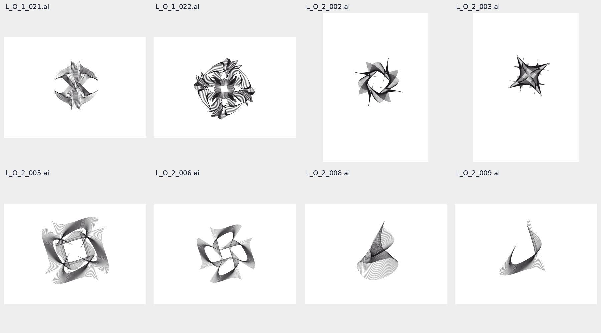
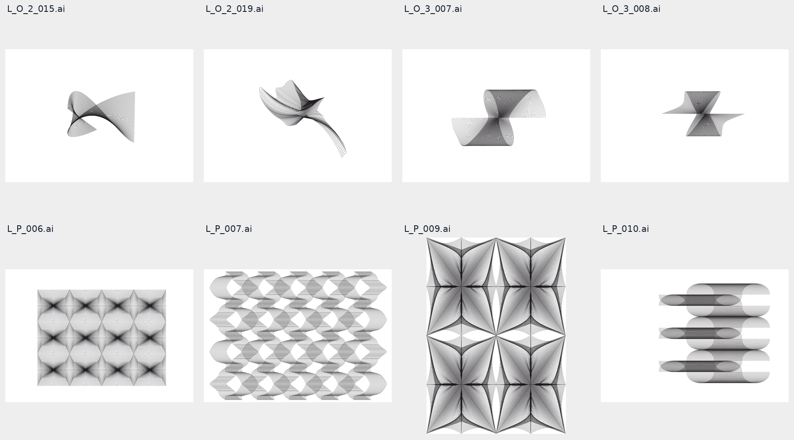

Revisit the edge tension work. Write an api or evalute existing, use

Original resources are:
/home/bkoz/src/izzi/resources.static/edge-tension-please-01.tar.xz

Study plates:
L_0_1_021.ai
L_0_1_022.ai
L_0_2_002.ai
L_0_2_003.ai
L_0_2_005.ai
L_0_2_006.ai
L_0_2_008.ai
L_0_2_009.ai
L_0_2_015.ai
L_0_2_019.ai
L_0_3_007.ai
L_0_3_008.ai

L_P_006.ai
L_P_007.ai
L_P_009.ai
L_P_010.ai


Pay attention to two-color and three-color compositions of basic forms.

Propose API to experiment with these curve forms.
Parameterize all study plates and put in examples study with paramater space grids. Append staged implementation plan to this file below the line.

_______________________

# Edge tension revisited: reference analysis and implementation plan

2026-10-25. Planning baseline: `68f7ee0c`. Sections 1–8 retain the planning
record; the execution record below documents the completed implementation.
The original brief above is preserved verbatim.

## Current status and follow-up

Verified again 2026-10-26: **E0–E6 are technically complete. No edge-tension
implementation tasks remain in this brief.** Eight GCC checks passed
against the working tree recorded in the verification receipt. Its rebuilt
native worker reproduced all
608 distinct edge-tension drawings and eight legacy ribbon/surface-tension
baselines byte for byte. The delivered study contains sixteen recipes,
eighty plates and 672 sweep cells. The
[verification receipt](20261025.tension_revisited/verification-20261026.json)
records the tested source hashes, checks, artifact audit, and remaining work.
The [current saved state](20261025.tension_revisited/state.json) consolidates
the technical result, contact-sheet acceptance, evidence hashes, delivery
revisions, review locations, and the two remaining follow-up items.

| Item | Status and next action |
| --- | --- |
| Baseline contact sheet | Accepted by the user on 2026-10-26: “review contact sheet looks good.” The [approved sheet](20261025.tension_revisited/baseline-contact-approved-20261026.png) and its [review record](20261025.tension_revisited/human-review-20261026.json) preserve the exact artifact and hash. |
| Parameter-grid review | Pending. Inspect the eighty plates in the study PDF, covering G1/G2 shape variation, D spacing, C two-/three-ink separation, and P opacity/registration. Record acceptance or specific adjustments for the sampled controls and their extremes. |
| Book refresh after shared changes | Both saved PDFs, all 1,291 selected/full-book PNG hashes, and their source bundles passed the 2026-10-26 integrity audit. At verification, four bundled shared inputs differed from the working tree: the source inventory, native catalog, guilloche header, and guilloche enrichment fragment. Both edge-tension headers and all replayed edge drawings matched the delivery. After the ongoing shared work settles, run the focused checks and regenerate the selected/full books to record the final catalog snapshot and page map. |
| Git delivery | Implementation: `bb7759a4`; verification and remaining-work record: `e7e26070`; contact-sheet approval and archived image: `37c7613c`; consolidated handoff state: `ef2ab23a`. All four are committed and pushed. |
| Optional extensions | Whole-fan ink compositions in the independent composition book, a guilloche adapter and surface-field deformation remain unscheduled follow-on work. They are outside the completed E0–E6 scope. |

The contact-sheet acceptance covers the sixteen displayed baseline drawings.
Generated coverage and delivery receipts retain `human_review: pending` for
the full study set. The dated review record identifies the accepted sheet.
Generation-baseline fixture promotion follows the explicit workflow in
[CONTRIBUTING.md](../../../CONTRIBUTING.md).

## Recommendation

Add `src/izzi-svg-edge-tension.h`, in namespace `izzi::edge_tension`, for
families of curves interpolated between boundaries, endpoint fans, and their
transformed repetitions. Keep the existing scalar-field surface-tension API
as a separate construction. Its source layouts are useful, but they do not
provide the direct control over ribbon edges, pinches, open ends, and repeated
voids needed by these sixteen references.

Start with two curve primitives and four pilot plates. Establish recognizable
silhouettes and negative spaces before multiplying the number of recipes.
Then register all sixteen recipes in the native study catalog, with explicit
geometry grids and two- and three-color comparisons. Each recipe should
produce an independently authored interpretation with editable construction
parameters. Matching the original Illustrator control points is not an
objective of this plan.

## 1. Reference inspection and identity

The source is the tracked edge-tension archive.
Its SHA-256 is
`2fa383e02be38b9d85961b12cebbee1903d633499ec5b022e69691bdc1cbc565`.
The twelve object filenames in the brief contain a zero, `L_0_…`; their
unique corresponding archive members contain the letter O, `L_O_…`.
The four `L_P_…` names match literally. Use the archive spelling for canonical
recipe IDs and retain the requested spelling in reference metadata.

All sixteen files are single-page, PDF-compatible Illustrator documents.
I rendered their PDF previews with `pdftoppm` at a 1,000-pixel maximum
dimension and inspected the contact sheets below. The previews are black
line work on white. Two- and three-color treatments in this plan are new
composition proposals, rather than colors recovered from the originals.

The [reference manifest](20261025.tension_revisited/reference-manifest.json)
records each requested name, exact archive member, byte size, SHA-256, page
size, and contact-sheet hash. Archive members are under
`run/media/bkoz/EdgeTensionPlease/L_OBJECT/` or `L_PATTERN/`.
No Illustrator path coordinates were extracted. The construction families,
component counts, and parameter values below are visual hypotheses to test.





The contact sheets retain the original page margins. For future construction
comparisons, show an additional artwork crop with its crop bounds recorded;
otherwise the large margins make unrelated silhouettes appear deceptively
similar. Do not crop each parameter-grid cell independently.

| Archive plate | Observed form | Proposed construction and feature to preserve |
| --- | --- | --- |
| `L_O_1_021` | Opposed pointed fans, side wings, crossed center, small internal openings | Mirrored pairs of lofted ribbons; preserve the vertical pinch and separation between the side wings |
| `L_O_1_022` | Dense angular rosette around a small square opening | Two interleaved, rotated four-part fan assemblies; preserve the square void and distinct curled tips |
| `L_O_2_002` | Open pinwheel with hooked fins and long thin tips | Four rotated asymmetric fans around an empty center; preserve handedness and the open ring |
| `L_O_2_003` | Compact crossing star with sharp points and curved recesses | Four pinched fans closer to the center; preserve the contrast between long points and scooped edges |
| `L_O_2_005` | Rounded square arrangement, central square opening, diagonal crossings | Four broad saddle bundles; preserve the central opening and flared outside corners |
| `L_O_2_006` | Rotating arrangement with four conspicuous teardrop openings | Four bent ribbon bundles; preserve separate openings instead of merging them into a single central hole |
| `L_O_2_008` | Upright twisted ribbon, pointed upper end, rounded lower bowl | One asymmetric loft with a crossing waist; preserve the unequal upper and lower lobes |
| `L_O_2_009` | Open U-shaped sweep with horns of different heights | One open saddle/fan; preserve the empty U and the unbalanced tips |
| `L_O_2_015` | Sideways crossing, small rounded left lobe, broad right edge | An asymmetric two-boundary loft; preserve the left/right span contrast |
| `L_O_2_019` | Leaf-like upper curl, central crossing, extended diagonal tail | Two connected loft spans; preserve the tail and avoid a kink where the spans meet |
| `L_O_3_007` | Opposed saddle sheets with broad horizontal terminal edges | Two reflected lofts; preserve the waist and the nearly horizontal outer boundaries |
| `L_O_3_008` | Flared, more angular counterpart with a diagonal crossing | Two sheared lofts; preserve the straight terminal portions and the skewed crossing |
| `L_P_006` | Repeated four-point junctions alternating with rounded openings | A rectangular array of a four-fan cell; preserve the alternating junction/void rhythm |
| `L_P_007` | Interlocking curved ribbons in staggered rows | Alternating handed open-ribbon cells; preserve the oval openings and row rhythm |
| `L_P_009` | Tall pointed saddle cells with four-way dark junctions | An anisotropic reflected-fan lattice; preserve the elongated arched/diamond-shaped spaces |
| `L_P_010` | Offset horizontal bands with rounded ends and dark overlaps | Staggered capsule-like loft bands; preserve the long horizontal cadence and overlap strips |

The terms “saddle,” “loft,” and “fan” describe proposed planar constructions.
They do not establish that the original artist used a particular 3D surface,
Illustrator blend operation, or mathematical algorithm.

## 2. Existing API evaluation

This evaluation uses the current source, including the already implemented
S1 tuning and S2 layout builders. The older
[surface-tension v2 proposal](20260817.openai_api_surface_tension_v2_proposal.md)
is historical context; its proposed S1/S2 work should not be scheduled again.

| Existing facility | Useful capability | Limitation for this brief | Decision |
| --- | --- | --- | --- |
| [`izzi-svg-surface-tension.h`](../../html/izzi-svg-surface-tension_8h.html) | Anisotropic Gaussian sources, level sets, boundary attraction, deterministic disturbances, layer registration and opacity | Samples one shared scalar field; marching squares emits separate line segments. There are no editable boundary rails, endpoint correspondences, or curve-bundle topology controls | Preserve existing behavior; do not make these references another set of Gaussian source presets |
| Surface-tension S1/S2 builders | Level spacing and ring, lattice, rotating-array, cluster, and field source layouts | Source arrangement controls where field contours appear, not how a fan opens or a ribbon crosses itself | Reuse the idea of explicit layout builders, not their Gaussian geometry |
| [`izzi-svg-curves-grignani.h`](../../html/izzi-svg-curves-grignani_8h.html) | Rolling and ripple ribbons from projected 3D strands; fold, torsion, roll, and view controls | Fixed spine constructions; returns black-filled SVG path strings; does not expose individual boundary curves, independent strand paint, or reference-specific voids | Use as a comparison in the pilot. A new structured curve resolver is a better fit than parsing its SVG output |
| [`izzi-svg-guilloche.h`](../../html/izzi-svg-guilloche_8h.html) | Resolved paths, plate colors, repeated families, transforms, clips, paint controls | Its centerline vocabulary does not directly describe arbitrary paired cubic boundaries or endpoint correspondence | Follow its geometry/paint separation; add an adapter later only if an actual composition needs it |
| [`izzi-levels-contours-regions.h`](../../html/izzi-levels-contours-regions_8h.html) | Shared interpolation/marching-cell helpers and explicit closed scalar regions | Closed regions use a different cell construction from the legacy open contour segments; they do not infer ribbon boundaries | Reserve for an optional future field-mask experiment; do not route ordinary ribbon geometry through a raster field |
| [`izzi-review-catalog.h`](../../html/izzi-review-catalog_8h.html) | Native descriptors, render callbacks, existing ribbon and six surface-tension forms | Current surface forms expose radius, exponent, and degeneration; none represents these sixteen reference recipes | Add sixteen native forms in a new `edge-tension` family |

A Gaussian field may suggest flowing outlines, but it does not independently
control a pointed fan, its terminal edges, and the hole between its neighbors.
The strongest evidence for the proposed change is this control mismatch.
The Grignani construction is closer visually; the pilot should compare it
against the new primitives before finalizing the public API.

## 3. Geometry contract

### Two primitives

Work in local coordinates with a nominal motif domain of `[-1,1]²`. All
length controls below are measured in this domain; angles in the C++ API are
radians. Study labels may use degrees with an explicit conversion. Apply
scene placement, repetition, and paint after generating the curves.

**Boundary loft.** Author two cubic Bézier boundary curves, `A(t)` and `B(t)`.
For `N` strands, let `u = i/(N-1)` and `s = u^p`, where `p > 0` controls
spacing bias. Generate

```text
L_i(t) = (1-s) A(t) + s B(t),    0 <= t <= 1.
```

Since both boundaries are cubic with the same parameter direction, each
intermediate strand is exactly cubic: interpolate the corresponding four
control points. This supplies editable outer edges, curved internal strands,
and a deliberate crossing when the boundary endpoints are opposed. Reversing
`B` means reversing all four of its control points. It is a topology choice,
not an accidental change of point order during rendering.

**Endpoint fan.** Author two rails `A(u)` and `B(u)` and a correspondence
`v = u^q` or `v = 1-u^q`, with `q > 0`. Connect `A(u)` to `B(v)` with a
straight segment or a cubic span whose two tangent directions and handle
lengths are explicit. Straight spans create an apparent curved envelope;
curved spans allow a richer bend. Use the straight case as a diagnostic
against unnecessary curvature in the pilot.

For either primitive, a cubic with endpoints `P0`, `P3`, endpoint tangent
angles `a`, `b`, and handle ratios `h0`, `h1` has

```text
D  = length(P3 - P0)
P1 = P0 + h0 D (cos(a), sin(a))
P2 = P3 - h1 D (cos(b), sin(b)).
```

Degenerate endpoints require an explicit policy: permit a collapsed boundary
as a fan tip, but reject an entire empty bundle. Store strand IDs and bundle
IDs independently of sampling density. Emit exact SVG cubic paths for these
two primitives; sample only for bounds, diagnostics, or a later deformation.

### Assembly and repetition

Build the object recipes from a small number of authored bundles using
translation, rotation, reflection, and anisotropic scale. A radial assembly
places copy `j` at `R(cos(theta_j), sin(theta_j))`, with
`theta_j = phase + 2*pi*j/m`; its local rotation can have a separate offset.
Reflection and reversal of the boundary correspondence must remain distinct
operations because they produce different crossings.

For pattern cells, place instance `(r,c)` at
`(c*pitch_x + (r mod 2)*stagger*pitch_x, r*pitch_y)` before any alternating
reflection. Use a two-row supercell when `stagger` is nonzero, and enlarge
the supercell when a color cycle requires it. A visually repeated cell is
not automatically seamless. Where strokes cross a tile boundary, pair their
endpoints and tangent directions; otherwise use intentionally closed motifs
whose repetition does not require a joining stroke.

Negative spaces should emerge from the placed curves and their spacing.
Avoid white polygons painted over the center: they would erase colored
companions and conceal incorrect geometry. A documented clip is appropriate
for a finite field boundary, not as a substitute for the recipe's voids.

### Proposed API shape

Use one public header initially. This is a design sketch, not a declaration
that these types already exist:

```cpp
namespace izzi::edge_tension {
  struct point { double x, y; };
  struct cubic { point p0, p1, p2, p3; };
  enum class bundle_kind { boundary_loft, endpoint_fan };
  enum class correspondence { forward, reverse };

  struct bundle_spec;       // rails, span tangents, count, bias, stable ID
  struct instance_spec;     // bundle reference, affine transform, stable ID
  struct repeat_spec;       // finite lattice or periodic supercell
  struct ink_spec;          // color, opacity, width, blend, registration
  struct composition_spec; // ink assignment, order, phase offsets
  struct render_budget;     // instances, strands, curve segments, SVG bytes
  struct scene_spec;        // bundles, instances, paint, clip, size, metadata
  struct resolved_scene;   // individual cubic strands and their ownership

  resolved_scene resolve(const scene_spec&);
  std::string render_svg(const resolved_scene&);
}
```

Recipe builders return ordinary `scene_spec` values. Provide typed tuning
structs for fan, loft, radial assembly, and lattice families; avoid one large
unvalidated bag of doubles. Reference recipe names belong in example/review
data and metadata, while the public geometric API remains useful without
the archive. The native review adapter translates its named controls into
those typed tuning structs.

Store the resolved cubic controls, instance transform, strand index, component
ID, and ink ID. Return diagnostics for collapsed strands and clipping.
Keep ID creation, finite-value checking, number formatting, and XML escaping
deterministic. The header must be independently includable and safe in two
translation units. Do not add a dependency on Illustrator or the archive to
the installed library.

### Controls and bounds

These are proposed public limits, narrower than unrestricted cubic editing.
The recipe studies use smaller ranges selected for visible variation.

| Control | Meaning | Proposed allowed range |
| --- | --- | --- |
| `strand_count` | Number of curves per bundle | Integer 8–128; default 48 |
| `spacing_power` | `p` in the loft spacing law, also usable on fan rail samples | 0.35–3.0; default 1.0 |
| `mapping_power` | `q` in the fan endpoint correspondence | 0.35–3.0; default 1.0 |
| `handle_ratio` | Endpoint handle length divided by its chord length | 0–1.5; default 0.55 |
| `opening` | Included angle between a fan's authored terminal directions | 20–160 degrees |
| `twist` | Rotation applied to the second loft boundary about the motif origin before interpolation | -150–150 degrees |
| `waist` | Separation of the two inner construction anchors | 0.02–0.60 local units |
| `orbit` | Distance of repeated bundle origins from the assembly center | 0–0.80 local units |
| `span_ratio` | Second terminal span divided by the first | 0.20–3.0 |
| `skew` | Horizontal displacement of the second boundary | -0.60–0.60 local units |
| `tail_length` | Length of a second connected loft span | 0.20–1.80 local units |
| `phase` | Relative rotation of a companion assembly | -90–90 degrees; independent of the fixed camera |
| `pitch_x`, `pitch_y` | Lattice translation distance | 0.50–3.0 local units |
| `stagger` | Odd-row horizontal offset divided by `pitch_x` | 0–0.75 |
| `cell_aspect` | Vertical scale of the motif before repetition | 0.50–2.5 |
| `stroke_width` | Width in scene units at the 320-unit study viewport | 0.15–1.20; default 0.45 |
| `ink_count` | Distinct authored inks, excluding paper and overlap colors | 2 or 3 in the study adapter; monochrome available for diagnostics |
| `opacity` | Per-ink alpha | 0.15–1.0; default 0.80 |
| `registration` | Per-ink translation after motif placement | Each coordinate -0.10–0.10 local units; default zero |

For controls such as `waist` and `opening`, each recipe must document the
exact anchors or tangent angles it changes. They are construction controls,
not claims that the visible minimum gap or opening angle equals the input.
An observed gap can become smaller because other curves cross it.

Use fixed bounds per recipe covering its whole advertised grid. Reserve
adaptive sampling for non-cubic extensions, with a device-space error bound,
maximum subdivision depth, and explicit failure on budget exhaustion.
Suggested initial limits are 256 instances, 128 strands per bundle, 65,536
resolved cubic segments, and 16 MiB of SVG. Check products before allocation.
These are implementation starting points to benchmark, not measured limits.

## 4. Sixteen recipe specifications and geometry grids

Each row below defines two complete 3×3 comparisons. An entry such as
`waist [.08, .18, .30] × twist [20, 45, 70]` means nine cells, not three
diagonal examples. The middle value is the proposed baseline. Angles in
these tables are degrees; all other lengths and ratios follow section 3.
Every number is an authored starting value to calibrate in the pilot, not a
measurement or reverse-engineered parameter from the source file.

Recipe IDs use `edge-tension/o-1-021` through the corresponding object
suffixes, and `edge-tension/p-006`, `p-007`, `p-009`, `p-010` for patterns.
Do not add separate forms for the zero/O aliases.

| Plate / recipe suffix | Initial assembly | Grid G1 | Grid G2 |
| --- | --- | --- | --- |
| `O_1_021` / `o-1-021` | Four loft bundles in mirrored pairs; vertically aligned tips | `waist [.08,.18,.30]` × `twist [20,45,70]` | `span_ratio [.7,1,1.3]` × `handle_ratio [.35,.60,.85]` |
| `O_1_022` / `o-1-022` | Two four-fan assemblies, eight bundles total; companion rotation is `phase` | `orbit [.12,.24,.36]` × `opening [50,80,110]` | `phase [15,30,45]` × `handle_ratio [.35,.65,.95]` |
| `O_2_002` / `o-2-002` | Four hooked fans, cyclic orientation, no center patch | `orbit [.28,.42,.56]` × `twist [30,60,90]` | `opening [40,70,100]` × `mapping_power [.6,1,1.6]` |
| `O_2_003` / `o-2-003` | Four tightly arranged fans; long terminal rays | `waist [.04,.12,.24]` × `opening [45,75,105]` | `twist [15,40,65]` × `handle_ratio [.30,.55,.85]` |
| `O_2_005` / `o-2-005` | Four broad lofts around a square void | `orbit [.22,.34,.46]` × `waist [.08,.18,.30]` | `twist [20,40,60]` × `handle_ratio [.35,.60,.85]` |
| `O_2_006` / `o-2-006` | Four bent lofts, each contributing an inner teardrop space | `orbit [.20,.32,.44]` × `twist [35,60,85]` | `span_ratio [.7,1,1.3]` × `handle_ratio [.35,.60,.85]` |
| `O_2_008` / `o-2-008` | One upright loft; second terminal span is the lower bowl | `twist [35,65,95]` × `waist [.06,.16,.28]` | `span_ratio [1.2,1.8,2.4]` × `handle_ratio [.35,.65,.95]` |
| `O_2_009` / `o-2-009` | One open fan/saddle; unequal terminal rails | `opening [55,90,125]` × `span_ratio [.8,1.4,2]` | `skew [-.2,0,.2]` × `handle_ratio [.30,.60,.90]` |
| `O_2_015` / `o-2-015` | One sideways loft; second span is the broad right boundary | `span_ratio [1.4,2,2.6]` × `skew [-.3,0,.3]` | `twist [30,55,80]` × `waist [.05,.15,.25]` |
| `O_2_019` / `o-2-019` | Two joined loft spans; second span forms the trailing tail | `tail_length [.65,1,1.35]` × `twist [25,50,75]` | `phase [-20,0,20]` × `span_ratio [.6,1,1.4]` |
| `O_3_007` / `o-3-007` | Two reflected broad lofts with horizontal terminal edges | `waist [.06,.18,.30]` × `twist [20,45,70]` | `span_ratio [.7,1,1.3]` × `handle_ratio [.35,.60,.85]` |
| `O_3_008` / `o-3-008` | Two sheared lofts with shorter handles and angular ends | `skew [-.4,0,.4]` × `opening [45,75,105]` | `twist [20,45,70]` × `handle_ratio [.15,.35,.55]` |
| `P_006` / `p-006` | Four-fan cell; rectangular translations | `opening [60,90,120]` × `waist [.08,.16,.24]` | `pitch_x [1.2,1.5,1.8]` × `pitch_y [1.2,1.5,1.8]` |
| `P_007` / `p-007` | Alternating handed ribbons; two-row supercell; fixed `pitch_x=1.5` | `twist [25,50,75]` × `span_ratio [.7,1,1.3]` | `stagger [.25,.5,.75]` × `pitch_y [.7,1,1.3]` |
| `P_009` / `p-009` | Tall reflected-fan cell; fixed `pitch_y=2.4` | `cell_aspect [1.2,1.6,2]` × `opening [45,75,105]` | `waist [.06,.14,.22]` × `pitch_x [.9,1.2,1.5]` |
| `P_010` / `p-010` | Long rounded loft bands; alternating row offsets; fixed `pitch_x=2.2` | `span_ratio [1.5,2,2.5]` × `handle_ratio [.30,.55,.80]` | `pitch_y [.55,.80,1.05]` × `stagger [.25,.5,.75]` |

`twist` on a fan rotates its second endpoint rail before constructing the
spans. `opening` on a loft changes the authored terminal tangent directions.
For `O_2_019`, `phase` turns the tail about the shared join; adjust both
adjacent handles to retain tangent continuity. These are explicit recipe
adaptations of the generic controls, and their descriptions belong beside
the native descriptors.

For `P_006` and `P_009`, establish the cell-edge anchors from the selected
pitch before building the internal fan. Moving repeated copies without
moving their boundary anchors would create unintended seams. For `P_007`
and `P_010`, first decide whether the authored motif is closed or joins a
neighbor; record that choice per recipe rather than claiming continuity
from appearance alone.

At the end of calibration, record the accepted boundary controls, topology,
and baseline values in versioned recipe code. If the four-bundle hypothesis
fails a reference, change the assembly and update this table. Increasing
strand density is not evidence that the underlying form has been matched.

## 5. Two- and three-color composition

Color should reveal which curves generate the form. Each strand has an ink
owner, and each ink can have its own registration, opacity, and draw order.
Use the native library palette: `rurikon` and `daylily` for two inks, adding
`asagiiro` for three. Use the existing study paper treatment. “Three colors”
means three authored inks; antialiasing and overlaps can produce additional
pixel colors.

Support component-level ink ownership in the API, including assigning an
entire fan, a reflected partner, or a pattern row to an ink. Single-bundle
plates also need useful color studies. The common study therefore offers
three assignments that work for every recipe:

| `ink_assignment` | Deterministic rule within a bundle | Intended reading |
| --- | --- | --- |
| `bands` | Divide the strand indices into `K` contiguous equal groups | The progression from one boundary to the other |
| `interleaved` | Strand `i` uses ink `i mod K` | Fine chromatic interference and line density |
| `opposed-bands` | Divide the distance of a strand index from its nearest end into `K` groups | Paired outer edges against a differently colored interior |

More precisely, with `u=i/(N-1)`, `bands` uses
`min(K-1, floor(K*u))`, and `opposed-bands` uses
`min(K-1, floor(K*2*min(u,1-u)))`. Compute these from the unwarped strand
index so changing `spacing_power` moves curves without reassigning their
colors. Retain the same assignments through transforms and tiling; any
intentional row color cycle is separate recipe data.

For the multi-bundle forms, also make authored examples with whole components
assigned to different inks: opposed fan pairs in `O_1_021`, the inner and
outer assemblies of `O_1_022`, and alternating ribbon rows in `P_007`.
For a third structural component, use a declared companion bundle with its
own rails and transform. These can be later composition-book scenes; the
required two-/three-color study grid must already work without them.

Use `source_over` as the predictable baseline. A separate overprint experiment
can compare `multiply` with the same geometry and inks. Do not replace a
curve color with a precomputed dark overlap color. Keep draw order explicit
and distinguish an optical crossing from a physical over/under weave.
Automatic interlace cutting and 3D occlusion are optional later features.

Registration in the common study is a single amplitude `a`. For ink `k`,
translate by

```text
(k - (K-1)/2) * a * (1, 0.5)
```

in motif units, converted to scene units by the recipe's fixed placement
scale. For fields, the same translation applies to the whole ink layer,
not independently to every tile. Extend the rendered repeat beyond the clip
before registration so a shifted ink does not reveal an unpainted border.

## 6. Native examples-study specification

Register sixteen forms in the `edge-tension` family. The
[native descriptor](../../html/izzi-review-descriptor_8h.html) remains the source
of truth for bounds, defaults, samples, render callbacks, and studies.
Populate `form_descriptor.studies` explicitly so meaningful axis pairs stay
together; automatic pairing by parameter order is too easy to disturb.

Each form exposes its four recipe-specific controls from G1/G2 plus the six
common controls below. Other public API controls, such as arbitrary rail
editing and blend mode, remain fixed in this particular study adapter until
they have their own effective comparisons.

| Study | Axes and samples | Cells per form | Native layout |
| --- | --- | ---: | --- |
| G1: principal shape | First geometry pair from section 4 | 9 | `grid-3x3` |
| G2: secondary shape | Second geometry pair from section 4 | 9 | `grid-3x3` |
| D: line structure | `strand_count [24,48,72]` × `spacing_power [.6,1,1.6]` | 9 | `grid-3x3` |
| C: ink structure | `ink_count [2,3]` × `ink_assignment [bands,interleaved,opposed-bands]` | 6 | `categorical`, two axes |
| P: paint and displacement | `opacity [.4,.8,1]` × `registration_amount [0,.02,.04]` | 9 | `grid-3x3` |

This is **42 sweep cells per form, 672 across sixteen forms**, plus sixteen
baseline render requests. Baselines repeat inside grids, so 688 requests is
not a count of unique SVGs. There are eighty study plates before covers,
contents, reference notes, or future extra studies. All individual studies
fit within the existing twelve-cell pagination limit. The categorical layout
already accepts multiple axes; a custom two-column, three-row renderer is
not needed for coverage.

Common baselines are `strand_count=48`, `spacing_power=1`, `ink_count=2`,
`ink_assignment=bands`, `opacity=.8`, `registration_amount=0`, and fixed
`stroke_width=.45` at the 320-unit study scale. Keep seed `20261025`, camera,
palette, clipping, and unrelated controls fixed across every comparison.
The deterministic primitives need no random perturbation; retain the seed
in the standard recipe identity for future extensions.

Use one fixed camera per recipe, derived from all advertised geometry
extrema with a margin. Keep source-page aspect information in the evidence,
but do not confuse A4 page margins with the motif's geometric proportions.
Pattern forms get a fixed field clip and a repeat large enough to cover it
at every advertised pitch and registration value. Report the number of
generated instances so a density change is interpretable.

The current checker compares both `geometry_paint_signature` and raster
`painted_signature` at every held setting. Despite the first name, its SVG
signature includes paint attributes. Color and opacity studies can therefore
use the existing validation mechanism; they do not need artificial geometry
changes or an exemption. Also check that each ink visibly contributes,
because a valid third color declaration alone does not prove a three-color
composition.

Add each reference identity to the form's `evidence`, and declare the new
header, recipe owner, catalog, and worker in `source_files`. Update
`source-inventory.json`
using the repository's existing ownership conventions. Keep the binary
archive as reference evidence, separate from the installed renderer's source
dependencies. The review must render without loading the archive.

The selected pilot command, once the forms exist, is:

```sh
python3 scripts/render-examples.py study \
  --form edge-tension/o-2-008 \
  --form edge-tension/o-2-005 \
  --form edge-tension/o-3-007 \
  --form edge-tension/p-006 \
  --output build/edge-tension-pilot --strict --png \
  --pdf outputs/edge-tension-pilot.pdf
```

Then run a selected build with all sixteen explicit `--form` arguments,
followed by `make examples-study` for integration into the full book.
Follow the [existing examples workflow](../examples-workflows.md): a
selected build records `scope: selected`; it does not establish whole-book
coverage. Use receipt page mappings to locate the new plates. Page numbers
will move as the catalog grows, so do not promise a fixed insertion page.

## 7. Staged implementation plan

The original stages and exit conditions are retained below for reference.
Their technical work is complete; the execution record records the results
and calibrated recipe adaptations. Current follow-up is listed above.

| Stage | Work and files | Exit condition |
| --- | --- | --- |
| E0 — reference and baseline inventory | Use this report, the manifest, and the contact sheets. Capture current surface-tension and Grignani baseline SVGs. Define an annotated artwork crop and feature checklist for each reference | All sixteen identities resolve, existing output hashes are recorded, and each target has named silhouette/void/crossing features |
| E1 — primitive pilot | Add `src/izzi-svg-edge-tension.h` with cubic rails, lofts, endpoint fans, transforms, structured resolution, rendering, and budgets. Add focused `tests/edge-tension.cc`; list the header in `CMakeLists.txt`. Make draft recipes for `O_2_008`, `O_2_005`, `O_3_007`, `P_006` | Both primitives have visible, bounded controls; four pilots express their target features. Compare them with a Grignani ribbon and a surface-tension contour baseline. Revise the primitive or recipe before expanding if the target features are absent |
| E2 — twelve objects | Author all object recipe builders in a dedicated example/review recipe owner, with the parameter table beside the code. Add `examples/edge-tension-plates.cc` as a reproducible gallery driver. Calibrate G1/G2 ranges | Twelve distinct baselines, all 216 object geometry-grid cells render, and each curve join/crossing/void is intentional. Numeric and visual observations are recorded separately |
| E3 — four patterns | Add finite repeats, periodic supercells where appropriate, clip handling, and the four pattern recipes. Establish boundary anchor/tangent rules | All four baselines and 72 pattern geometry-grid cells render; seams or intentional non-joining boundaries are documented. Neighbor comparisons remain valid across pitch and stagger samples |
| E4 — ink composition | Add explicit ink ownership, the three assignments, registration, opacity, draw order, and optional overprint. Render C and P studies for all recipes | Every requested two-/three-color state has the expected distinct ink definitions and visible contribution from each ink. C/P contribute 240 complete sweep cells; painter order is reproducible |
| E5 — study integration | Register sixteen native forms and all five studies per form in `src/izzi-review-catalog.h`; update source ownership, build dependencies, catalog tests, and example documentation. Render D studies and the full selected set | Sixteen forms, eighty studies, and 672 sweep cells are covered. Axis checks, isolated-run determinism, source fingerprints, and SVG/PNG/PDF receipts pass. Selected coverage is labeled accurately |
| E6 — regression and delivery | Run the focused C++/catalog checks and full `make examples-study`; publish the resulting book through the existing output workflow. Add `docs/generative_patterns/edge_tension.md` explaining controls, recipes, evidence, and limitations | Existing surface-tension behavior is preserved; new pages appear in the full book with source and parameter links. Technical results and pending human visual review remain distinct |

E1 should establish the API before E2 multiplies recipes. E2 and E3 can share
the same primitive library; E4 does not require changing their geometry.
Keep the new recipe owner out of the public install surface if it consists
only of study-specific presets. If it is a `.h` or `.inc` under `src/`, add
it to the explicit CMake installation list and source inventory rather than
leaving an undeclared file there.

Do not require the composition book to complete this brief. It is a separate
workflow with its own cross-family and wild-scene coverage rules. Whole-fan
color compositions can be added there later without delaying the required
parameter studies in examples-study.

### Verification contract (implemented)

1. **Curve identities.** Check Bézier endpoints and endpoint derivatives,
   exact equality of the first/last loft strands to their boundaries,
   correspondence reversal, spacing-law endpoints, and affine transforms.
   Test a collapsed fan tip and a rejected completely empty bundle.
2. **Connected spans.** For `O_2_019`, verify shared endpoints and collinear,
   consistently directed join tangents under every advertised tail/phase
   sample. Do not infer continuity from a dense raster preview.
3. **Repetition.** Compare translated neighbor boundary positions and tangents
   for joining motifs; test the appropriate supercell for staggered rows and
   color cycles. Check a center crop of a 3×3 supercell arrangement for visible
   seam artifacts at the actual export resolution.
4. **Independent controls.** For every grid row and column, require changes
   in the resolved construction or paint and in the rendered pixels. A
   changed metadata field, silently clamped value, or altered ID is not a
   useful control. Existing axis checks establish group variation; add
   duplicate-sample diagnostics to catch neighboring samples that coincide.
5. **Ink contribution.** Count distinct declared source inks, then remove
   each ink in turn and compare the painted result. A third ink fully hidden
   behind other strands must not pass merely because it is present in SVG.
   Keep the background and blend mode fixed for these ablations.
6. **Bounds and cost.** Reject non-finite coordinates, invalid counts and
   powers, and excessive instance/strand products. Check minimum and maximum
   parameter combinations, byte budgets, clipping margins, and deterministic
   failure behavior. Report render cost from measured pilots before setting
   performance expectations for the full book.
7. **Library integration.** Compile the new header alone, include it in two
   linked translation units, run the new focused tests and existing native
   catalog/source-inventory checks, and confirm installation through the
   explicit public-header list. Do not rely on the current umbrella-header
   ODR test to include a header that the umbrella does not include.
8. **Regression.** Compare pre/post outputs for unchanged surface-tension
   fixtures and existing Grignani forms with the same compiler and render
   environment. Reuse the established test targets and receipts instead of
   introducing a competing verification workflow.

### Visual acceptance notes

For each target, place its source crop beside the new baseline and identify
the matched and unmatched features: terminal-edge shape, handedness,
crossing arrangement, principal voids, line-spacing character, and repeated
cell rhythm. Distinguish an intentionally approximate interpretation from a
failed attempt to preserve a named feature. Pixel similarity alone is a poor
criterion because line density, scale, and antialiasing can dominate it.

Technical completion can be established unattended. Human aesthetic review
should retain the repository's `pending` status until it actually occurs;
that status does not prevent generating the complete proposed study set.

## 8. Planning delivery and remaining uncertainty

This section records the planning-time assessment. See the current status
above and the execution record below for implementation results.

Completed during planning: inspected all sixteen PDF previews; resolved
the zero/O naming discrepancy; recorded source hashes and page sizes; reviewed
the surface-tension, Grignani, guilloche, region, and native-study interfaces;
specified all sixteen recipes, five studies per recipe, and staged checks.

At planning time, the primitive choices, authored Bézier controls, matching
quality, pattern-cell continuity, raster legibility at grid extremes and
rendering cost had not been established. E1–E5 subsequently established the
constructions, numeric continuity, bounds and export evidence described
below. Aesthetic matching and perceptual legibility remain human-review
items. The parameter values are authored experiments, not fitted results.

The plan uses local geometry generation and the existing native renderer.
No external model call or model-selection workflow is needed to execute it.
An optional future extension could deform these curve bundles with the
surface-tension field, but it should follow successful reference studies so
the undeformed construction remains inspectable.

Planning-artifact validation: all sixteen archive-member hashes and sizes
match the manifest; both contact sheets decode and match their hashes; all
local Markdown links resolve; all sixty-four geometry axes have three
ordered, distinct samples within the proposed bounds; the study totals
recompute to eighty plates and 672 sweep cells. That planning delivery did
not introduce library code. The subsequent implementation and completed
checks from section 7 are documented below.

## Execution record — 2026-10-25

The plan above is retained as the planning record. Implementation now lives in
[`izzi-svg-edge-tension.h`](../../html/izzi-svg-edge-tension_8h.html) and the separate
[`native recipe owner`](../../html/izzi-review-edge-tension_8h.html). The
[API and recipe guide](../../generative_patterns/edge_tension.md) documents
construction semantics, calibrated adaptations, limits and commands.

### E0 — evidence and comparison

Verified the archive hash and all sixteen member sizes/hashes against the
reference manifest. Re-rendered the PDF previews at a 1,000-pixel maximum
dimension and recorded [artwork crop bounds](20261025.tension_revisited/crop-bounds.json).
These crops are additional reference diagnostics; study cells retain their
fixed cameras. No Illustrator controls or source paths were extracted.

Captured the six existing surface-tension forms and both Grignani forms with
GCC 16.2.1, `-std=c++20 -O1`, seed 20261025 and progress .37, before and after
the change. All eight SVGs are byte-identical; the
[verification record](20261025.tension_revisited/existing-output-verification.json)
contains their hashes. The local
comparison
shows the projected Grignani and scalar-level-set baselines beside two new
cubic constructions. Direct boundary ownership provides the required cup,
crossing and square opening without parsing either older renderer's SVG.

### E1 — primitives and pilot

Implemented exact cubic boundary lofts, endpoint fans and straight fan
spans; explicit reversal, spacing/correspondence powers, typed tuning,
affine/radial/lattice placement, stable strand/component/ink IDs, deterministic
XML serialization, clipping diagnostics, collapsed-tip policy and budgets.
The geometry header is independently includable. The installed recipe header
is separate from the geometric core, and both are listed in the install
manifest. Their combined two-translation-unit probe links and runs.

The four-form pilot passed twenty strict study plates, including two isolated
native renders per distinct recipe, neighboring-sample checks and color/paint
ink ablations. The pilot's
PDF and
coverage record selected
scope. Visual inspection confirmed the pointed bowl, square ring, opposed
saddles and repeated junction/void rhythm. The public primitives were retained.

### E2/E3 — sixteen authored constructions

Registered twelve objects and four patterns, with the original four geometry
controls and both nine-cell grids for every form. All 288 geometry cells are
included in the numeric and rendered studies. The
baseline gallery
and contact sheet
show the complete set.

Calibration retained the planned sample values. Loft recipe handle controls
scale the authored baseline handles; fan handles retain the exact endpoint
chord-ratio contract. O_2_009 uses camera scale 65
instead of the initial 75 so every grid sample fits. O_2_006 uses four closed
cubic teardrop lofts, with more separation than the source's joined ribbons.
P_006 and P_009 use straight fan spans between bowed endpoint rails; their
pitch-dependent extreme ports retain matching endpoint tangents. P_009
changes interior rail shape with cell aspect while retaining those ports.
P_007 and P_010 use bounded motifs with intentional gaps/overlaps and a
two-row supercell; their motif ends are not claimed to join. The per-recipe
feature/control table in the guide records these adaptations.

O_2_019 uses two loft spans with identical endpoint positions and first
derivatives at the join, including all tested tail-length, phase and twist
combinations. Neighbor-port checks cover pitch/opening extremes. Twenty-four
raster comparisons of center crops inside three-by-three supercell fields
pass at study scale for low/middle/high geometry corners of all four patterns;
maximum observed channel difference is zero. There are no white knockout
polygons. Object samples retain a 12-unit margin in their fixed cameras;
pattern fields retain one fixed finite-field clip.

### E4/E5 — paint and native studies

Added explicit G1/G2/D/C/P descriptors for all sixteen canonical IDs, with
seed 20261025 and ten native controls per form. Each C study uses six cells
covering both ink counts and all three assignments. Each P study uses nine
opacity/registration combinations. Each of these 240 cells passes ink
ownership and visible-contribution checks, totaling 528 ink-removal renders.
All three native palette colors survive the palette gate without remapping.
Registration is global per ink and independent of spacing bias. Source-over
is the baseline; the API also supports multiply and explicit ink drawing order.

The selected book passes with 80 study plates, 672 sweep requests and 16
baseline requests. These resolve to 608 distinct cached SVGs. Every static
held setting changes both geometry/paint and painted pixels, and no adjacent
samples are duplicates. Existing families also receive neighboring-sample
diagnostics without changing their historical acceptance rules.

`make edge-tension-study CXX=/usr/bin/g++` produced the
82-page PDF,
HTML book,
coverage and
delivery receipt.
The receipt links the actual page map; the 82 pages include the cover and
contents. PDF SHA-256:
`b32bb5e29b2314d46e172e2821f57b04f8c0371516faa57b2e2d7b1605958286`.
The source bundle contains the code used for the book; archive evidence is
metadata rather than a renderer dependency.

### E6 — integration and handoff

Added `make edge-tension-plates`, `make edge-tension-check` and
`make edge-tension-study`; `make examples-study` discovers the family without
a separate Python control registry. Updated source ownership, the native
catalog's per-form seed support, documentation indexes and this execution
record. The ownership audit also classifies the previously added Dutch
stage-6 gallery, allowing the complete current source tree to pass discovery.

GCC 16.2.1 and Clang 22.1.8 each pass the eight focused/header/native-catalog/
source-inventory/builder CTests. The full `make examples-study CXX=/usr/bin/g++`
integration build passes with 376 forms in 32 families, 1,206 study plates and
7,311 distinct renders. Its 1,209 PNG page hashes and compact PDF receipt were
verified. The eighty edge-tension plates and all 672 cells appear in the full
manifest with scope `all`, separately from the selected-book receipt. The
672-cell native test reaches 14,112 cubics and 4,417,034 SVG
bytes in its largest study sample, below the default budgets. Descriptor
corners, finite-value failures and budget overflow are also exercised.

The full HTML study book,
1,209-page compact PDF
and delivery receipt
are local outputs. The receipt supplies the current page mapping and PDF hash
`a0172e59f7292550ca2eb58bb59bdd21b051533556e72bf191de931a79116f77`.
`git diff --check` passes.

Human aesthetic review remains pending. These technical results do not
promote accepted visual baselines or claim exact reconstruction of Illustrator
coordinates. The composition book is independent and is not required here.

## Verification and saved state — 2026-10-26

The fresh verification used an isolated Release build with GCC 16.2.1 from
the working tree based on `d348f984`. The tree includes ongoing shared
catalog/guilloche edits, so the
[saved receipt](20261025.tension_revisited/verification-20261026.json)
identifies the actual tested inputs by SHA-256, rather than attributing all
results to that commit alone. Two unrelated Here Lies Trouble files changed
during the run; none of the edge-tension or shared catalog inputs used by
these checks changed. Existing accepted visual baselines were preserved.

| Verification | Result |
| --- | --- |
| Fresh CTests | 8/8 pass: both isolated headers, numeric/geometry studies, two-translation-unit linkage, periodic rendering, native catalog, source inventory, and review builder contracts |
| Current catalog descriptors | All sixteen edge forms match the delivered bounds, defaults, studies, capabilities, and evidence |
| Current native render replay | 608/608 distinct edge-tension SVGs match their delivered raw native hashes; 8/8 legacy Grignani/surface-tension baselines also match |
| Periodic raster comparisons | 24/24 pass at study scale; maximum observed channel difference is zero |
| Reference identities | Archive hash and all sixteen member hashes/sizes match the reference manifest |
| Selected and full-book coverage | Both contain all sixteen forms, eighty edge study plates, and 672 edge sweep cells; no failed axes or adjacent duplicate samples |
| Ink evidence | Both coverage records contain 528 successful ink-removal checks across the 240 color/paint cells |
| Artifact integrity | All 608 edge SVGs in each book, 82 selected and 1,209 full-book PNGs, and both source bundles match recorded hashes |
| PDF delivery | Selected PDF has 82 pages; full compact PDF has 1,209. Both match their receipt byte sizes, SHA-256 values, and input-manifest hashes |

This run rebuilt and tested the current native code and replayed the complete
edge render set. It audited the existing books without regenerating the full
376-form book. Today's checks used GCC; the Clang results in the execution
record remain the earlier delivery checks.

### Remaining work

1. **Complete parameter-grid review.** The user accepted the sixteen-baseline
   contact sheet on 2026-10-26. Review the eighty G1/G2/D/C/P plates for shape
   variation, line spacing, two-/three-ink separation, and opacity/registration
   across the sampled ranges. Record acceptance or specific changes. The
   contact-sheet approval does not establish review of those parameter
   extremes, so the full-study receipts remain `human_review: pending`.
2. **Refresh integration evidence after the shared work settles.** Run
   `make edge-tension-check CXX=/usr/bin/g++`,
   `make edge-tension-study CXX=/usr/bin/g++`, and
   `make examples-study CXX=/usr/bin/g++` against the final shared tree.
   Confirm selected/all coverage, source fingerprints, PDF page mappings,
   and delivery hashes. This updates the catalog and book snapshot; today's
   replay found no change to the delivered edge-tension artwork.

There are no outstanding implementation defects identified by this
verification. Whole-fan color compositions in the independent composition
book, a guilloche adapter, and surface-field deformation remain optional
extensions outside the completed brief.

### Contact-sheet review — 2026-10-26

User feedback: “review contact sheet looks good.” Recorded as acceptance of
the sixteen-baseline contact sheet. The
[archived approved image](20261025.tension_revisited/baseline-contact-approved-20261026.png)
and [human-review receipt](20261025.tension_revisited/human-review-20261026.json)
preserve the reviewed artifact, its SHA-256, and the scope of acceptance.
The earlier technical-verification receipt remains the record of checks and
review status at verification time. Parameter-grid review and the shared-book
refresh remain the follow-up items above.

### Saved checkpoint — 2026-10-26

Consolidated the current handoff in
[state.json](20261025.tension_revisited/state.json). E0–E6 are technically
complete, the baseline contact sheet is accepted, and the next review is the
eighty parameter-grid plates. Regenerate the selected and full books after
the shared catalog work settles. The checkpoint records the exact delivery
revisions and hashes of the verification, review receipt, and approved image.
Both edge-tension headers still match the verified hashes. This save-state
update records the existing results; it does not rerun tests or rebuild books.
