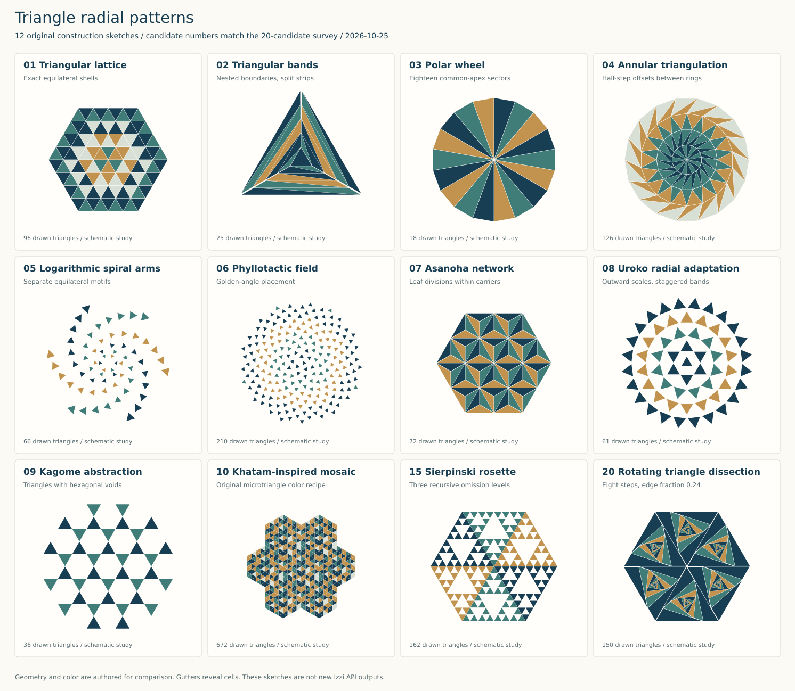
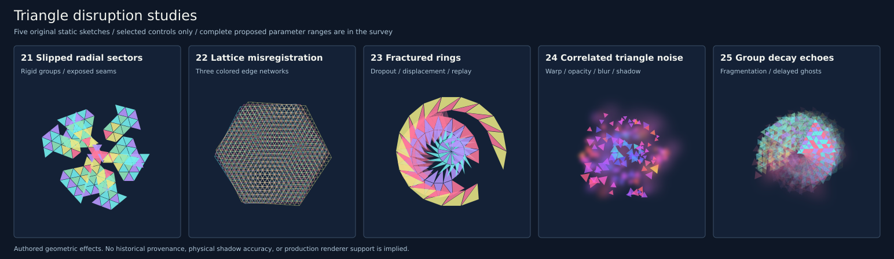

# Triangle radial patterns: survey, analysis, and recommendations

Recorded: 2026-10-25, America/Los_Angeles. Repository inspected at `38a0d49178da`.

Starting point: **Hexagonal honeycomb**, printed/PDF page **1056** of
the 2026-10-24 examples-study book,
plate `drawing-honeycomb--cell_radius-count`.

Scope: **twenty main candidates, three wild/glitch variants, and two speculative
noise/decay systems with maximum-weird presets**. The survey covers geometric
constructions, Japanese patterns, Persian and other Islamic ornament, and
mathematical prior art. This is an exploration report with original construction
sketches; the proposed triangle generators are not implemented in Izzi by this
report.

Proposed public header: **`src/izzi-svg-triangle-fills.h`**, with the API and
integration proposal below. References accompany individual candidates and are
collected in an annotated candidate-to-source index.

**Recommendation:** begin with **01 triangular lattice**, **07 asanoha**,
**10 khatam**, **11 six-point star field**, **04 annular triangulation**, and
**20 recursive rotating triangles**. Together they cover an exact tessellation,
leaf geometry, intricate mosaic, interlaced stars, circular growth, and spiral
motion. If the triangle must remain strictly equilateral, start with 01 and 10;
use 07 as decoration inside equilateral carrier triangles, and 11 as a composition
of overlapping equilateral triangle outlines.

For maximum weirdness, use **24 correlated triangle noise** and **25 hierarchical
group decay**. Their presets deliberately permit overlap, missing geometry,
strong displacement, variable opacity, blur, and colored shadows. They are
compositions built from triangle geometry, with no seamless-tiling requirement.

## Reading the reference

Page 1056 compares `cell_radius = 12, 20, 28` against `count = 7, 19, 37`,
with radius 20 and count 19 as its baseline. The small hexagons form a centered
cluster with visible gutters. The useful behavior is growth outward from a center
while preserving a recognizable local cell and coherent larger silhouette.

The study registration calls
[`make_hexagon_honeycomb`](../../html/izzi-svg-render-basics_8h.html), which obtains
centers from
[`radiate_hexagon_honeycomb`](../../html/izzi-svg-radial-fill-hexagon_8h.html).
The latter uses breadth-first traversal of six lattice directions. Counts
7, 19, and 37 correspond to the centered-hexagonal sequence
`1 + 3k(k + 1)` for complete rings `k = 1, 2, 3`.

There are two possible meanings of a triangle fill. The main interpretation here
is **triangles as the repeated cells or motifs**, analogous to the hexagons on
page 1056. A second interpretation is **ornament inside a single triangular
boundary**. The same constructions often support both; the final boundary section
explains the differences. A radial fill here describes geometry or motif placement,
rather than an SVG color gradient.

Three distinctions determine which candidates will work:

- **Tessellation:** cells cover a domain without interior overlaps or gaps before
  applying any visual gutter. Shared vertices and edges matter.
- **Motif arrangement:** independent triangle marks surround a center. Gaps,
  overlap, changing scale, and arbitrary orientation are legitimate controls.
- **Decorated carrier:** a triangle or larger tile carries smaller triangles,
  linework, or relief. The carrier and its internal marks need separate counts.

## Visual construction studies



[Open the vector sheet](20261025.triangle_radial_patterns_explore/constructions.svg).
Its [standard-library Python generator](20261025.triangle_radial_patterns_explore/generate.py)
records the constructions. The twelve panels illustrate candidates 01–10, 15,
and 20. They are schematic proposals, not historical facsimiles or new Izzi API
outputs. In particular, the khatam panel is an original hierarchical color recipe,
and the uroko panel is an authored radial arrangement of triangular scales.

The drawings use a shared restrained palette so that topology, direction, and
negative space are easier to compare. Small gutters reveal the individual cells;
those gutters are a rendering treatment rather than a claim about the underlying
tiling. Historical references remain separately linked below.

## Candidate comparison

“Equilateral” refers to the visible triangle unit, not just its enclosing carrier.
Effort estimates are relative implementation judgments, not measured schedules.
These are twenty visual candidates; several deliberately share a geometric engine.

| ID | Candidate | Triangle geometry | Radial organization | Fill behavior | Effort |
| --- | --- | --- | --- | --- | --- |
| 01 | Equilateral triangular lattice | Equilateral | Complete hexagonal shells | Exact tiling | Low |
| 02 | Concentric triangular bands | General triangles; equilateral boundaries | Threefold nesting | Exact triangulated bands | Low |
| 03 | Polar fan / triangle wheel | Isosceles; equilateral only at six sectors | Common apex, N sectors | Exact polygonal disk | Low |
| 04 | Staggered annular triangulation | Isosceles or scalene | Nested polygonal rings | Exact mesh with suitable connectivity | Medium |
| 05 | Logarithmic spiral arms | Equilateral stamps | Several chiral arms | Deliberate negative space | Low |
| 06 | Phyllotactic triangle field | Equilateral stamps | Golden-angle placement | Approximately even density; gaps | Low |
| 07 | Asanoha leaf network | Equilateral carriers; 30°/30°/120° subdivisions | Sixfold lattice patch | Decorated tiling | Medium |
| 08 | Uroko radial scales | Equilateral stamps, or stretched scales | Staggered circular bands | Gaps or controlled overlap | Low |
| 09 | Kagome open lattice | Equilateral triangles plus hexagonal voids | Sixfold patch | Intentionally porous | Medium |
| 10 | Khatam-inspired microtriangle mosaic | Equilateral in the proposed version | Nested star and triangle groups | Dense decorated tiling | Medium |
| 11 | Six-point star and hexagon field | Equilateral triangle outlines or subdivisions | Sixfold stars, radial patch selection | Strapwork or mosaic | Medium |
| 12 | Twelve-point star medallion | Slender isosceles/scalene triangles | Twelvefold center and satellite rings | Finite star assembly | Medium |
| 13 | Girih-derived triangulated patch | General triangles inside polygonal tiles | Decagonal focal motif | Polygon scaffold with triangle infill | High |
| 14 | Muqarnas-inspired facet fan | General projected triangles | Receding tiers | Relief-derived assembly | High |
| 15 | Sierpiński triangle rosette | Equilateral | Six recursive sectors, or one triangle | Fractal perforation | Low–medium |
| 16 | Penrose golden-triangle patch | 36°/72°/72° and 108°/36°/36° | Fivefold seed and substitution | Matching-rule tiling | High |
| 17 | Conway–Radin pinwheel patch | Right triangles with legs 1:2 | Radial reveal of substitution patch | Nonperiodic tiling | High |
| 18 | Projected geodesic cap | General projected triangles | Axis of a triangulated sphere | Projected mesh | Medium–high |
| 19 | Hyperbolic triangular disk | Curved geodesic triangles in disk view | Density increases toward rim | Hyperbolic tiling | High |
| 20 | Recursive rotating triangles | Equilateral nested core; scalene outer pieces | Threefold inward spiral | Exact recursive dissection | Low–medium |

## The twenty candidates

### 01. Equilateral triangular lattice, grown in complete shells

**Construction.** Start from the ordinary equilateral triangular tessellation,
center the field on a lattice vertex, and retain whole hexagonal shells. Six
triangles meet at the center. Give successive shells alternating tones or a
subtle radial lightness ramp. A small inset produces gutters like page 1056.

**Why it fits.** This is the closest structural counterpart to the reference:
one repeated shape, exact adjacency, clear radial growth, and few controls.
It is also the common foundation for several richer candidates below.

**Controls.** Triangle side length, shell count, cell inset, global angle,
shell palette, and center opening. A hexagonal patch with side length `k` unit
edges contains `6k²` triangles: 6, 24, 54, 96. These are a geometric derivation,
not the hexagon generator's 7, 19, 37 counts.

**Assessment.** Essential baseline. Keep its topology fixed when adding color or
animation. It demonstrates whether more elaborate recipes add useful structure.

### 02. Concentric triangular bands

**Construction.** Nest similar, concentric equilateral triangles. Connect
corresponding corners of successive boundaries; split each intervening
quadrilateral into two triangles. Retain the innermost triangle as the core.
Repeat one consistent diagonal rule around the three sides.

**Appearance.** A triangular target, stepped pyramid, or folded contour map.
Unlike 01, its strong features are three long sides and changes of scale.

**Controls.** Band count, linear or geometric spacing, diagonal handedness,
alternating band color, and core size. The band pieces generally are not
equilateral, even though every nested boundary is.

**Assessment.** A particularly good choice when the final container itself is
a triangle. Concentric boundaries preserve threefold symmetry; a consistently
chosen diagonal can remove mirror symmetry. This is an elementary geometric
proposal without an asserted historical attribution.

### 03. Polar fan / triangle wheel

**Construction.** Join a common center to the vertices of a regular N-gon.
Each sector is an isosceles triangle with apex angle `360°/N`. Optional
homothetic subdivisions introduce a second scale without changing the spokes.

**Appearance.** A direct sunburst with a clearly legible center. Six sectors give
equilateral triangles; 12, 18, and 24 give progressively narrower wedges.

**Controls.** Sector count, outer radius, angular phase, alternating colors, and
subdivision depth. A central opening requires truncating or subdividing the
triangles, so it changes the visible primitive.

**Assessment.** Very inexpensive and useful for emphasis. High sector counts
create a dense central junction and large empty outer faces. It is better as a
medallion or center treatment than as the only general-purpose field generator.
This construction follows directly from regular polygon geometry.

### 04. Staggered annular triangulation

**Construction.** Place vertices on successive regular polygonal rings, offset
alternate rings by half a sector, and triangulate the annular region between
them. A safe first version uses equal vertex counts and a fixed cyclic
connectivity; a later version can increase ring populations while explicitly
matching the two boundary cycles.

**Appearance.** A circular woven crystal or faceted ripple. Individual triangles
can point alternately inward and outward while the overall field expands.

**Controls.** Ring radii, sector population, half-step phase, radial spacing,
core radius, and color by ring or triangle orientation.

**Assessment.** The strongest circular counterpart to the honeycomb. Exact
coverage is achievable, but arbitrary phase, radius, or connectivity changes
can invert cells. Keep the mesh valid before applying insets. These are
triangles with variable angles, rather than equilateral stamps.

### 05. Logarithmic spiral arms of triangles

**Construction.** Use `r = r0 exp(bθ)` for each of several rotated arms. Place
equilateral triangle motifs along each arm and orient them radially, tangentially,
or along the spiral tangent. Sample by arc length when even visual spacing is
required; equal angular steps instead produce outward expansion.

**Appearance.** A chiral vortex with strong directional movement and breathable
negative space. Mirroring the spiral reverses its handedness.

**Controls.** Arm count, pitch `b`, inner cutoff, triangle size, spacing rule,
orientation offset, and handedness. Scaling the triangles with radius produces
a different effect from keeping every triangle the same size.

**Assessment.** Excellent for motion and open fields. This is a layout of discrete
motifs, with no claim of seamless coverage. The construction is a direct use
of [logarithmic spiral geometry](https://mathworld.wolfram.com/LogarithmicSpiral.html);
it is not labeled as a historical Persian or Japanese pattern.

### 06. Phyllotactic triangle field

**Construction.** Place motif centers at `r_n = c sqrt(n + α)` and
`θ_n = nγ + θ0`, with `γ = π(3 − sqrt(5))`, approximately 137.508°.
Replace the usual seed marks with equilateral triangles. Their orientation can
follow the radial direction, remain fixed, or follow a separate phase rule.

**Prior art.** The botanical placement follows Vogel's sunflower model, discussed
in the authors' [The Algorithmic Beauty of Plants, chapter 4](https://www.algorithmicbotany.org/papers/abop/abop.pdf).
Using triangle glyphs and the proposed orientation controls is this report's
adaptation.

**Assessment.** A useful organic contrast to strict rotational order. Approximate
uniform point density does not guarantee collision-free triangle packing.
There is no exact sixfold symmetry and no seamless tessellation. Controls should
include count, spacing, glyph scale, central offset `α`, and orientation.

### 07. Asanoha / hemp-leaf network

**Prior art.** Japanese kumiko makers describe a framework of equilateral
triangles, assembled into hexagonal structures, with smaller members forming
leaf patterns inside the triangles.
[K-INO, kumiko technique](https://k-ino.jp/en/kumiko/kumiko-technique/).

**Construction.** Build candidate 01, then connect each triangle's centroid to
its three vertices. Each carrier becomes three 30°/30°/120° triangles.
Across adjacent carriers the lines produce the familiar sixfold leaf network.
Use complete outer shells for the radial patch.

**Appearance.** Crisp leaves, stars, and diamonds that reveal different groupings
as the eye moves between scales. A strong fit for fine linework or two-tone fill.

**Controls.** Carrier size, shell count, internal line width, gutter, and leaf
color grouping. Preserve shared boundary points; independent radial rotation of
individual leaves would break the network.

**Assessment.** Best first Japanese direction. It supports both a triangle
carrier with interior ornament and a larger radial field. The leaf subdivision
uses non-equilateral triangles even though the carriers remain equilateral.

### 08. Uroko-inspired radial scales

**Prior art.** The Tokyo National Museum's translation guide identifies
*urokomon* as a triangle pattern.
[TNM terminology guide, geometric patterns](https://webarchives.tnm.jp/assets/img/research/extra/Japanese_to_English_Translation_at_the_Tokyo_National_Museum.pdf).

**Construction.** Arrange outward-facing triangular scales in concentric bands.
Offset alternate bands so the tips sit between the scales in the preceding band.
Keep equilateral triangles for continuity with the current primitive, or allow
an explicit height-to-width control for longer scales.

**Appearance.** An armored disk or layered fan. Alternating light and dark bands
can establish direction without fine lines.

**Controls.** Band count, angular pitch, stagger, scale size, overlap, and
inward/outward orientation.

**Assessment.** Clear at small sizes and straightforward to implement. The radial
layout is a contemporary proposal inspired by uroko, not a claim that traditional
uroko is inherently concentric. Increasing each ring's population should happen
in complete symmetry groups when rotational regularity matters.

### 09. Kagome-inspired open triangle lattice

**Prior art.** Tanihata describes kagome as a design derived from basket weave,
with a six-pointed-star reading.
[Tanihata, pattern comparison](https://www.tanihata.co.jp/design/).

**Construction.** Use the trihexagonal arrangement with vertex sequence
`3.6.3.6`: equilateral triangles alternate with hexagons around each vertex.
Render the triangles and leave the hexagons open. For a woven rendition,
render the three strip directions and resolve crossings explicitly.

**Appearance.** A light, porous cousin of the honeycomb. Negative hexagons become
as prominent as positive triangles. Select a centered hexagonal patch to obtain
radial growth without distorting the lattice.

**Controls.** Pitch, shell extent, strip width or triangle fill, crossing clearance,
and void treatment.

**Assessment.** Strong for open screens and sparse pattern fills. A field of
corner-sharing triangles is only the geometric abstraction; actual over/under
weaving requires crossing topology. It is intentionally not an all-triangle
covering of the plane.

### 10. Khatam-inspired microtriangle mosaic

**Prior art.** Iranian khatam assembles triangular-section pieces into larger
geometric units before applying the resulting inlay to objects. The cultural
organization's craft account explicitly describes this triangle-to-compound-unit
process.
[Iranian Khatam](https://en.icro.ir/Handicrafts/Iranian-Khatam).

**Construction.** Subdivide equilateral carrier triangles into a fine triangular
grid. Group colors into six-point stars, small hexagonal centers, and contrasting
borders. Repeat those compound units in complete shells around a central motif.
Keep the small tile scale and the larger star scale independently controllable.

**Appearance.** Dense, jewel-like geometry with a clear long-distance rosette
and close-distance microstructure. A dark/ivory/brass-like palette is one possible
digital treatment, not a material simulation.

**Assessment.** Best first Persian direction for literal triangle fills. The
proposed version can keep every visible tile equilateral. It shares the lattice
engine with 01; its distinctive contribution is hierarchical grouping and color.
The accompanying sketch demonstrates that hierarchy without reproducing a
particular historical inlay design.

### 11. Six-point star and hexagon field

**Prior art.** The Met's late 13th–14th-century panel from Nishapur combines
six-point stars and hexagonal tiles with matched edge lengths.
[Nishapur star-and-hexagon panel](https://www.metmuseum.org/learn/educators/curriculum-resources/art-of-the-islamic-world/unit-three/featured-works-of-art/image-14).

**Construction.** Begin with two equilateral triangle outlines sharing a center,
one rotated 60° relative to the other. Resolve their crossings into a hexagram.
For a filled version, decompose the star into a central hexagon and six triangular
tips; optionally triangulate the central hexagon. Arrange compatible star and
hexagon units on a shared lattice, then select a centered patch.

**Appearance.** A strong radial star with secondary hexagons. It works as
continuous strapwork, a filled mosaic, or a medallion surrounded by satellite stars.

**Assessment.** Excellent fit, with existing Izzi `hex6` machinery to inspect.
Two overlapping filled triangles alone double-paint the overlap; use a union or
nonoverlapping subdivision when opacity matters. A star-only layout is an
adaptation of the cited mixed-tile panel, not its reconstruction.

### 12. Twelve-point Persian star medallion

**Prior art.** The Met holds a twelve-point star tile from Khargird, northeastern
Iran, dated 1442–43, with interlaced decoration.
[Twelve-Pointed Star-Shaped Tile](https://www.metmuseum.org/art/collection/search/446971).

**Construction.** Make a twelvefold star boundary by alternating outer and inner
vertices, then triangulate it from its center. Add one ring of smaller compatible
motifs or a second interlaced contour. This is a finite medallion construction,
not a claim that twelve-point stars alone tile the plane.

**Appearance.** More elaborate and needle-like than 11, with an emphatic center.
The star's outline, inner opening, and border hierarchy are more important than
simply increasing the fan's sector count.

**Controls.** Outer/inner radius ratio, border width, satellite scale, ring spacing,
and interlace clearance.

**Assessment.** Strong for a focal ornament. Its triangles are generally not
equilateral. The sketch algorithm would be an original interpretation of the
documented star tradition rather than a traced version of the artifact.

### 13. Girih-derived triangulated patch

**Prior art.** Lu and Steinhardt analyze girih through five decorated polygonal
tile types and connected linework. Their decagonal construction provides a
specific geometric reference; the historical interpretation of quasiperiodicity
need not be assumed for this proposal.
[Lu and Steinhardt, 2007](https://bpb-us-w2.wpmucdn.com/sites.uwm.edu/dist/0/158/files/2017/04/Lu-Steinhardt.Decagonal-and-Quasi-Crystalline-Tilings-in-Medieval-Islamic-Architecture.2017-23rjxd4.pdf).

**Construction.** Start from a valid finite girih patch. Preserve its tile edges
and strap connections, then triangulate tile interiors to produce a secondary
faceted fill. Use a decagon as the visual center and grow compatible surrounding
tiles only when the placement rule is defined.

**Assessment.** Rich, but not an equilateral-triangle tessellation. Repeating
arbitrary triangles around a tenfold center does not make a girih pattern.
Izzi already has a bounded five-tile `girih10` patch; unrestricted growth would be
new work. Prefer this after simpler triangle recipes, unless decagonal geometry
is the main artistic objective.

### 14. Muqarnas-inspired tiered facet fan

**Prior art.** Archnet documents tiers of muqarnas forming the entrance
semi-dome of the Shah/Imam Mosque in Isfahan.
[Masjid-i Imam, Isfahan](https://www.archnet.org/sites/1622?media_content_id=63198).

**Construction.** Build several receding courses of niche-like cells and
connecting facets, then triangulate appropriate surfaces for a planar rendering.
Keep projected depth and tier boundaries separate from surface ornament.
An entrance fan can be bilateral; a dome interpretation can be rotational.

**Appearance.** A stepped vault, hanging crystalline canopy, or folded fan.
Contrasting facet values can produce depth without gradients.

**Controls.** Tier count, angular subdivision, recession, projection, and relief
contrast. These projected triangles have different sizes and angles.

**Assessment.** A compelling later experiment with existing local machinery.
Muqarnas is a spatial construction, so a flat radial triangle mosaic should be
labeled a facet interpretation. Reuse the repository's tier logic; its own
source explicitly describes the implementation as a drawing grammar rather than
a measured historical reconstruction.

### 15. Sierpiński triangle rosette

**Prior art.** The gasket construction retains three half-scale corner triangles
at each step.
[Mandelbrot's Yale-hosted fractals reference](https://users.math.yale.edu/~bbm3/web_pdfs/EncycScienceAndTechnologyFractals.pdf).

**Construction.** Apply that subdivision to each of six equilateral sectors
meeting at a center. Alternatively, use a single upright triangle as the carrier.
Keep or remove the central subtriangle using an explicit occupancy rule.

**Appearance.** A perforated rosette or triangular lace with the same vocabulary
at several scales. At depth `d`, six sectors contain `6 × 3^d` retained leaf
triangles, and the remaining area fraction is `(3/4)^d` before adding gutters.

**Controls.** Recursion depth, retained branches, depth palette, and minimum
visible feature size.

**Assessment.** Easy to prototype and good for scale studies. A fully populated
four-child triangle subdivision is a dense triangular grid, not the perforated
gasket. Existing recursive-triangle infrastructure may help, but its occupancy
semantics must be checked rather than inferred from its name.

### 16. Penrose golden-triangle patch

**Prior art.** Penrose kite-and-dart constructions can be decomposed into marked
triangle types and developed through substitution. Ritter's Oxford notes explain
both the triangle decomposition and why matching information matters.
[Lectures on Penrose Tilings, sections 4 and 8](https://people.maths.ox.ac.uk/ritter/masterclasses/ritter-lectures-on-penrose-tilings.pdf).

**Construction.** Use the acute 36°/72°/72° and obtuse 108°/36°/36° triangles,
including their orientation and edge markings, with a valid substitution seed.
Grow a fivefold-centered patch and reveal it outward from the focal point.

**Appearance.** Ordered but nonperiodic, with changing star clusters and less
obvious bands than a regular lattice.

**Assessment.** Valuable when irregular long-range order is desired. Golden
triangle shapes by themselves do not enforce a Penrose tiling. A finite patch
can be generated by the matching/substitution rules, but its appearance alone
does not establish aperiodicity. This needs different primitives and substantially
more bookkeeping than 01 or 07.

### 17. Conway–Radin pinwheel patch

**Prior art.** The pinwheel construction uses a right triangle with legs in a
1:2 ratio and a substitution into five similar pieces. Its tilings develop
infinitely many tile orientations.
[Radin, The pinwheel tilings of the plane](https://web.ma.utexas.edu/users/radin/papers/pinwheel.pdf).

**Construction.** Generate a legal substitution patch, then reveal or color it
by distance from a chosen center. Use clipped coverage or whole-tile selection
at the boundary, according to the desired silhouette.

**Appearance.** An angular field with no dominant family of parallel edges at
large scales. It supplies a very different texture from the sixfold candidates.

**Controls.** Substitution depth, seed orientation, reveal radius, radial palette,
and tile inset.

**Assessment.** Interesting experimental candidate, with a weaker intrinsic
center. Infinitely many orientations across the infinite tiling do not mean that
a particular finite patch has continuous rotational symmetry. Radial composition
is an added selection rule, rather than a property of the original patch.

### 18. Projected geodesic cap

**Prior art.** Fuller's geodesic structures provide a direct precedent for
triangular surface networks.
[Buckminster Fuller Institute, geodesic domes](https://www.bfi.org/about-fuller/geodesic-domes/).

**Construction.** Subdivide the faces of an icosahedron, normalize the vertices
onto a sphere, choose a viewing axis, retain a front cap, and project the planar
triangular facets into the drawing. A view through a vertex gives a fivefold
focal arrangement; a face-centered view gives a different organization.

**Appearance.** A faceted dome or lens. Compression toward the rim supplies a
radial density change with a spatial explanation.

**Controls.** Subdivision frequency, viewing axis, cap angle, projection, and
facet shading. Clipping exactly at the silhouette can create nontriangular
fragments unless they are retriangulated.

**Assessment.** Useful architectural counterpart to flat ornament. Even when
the source faces begin equilateral, spherical normalization and projection
generally change their visible side lengths. Existing polyhedral infrastructure
is a reuse opportunity, not proof that this projected radial fill already exists.

### 19. Hyperbolic triangular disk

**Prior art.** Hyperbolic reflection constructions produce tilings of triangular
fundamental regions in the Poincaré disk.
[Bulatov, Bending Hyperbolic Kaleidoscopes, Bridges 2011](https://archive.bridgesmathart.org/2011/bridges2011-479.pdf).

**Construction.** Choose a hyperbolic triangle with angles `π/p`, `π/q`, and
`π/r`, where `1/p + 1/q + 1/r < 1`, and reflect it in its sides. A regular
`{3,7}` triangular tiling is a possible target construction: seven triangles
meet at a vertex. Stop before the disk boundary at a minimum visible size.

**Appearance.** A finite disk with a strong impression of infinite detail as
cells shrink toward the rim.

**Assessment.** Lowest fit for the present straight-sided equilateral primitive.
In the Poincaré model, edges are circular arcs orthogonal to the boundary, with
diameters as a special case. Replacing them with straight chords creates an
approximation and should be labeled accordingly. A Klein-model version has
straight edges but a different angle appearance. Keep this as a research option.

### 20. Recursive rotating triangles / pursuit spiral

**Construction.** For a triangle with cyclic vertices `A, B, C`, form
`A' = (1 − t)A + tB`, `B' = (1 − t)B + tC`, and
`C' = (1 − t)C + tA`, for `0 < t < 1`. Fill the three outer pieces and repeat
inside `A'B'C'`. Starting with an equilateral triangle keeps each nested core
equilateral while rotating and shrinking it; the removed pieces are generally
scalene. Fill the last core to close the construction.

**Appearance.** A compact inward spiral with exact containment and visible
handedness. Repeat the construction in six equilateral sectors for a radial
rosette, or use it directly inside one triangle.

**Controls.** Edge fraction `t`, depth, palette cycle, and alternating sector
handedness. `t = 1/2` has special midpoint symmetry; values around 0.18–0.30
are useful proposed starting points for a visible spiral.

**Assessment.** High visual return for little geometric machinery. This is an
elementary recursive construction proposed here without a cultural attribution.
It fills a triangle exactly and provides a distinct alternative to placing
independent triangle stamps along the spiral arms in 05.

**Related mathematical prior art.** Cyclic pursuit produces nested rotating
polygons and spiral trajectories.
[Weisstein, Mice Problem](https://mathworld.wolfram.com/MiceProblem.html).
The fixed edge-fraction dissection here is a discrete construction; it is not
the continuous, constant-speed pursuit model in that reference.

## Three wild or glitch variants

These extend the twenty main candidates. Each begins with known triangle cells
and applies a controlled operation, so a zero-effect version provides a useful
comparison. Their names describe proposed behavior rather than historical styles.



[Open the experimental vector sheet](20261025.triangle_radial_patterns_explore/experimental.svg).
Panels 21–25 illustrate selected controls from the proposals. They are static
construction sketches, not implementations of the full parameter systems below.

### 21. Slipped radial sectors

Partition candidate 01, 07, or 10 into angular sectors using stable cell IDs.
Rotate each whole sector by a different offset about the same center, optionally
shifting it radially. Triangles within a sector retain their shapes and relative
positions; the fault appears at the seams as cracks, collisions, or doubled edges.

Use a broad asymmetric sequence of sector offsets, rather than independent
point jitter. A protected center can retain the original motif while the outer
structure slips. The visible result is a broken kaleidoscope with a recognizable
underlying construction.

| Parameter | Suggested exploration range | Strong starting value |
| --- | --- | --- |
| `sector_count` | 3–18 | 9 |
| `phase_slip_deg` | 0–35° | 24° |
| `radial_shift_a` | 0–2 triangle side lengths | 0.9 |
| `neighbor_correlation` | 0–1 | 0.55 |
| `protected_radius_fraction` | 0–0.5 of field radius | 0.16 |
| `seed` | Any fixed unsigned seed | 20261025 |

Choose cells by centroid to preserve whole triangles, accepting a stepped seam.
Cutting at exact sector rays instead requires clipping and possibly
retriangulation. This is an original geometric modifier, not an analog signal
simulation. Keep it close to the triangle geometry implementation.

### 22. Misregistered lattices and triangle moiré

Render two or three copies of a dense triangle-edge network. Give the copies
slightly different rotations, pitches, translations, and colors. Their
superposition produces large-scale interference that changes dramatically under
small parameter adjustments. Edge networks usually expose the beat more clearly
than opaque, fully filled triangles.

| Parameter | Suggested exploration range | Strong starting value |
| --- | --- | --- |
| `layer_count` | 2–4 | 3 |
| `angle_offsets_deg` | Typically within ±6° | −2.8°, 0°, +3.7° |
| `pitch_ratios` | 0.96–1.04 | 0.985, 1, 1.018 |
| `registration_a` | Each axis within ±1.5 sides | Three distinct offsets |
| `edge_width_a` | 0.008–0.08 | 0.025 |
| `layer_opacity` | 0.15–0.9 | 0.65 |
| `blend` | normal, multiply, screen, difference | difference, with normal comparison |

Use [Izzi's moiré family](../../generative_patterns/moire.md) as the local
construction and tuning precedent; its documentation already separates pitch,
registration, layers, and seeded degeneration. Triangle edge networks are the
proposed addition. Increasing angular error indefinitely does not increase the
same effect: large errors can destroy the slow beat and produce a different
crosshatch. The displayed result also depends on sampling resolution, so inspect
both the vector and its intended-size rasterization.

### 23. Fractured rings with dropout and replay

Select one or more annular bands and angular runs of cells. Translate the selected
groups, remove contiguous subgroups, and replay a few groups at displaced
positions. Keep the individual triangle vertices together under each transform.
The result resembles a patterned disk whose rows have torn, skipped, and echoed.

| Parameter | Suggested exploration range | Strong starting value |
| --- | --- | --- |
| `affected_band_count` | 1–5 | 3 |
| `band_width_a` | 0.5–4 sides | 1.7 |
| `angular_run_deg` | 10–140° | 75° |
| `tangential_shift_a` | 0–3 sides | 1.8 |
| `dropout_fraction` | 0–0.8 of selected groups | 0.45 |
| `replay_count` | 0–5 | 3 |
| `echo_opacity_ratio` | 0.2–0.9 per copy | 0.58 |

Correlate selection over neighboring cells so the damage reads as a broken band.
For animation, derive events from seed, group ID, and phase; resampling noise
independently every frame would produce a different temporal effect. Existing
[screen-glitch composition](../../generative_movement/screen-glitch.md) supplies
a local precedent for stable identities and ordered effects. This triangle-aware
operation acts on cells before rendering; actual tape, film, or receiver effects
can be composed afterward using that existing family.

## Two speculative systems for maximum weirdness

Candidates 24 and 25 are deliberately speculative. The algorithms, ranges, and
presets below are proposed engineering and artistic controls, not measured
historical recipes. Distances use **`a`**, the unmodified triangle's side length;
for subdivided or irregular meshes, use the median leaf-edge length before
effects. Opacity is clamped to `[0,1]`; angles are in degrees. A static render uses
the specified phase, while animation advances the same deterministic fields.

### 24. Correlated triangle noise with warped centers and soft shadows

**Idea.** Make a faceted noise field in which large regions drift together while
individual triangles rotate, swell, disappear, and leave colored soft shadows.
At low settings it resembles a mineral surface. At the maximum-weird preset,
triangle fragments float through blurred islands and interference bands.

**Construction.** Start from a dense triangular lattice or annular mesh. Sample
several independently seeded, spatially correlated fields at each cell's original
centroid. Use separate channels for displacement, rotation, scale, opacity, blur,
and shadow, all sharing a controllable large-scale component. Domain-warp the
noise sampling coordinates before evaluating those channels. Move and transform
each complete triangle around its centroid; this preserves a straight-edged
triangle even when neighboring cells separate or collide.

One bounded scalar field can be defined as:

```text
F(p, phase) = sum(gain^j * N_j(lacunarity^j * p, phase), j=0..octaves-1)
             / sum(gain^j, j=0..octaves-1)
u_i = F(p_i / correlation_length + warp_strength * W(p_i), phase)
alpha_i = alpha_min + (alpha_max - alpha_min) * ((u_i + 1) / 2)^opacity_gamma
scale_i = clamp(exp(log_scale_sigma * scale_field_i), scale_min, scale_max)
```

Here each `N_j` is a seeded continuous noise function bounded by `[-1,1]`,
and `W` is a two-channel warp field in normalized sampling coordinates. Clamp
the normalized field if a particular noise implementation has a larger range.
Blur and shadow are applied to selected groups after transforming their cells.

| Parameter | Proposed range | Maximum-weird preset |
| --- | --- | --- |
| `base_shells` | 3–16 | 12, giving 864 base triangles |
| `correlation_length_a` | 0.5–24 | 2.7 |
| `noise_octaves` | 1–6 | 5 |
| `lacunarity` | 1.5–3.8 | 2.6 |
| `gain` | 0.25–0.8 | 0.62 |
| `domain_warp_strength` | 0–4 normalized noise units | 2.4 |
| `group_coherence` | 0–1; shared group field weight | 0.64 |
| `translation_amplitude_a` | 0–4 | 2.2 |
| `rotation_amplitude_deg` | 0–180 | 155° |
| `log_scale_sigma` | 0–1.2 | 0.9 |
| `scale_min`, `scale_max` | Positive bounded ratios | 0.18, 3.2 |
| `alpha_min`, `alpha_max` | 0–1 | 0.015, 0.98 |
| `opacity_gamma` | 0.25–4 | 0.42 |
| `dropout_threshold` | −1–1; drop low-field cells | −0.18 |
| `blur_sigma_a` | 0–1 | 0.48 maximum, modulated by field |
| `blurred_group_fraction` | 0–1 | 0.58 |
| `shadow_offset_a` | Each axis within ±3 | (+1.4, −0.9) |
| `shadow_sigma_a` | 0–1.5 | 0.8 |
| `shadow_opacity` | 0–1 | 0.62 |
| `hue_span_deg` | 0–360 | 280° across groups |
| `blend` | normal, screen, multiply, difference | screen plus one difference echo |
| `seed`, `phase` | Fixed integer; normalized cycle | 20261025, 0.73 |

The preset does not set every slider to its upper bound: all-opaque layers or
uniform maximum blur can erase the interaction between facets and noise. Here,
maximum weirdness means strong, independently controlled conflicts of scale,
alignment, focus, and visibility, including both sharp and soft regions.

**Prototype behavior to inspect.** A blurred group's alpha mask should be
blurred after composition when a cloud-like mass is intended. Blurring each
triangle independently produces a different dotted effect. A rigid cell
transform preserves its triangle shape; warping every vertex independently
changes the primitive and needs a separately named mode.

### 25. Hierarchical group decay with colored shadow echoes

**Idea.** Treat the radial fill as a hierarchy of parent motifs and child
triangles. Let parents loosen, children fragment, and earlier states persist as
offset translucent ghosts. Some groups retain crisp geometry while their shadows
outlive them. The result can resemble a collapsing crystalline mandala with a
moving memory of its own structure.

**Construction.** Assign stable parent IDs to sectors, rings, or macrotriangles,
then subdivide their leaves. Give each group an onset time and decay rate from
correlated fields. Advance a radial or spiral decay front. First move the parent
group, then apply child divergence, then opacity loss and blur. Echoes evaluate
the same geometry at earlier phases rather than sampling unrelated new triangles.

```text
age_g(t) = max(0, t - onset_g)
alpha_g(t) = 2^(-age_g(t) / half_life_g)
child_alpha_i(t) = clamp(alpha_g(t) * local_survival_i(t), 0, 1)
echo_j(t) = transformed_copy(group_state(t - j * echo_delay))
echo_alpha_j(t) = echo_alpha_0 * echo_retention^j * alpha_g(t - j * echo_delay)
```

For a nonlooping study, states before onset remain intact. A looping version
needs an explicit reset or crossfade; a simple modulo clock can otherwise
produce a sudden reconstruction at the cycle boundary.

| Parameter | Proposed range | Maximum-weird preset |
| --- | --- | --- |
| `parent_sectors` | 3–18 | 6 |
| `subdivision_depth` | 0–5 | 3 full four-child levels: 384 leaves |
| `decay_front` | outward, inward, spiral, seeded islands | spiral |
| `front_turns` | 0–4 across field radius | 2.5 |
| `onset_spread_seconds` | 0–6 | 2.8 |
| `group_coherence` | 0–1 | 0.72 |
| `half_life_seconds` | 0.15–8 | 0.7, varying by group from 0.35 to 1.4 |
| `parent_rotation_deg` | 0–180 amplitude | 120° |
| `child_scatter_a` | 0–5 | 2.6 |
| `fragment_probability` | 0–1 at front passage | 0.78 |
| `child_scale_range` | Positive ratios | 0.12–2.4 |
| `alpha_floor` | 0–0.3 for surviving traces | 0.01 |
| `blur_sigma_a` | 0–1.5 | Up to 0.9 as groups age |
| `echo_count` | 0–12 | 8 |
| `echo_delay_seconds` | 0.03–1.5 | 0.17 |
| `echo_alpha_0` | 0–1 | 0.8 |
| `echo_retention` | 0.15–0.95 | 0.74 per echo |
| `echo_rotation_deg` | −45–45° per echo | 19° |
| `echo_translation_a` | Each axis within ±2 per echo | (+0.32, −0.18) |
| `shadow_offset_a` | Each axis within ±4 | (+1.8, +1.1) |
| `shadow_sigma_a` | 0–2 | 1.25 |
| `shadow_half_life_ratio` | 0.25–4 relative to source | 2.3 |
| `shadow_hue_offset_deg` | 0–360 | 160° |
| `echo_blend` | normal, screen, difference | alternate screen/difference |
| `seed`, `sample_time_seconds` | Fixed integer; nonnegative time | 20261026, 2.4 |

The long-lived shadow is an artistic layer, not physically correct illumination.
Apply decay to group masks when fragments should dissolve together; apply it to
individual leaves when a granular disintegration is wanted. This distinction is
what makes the hierarchy consequential rather than merely a list of random
per-triangle opacities.

**Local precedents.** The proposed layering and deterministic effect order build
on the ideas documented in [Izzi moiré](../../generative_patterns/moire.md) and
[screen-glitch composition](../../generative_movement/screen-glitch.md).
Candidates 24 and 25 are original triangle-specific combinations; no existing
Izzi preset or historical pattern is claimed to implement them.

### A single weirdness control with meaningful subordinate parameters

Expose `weirdness ∈ [0,1]` as a convenience macro over an explicit recipe.
At zero, return the base geometry with its normal appearance. At one, resolve
the relevant maximum-weird preset above. Store the fully resolved parameters
alongside the macro value so that a saved composition remains inspectable.

For a target amplitude `A*`, a useful initial mapping is `A(w) = A* w^1.4`.
Introduce opacity variation as
`alpha(w) = (1 − w) alpha_base + w alpha_target`. Introduce a log-scale
amplitude smoothly from zero. Threshold discrete operations such as dropout and
fragmentation using stable per-group random values; do not reseed when `w`
changes. A layer being introduced should fade in before its maximum transform
is reached. These mappings are proposals to evaluate visually, not perceptual
calibration claims.

Keep independent overrides for **coherence**, **blur**, **shadow**, **opacity
spread**, **fragmentation**, **echo count**, and **seed**. A single scalar cannot
express both a coherent melting mass and an explosive cloud of isolated shards.
Both are legitimate maximum-weird states.

Treat resource limits separately from artistic strength. Proposed prototype
limits are 20,000 generated leaf triangles, 12 echoes, 256 independently filtered
groups, and a bounded output canvas. These values are provisional, not benchmark
results. With 384 leaves and eight echoes, candidate 25 starts at 3,456 triangle
instances before shadow copies or further fragmentation. Filtering each copy
independently would be unnecessarily expensive; reuse group masks and cache
repeated geometry where possible. Expand each filter region by at least the
chosen shadow displacement plus approximately `3 sigma` of blur on each side,
then verify visually that it is not cropping the tails.

## Geometric and implementation analysis

### Preserve the triangle contract

The existing study's `drawing-triangle` constructs three equally spaced vertices
on a circle, so its `radius` is the **circumradius** of an equilateral triangle.
For that triangle, side length `a = sqrt(3) R`, altitude `h = 3R/2`, and
inradius `R/2`.

Use an explicit side length or circumradius in a future API. Keep lattice pitch,
glyph size, and gutter separate. Changing a hexagon draw call from six sides to
three while retaining its original centers will create a field of triangle marks,
but it will not construct a triangle tessellation.

For a regular triangular lattice, use integer indices and the basis
`e1 = (a, 0)`, `e2 = (a/2, sqrt(3)a/2)`. Vertex `(i,j)` is
`origin + i e1 + j e2`. Split each basis parallelogram into its two equilateral
faces. Store topology with integer vertex and face keys, then convert to floating
coordinates when rendering. This makes shared boundaries and deterministic
growth straightforward.

The center convention is part of the design. A **vertex-centered** lattice
supports sixfold symmetry and a center occupied by six triangles meeting at a
point. A **face-centered** lattice has a central triangle and a natural threefold
symmetry. An `open_center` parameter therefore needs a defined hole boundary;
it cannot always mean removing a single cell as it does in the honeycomb.

### Separate twenty designs from the smaller set of engines

| Shared construction | Candidates it can support | Main additional work |
| --- | --- | --- |
| Triangular lattice and subdivision | 01, 07, 10; parts of 09 and 11 | Leaf subdivisions, motif grouping, retained-cell rules |
| Nested polygon boundaries | 02, 03, 04, 12 | Valid annulus connectivity and star outlines |
| Polar motif placement | 05, 06, 08 | Sampling, orientation, and overlap control |
| Recursive dissection | 15, 20 | Separate omission and rotation rules |
| Specialized prior-art structures | 13, 14, 16, 17, 18, 19 | Tile matching, spatial projection, or non-Euclidean geometry |

Khatam-style grouping over the ordinary triangular lattice is intentionally a
different design recipe on a shared engine. It should not be represented as an
unrelated tessellation algorithm. Conversely, girih, Penrose, and hyperbolic
patterns should not be reduced to palette presets on that same lattice.

### Existing Izzi reuse opportunities

| Local source | Verified relevant capability | Implication |
| --- | --- | --- |
| [`izzi-review-extra.h`](../../html/izzi-review-extra_8h.html) | Triangle primitive, honeycomb registration, and recursive-triangle study registration | Reuse the study workflow and explicit controls. |
| [`izzi-svg-radial-fill-hexagon.h`](../../html/izzi-svg-radial-fill-hexagon_8h.html) | Center-out hexagon-center traversal | Reuse the interface concept; construct actual triangle topology separately. |
| `izzi-svg-guilloche-arabesque.inc` | Shared tile graph, `hex6`, star outlines, interlace handling, bounded five-tile `girih10` patch | Inspect these before creating duplicate star or girih machinery. |
| [`izzi-svg-guilloche-muqarnas.h`](../../html/izzi-svg-guilloche-muqarnas_8h.html) | Tiered niche cells, facets, projections, and resource bounds | Candidate 14 should develop this spatial grammar. |
| [`izzi-svg-polyhedral.h`](../../html/izzi-svg-polyhedral_8h.html) | Referenced by the polyhedral and recursive-slot study entries | Investigate as a building block for 15 and 18; no new behavior was verified by executing it here. |

For a future triangle API, return either explicit triangle vertices or instances
with position, scale, orientation, and a prototype identifier. Centers alone
cannot represent the varied triangles in 04, 13, 16, or 18.

Retain cell identity, shell/depth, and symmetry group as separate metadata. They
support stable color assignments, outward reveal, and reproducible animation
without changing geometry. Complete symmetry groups should be the default
growth unit; an arbitrary triangle-count cutoff can leave a lopsided last ring.

### Proposed header and public API

Use **`src/izzi-svg-triangle-fills.h`** as the public entry point. It matches
the existing `izzi-svg-*` naming, is concise, and includes tessellation,
triangle-carrier ornament, radial placement, and the requested experimental
compositions. A more literal alternative is
`izzi-svg-triangle-tessellations-fills.h`; the shorter name is the recommendation.
`izzi-svg-radial-fill-triangle.h` would mirror the existing hexagon filename,
but it is narrower than the nested-triangle, noise, and group-decay scope here.

Keep three explicit layers in that interface:

| Layer | Responsibility | Typical output |
| --- | --- | --- |
| Geometry | Shared vertices, triangle cells, shell/depth/group identity | Triangle mesh or motif instances |
| Composition | Cell grouping, layers, transforms, palette, opacity, glitch/decay | Ordered groups with appearance and filter specifications |
| SVG rendering | Paths, reusable definitions, clipping, filters, stable IDs | An SVG group plus its required definitions |

An illustrative API outline follows. It is proposed vocabulary, not a declaration
that these symbols currently exist:

```cpp
namespace svg::triangle_fills {
  struct triangle_cell {
    std::array<point_2t, 3> vertices;
    std::uint64_t id;
    unsigned shell;
    unsigned group;
  };

  struct mesh;
  struct composition;
  struct svg_fragment;  // rendered group plus required defs/filter resources
  struct lattice_spec;
  struct annular_spec;
  struct rotating_triangle_spec;
  struct appearance_spec;
  struct sector_slip_spec;
  struct correlated_noise_spec;
  struct group_decay_spec;
  struct render_spec;

  mesh generate(const lattice_spec&);
  mesh generate(const annular_spec&);
  mesh generate(const rotating_triangle_spec&);
  mesh subdivide_asanoha(const mesh&);

  composition compose(const mesh&, const appearance_spec&);
  composition apply(const composition&, const sector_slip_spec&);
  composition apply(const composition&, const correlated_noise_spec&);
  composition apply(const composition&, const group_decay_spec&);
  svg_fragment render(const composition&, const render_spec&);
}
```

Use recipe-specific specifications instead of one large object with many ignored
fields. Common controls should define origin, base side length, orientation,
boundary policy, center treatment, deterministic seed where relevant, and a
resource budget. A composition can carry strokes as well as triangle fills,
allowing star strapwork and colored shadows to use the same orchestration.
Hyperbolic curved edges need a separate path representation or an explicit
conversion; they do not fit a three-straight-vertex cell without approximation.

The first geometric implementation should establish 01, 04, 07, 10, 11, and 20,
reusing the arabesque renderer for the star-specific parts. Build 21–25 as
modifiers and composition recipes over those results. They should not require
separate copies of the tessellation algorithm. Delegate actual film/video effects
to the existing screen-glitch family rather than embedding those engines in
the new triangle header.

Include the public header through `izzi-svg.h` after the foundational render
types are available. The new header should include the concrete dependencies it
uses, not the umbrella `izzi-svg.h`, which would create an avoidable include
cycle. If implementation size grows, move detail code into private includes
while retaining one public entry point. Add named study registrations and a
triangle-fills example alongside the eventual geometry implementation. This
report proposes those additions; it does not create an empty production header
or claim the API has been shipped.

### Fills inside a single triangle

Candidates **02, 07, 10, 15, and 20** naturally support a triangular carrier.
For 07 and 10, use a parent triangle subdivided on its own barycentric grid.
For 15 and 20, recursion preserves the parent's boundary. These produce deliberate
edge and corner behavior without partial cells.

Other candidates can be clipped to a triangle, but clipping may cut motifs or
turn a triangle into a polygon with more than three sides. If every visible
cell must remain triangular, retriangulate clipped cells or use a constrained
triangulation of the boundary. If every cell must additionally remain congruent
and equilateral, use compatible lattice-aligned boundaries instead.

When two triangular carriers share an edge, share their edge subdivision
parameters and mirror compatible motifs as needed. Independently rotating the
interior pattern in each carrier will generally produce discontinuous lines.

## Recommended first study series

Build a compact first comparison around six candidates, in this order:

| Order | Candidate | Question the study answers | Suggested first sweep |
| --- | --- | --- | --- |
| 1 | 01 triangular lattice | Does the triangle counterpart preserve the clarity of the honeycomb? | `shells = 1, 2, 3`; side length held constant |
| 2 | 07 asanoha | Does interior leaf structure add value at the intended display size? | Three carrier pitches × three line widths |
| 3 | 10 khatam | How much hierarchy remains readable before microtriangles merge visually? | Two subdivision depths × three motif-group scales |
| 4 | 11 six-point star field | Does a strong star center improve the larger composition? | Filled subdivision, plain outlines, interlaced outlines |
| 5 | 04 annular triangulation | Is a circular silhouette preferable to a hexagonal one? | Three ring counts × three angular populations |
| 6 | 20 recursive rotating triangles | How much chirality is useful inside a triangle? | `t = 0.18, 0.24, 0.30` × depth 3, 5, 7 |

Use one common ink/ground pair first, then introduce tradition-inspired palettes.
For fair visual comparison, provide both a fixed-scale view and a fitted view:
the first exposes true density changes, while the second makes different overall
silhouettes comparable. Show exact cell counts and carrier counts separately.
The study should include a single motif close-up and a larger field, because
readability at one scale does not imply readability at the other.

Geometry checks should match the construction: positive triangle area, valid
shared edges, intended symmetry, and no unintended overlaps for tessellations;
explicit spacing and overlap behavior for motif arrangements. For exact closed
meshes, compare summed triangle area with domain area. For recursive and
hyperbolic candidates, enforce depth and minimum-feature limits before generating
large outputs. These are proposed implementation checks, not claims that all
twenty generators have been built or validated.

For later exploration, add **09 kagome** for openness, **15 Sierpiński** for
multiscale perforation, and **05 spiral arms** for motion. Pursue **13 girih**,
**16 Penrose**, **17 pinwheel**, and **19 hyperbolic** when their specific
geometry is the desired result; their complexity buys properties that simpler
triangle stamping cannot reproduce.

For the experimental comparison, pair **21–23** with their zero-effect bases,
and show **24–25** at `weirdness = 0, 0.5, 1`. Hold seed, camera, and source mesh
fixed. Include one close-up of blur/shadow boundaries and one full-field view.
For motion, compare multiple phases without changing the seed; a still image
cannot establish temporal coherence or the behavior of delayed echoes.

## Annotated references for the triangle patterns

These references document the underlying patterns or mathematical constructions.
The radial selection, control ranges, palette choices, and speculative effects
are separately identified proposals in this report. Entries marked “authored”
point to the explicit construction rather than attaching an unsupported
historical name to it.

| Candidate(s) | Reference | What it supports |
| --- | --- | --- |
| 01 | Alexander F. Ritter, [Lectures on Penrose Tilings](https://people.maths.ox.ac.uk/ritter/masterclasses/ritter-lectures-on-penrose-tilings.pdf), Oxford masterclasses, 2014, section 1 | Definitions and elementary regular tilings; the shell enumeration is derived in this report. |
| 02, 04 | [Authored construction generator](20261025.triangle_radial_patterns_explore/generate.py), functions `triangular_bands` and `annular_mesh` | Exact sketch recipes and area checks; no traditional pattern attribution is asserted. |
| 03, 11 | The Metropolitan Museum of Art, [Islamic Art and Geometric Design: Activities for Learning](https://www.metmuseum.org/-/media/files/learn/for-educators/publications-for-educators/islamic_art_and_geometric_design.pdf), activities on circle divisions and stars | Educational circle, hexagon, and triangle constructions. Candidate 03's arbitrary-N fan is an elementary extension. |
| 05 | Eric W. Weisstein, [Logarithmic Spiral](https://mathworld.wolfram.com/LogarithmicSpiral.html), Wolfram MathWorld | Polar equation and tangent relationship; triangle placement is the proposed motif layer. |
| 06 | Przemyslaw Prusinkiewicz and Aristid Lindenmayer, [The Algorithmic Beauty of Plants](https://www.algorithmicbotany.org/papers/abop/abop.pdf), 1990, chapter 4 | Vogel-model phyllotaxis; triangle glyphs and their orientation are an adaptation. |
| 07 | K-INO Inomata Art, [Kumiko technique](https://k-ino.jp/en/kumiko/kumiko-technique/); Tanihata, [Asanoha](https://www.tanihata.co.jp/products/tn-101/) | Practitioners' triangular framework, leaf construction, and named motif. |
| 08 | Tokyo National Museum, [Japanese-to-English translation guide](https://webarchives.tnm.jp/assets/img/research/extra/Japanese_to_English_Translation_at_the_Tokyo_National_Museum.pdf), section 7.5 | *Urokomon* terminology; the concentric layout is authored here. |
| 09 | Tanihata, [Kumiko pattern comparison](https://www.tanihata.co.jp/design/), kagome entry | Basket-weave source and six-point-star motif. The open triangle/hexagon field is a geometric abstraction. |
| 10 | Iran's Islamic Culture and Relations Organization, [Iranian Khatam](https://en.icro.ir/Handicrafts/Iranian-Khatam) | Triangular component assembly in khatam craft; the digital color recipe is original. |
| 11 | The Metropolitan Museum of Art, [Star- and hexagonal-tile panel, Nishapur](https://www.metmuseum.org/learn/educators/curriculum-resources/art-of-the-islamic-world/unit-three/featured-works-of-art/image-14), late 13th–14th century, object 37.40.26 | A specific Iranian example of six-point stars and matching hexagons. |
| 12 | The Metropolitan Museum of Art, [Twelve-Pointed Star-Shaped Tile](https://www.metmuseum.org/art/collection/search/446971), Khargird, 1442–43, object 17.143.1 | A specific Iranian twelve-point star and interlaced design. |
| 13 | Peter J. Lu and Paul J. Steinhardt, [Decagonal and Quasi-Crystalline Tilings in Medieval Islamic Architecture](https://bpb-us-w2.wpmucdn.com/sites.uwm.edu/dist/0/158/files/2017/04/Lu-Steinhardt.Decagonal-and-Quasi-Crystalline-Tilings-in-Medieval-Islamic-Architecture.2017-23rjxd4.pdf), *Science* 315, 1106–1110, 2007 | Five-tile girih construction and connected strapwork; triangle infill is a separate proposed layer. |
| 14 | Archnet, [Masjid-i Imam, Isfahan](https://www.archnet.org/sites/1622?media_content_id=63198) | Documented tiered muqarnas at the entrance; no measured reconstruction is claimed here. |
| 15 | [Fractals, Yale-hosted article](https://users.math.yale.edu/~bbm3/web_pdfs/EncycScienceAndTechnologyFractals.pdf), *Encyclopedia of Physical Science and Technology*, figure 1 | Three half-scale copies in the gasket construction; the six-sector assembly is proposed here. |
| 16 | Ritter, [Lectures on Penrose Tilings](https://people.maths.ox.ac.uk/ritter/masterclasses/ritter-lectures-on-penrose-tilings.pdf), sections 4 and 8; Roger Penrose, [A is for Aperiodic Tiles](https://www.maths.ox.ac.uk/outreach/oxford-mathematics-alphabet/aperiodic-tiles) | Marked triangle decomposition, inflation, and fivefold-centered constructions. |
| 17 | Charles Radin, [The pinwheel tilings of the plane](https://web.ma.utexas.edu/users/radin/papers/pinwheel.pdf), *Annals of Mathematics* 139, 661–702, 1994 | Pinwheel substitution and orientation behavior. |
| 18 | Buckminster Fuller Institute, [Geodesic domes](https://www.bfi.org/about-fuller/geodesic-domes/) | Triangular geodesic structures; planar projection is the proposed rendering treatment. |
| 19 | Vladimir Bulatov, [Bending Hyperbolic Kaleidoscopes](https://archive.bridgesmathart.org/2011/bridges2011-479.pdf), *Bridges 2011*, 479–482 | Hyperbolic triangle reflection constructions and disk representations. |
| 20 | Eric W. Weisstein, [Mice Problem](https://mathworld.wolfram.com/MiceProblem.html), Wolfram MathWorld; [authored generator](20261025.triangle_radial_patterns_explore/generate.py), `rotating_triangles` | Related cyclic pursuit and the explicit discrete dissection used here; the two models are distinguished above. |
| 21 | Authored sector transform proposal above and [experimental sketch generator](20261025.triangle_radial_patterns_explore/generate.py) | An original triangle-aware modifier; no historical attribution. |
| 22 | [Izzi moiré family](../../generative_patterns/moire.md) and [`izzi-svg-moire.h`](../../html/izzi-svg-moire_8h.html) | Local precedent for layered interference and registration controls. |
| 23–25 | [Izzi screen-glitch composition](../../generative_movement/screen-glitch.md), [moiré family](../../generative_patterns/moire.md), and the explicit specifications above | Local compositional precedents; triangle noise, group decay, and maximum-weird presets are speculative additions. |

## Research and artifact record

The page number, plate title, controls, and baseline were checked against the
local PDF's extracted text and a rendered image of page 1056. The current source
was read for the triangle primitive, honeycomb traversal, arabesque tile graph,
muqarnas grammar, and related study registrations. The PDF itself is dated
2026-10-24; the inspected working-tree revision is recorded above, so the two
should not be assumed to be the same build solely from their filenames.

External references were consulted on 2026-10-25. Museum object records support
the specific Persian artifacts; Japanese makers and the Tokyo National Museum
support the pattern terminology and construction precedents. Mathematical
references support the specialized models. The proposed radial organization,
implementation effort, shortlist, and control ranges are this report's design
analysis. No claim of exclusive cultural origin is made for elementary triangles,
stars, or lattice geometry.

The companion sheets are reproducible with:

```sh
python3 docs/development/sessions/20261025.triangle_radial_patterns_explore/generate.py
```

The first sheet illustrates twelve selected main constructions; the second
illustrates selected controls from all five experimental candidates. The full
25-candidate survey includes additional proposals for girih matching, historical
muqarnas interpretation, Penrose and pinwheel substitution, geodesic projection,
and hyperbolic tiling. The sketches do not implement those algorithms or the
complete parameterized noise/decay systems.

Validation performed for these artifacts: both SVGs parsed as XML and were
rasterized and visually inspected; the generator checked nondegenerate triangles
and eight applicable area identities in the main sheet; all 25 numbered entries
and local Markdown links were checked. The report and sketch generator do not
constitute a build or test of the proposed C++ API.
