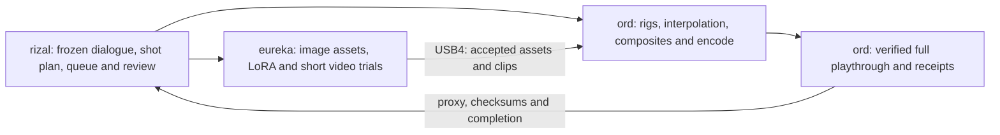

Given the video that was rendered with the stage 4 workflow:
20261026.here_lies_trouble_stage_4_production_details.md

Look at other ways to render the frames for the total 53 minute short, suggest 1-3 options. These options should include: using the existing stage-5 render to construct a local LoRA that can be used with free image generators that are available on https://huggingface.co/ to compute the rest of the frames, using the November 1 seedance allotment to render just certain key frames 1 or 2 or n seconds apart and using a local render to create everything inbetween, etc etc.

Study the current state of the art in image generation models, find closest fit for local models that can run on eureka/ord/rizal. Use rizal as the control plane and eureka/ord as a render cluster.

Answer the questions:
1) would this give finer grained control of gaze and mouth motion?
2) would this simplify the "other animal" appearances?
3) could the local render be composited with local voices to get a rough playthrough of the whole script?

Append proposal to this document.

----------

**Selected implementation:** the user chose the six-second controlled
performance plus a measured asset/video comparison. The detailed scope,
timing, bounded experiments and restart contract are in
[local rendering Stage 1](20261027.local_rendering_exploration_stage_1.md).
That document is the implementation and restart reference. The user approved
unattended P0–P5 execution, now complete: the six-second controlled rig passes
technical checks, five image attempts are measured, Wan's tested recipe hit
a projected runtime limit, and the guided VACE comparison finished. The
decision retains the rig for control; generated alternatives need repair.
See its completed execution record and
review bundle.
Human approval of the actual combined canary remains pending.
The user subsequently accepted version 2's gaze motion and requested better
animal rendering. The [artwork refinement](20261027.local_rendering_exploration_stage_1.md#12-artwork-refinement-after-gaze-review)
preserves the same six-second control clock and dialogue; appearance review
remains separate from the accepted gaze.

## Proposal — October 27, 2026

**Recommendation: build a complete local performance pass with reusable
character rigs, use a small image LoRA to extend the asset library if needed,
and reserve Seedance for selected shots that benefit from generated body or
camera motion.** This offers the clearest route to controllable speech and
gaze without generating every frame independently. A fully generative local
video version is worth a short experiment, but its speed and four-character
consistency on these AMD machines are not established.

This proposal uses the repository's production evidence and primary model,
runtime and provider documentation checked on October 27. It does not report
new local model benchmarks. No models were downloaded or trained, no remote
services were changed, and no provider generation was submitted for this
research.

### What is available now

The actual dialogue duration is **52:35.375**, or **3,155.375 seconds**.
At 24 fps that is **75,729 frames**, excluding any additional title or end
cards. Stage 4 supplies 103 seconds / 2,472 delivery frames, leaving
73,257 frames of picture to supply. The complete 48 kHz dialogue master,
297 cached speech chunks, 191 turns and four fixed voices already exist.
These figures come from the [Stage 4 production record](20261026.here_lies_trouble_stage_4_production_details.md#12-stage-4-handoff-recorded-october-27).

There is **no existing Stage 5 visual render to train from**. The
[Stage 5 record](20261027.here_lies_trouble_stage_5.md) and local prep directory
contain a six-second audio canary and provenance, but no facial rig, tracked
visual canary or production runner. Use the Stage 4 footage and accepted
source artwork for an initial appearance experiment; add accepted Stage 5
examples when they exist. Stage 4's nine-cue gaze audit found no clearly
demonstrated reciprocal exchange. Training on those frames cannot supply
missing examples of successful gaze or speech articulation.

The complete voices are already local: unicorn / `af_bella`, dog / `am_echo`,
albatross / `af_nicole`, cat / `af_heart`. A rough playthrough needs picture
and assembly, not a new voice model or another 53-minute synthesis pass.
Full-audio listening flags and remaining caption alignment still need their
existing finishing work.

### Three production options

| Option | What generates the picture | Gaze and mouth control | Main tradeoff | Recommended use |
| --- | --- | --- | --- | --- |
| **1. Local rigs and layered scenery** | Accepted artwork, reusable poses, walk/flight cycles, explicit face controls and local compositing | Direct control of each character, target and frame | Requires asset preparation; initially looks like limited animation | **Build the full rough playthrough this way first** |
| **2. Appearance LoRA plus local animation** | A small local image model creates additional poses, scenery and shot assets; rigs or short guided video renders animate them | Direct with rigs; uncertain if left to a video model | Curation, training and identity checks; LoRA does not itself provide motion control | Expand option 1 when reference editing alone cannot maintain the cast |
| **3. Selected Seedance clips plus local bridges** | Paid clips establish difficult shots; local rigs or conditioned video fill selected intervals | Local face controls remain the dependable timing mechanism | Sparse references leave motion and occlusion underdetermined; credits remain limited | Add richer motion selectively after the local performance method passes |

#### 1. Local rigs and layered scenery

Prepare each hero as a separate asset with body, head, eyes, mouth/beak and
occlusion layers. Begin with the accepted artwork and clean Stage 4 frames.
Use reference editing only where a needed pose is absent. A practical first
set is forward, partner-left and partner-right heads, several mouth shapes,
closed/open eyes, and a short walk or flight cycle. Head turns need drawn or
modeled perspective changes; rotating a flat face does not create a convincing
three-quarter view.

Drive the rig from the frozen episode timeline. Animate only the current
speaker's mouth from actual speech activity, with closures at pauses.
Later, phoneme alignment can select a small viseme set. Give the albatross a
hinged beak rather than a human lip rig. Author gaze as a target character
plus head/eye curves, including the listener's delayed return look. Keep
facial controls separate from body motion so a syllable does not bounce the
whole animal. Medium two-shots can make the exchange readable when the
original wide composition leaves faces too small.

Reuse the existing SVG/raster/FFmpeg infrastructure for flat layers and
compositing; add textured meshes only where deformation or perspective needs
them. On newly rendered characters, face attachment follows the rig. On
saved moving Stage 4 footage, replacement faces still require tracked head
transforms and occlusion masks. That tracking is real work, not a consequence
of adding a mouth overlay.

Make wildlife a separate timed layer, using the already approved designs and
global episode clock. Foreground masks control whether a bird passes behind
a hero or vegetation. Keep the albatross's main-character identity separate
from visiting birds. This follows the successful local wildlife treatment
already recorded in [Stage 4](20261026.here_lies_trouble_stage_4_production_details.md#funded-sequence-assembly).

This option can supply every frame without paid generation. Its first
deliverable is a coherent, voiced animatic with limited animation, not a
claim of matching Seedance's texture or full-body motion. The main investment
is reusable art and performance controls.

#### 2. Appearance LoRA plus local animation

**Start by comparing reference editing against a small LoRA.** Qwen's
existing editing path may already produce enough usable pose assets. Train
only if the adapter improves identity, markings or style on held-out views.
For the first training experiment, prefer
[FLUX.2-klein-base-4B](https://huggingface.co/black-forest-labs/FLUX.2-klein-base-4B):
it has an Apache-2.0 release and an undistilled base intended for adaptation.
BFL documents local fine-tuning, while
[AI Toolkit](https://github.com/ostris/ai-toolkit) lists this model and the
Qwen editing models as supported training targets. That establishes a
software path, not a verified ROCm training run on this cluster.

Proposed dataset and trial:

1. Extract candidate stills from the clean provider originals and accepted
   artwork, before captions and wildlife overlays. Record source hashes,
   clip/frame positions and crops. Reject anatomy drift, darkened unicorn
   horns, blurred faces and accidental background changes.
2. Start with **20–40 genuinely different frames for a style-only trial**.
   This is consistent with BFL's [style-training example](https://docs.bfl.ai/flux_2/flux2_klein_training_example),
   not a universal dataset-size rule. For character identity, separately
   assess whether each hero has enough distinct angles and expressions;
   adjacent frames do not provide independent coverage.
3. Use distinct character names/tokens and captions describing visible
   species, pose, markings and composition. Prefer isolated hero crops for
   identity learning; retain a few group compositions for evaluation.
   Keep style and identity experiments separable so the model does not learn
   that every frame must contain all four animals on the same road.
4. Split validation by whole clip or viewpoint, not random neighboring
   frames. Test unseen poses, paired compositions, quiet listeners, horn
   color, beak shape and character count against the reference-editing
   baseline. A successful training loss is not the acceptance criterion.
5. Run one small adapter trial on eureka: proposed rank 16, batch size 1,
   512–768 pixel training buckets, cached text/VAE features and gradient
   checkpointing. These are starting settings to measure and revise.
   First prove a forward/backward step with the actual ROCm stack; an
   NVIDIA-only optimizer or attention dependency may require a supported
   alternative. Do not assume a base-model adapter works identically on a
   distilled checkpoint.

Generate a library of approved poses and scenery, then animate those assets
with option 1. An image LoRA trained for FLUX cannot simply be loaded into
Wan or LTX; video adapters require the corresponding video architecture and
training procedure. Independently sampling all 75,729 frames would also
invite flicker and identity drift, even with a fixed seed.

An optional video branch can take a locally rendered pose/depth guide and
character references into VACE or Wan-Animate-2. Compare a complete short
interaction before expanding. A diffusion pass may improve appearance while
changing eye direction, mouth timing or anatomy; retain the rig output as
the control reference and add final facial correction after any generative
pass that disturbs it.

The source footage's training-use terms need to be recorded with the dataset.
The provider's [published terms](https://www.seedance2ai.io/terms-of-use)
describe rights in paid outputs and plan-dependent commercial use, but do
not explicitly settle customer LoRA training on those outputs. Treat that
as a specific unresolved input-license question, not as proof that training
is either prohibited or cleared. Existing independently usable character
artwork provides an alternative starting dataset.

#### 3. Selected Seedance clips plus local bridges

Use paid footage for something the local rig cannot yet do well: a new route
view, a difficult crossing, a useful turn, or a clean reusable body-motion
segment. Extract approved pose and scenery references from those clips.
Do not buy a full clip merely to retain one arbitrary frame if the same
reference can be made locally.

The current [Seedance 2 endpoint](https://www.seedance2ai.io/llms-api.txt)
accepts **4–15-second clips**, with optional start/end images. It does not
offer a sparse-output-frame price. Rendering 15 seconds and keeping one
frame per second still pays for 15 seconds. The endpoint also does not
document a standalone input-audio parameter; its generated audio should
not replace the existing performance.

There are three different meanings of "fill the frames in between":

- **Rig interpolation:** interpolate positions, head poses and other authored
  controls. This is the preferred way to preserve specified performance.
- **Frame interpolation:** RIFE estimates intermediate pictures from a pair
  of images. Its [upstream implementation](https://github.com/hzwer/ECCV2022-RIFE)
  supports arbitrary interpolation times, but does not take the dialogue or
  a gaze schedule as performance constraints. My assessment is that it is
  suitable for modest frame-rate conversion within a coherent shot, not a
  dependable way to invent one or two seconds of speaking, walking and
  occlusion from unrelated stills. Never interpolate across a cut. For a
  12-to-24-fps trial, composite precise mouths and wildlife afterward at
  24 fps so interpolation cannot smear their timing.
- **Generative bridging:** condition a video model on sparse references and
  preferably a complete pose/layout guide. LTX provides explicit
  [keyframe-conditioning pipelines](https://github.com/Lightricks/LTX-2/blob/main/packages/ltx-pipelines/docs/pipelines.md).
  VACE accepts video masks, reference images and control video, with its
  [guide](https://github.com/ali-vilab/VACE/blob/main/UserGuide.md) recommending
  short sequential clips for long work. This synthesizes plausible motion;
  it does not establish that the requested gaze, words or exact endpoints
  have been preserved. Test those separately.

For the whole episode, a uniform anchor schedule would require the following
number of images, including the start and a final endpoint:

| Anchor spacing | Anchor images | What it leaves unresolved |
| --- | ---: | --- |
| 1 second | 3,157 | 24-frame intervals still contain speech and footfall changes |
| 2 seconds | 1,579 | Larger pose changes and occlusions |
| 5 seconds | 633 | Requires actual animation or generative motion between anchors |
| 10 seconds | 317 | Better treated as shot planning than frame interpolation |

Counts use `ceil(3155.375 / spacing) + 1`; they are reference counts, not
provider jobs or billable seconds. Prefer anchors at shot boundaries and
meaningful performance changes to a rigid one-second grid. Extracting dense
anchors from the existing 103 seconds does not supply later terrain or
new interactions across the remaining 50:52.375.

**November 1 is not a confirmed credit grant.** The latest saved authenticated
observation is 40 credits, recorded in the
[Stage 5 funding forecast](20261027.here_lies_trouble_stage_5.md#credit-forecast-for-november-1).
The provider's [billing terms](https://www.seedance2ai.io/terms-of-use)
tie subscription credits to billing periods, rather than a universal
first-of-month reset. If a future 6,000-credit grant arrives and the 40
remain, 6,040 credits would fund 100 whole seconds at the **historically
measured** 60 credits/second. A six-second canary uses 360, leaving 94 whole
seconds and 40 credits; the additional character/handoff tests must also
come from that remainder. This is a conditional budget, not a new quote or
an account balance checked during this research.

### Model shortlist and fit to the actual machines

"Available on Hugging Face" is not equivalent to Apache-licensed, already
installed, or proven fast on AMD. The following are candidates selected for
this production problem, not an independent image-quality leaderboard.

| Model/tool, with primary source | Relevant capability | Local recommendation and limits |
| --- | --- | --- |
| [Qwen-Image-Edit-2511](https://huggingface.co/Qwen/Qwen-Image-Edit-2511) | Apache-2.0 reference editing with improved character consistency | **First asset-editing baseline on eureka** because the repository records a prior installation. Revalidate that runtime; it has not been tested in this research. |
| [FLUX.2-klein-base-4B](https://huggingface.co/black-forest-labs/FLUX.2-klein-base-4B) / its distilled 4B sibling | Small generation/editing family; Apache-2.0; trainable base | **First new LoRA candidate**. Train on the base; benchmark inference separately. BFL's [local guide](https://help.bfl.ai/articles/7108141705-can-i-run-or-fine-tune-flux-2-klein-locally) reports 12 GB NVIDIA training configurations, which are not an AMD speed or peak-memory guarantee. |
| [Z-Image base](https://huggingface.co/Tongyi-MAI/Z-Image) | Apache-2.0 undistilled model intended for adaptation, with negative prompting | Useful fallback for background/style assets. Its base and Turbo have different training expectations; do not assume the fastest checkpoint is the best training base. |
| [Qwen-Image-2.1](https://huggingface.co/Qwen/Qwen-Image-2.1) / [2.1-Turbo](https://huggingface.co/Qwen/Qwen-Image-2.1-Turbo) | Newer 7B visual model; multi-reference editing and transparent layers; Turbo uses eight denoising steps | Strong research comparison for cutouts. The [current research license](https://huggingface.co/Qwen/Qwen-Image-2.1/raw/main/LICENSE) limits use to research/evaluation without a separate commercial license, so it is not the default production-free replacement for 2511. |
| [FLUX 3 Image Klein](https://huggingface.co/black-forest-labs/flux-3-image-klein) | Newer 5.6B image transformer, up to ten references and bounding-box guidance; separate Base for training | Useful comparison for four-character layout. Its card reports 31 GB BF16 peak on a B200 at 1024² with prompt upsampling off. This is not a gfx1151 measurement. The Kommunity license has conditional commercial-output provisions; it is not Apache-2.0 or blanket commercial fine-tuning permission. |
| [Wan2.2-TI2V-5B](https://huggingface.co/Wan-AI/Wan2.2-TI2V-5B) | Apache-2.0 image/text-to-video, 24 fps, 704×1280 portrait mode | **First small local video benchmark** on eureka. The official offloaded recipe calls for at least 24 GB GPU memory. Its standard I2V path takes a starting image; do not advertise it as an exact two-endpoint bridge. Upscaled output must be labeled as such. |
| [Wan2.1-VACE-1.3B](https://huggingface.co/Wan-AI/Wan2.1-VACE-1.3B) and [VACE](https://github.com/ali-vilab/VACE) | Small 480p-class guided editing/generation with video, masks and references | Test whether a rig guide survives generative styling before trying the larger 14B variant. Lower resolution is suitable for a method test, not proof of 1080p delivery quality. |
| [Wan2.2-Animate-2-14B](https://huggingface.co/Wan-AI/Wan2.2-Animate-2-14B) | August 2026 release; Apache-2.0; direct driving-video conditioning and viewpoint controls | Relevant newer motion-transfer experiment after a rig exists. The upstream setup specifies CUDA/FlashAttention; ROCm compatibility and this four-animal scene remain unverified. Do not translate its real-time claims into a local throughput estimate. |
| [LTX-2.5](https://huggingface.co/Lightricks/LTX-2.5) | Current 22B audio/video family, eight-step distilled variant, multishot and conditioning paths | Best feature-rich bridge comparison, but a larger integration risk than 5B Wan. Additional text encoder, codecs and upscalers consume memory. Its [community license](https://github.com/Lightricks/LTX-2/blob/main/LICENSE-2_x) has eligibility/transfer conditions. Test actual AMD attention/quantization support before allocating a sequence. LTX-2.3 is an older fallback, not the newest surveyed release. |
| [RIFE ncnn Vulkan](https://github.com/nihui/rife-ncnn-vulkan) | Frame interpolation; portable AMD/Intel/NVIDIA implementation without CUDA or PyTorch | **Good ord candidate** for a small within-shot interpolation trial. It supplies interpolation, not character direction or speech animation. |

LivePortrait is worth a bounded dog/cat face experiment, but not an assumed
solution for all four animals. Its current
[animal configuration](https://github.com/KlingAIResearch/LivePortrait/blob/main/src/config/inference_config.py)
temporarily reuses a human stitching/retargeting checkpoint. That is not
evidence of a validated albatross beak or unicorn muzzle controller. Existing
performance requirements should determine whether such a helper is useful.

The newer model survey changes the August vendor-alternatives discussion:
there are now additional small image and guided-animation candidates, while
actual local throughput is still unknown. The same-day
[hardware inventory](../../workflow-diagrams/local-model-inventory.20261027.json)
is a better capacity reference than the older generic memory estimates.

### Rizal control plane; eureka and ord workers

| Host | Recorded October 27 capacity | Proposed assignment |
| --- | --- | --- |
| **rizal** | Ryzen 9 3950X, 32 logical CPUs, 62.7 GiB host RAM; Quadro RTX 4000 identity rechecked, VRAM not remeasured | Own source/audio timeline, shot manifests, job dependencies, review index and completion notification. Keep heavy image/video diffusion on workers. |
| **eureka** | Ryzen AI MAX+ 395 / Radeon 8060S; 96 GiB GPU allocation and 31.1 GiB host-visible RAM | First reference-editing and LoRA tests; one large GPU job at a time; later short guided video jobs. Installed LLMs share this allocation. |
| **ord** | Same processor family; 125.1 GiB host-visible RAM; 512 MiB reported dedicated GPU allocation with shared-memory capacity not established by that number | Asset preparation, local rig rendering, Vulkan interpolation, encoding and canonical delivery storage. Admit diffusion jobs only after measuring usable GPU allocations and running the same smoke test. |

These are recorded observations from the [current topology](../../workflows.md#devpac-compute-resources-2026-10-27),
not fresh remote measurements in this proposal. Do not add eureka's host
and GPU allocations as if they were independent memory pools, or equate
ord's total host RAM with allocatable GPU memory. Neither machine is proven
to deliver discrete high-end NVIDIA throughput merely because weights fit.

AMD's current [compatibility matrix](https://rocmdocs.amd.com/en/latest/compatibility/compatibility-matrix.html)
includes the gfx1151/Radeon 8060S family, but its Ryzen OS table does not
establish official support for these Fedora 44 installations. Preserve the
working media environment and test a pinned separate environment first.
Verify device detection, a small inference, and a training backward pass.
Start from supported BF16/FP16 operations; FP8/NVFP4 files and CUDA-specific
kernels do not imply usable AMD acceleration.

Use the existing SSH queue and receipt conventions described in
[workflows](../../workflows.md#established-compute-queues-and-delivery-history).
Schedule independent shots/assets across machines rather than splitting one
diffusion model across the USB4 link. Transfer large accepted intermediates
directly between workers; return proxies and manifests to rizal. Reuse the
queue design, but create a separate HLT queue and job namespace.

Every proposed job needs source/audio/asset/model hashes, exact frame range,
seed/settings, device/runtime identity, dependency IDs and an output receipt.
Use a GPU lease to avoid colliding with eureka's LLMs. Cache completed jobs;
a retry gets a new attempt receipt, and failed shots do not erase accepted
ones. Final assembly must cover the timeline exactly once, with no dropped
or duplicated speech at chunk boundaries.

### Direct answers to the three questions

**1. Finer gaze and mouth control? Yes, with explicit local controls.**
Options 1 and the rig-based version of option 2 expose target, timing,
speaker ownership and closure directly. LoRA improves appearance; it is not
a gaze scheduler. Generative bridges remain a comparison until normal-speed
review proves the intended exchange. Use the existing six-second albatross/
dog canary and its two-frame speech timing target; test the other mouths
separately before generalizing.

**2. Simpler "other animal" appearances? Yes, largely already demonstrated.**
Local wildlife layers can enter at exact times without asking a video model
to regenerate the cast or route. Retain approved designs and the continuous
global clock. Scene depth, foreground occlusion and any hero reaction still
need authoring, but these can be changed locally without regenerating the
whole shot.

**3. A local render plus local voices for the entire script? Yes.**
The complete dialogue master already exists. A shot plan with character
poses, gentle motion, per-speaker mouths, simple scenery and wildlife can
produce a full 52:35.375 rough playthrough. Deliver it explicitly as an
animatic, with placeholders identified in the review notes. Assemble against
the existing master and canonical words; do not replace them with model
speech or ASR text. The old
local episode trial script
is hard-coded for a different 165-second, 30-fps, random-voice trial; it is
not a ready-made full Stage 5 runner.

### Workload and feasibility measurements

No wall-time forecast should be taken from a model's NVIDIA demo. Measure
**accepted output seconds per worker-hour**, including failed generations
and required correction, alongside peak memory and raw inference time.

For scale, dividing the full episode into five-second jobs requires
`ceil(3155.375 / 5) = 632` jobs before overlap. If two workers were equally
capable and useful scheduling efficiency were 70%, the following would be
the approximate generation time:

| Measured minutes per five-second job, if achieved | Two-worker elapsed time |
| ---: | ---: |
| 5 | 37.6 hours |
| 15 | 112.9 hours / 4.7 days |
| 30 | 225.7 hours / 9.4 days |

These are **sensitivity scenarios, not measured performance**. Calculation:
`632 × minutes / (60 × 2 × 0.70)`. Overlap, rejected shots, upscale,
compositing and human cleanup add time; one effective worker doubles these
figures. A small image transformer fitting in memory does not make an entire
video pipeline this fast. Even a hypothetical 30 seconds per independent
image would consume about 631 worker-hours for all 75,729 frames, before
solving their temporal consistency.

Uncompressed 1080×1920 RGB8 frames alone would occupy about **471.1 GB**
(`75729 × 1080 × 1920 × 3`), with RGBA and intermediates needing more.
Store reusable assets, bounded frame batches and lossless video intermediates
on workers; keep light review proxies on rizal. A 704×1280 generated shot
resized to 1080×1920 must be recorded as upscaled, even though the delivery
container has the final dimensions.

### Proposed first implementation sequence

1. **Prove the performance locally.** Build the Stage 5 six-second albatross/
   dog rig study using its unchanged audio. Confirm speaking ownership,
   returned gaze, a readable mutual hold, face attachment and pauses at
   normal playback size. Use the established combined-canary review before
   production continuation.
2. **Compare assets before training.** Test the existing Qwen editor and
   FLUX.2 4B on the same small pose sheet. If identity remains inadequate,
   run the curated LoRA trial with whole-clip holdouts. Record whether the
   adapter improves the actual scene, not just isolated attractive images.
3. **Test one guided motion method.** Benchmark Wan 5B for body motion and,
   if guidance is the missing feature, VACE or Wan-Animate-2 on the rig
   clip. LTX-2.5 is the larger keyframe/conditioning comparison if its AMD
   dependencies work. Stop expanding a candidate that cannot keep the
   four heroes distinct or needs repeated facial repair.
4. **Expand to a complete dialogue segment, then a full animatic.** Validate
   the 12-second dog/albatross handoff and complete short unicorn/cat turns.
   Build a one-minute sequence including a cut and a wildlife visit before
   queuing the full source. Reuse the same timeline and controls throughout.
5. **Spend future credits selectively.** Once the actual grant and request
   price are known, choose the small number of shots whose motion genuinely
   improves the accepted local version. Recompute time and budget from the
   canary results rather than committing to generative coverage of all
   remaining minutes.

The immediate engineering deliverable should be the **six-second controlled
performance plus a measured asset/video comparison**, followed by the
complete voiced animatic. That provides an inspectable basis for deciding
which parts merit LoRA training, local diffusion or additional Seedance spend.
