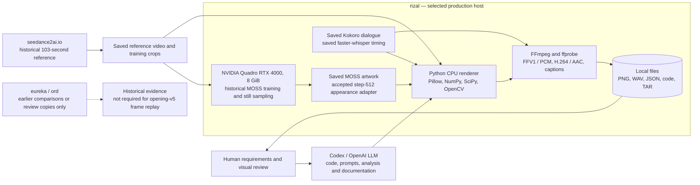
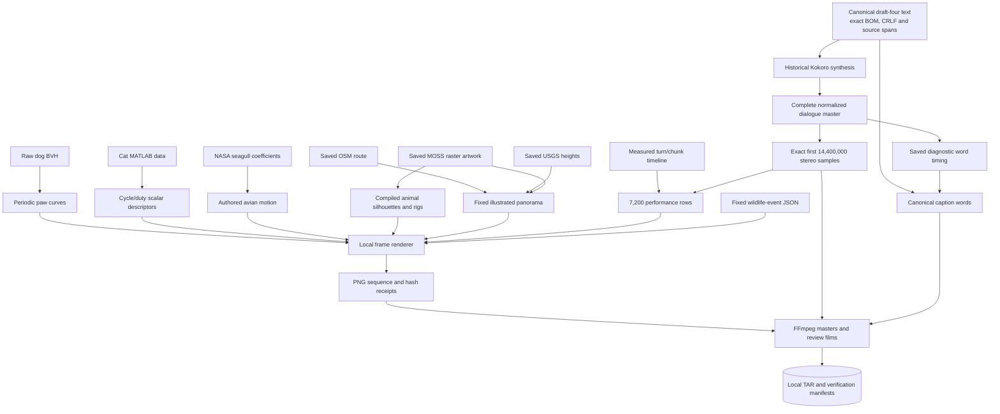
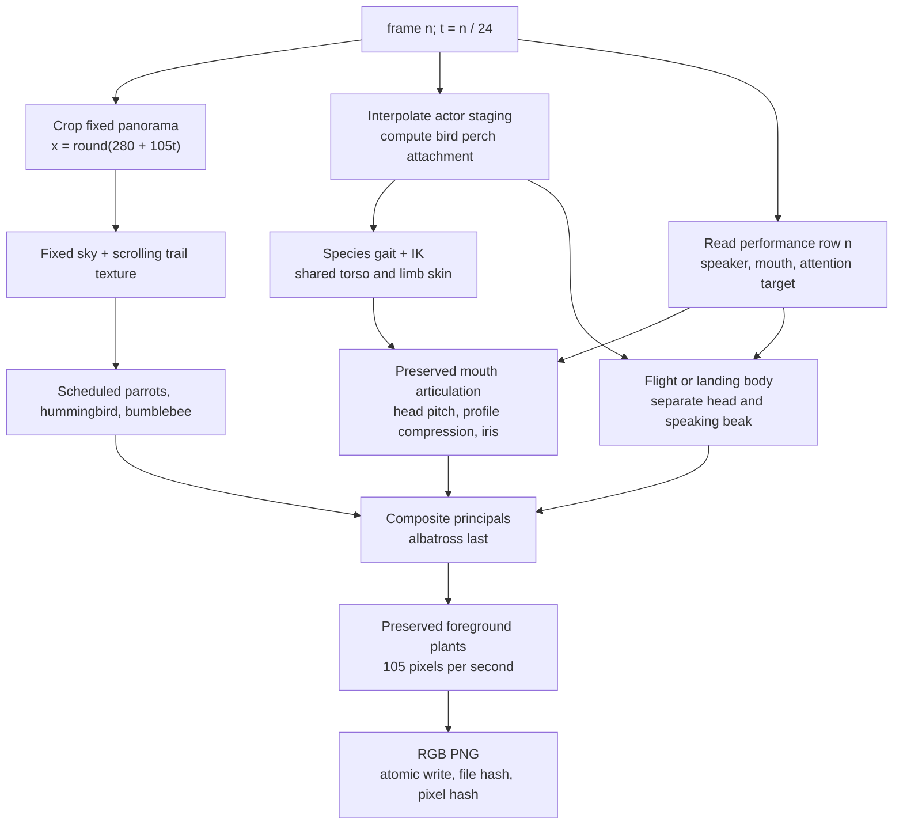
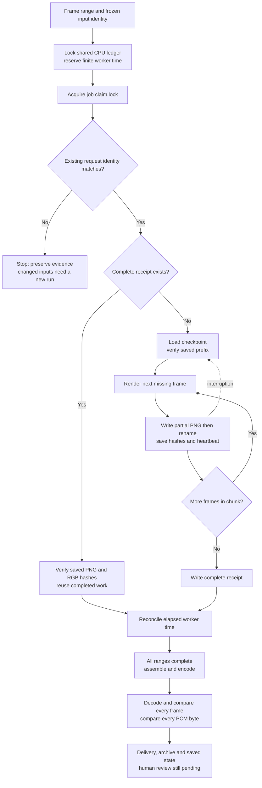
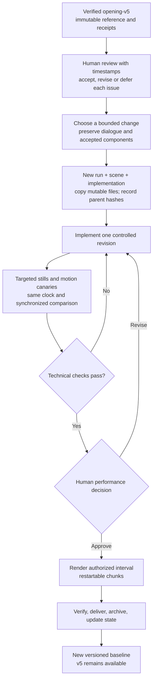

# Here Lies Trouble — opening-v5 durable local-rendering workflow

Filename date: October 29, 2026. Written and checked October 30, 2026.
Project root on the production host: `/home/bkoz/src/izzi`.

Later evolution: the October 30 human review accepts v5's scenery/location
tracking and incidental animals, and requests further gait, head-view and
bird-contact revisions. Continue that work from
[local exploration Stage 5](20261030.local_rendering_exploration_stage_5.md).
This manual remains the exact replay reference for the preserved opening-v5.

This document describes the delivered **opening-v5** sufficiently to restore
its files, replay its frozen renderer, understand its inputs, and start a new
revision without needing the preceding conversation. It includes the actual
implementation, verification evidence, known reproduction limits and open
human-review decisions. Large binary inputs and executable source are in the
identified archive; this Markdown file is the operating manual, not a substitute
for those bytes.

**Current result:** a 300.000-second, 7,200-frame, 1080×1920, 24-fps local animated
conversation. Exact lossless picture/audio, captions and interruption/resume
checks passed. **Human approval of the complete moving film is pending.**
Some spatial terrain joins and skyline distortion remain visible.

Open the review player,
clean MP4,
or 103-second Seedance comparison.

## 1. What this system is

Opening-v5 animates **saved raster animal artwork with local Python code**.
MOSS-Image-Base and an accepted appearance LoRA generated the source stills in
earlier work. Python supplies body deformation, footsteps, mouths, attention,
bird flight/landing, visitor animals, camera movement and compositing. FFmpeg
supplies media assembly. Neither MOSS nor a hosted video model runs for each
frame. A future LLM does not need to invent the renderer again to reproduce it.

There are two different uses of “Plan B” in this project's history:

- **Seedance production Stage 4, Option B:** restart the video from the beginning
  using canonical draft four; this produced the 103-second reference.
- **Local exploration Stage 4, Plan B:** use numeric animal-motion sources and
  authored local animation instead of labeling each animal's reference-video
  motion. This is the selected method for opening-v5. Local Plan A remains the
  labeled-video alternative.

Local exploration Stage 4 belongs to the broader production Stage 5 research.
Do not confuse its renderer with the earlier hosted Seedance production.

The user accepted the checkpoint-512 **appearance direction**, and subsequently
found v4's mouths, foreground and albatross motion improved. They requested v5
to repair body/leg joins, make gaze readable, use different species cadences,
make the bird's feet reach forward before landing, use OSM terrain, and scroll
the background at the foreground's speed. Those requests authorized this
five-minute render; they did not constitute acceptance of its resulting motion.

## 2. Result contract and identities

| Property | Frozen opening-v5 value |
| --- | --- |
| Episode interval | `[0, 300)` seconds; frames `0…7199` |
| Picture | RGB source PNGs; 1080×1920; 24 frames/second |
| Exact audio | First 14,400,000 stereo sample frames of the existing master; 48,000 Hz, 24-bit PCM |
| Audio/video clock | Exactly 2,000 audio sample frames per video frame |
| Captions | 81 cues, 792 canonical whitespace tokens; speaker labels 1–4 |
| Full canonical episode | 3,155.375 seconds; retained, not shortened or rewritten |
| Excerpt endpoint | Inside speaker 3's turn 27; diagnostic timing places “when” at 299.575–300.055 seconds |
| Reference comparison | Only `[0, 103)` seconds; 2,472 frames; no reference exists here for the final 197 seconds |
| Selected code / scene | `implementation-v5` / `scene-v5` |
| New v5 image/training/provider work | Zero image attempts, zero training attempts, zero provider credits |
| Human video approval | False / pending |

The production input identity is:

```text
58f73e6215117a54d022260776ee5f578b16ee0c062feb9594bd6f72f57cd7d2
```

This identity hashes inputs, controls, dialogue excerpt, compiled PNG/JSON
assets and all Python modules in the frozen implementation. It does **not** pin
every installed dependency binary, CPU implementation, font or encoder build.

| Authoritative object | SHA-256 |
| --- | --- |
| Canonical fourth-draft text | `889c2fdd91008e7acd998a7ed1ab94c4a0a20e71c5cba06ec37070e47001f4f6` |
| Complete dialogue master WAV | `efc0ad9a7bdf1bd39a47003db860c4efc9d6659b912e6c32d22f66aa1d000cec` |
| Canonical timeline JSON | `dddbd3a6b4cc32da77a235bef0ea40958f4401a2c89093be62f9c3956075bf70` |
| Five-minute WAV file | `984780c4efc802a6c4d9342a745c51b7ef1152b1fa04525e13ad3802927d874b` |
| Five-minute decoded signed little-endian 24-bit PCM | `037ef1f8d16a0a7e5e3f3250031a76f42f754db8ff31edd0c5b200c83c8ea4ec` |
| Lossless MKV file | `a3541955f8a967912d4e63c399273a76090ef9383e2e8f828f1b78c5a54dde74` |
| Clean MP4 file | `c472ed2ffaf5b166d5d5a0675da2c8a2040505a67aca2206194bfa924ff21ae3` |
| Captioned MP4 file | `49411e2eb48539a52d6646bd48dba8bd3794e013e24efa18f816cd35efe13e36` |
| Comparison MP4 file | `8d818fd6601de0ec3ffaa664b9466588fcaa1e1e2e7ea5dbc9bccb071f6996b3` |
| Accepted MOSS step-512 adapter | `531a15674d208798d5d0a3972bcd9ba5ddc6e0ac54a3257bf312446ae0b59024` |

The WAV container hash and decoded PCM hash intentionally differ. Likewise,
matching decoded picture/audio does not automatically mean matching MKV/MP4
container bytes. Restore the archived media when file-byte identity is required.

## 3. Directory map

All paths below are relative to the repository root unless absolute. These
short names are used throughout this document:

```text
R  = outputs/here-lies-trouble/local-rendering-stage-4-motion-20261029
B  = outputs/here-lies-trouble/stage-4-20261026-option-b-v3
S2 = outputs/here-lies-trouble/local-rendering-stage-2-lora-20261027
S3 = outputs/here-lies-trouble/local-rendering-stage-3-opening-20261028
D  = R/delivery/opening-v5
```

| Path | Purpose |
| --- | --- |
| `R/opening-v5/inputs.json` | Selected implementation/scene, range, source-audio identity |
| `R/opening-v5/performance.json` | All 7,200 time-indexed speech/attention controls |
| `R/opening-v5/inputs/` | Exact WAV; approval; staging, motion, route and wildlife JSON |
| `R/opening-v5/assets` | Symlink to `../scene-v5/assets`; retain its relationship |
| `R/scene-v5/assets/` | Compiled source silhouettes, face/wing layers, rig manifest, panorama, ground and foreground |
| `R/implementation-v5/` | Nine frozen Python files, including inherited dependencies |
| `R/opening-v5/jobs/frames/000000-000024/` | Example one-second job: request, checkpoint, heartbeat, receipt, PNGs |
| `R/opening-v5/frames/` | Complete numbered sequence; hardlinks to completed job PNGs |
| `R/opening-v5/review/` | Masters, preflight/recovery/media evidence, runtime and selected-code manifest |
| `R/source-art/` | Original neutral quadruped/scenery MOSS PNGs and exact prompts/sampling metadata |
| `R/sources/` | Raw dog BVH, inspected kinematics, cat MATLAB data and compiled descriptors |
| `D/` | Player, review videos, captions, delivery manifests and local archive |
| `R/recipe-v5/` | Repository-relative script/config/document snapshots and canonical/reference media |
| `S3/cpu-budget.json` | Shared, cumulative six-hour CPU-worker allowance |
| `S3/budget.json`, `S3/attempts/` | Historical image/training/GPU-phase allowance and receipts |
| `resources.static/here-lies-trouble/stage-4-state.json` | Current project handoff and artifact inventory |
| `B/readiness.json` | Byte-identical mirror of that shared project state |
| `R/v5-continuation.json`, `R/readiness.json` | Local-rendering continuation and delivery selection |

The canonical file is
`outputs/transcription-enrichment/here-lies-trouble/here-lies-trouble.20261026.fourth-draft.txt`.
Use this exact spelling and hash; earlier conversational “forth-draft” wording
is not a different canonical input. Preserve its UTF-8 BOM and CRLF line endings.

### Authority when older metadata disagrees

Use `opening-v5/inputs.json`, frozen executable code, the selected
`review/implementation-manifest.json`, per-job requests and final verification
receipts together. Several inherited fields are history, not active controls:

- `implementation-v5/manifest.json` lists seven copied v4 dependencies. The
  selected review manifest lists **all nine** files, including the v5 worker/art.
- The asset manifest's top-level `sources`/`files` inventory contains older
  Stage 3 material. Each current quadruped's `source_art` and `body_path` identify
  its actual v4 neutral artwork; per-job hashes cover the compiled asset tree.
- Old `torso_path`, segmented-limb paths and `v5_limb_paths` remain on disk.
  V5's active quadruped render uses the whole `*-v4-intact.png` silhouette.
- Some descriptive knobs are unused. For example, metadata mentions yaw 0.3;
  executable v5 face code uses a maximum factor **0.28**. The code is authoritative.
- Earlier motion descriptor files retain old retarget periods. Active v5 actor
  gait periods are **1.8 / 1.0 / 0.75 seconds**.
- An archive's internal state predates its own final checksum. The external
  archive receipt and current shared state supersede that packaging snapshot.

## 4. Hosts, AI and software



| Component | Actual role and reproduction requirement |
| --- | --- |
| **rizal** | Verified hostname in production chunk receipts. Linux x86_64 host for v5 CPU rendering and local storage; earlier MOSS work used its GPU. No GPU is needed to replay compiled v5 frames. |
| **NVIDIA Quadro RTX 4000** | Historical MOSS host GPU: 8 GiB physical VRAM, SM75, no native BF16; recorded driver `615.78.08`. Small-VRAM offloading was used. This is not a requirement for CPU frame replay. |
| **eureka** | Earlier Qwen-Image-Edit-2511 / FLUX.2-klein-base-4B comparison host and possible fallback. Neither model supplies the selected v5 source artwork. |
| **ord** | Earlier review/gallery copy destination. There is no verified off-host copy of the opening-v5 archive in its delivery receipt. |
| **Codex / OpenAI LLM** | Authored and revised Python, prompts, configurations, analysis and documentation in response to human direction. An exact historical LLM build, seed and inference transcript are not pinned as a render dependency. Replay saved code/assets instead of asking a new model to recreate them from prose. |
| **Seedance provider** | Reference provenance records `seedance2ai.io`, image-to-video, `pro`, `standard`, 1080p, audio disabled, API `/api/v1/video/seedance2`. Do not infer an immutable backend “2.5” version from conversational naming. Reuse downloaded reference bytes; cloud regeneration is not an exact-replay method. |
| **fal.ai** | Part of earlier project comparisons; no fal.ai request is made by the selected v5 renderer. |
| **Kokoro-82M** | Previously synthesized the four voices. V5 reuses the existing master; no TTS calls occur during replay. |
| **faster-whisper-small** | Previously measured word times as diagnostic evidence. Captions retain canonical tokens, not ASR substitutions. V5 reuses the saved word check. |

The speech/ASR records pin local CPU software and artifacts; they do not provide
an independent hostname for every original chunk. Do not invent per-chunk host
provenance beyond the saved evidence. The v5 frame receipts explicitly identify
rizal.

### CPU render runtime

Recorded in `R/opening-v5/review/runtime-environment.json`:

| Software | Recorded version / role |
| --- | --- |
| Python | 3.14.8, GCC 16.2.1 build; orchestration, hashing, file locking |
| Linux / libc | `7.2.11-200.fc44.x86_64`, glibc 2.43, x86_64 |
| Pillow | 12.3.0; PNG I/O, raster drawing, compositing and resizing |
| NumPy | 2.4.6; image arrays, coordinate fields and audio energy |
| SciPy | 1.16.2; Delaunay mesh, sparse shortest paths, interpolation/support math |
| OpenCV | 4.13.0; image remapping, affine triangles, alpha/matte processing |
| FFmpeg / ffprobe | 8.1.3; encoding, sample trims, decoding and measurements |
| libass | 0.17.4 observed in the document's caption-render dependency check |
| Git HEAD observed at rendering | `dca4cd5d34f4edce58565d33717db58fd801638f`; uncommitted files existed, so this commit alone is insufficient |

Exact caption rendering also depends on fonts. The saved ASS declares DejaVu
Sans. A direct FFmpeg/libass check resolved it to
`/usr/share/fonts/dejavu-sans-fonts/DejaVuSans.ttf`, SHA-256
`f0d9a390aa7cf43999a2fd1502a47c381bc7809ab5fac6937f0f6dd6524096cd`.
Comparison/montage titles explicitly use
`/usr/share/fonts/gnu-free/FreeSans.ttf`, SHA-256
`02278f4358389962b4b142c33d274c015e9a647085536b316f31bcf2b9335112`.
The v5 archive does not contain those system font binaries or a complete OS
image. Matching top-level package versions alone is not a proof of cross-host
pixel or container-byte equivalence.

### Historical MOSS appearance recipe

This is provenance and a starting point for separately scoped appearance work,
not a prerequisite to replay the existing film:

- Base model: `OpenMOSS-Team/MOSS-Image-Base`, revision
  `85975793d8b3d432f1b6e27f352abaa4c2a4c0d3`.
- Trainer: `KohakuBlueleaf/KohakuMossTrainer`, revision
  `67f3bb54d8ee8f18384b11113f96b5b71d38c12f`.
- Isolated historical runtime: Python 3.12.16, torch 2.14.1+cu130,
  TileLang 0.1.15, LyCORIS 4.1.3, Diffusers 0.42.1, Transformers 5.21.0.
  Full package pins are in `S2/preflight/rizal-runtime-requirements.txt` and
  `rizal-runtime-packages.json`; this is separate from system-Python rendering.
- Refined dataset: `S3/dataset/curated-v2/manifest.json`, **26 training crops
  from 12 source frames**, plus two validation and two test crops. Training
  subjects: two group, two unicorn-head, four unicorn-body, six dog, six cat,
  six albatross. Source clips 1–5/8 train, clip 6 validates, clip 7 tests.
  The examples are correlated views of one route, not independent scenes.
- Configuration: `resources.static/here-lies-trouble/local-rendering-stage-3/configs/moss_refine.py`;
  rank/alpha 8, batch 1, learning rate `1e-4`, four warmup steps, seed 20261027,
  target area 512², no flips/upscaling, FP16 residual scaling, CPU optimizer and
  activation/gradient offload. Text and latents are cached.
- The initial refined run reached 256 steps. `moss_extend_512.py` resumed its
  native model/optimizer/RNG/loader checkpoint to step 512. One skipped overflow
  update means checkpoint 512 represents 511 successful updates; do not equate
  checkpoint number with an error-free update count.
- Accepted export:
  `S3/jobs/moss-refine-v2-extend-512/checkpoints/step_00000512/export/moss-refine-v2-extend-512-comfy.safetensors`.
  Its SHA is in section 2. “512” is a training checkpoint, not 512 denoising steps.

The raw neutral unicorn/dog/cat samples use seeds 2026102951/52/53, 512×512,
50 sampling steps, CFG 3, shift 5, skip layer 22, two-pass CFG, FP16, merged
adapter weight 1.0. The four scenery paintings use seeds 2026102941–44,
512×896, the same sampling settings and adapter weight 0.8. Exact prompts,
negative prompts and sampler knobs are saved beside each raw image. The
albatross reuses `S3/review/asset-bird-512-v2/0000_2026102811.png`, also copied
into the v5 recipe as `accepted-albatross-source.png`.

Native training checkpoints, the selected adapter, base model cache and GPU
runtime are **not in the v5 film archive**. The earlier
`S3/delivery/compare-512/compare-512-local-bundle.tar` preserves training
checkpoint material; the pinned base/runtime remain separate. Seeds and model
names alone do not guarantee byte-identical regenerated artwork. Preserve the
selected PNGs for exact film reproduction.

## 5. Data and storage: what is actually consumed

There is **no SQL database, vector database, online feature store or live map
service in the v5 frame loop**. Local JSON supplies control/configuration data;
PNG/WAV supply image/audio data; BVH/MAT/NPZ preserve motion provenance. The
filesystem, checksums, JSON receipts and file locks form the job store.
OpenStreetMap is an external geographic source whose selected data were saved
before rendering. New map downloads are unnecessary for replay.



### Motion inputs and their limits

| Input | Use in v5 | Provenance and limitations |
| --- | --- | --- |
| `inputs/dog-walk-cycle.json` | Four periodic paw curves, scaled and retimed for the dog | Derived from `sources/dog_quad_walkrun_001.bvh`, source frames `[293,362)`. Dataset DOI `10.6084/m9.figshare.24968946.v1`; saved metadata records CC BY 4.0. Uses forward kinematics, body-forward projection and a four-harmonic fit with 121 phase samples. Low paw height estimates contact; no force measurement. |
| `inputs/cat-gait-parameters.json` | Measured stance fraction informs an authored feline walk | `BorisPrilutskyLab/CatForelimbNeuromechanics`, `MotionData.mat`; source SHA `2831ab06b6216650a31f8aa21e320df96840c76eef29dd19913727eedf908660`. Uses `GenericCat.CycleTime.Average` = 0.6878574832 s and `DutyFactor.Average` = 0.6368161722. V5 chooses a 0.75-s output cycle. Full measured joint trajectories are not imported. The final article is CC BY-NC; supplied data are not claimed unrestricted. |
| Unicorn/horse | Procedural equine-style phase order, stance/swing and two-segment IK | No complete measured horse skeleton is used. Output cadence and pose tuning are authored. |
| `inputs/seagull-wing-coefficients.json` | Coupled wing-motion proxy for the albatross | NASA report `https://ntrs.nasa.gov/citations/20040075526`, equation 11, PDF page 8. Source PDF SHA `874cb1cc70ae2f319426ae25b584254cfbe99fbc60e2c001bc556760235e2cd0`. The saved record states US-government public use permitted. This is a two-jointed seagull approximation, not albatross mocap. |
| Albatross landing | Authored approach, folding, foot reach, perch and release | The wing proxy does not supply measured landing mechanics. Contact behavior is separate local animation. |
| Other animal research | Future library leads only | Jaguar/other feline, vulture/owl, rabbit, dolphin and grasshopper research must not be described as active motion streams in v5. No barn-owl reconstruction or extra animal was silently added. |

The dog BVH parser treats six-channel local translations as already containing
the rest offset; adding `OFFSET` a second time distorts the skeleton. Preserve
that interpretation when revisiting `scripts/hlt-local-stage4-motion.py`.
The source cycle's root displacement supplies scale in original BVH units;
the code does not assume those units are meters.

The compiled descriptors, rather than a fresh download or a new fit, are the
replay inputs. Preserve attribution and the recorded source limitations when
publishing derivatives or expanding the motion library.

### Terrain inputs

Point 0 is **34.1194910, -118.3529720**, the supplied northern Runyon Canyon
entrance location. The saved route follows OSM ways **36049622 and 182313579**,
with an approximately 16-m staging connector from Point 0. Its full working
length is 2,252.4 m. It is an inferred production path, not a supplied GPX or
survey. Eight anchors each have a center and 50-m left/right USGS elevation
sample. Point 0's saved center elevation is 369.26 m.

`resources.static/here-lies-trouble/stage-4-route-terrain.json` and the run's
`inputs/route-terrain.json` preserve the coordinates, anchor values, source
URLs/hashes and attribution. Route SHA:
`1b5cbcd20cea9f5c0948378858cf8b1067e1d64bb1e5a0ae4b5d64f8094b45f0`.
Attribution: © OpenStreetMap contributors, ODbL; USGS EPQS/3DEP elevation.
No Google Maps or Street View imagery is used in the v5 scene.

The production distance convention is:

```text
route_distance_m(t) = 2252.4 * t / 3155.375
route_distance_m(300) = 214.14887295487858
```

This connects episode time to the saved path. It is not a measured camera
speed, exact plant placement or surveyed ridgeline reconstruction.

## 6. Source artwork, geometry and scale

The three quadrupeds use the v4 neutral samples, reused unchanged as source
art for v5:

| Animal | Raw source under `R/source-art/neutral-cast-v4-v1/` | Raw PNG SHA-256 |
| --- | --- | --- |
| Unicorn | `0000_2026102951.png` | `c8ff96b52f0703001c93fe438745e4b32caaba37ba11ef56c2558d6569b8bccf` |
| Dog | `0001_2026102952.png` | `61a0cb0441adf10db6fd6b8b58ba4a3e0ab382dff466b032cd6568e679af6fbc` |
| Cat | `0002_2026102953.png` | `94773b9b35f335dce7e4bd00c58311586bd29209cf3b6bfc910ec0cd308c97df` |
| Albatross | `S3/review/asset-bird-512-v2/0000_2026102811.png` | `670fccbe71a5d341d6a577d5ea95cfd66435b8b7c4b61d878ef99e39acf9aa84` |

Earlier compilation removed exterior cream backgrounds and source floor/shadow
while retaining enclosed white dog fur. It used flood filling, outline/matte
operations and registered source coordinates, with 64-pixel padding around
quadrupeds. The unicorn's tail was darkened toward the reference treatment;
cyan hoof accents were retained. The resulting intact PNGs and rig coordinates
are the replay source. Rerunning matte extraction is unnecessary and may
introduce differences, particularly where stochastic segmentation is involved.

The user explicitly wanted a larger unicorn relative to the dog and a shorter
albatross body than the horse. Calibration uses visible subject bounds and
reference-derived staging, not the dimensions of transparent sprite canvases.
`inputs/staging.json` contains the actual time-varying position/scale schedule;
use it rather than the asset manifest's legacy default positions. The initial
quadruped target heights were 435 output pixels for unicorn, 155 for dog and
175 for cat. Bird body scale is considered separately from wingspan.

Within the 103-second reference interval, actor positions/scales interpolate
the saved observations. Beyond its last sample they hold the last formation.
This extension is an authored continuation; it is not tracking an unseen
five-minute Seedance film.

## 7. The frame algorithm



### 7.1 Clock, speech and attention

`performance.json` is an explicit array of 7,200 rows. Frame time comes from
the frame index, not wall-clock time. Each row contains the active canonical
speaker, audio energy, each actor's mouth/head/eye controls and attention
target. Render the saved rows to reproduce v5; do not recompute them as a
routine restart step.

The earlier preparation used the exact 300-second PCM excerpt, averaged
stereo to mono for analysis, calculated RMS in 2,000-sample windows and smoothed
energy with `[0.2, 0.6, 0.2]`. Speaking uses hysteresis: close below RMS 0.003,
open above 0.006. Aperture levels are 0, 0.28, 0.62 or 1. Only the active speaker
may receive an open-mouth control. This is energy-driven articulation, not
phoneme/viseme lip synchronization. The heard audio is never regenerated from
these controls.

| Speaker | Animal | Existing Kokoro voice |
| --- | --- | --- |
| 1 | Unicorn | `af_bella` |
| 2 | Dog | `am_echo` |
| 3 | Albatross | `af_nicole` |
| 4 | Cat | `af_heart` |

The ancestral TTS used Kokoro 0.9.4 / Misaki 0.9.4, torch 2.5.1+cpu, seed
20260809, speed 1.0 and native 24-kHz chunks, assembled and normalized into the
saved 48-kHz stereo PCM master. Source offsets and voices are in `B/speech.json`
and `B/timeline.json`. The master has no time stretch. The saved ASR used
`Systran/faster-whisper-small` revision
`536b0662742c02347bc0e980a01041f333bce120`, CPU int8, English, beam 5 and
300-ms VAD. Its recognized text supplies timing evidence only.

Attention normally targets the previous different speaker, or the dog at the
opening. Both the speaker and that partner get an intermittent glance envelope:
roughly the first 3.2 seconds of each 7-second interval, with entry/exit ramps,
then a return to forward neutral. Actual staged eye positions determine the
direction vector. The cat briefly follows the opening parrot flock during
12–13.75 seconds. The albatross's saved v4 face controls are preserved through
the first 103 seconds; later controls come from the extended episode timeline.

V5 retains the v4 anatomical lip/jaw or beak treatment, then adds a stable eye
opening with moving iris, up to 24° times target elevation of head pitch, and
up to 0.28 profile compression for attention toward a partner behind. This is
a 2D approximation, not a reconstructed 3D head turn. Numeric control activity
does not prove that a viewer reads the intended gaze.

### 7.2 Gait and continuous body skin

| Actor | Cycle | Phase offset | Shared authored travel target |
| --- | ---: | ---: | ---: |
| Unicorn | 1.8 s | 0 | 105 output px/s |
| Dog | 1.0 s | 0.17 | 105 output px/s |
| Cat | 0.75 s | 0.37 | 105 output px/s |

For procedural stance, stride is based on ground speed × cycle × stance
fraction / actor scale. Swing uses an eased return and lifted foot. The dog
instead interpolates the saved fitted paw curves and normalizes them using
source root displacement. A two-segment inverse-kinematics calculation supplies
each knee and foot. These choices retarget source evidence; they do not prove
measured species biomechanics or perfectly planted feet at every staged scale.

V4's moving leg layers under a stationary torso matte caused the visible body
join. V5 removes that overlay from the active render. It deforms **one complete
source silhouette** using 13 influences: torso plus upper leg/lower leg/foot
for each of four legs.

1. Downsample alpha to a 4-pixel grid and build a graph through connected
   animal pixels, with horizontal, vertical and diagonal edges.
2. Seed torso and limb regions; use SciPy sparse Dijkstra distances to compute
   normalized soft weights. Weights travel through the animal, not across the
   empty gap between its legs. Central belly and tail anchors limit collapse.
3. Move shoulder/hip roots by up to 5.5 source pixels horizontally and 2
   vertically, recalculate knees while retaining the intended foot goal, and
   add a 0.9° stride-linked torso roll.
4. Blend torso and limb displacement fields; forward-warp an 8-pixel-spaced
   Delaunay triangle mesh with OpenCV affine patches. Alpha and source texture
   move together through the shoulder/hip boundary.
5. Cache body poses by the rounded cycle phase; apply the per-frame face and
   staged position afterward. The selected code's exact scale/phase evaluation
   matters; changing where scale is sampled is a new render revision.

Early inverse-displacement and separate-layer experiments tore or pinched the
texture and were rejected. Their artifacts may remain in development evidence;
they are not the selected renderer. The preflight tested 259 phase parameters
(217 unicorn, 24 dog, 18 cat) for one substantial alpha component and visible
paw/hoof neighborhoods. It did not certify natural locomotion.

### 7.3 Bird flight, landing and riding

The albatross uses its existing source-textured wing and head mesh. Authored
wingbeat windows start at 3.5, 17.5, 36, 48.5, 56, 74 and 94 seconds, each
spanning 3.2 seconds; other times use the glide treatment. After the last
window, the extension continues gliding with its body bob and face controls.
There is no newly scheduled late-film wingbeat or second landing in v5.

Landing is a separate event:

| Episode time | Behavior |
| --- | --- |
| Before 49 s | Original trailing flight feet and flight body |
| 49–50.4 s | Feet reach forward; approach attachment ramps in |
| 50.4–51.5 s | Feet settle beneath the belly; wings fold |
| 51.5–56.5 s | Perch/ride; modeled shanks perpendicular to the horizontal bird body |
| 56.5–58.5 s | Release and return to trailing flight feet |

The selected source-space foot points are flight `[260,536]`, forward
`[490,553]`, and contact `[377,578]`; the contact hip is `[377,507]`.
Webbed-foot source texture remains approximately level. The bird's placement
blends toward the unicorn's `perch_back_source` location, scale and body bob.
It does not solve full 3D contact with the continuously deformed/rolled back;
small visible contact errors remain a human-review question.

### 7.4 Scenery and visitors

The terrain atlas is **33,792×1,280 RGBA**, constructed once from the four
existing MOSS paintings. Its SHA is
`4ae5f17561329d85b85f4986b7851524ddd959258126d31363e1f253a770b076`.
Preparation places 26 tiles at 1,280-pixel increments, with 512-pixel overlaps,
coarse elevation adjustment, local skyline alignment, a minimum-error spatial
seam and six-pixel feathering. The seams are baked into world coordinates.
There is no timed image replacement or dissolve.

At time `t`, crop starts at `round(280 + 105*t)`. The terrain, trail texture
and retained foreground plants all move left at the requested 105 px/s. The
cream sky/cyan sun motif stays fixed. Foreground source-art SHA remains
`48b59cb9fc0d0589a7855f2ed640bb78ec62913afd6277b80bc9bad7741a40a3`.
All 7,200 camera positions stay within the atlas. The 5-to-6-second opaque
terrain comparison is exact after compensating for 105 pixels of travel.

Spatial quilting still introduces visible texture joins and local skyline
warping, particularly around 120 seconds and near the endpoint. This is a
known limitation, not evidence of a remaining timed dissolve. The illustrated
terrain follows a coarse OSM/USGS staging plan; it is not an exact skyline.

Incidental animals are drawn with existing local raster/vector drawing code,
not newly sampled by MOSS. The inherited event schedule is deterministic:

| Event | Time | Count |
| --- | --- | ---: |
| Green parrot flock | 11.252–14.269 s | 5 |
| Hummingbird | 39.589–43.272 s | 1 |
| Bumblebee | 78.229–83.212 s | 1 |

Each travels right-to-left through the upper/middle background. No new random
visitor schedule is sampled on restart. Butterflies, ladybugs and other
previously discussed animals are not additional scheduled events in this
five-minute delivery.

## 8. Production steps and software entry points

The delivered sequence followed this order: inspect human feedback; isolate
development assets; test continuous skin, gaze and landing; assemble the fixed
panorama and 300-second controls; freeze code/assets; run structural and motion
canaries; render one-second chunks; encode; verify every lossless frame/sample;
prove interruption/resume; create review media/captions; validate delivery;
save state; package and verify the archive; save the final archive receipt in
state. The production run did not wait for another approval after its internal
canaries because the user had explicitly authorized the five-minute revision.

| Script/module | Role and restart caution |
| --- | --- |
| `scripts/hlt-local-stage4-v5-prepare.py` | Historical development preparation of panorama, exact audio and controls. Targets `opening-v5-dev`, expects preexisting development assets and v4 controls, and writes approval metadata. It is **not** a clean-room bootstrap command or routine restart command. |
| `scripts/hlt-local-stage4-v5-prototype.py` | Development still/motion diagnostics. Earlier rejected prototypes are history. |
| `implementation-v5/hlt_local_stage4_v5_art.py` | Active scenery, continuous body skin, gaze, landing and final-frame composition. |
| `implementation-v5/hlt_local_stage4_v4_art.py` | Reused face anatomy, staging, bird flight/folding, visitors and utilities. Its old background/torso render path is superseded by v5. |
| `implementation-v5/hlt_local_stage4_art.py` | Reused gait/IK and avian functions. The old segmented-body compositor is not the selected v5 quadruped compositor. |
| `implementation-v5/hlt_local_stage3_art.py`, `hlt_local_stage3_opening_art.py` | Lower-level image/mesh helpers and inherited visitor/staging support. |
| `implementation-v5/hlt-local-stage4-v4-rig.py`, `hlt-local-stage4-v4-world.py`, `hlt-local-stage4-v4-worker.py` | Retained dependency/preparation history; not the active v5 worker. Still included in the production identity. |
| `implementation-v5/hlt-local-stage4-v5-worker.py` | Authorizes inputs, reserves worker time, renders/restarts jobs, encodes and verifies media. Supports explicit `--run` and chunk `--namespace`. |
| `scripts/hlt-local-stage4-v5-run.py` | Controller for `canaries`, `full`, `verify`, `recover`; reads selected frozen implementation. Its run/output locations are hardcoded to v5. |
| `scripts/hlt-local-stage4-v5-check.py` | Full structural preflight, or `--full` to reconcile final media with the saved preflight identity. `--full` is not a new complete pose test or a fresh full decode. |
| `scripts/hlt-local-stage4-v5-deliver.py` | Canonical captions, clean/lossless copies, captioned video, comparison, focused clips and HTML. Requires some original-workspace metadata absent from the film archive; see section 11. |
| `scripts/hlt-local-stage4-v5-delivery-check.py` | Video decode/count/duration checks, clean/captioned audio equality, exact canonical tokens and local links. |
| `scripts/hlt-local-stage4-v5-state.py` | Reconciles current delivery/inventory and readiness mirror; also verifies prior v4 media/archive. Requires broader workspace history. |
| `scripts/hlt-local-stage4-v5-package.py` | Builds and verifies the local TAR. If its completed archive already exists, verifies rather than replacing it. |

The nine selected Python file hashes are in
`R/opening-v5/review/implementation-manifest.json`. Root `scripts/` copies are
working tools; the selected renderer imports from the **frozen implementation
directory**. Editing a root art script alone does not alter v5 production.

### Chunk state and recovery



Each normal production job owns 24 consecutive frames. `request.json` pins
its range and hashes. `checkpoint.json` records frames already saved.
`heartbeat.json` records progress. `receipt.json` marks completion. Existing
frame PNGs are validated before reuse; they are not silently overwritten.
The global `frames/` directory is assembled from completed job PNGs using
hardlinks. Treat both views as the same immutable image data.

`cpu_budget()` uses a shared `fcntl` lock and reserves at most 900 elapsed
seconds before each worker action. A caught failure records actual elapsed
time. An ungracefully killed process can leave a conservative reserved charge.
Do not reset the ledger to make a restart pass. Confirm the real process and
lock state before reconciling a stale reservation; recorded PIDs may belong to
an execution namespace. A slower replacement host may exceed the 900-second
action timeout even while total allowance remains.

The actual recovery proof stopped jobs `[720,744)` and `[1200,1224)` after
12 frames in a separate namespace. On resume, saved prefix hashes/mtimes and
production receipts stayed unchanged; resumed PNGs matched production.
Re-running `recover` when those proof receipts already exist **validates saved
proofs; it does not necessarily render fresh frames**. Use section 10 for a
new runtime's fresh-render check.

Partial encoding has a separate boundary: if a master/proxy exists without a
completed encode receipt, the worker stops for reconciliation. Preserve the
files. Restore a missing artifact from the verified archive, or verify the
completed master and finish encoding in a new candidate. Do not manufacture a
success receipt or remove valid frames to force an automatic rerun.

## 9. Meaning of “the exact same results”

| Reproduction level | How to achieve it | What is established |
| --- | --- | --- |
| **Byte-identical delivered files** | Verify and extract the existing archive; compare file SHA-256 values | Same PNG/WAV/MKV/MP4/caption bytes. No model inference or rerendering is needed. |
| **Fresh frame reproduction** | Use frozen code/inputs/assets and matching runtime; render into an empty separate run; compare each new PNG and decoded RGB hash with original receipts | Fresh computation reproduces the baseline. Three fresh sample frames were tested for this document; the complete 7,200-frame fresh rerun was not repeated. |
| **Decoded-media equivalence after encoding** | Encode verified PNGs with exact PCM; decode every output frame/sample and compare | Same lossless picture/audio content. Container metadata or codec/font differences can still change file bytes. |
| **Regenerate artwork or retrain the adapter** | Restore separate model/runtime/checkpoint/data pins and conduct a new experiment | An upstream research reproduction, not a guaranteed route to identical v5 artwork or film. |

The original production already checked all 7,200 decoded lossless frames
against the original PNGs and all PCM bytes against the exact excerpt. This
proves correct assembly. It is distinct from independently rerendering every
frame from an empty output directory.

For this document, an empty replay run freshly rendered frames **24, 1272 and
7199**—opening, perch, endpoint—on rizal. All three matched both PNG file bytes
and decoded RGB. Baseline code/assets/media/receipts were unchanged. Evidence:
fresh reproduction check.
It is a same-host sample proof, not a blanket cross-host or full-run proof.

### Cheap first-session inspection

From the repository root, inspect these small records before spending compute:

```bash
cat outputs/here-lies-trouble/local-rendering-stage-4-motion-20261029/opening-v5/inputs.json
cat outputs/here-lies-trouble/local-rendering-stage-4-motion-20261029/opening-v5/readiness.json
cat outputs/here-lies-trouble/local-rendering-stage-4-motion-20261029/opening-v5/review/runtime-environment.json
cat outputs/here-lies-trouble/local-rendering-stage-4-motion-20261029/delivery/opening-v5/bundle-verification.json
cat outputs/here-lies-trouble/local-rendering-stage-3-opening-20261028/cpu-budget.json
```

The delivered baseline reports 7,200 frames, no active jobs and human approval
false. Do not run `full` just to obtain status; it validates existing chunks
and can perform another expensive complete media verification.

## 10. Tested fresh-replay procedure

The following script is self-contained when the compiled v5 inputs, code and
assets have been restored into the directory map above. Save it as a temporary
file such as `/tmp/hlt-v5-fresh-replay.py`, then run from the repository root:

```bash
python3 /tmp/hlt-v5-fresh-replay.py --label my-runtime-check-001
```

A saved executable copy
also accompanies this document; the complete script below is identical to the
one used for the three-frame verification.

It creates a new directory under `R/reproduction-checks/`, copies only inputs
and controls, links the unchanged compiled assets, imports frozen code,
uses the existing shared worker ledger, and compares freshly computed frames.
It refuses to reuse the same label. It does not rewrite baseline frames or
replace the selected delivery. Matching input identities are checked before
work starts.

```python
import argparse
import hashlib
import importlib.util
import json
import os
import re
import shutil
import sys
from datetime import datetime, timezone
from pathlib import Path

parser = argparse.ArgumentParser()
parser.add_argument('--full', action='store_true')
parser.add_argument('--label', default=datetime.now(timezone.utc).strftime('%Y%m%dT%H%M%SZ'))
args = parser.parse_args()
assert re.fullmatch(r'[A-Za-z0-9._-]+', args.label)
root = Path.cwd().resolve()
assert (root / 'scripts').is_dir() and (root / 'resources.static').is_dir()
base = root / 'outputs/here-lies-trouble/local-rendering-stage-4-motion-20261029'
baseline = base / 'opening-v5'
inputs = json.loads((baseline / 'inputs.json').read_text())
implementation = base / inputs['implementation']
destination = base / 'reproduction-checks' / args.label
destination.mkdir(parents=True, exist_ok=False)
replay = destination / 'opening-v5-replay'
replay.mkdir()
shutil.copytree(baseline / 'inputs', replay / 'inputs')
for name in ['inputs.json', 'performance.json']:
    shutil.copyfile(baseline / name, replay / name)
(replay / 'assets').symlink_to(os.path.relpath(base / inputs['scene'] / 'assets', replay))
sys.path.insert(0, str(implementation))
spec = importlib.util.spec_from_file_location('v5_worker', implementation / 'hlt-local-stage4-v5-worker.py')
worker = importlib.util.module_from_spec(spec)
spec.loader.exec_module(worker)
expected_identity = '58f73e6215117a54d022260776ee5f578b16ee0c062feb9594bd6f72f57cd7d2'
assert worker.identity(baseline)[0] == worker.identity(replay)[0] == expected_identity
ranges = [(n, n + 24) for n in range(0, 7200, 24)] if args.full else [(24, 25), (1272, 1273), (7199, 7200)]
verified = []
for start, end in ranges:
    with worker.cpu_budget(replay, 'durable-workflow-fresh-replay'):
        worker.chunk(replay, start, end)
    receipt = worker.read(replay / 'jobs/frames' / f'{start:06d}-{end:06d}' / 'receipt.json')
    for row in receipt['frames']:
        original = baseline / 'frames' / row['path']
        assert worker.sha(original) == row['sha256'], ('PNG differs', row['frame'])
        assert worker.pixels(original) == row['pixel_sha256'], ('RGB differs', row['frame'])
        verified.append(row)
report = {
    'status': 'technical_pass', 'recorded_at': datetime.now(timezone.utc).isoformat(),
    'scope': 'all7200_frames' if args.full else 'three_fresh_sample_frames',
    'run': str(replay.relative_to(root)), 'host': os.uname().nodename,
    'production_identity': expected_identity, 'verified_frames': verified,
    'png_bytes_exact': True, 'rgb_pixels_exact': True,
    'baseline_files_modified': False, 'provider_credits': 0,
    'limitation': 'A fresh same-host sample or full-frame replay; not a proof of arbitrary cross-host equivalence.',
}
worker.save(destination / 'verification.json', report)
print(json.dumps({'verification': str((destination / 'verification.json').relative_to(root)),
                  'frames_verified': len(verified), 'identity': expected_identity}))
```

For a separately intended complete reproduction, the same script supports
`--full --label my-full-replay-001`. It renders all 300 one-second chunks and
compares all 7,200 images, using the shared allowance. It does not encode or
promote a new delivery. Check remaining allowance first; new frame rendering
alone took about 84 minutes on the original host.

A failed sample is evidence of drift. Compare the selected code manifest,
input identity, exact asset bytes, Python/native packages and CPU behavior
before continuing. Do not relax the expected hashes or overwrite the baseline
to make a mismatch disappear. If decoded RGB matches but PNG bytes differ,
investigate image-encoding/runtime differences and retain the archived PNGs.

### Resume an unfinished original v5 run

Use this only for genuinely missing, unfinished work with the **same** pinned
inputs. Existing receipts retain completed work:

```bash
python3 scripts/hlt-local-stage4-v5-run.py full
python3 scripts/hlt-local-stage4-v5-run.py recover
python3 scripts/hlt-local-stage4-v5-check.py --full
```

The `full` action includes encode and complete lossless verification. With an
intact completed baseline, those actions are unnecessary for ordinary review.
Use an empty replay run to establish fresh reproducibility on another runtime.

## 11. Restore from the local archive

The completed archive is:

```text
R/delivery/opening-v5/opening-v5-local-bundle.tar
bytes: 22647029760
SHA-256: d7266281fbebd3184b86d869e1b29ec891bd87b14656b809c6252b896d519db6
payload paths verified: 16287
final frame PNGs: 7200
```

The external `D/bundle-verification.json` and `D/bundle-manifest.json` are the
receipts. Manifest SHA:
`baa505ff88adcd85b4582571b6b0b163bf881de301ed9e75747b225b3f0dc73c`.
The archive contains its manifest as `BUNDLE-MANIFEST.json`, plus compiled
scene/code, frames/jobs, exact excerpt, complete canonical text/audio/timeline,
reference video, source art/motion data, delivery media and recipe snapshots.
It is a **local** archive; off-host backup was not performed.

Choose persistent disk with sufficient space. The TAR is about 22.65 GB;
extraction, an independent replay and new lossless masters need additional
space. The production packager requires more than 50 GiB free. Preserve
hardlinks/symlinks when extracting, and do not unpack over a newer workspace.

This example restores into a new isolated repository layout. Adjust only the
archive location and the new destination parent if moving hosts:

```bash
export HLT_ARCHIVE=/home/bkoz/src/izzi/outputs/here-lies-trouble/local-rendering-stage-4-motion-20261029/delivery/opening-v5/opening-v5-local-bundle.tar
export HLT_RESTORE_PARENT
HLT_RESTORE_PARENT=$(mktemp -d /home/bkoz/src/izzi/outputs/hlt-v5-restored.XXXXXX)
export HLT_RESTORE_REPO="$HLT_RESTORE_PARENT/izzi"
export HLT_RESTORE_R="$HLT_RESTORE_REPO/outputs/here-lies-trouble/local-rendering-stage-4-motion-20261029"

python3 - <<'PY'
import hashlib, os
from pathlib import Path
archive = Path(os.environ['HLT_ARCHIVE'])
assert archive.stat().st_size == 22647029760
with archive.open('rb') as stream:
    assert hashlib.file_digest(stream, 'sha256').hexdigest() == \
        'd7266281fbebd3184b86d869e1b29ec891bd87b14656b809c6252b896d519db6'
Path(os.environ['HLT_RESTORE_R']).mkdir(parents=True, exist_ok=False)
print('Archive identity verified; empty destination created.')
PY

tar --extract --file "$HLT_ARCHIVE" --directory "$HLT_RESTORE_R"

python3 - <<'PY'
import hashlib, os, shutil
from pathlib import Path
root = Path(os.environ['HLT_RESTORE_REPO'])
base = Path(os.environ['HLT_RESTORE_R'])
recipe = base / 'recipe-v5'
def digest(path):
    with path.open('rb') as stream:
        return hashlib.file_digest(stream, 'sha256').hexdigest()
def copy_missing(source, target):
    target.parent.mkdir(parents=True, exist_ok=True)
    if target.exists():
        assert digest(target) == digest(source), target
    else:
        shutil.copyfile(source, target)
for prefix in ['scripts', 'resources.static', 'docs', 'outputs']:
    for source in (recipe / prefix).rglob('*'):
        if source.is_file():
            copy_missing(source, root / source.relative_to(recipe))
canonical = root / 'outputs/here-lies-trouble/stage-4-20261026-option-b-v3'
for source in (recipe / 'canonical-and-reference').rglob('*'):
    if source.is_file():
        copy_missing(source, canonical / source.relative_to(recipe / 'canonical-and-reference'))
assert (base / 'opening-v5/assets').resolve() == base / 'scene-v5/assets'
print('Restored compiled replay and archived canonical media.')
PY

cd "$HLT_RESTORE_REPO"
```

The actual recipe directory is **`recipe-v5/`**, not `recipe/`. Some abbreviated
sentences in the archived `RESTART.txt` use the latter shorthand; the commands
above use the actual paths.

The ledger copied here is a snapshot for a genuinely isolated restore. If a
newer live ledger exists, retain it instead. Do not run multiple restored
workspaces as independent copies of the same allowance: their locks would be
separate and the recorded total would no longer constrain aggregate work.
Use the current shared ledger/controller for work on the live production host.

Install or otherwise restore the matching CPU runtime before a fresh replay.
The archive contains executable source, not a complete virtual machine or
native-library environment. Open restored media immediately for byte-identical
review; use the fresh-replay procedure to test a replacement runtime before
rendering missing frames. The compiled frame loop needs no network, GPU,
provider credential, model download or online database.

### Archive coverage boundaries

The archive is sufficient for exact delivered files and compiled frame replay.
It is not a snapshot of every ancestor of the project:

| Not included in this film archive | Consequence / durable response |
| --- | --- |
| `B/plan.json`, `B/production.json`, `B/review/canonical-captions.json` | Original delivery/caption helpers expect these. Keep them from the intact workspace if rebuilding those helpers; otherwise reuse the archived final ASS/SRT/caption JSON and finished media. Do not synthesize missing metadata from guesses. |
| Complete preceding opening-v3/v4 deliveries and archives | Optional player/history links may not resolve in a minimal restore; the v5 films still play. The state helper's prior-v4 checks need that broader history. |
| Base MOSS weights, accepted adapter, native training runtime and all upstream training inputs | Compiled replay works; upstream retraining/sampling requires separate S2/S3 caches, archives and pins. Do not use the captioned reference film as if it were the original clean training clips. |
| System font and codec/native-library binaries | Restore matching versions/files or use archived media for exact bytes. Verify new encodes by decoded content; do not assume package names guarantee equality. |
| Every raw OSM/USGS API response referenced by the route JSON | Saved coordinates/elevations suffice for replay. Preserve or retrieve provenance separately when revising the geographical evidence; do not change the saved route during exact replay. |
| This later-written durable workflow and its fresh-sample evidence | Preserve this document and the new verification record alongside the original archive. The original archive and its checksum were not rewritten to add them. |

The three missing canonical metadata files are at the explicit `B` paths above
in the live workspace. Their absence affects rebuilding ancillary delivery
helpers, not decoding existing films or rendering the frozen image sequence.
Do not run the full workspace state/package helpers in a minimal restore until
their historical dependencies have been restored and checked.

## 12. Encoding, captions and final validation

For a complete **fresh** replay produced with section 10's `--full`, the frozen
worker can assemble and verify that separate run. Set the exact label used:

```bash
export HLT_R="$PWD/outputs/here-lies-trouble/local-rendering-stage-4-motion-20261029"
export HLT_FRESH_RUN="$HLT_R/reproduction-checks/my-full-replay-001/opening-v5-replay"
python3 "$HLT_R/implementation-v5/hlt-local-stage4-v5-worker.py" encode --run "$HLT_FRESH_RUN"
python3 "$HLT_R/implementation-v5/hlt-local-stage4-v5-worker.py" verify --run "$HLT_FRESH_RUN"
```

These actions use the shared ledger. Encoding requires the complete 300
normal `[n,n+24)` chunk receipts; the three one-frame sample jobs alone cannot
be assembled as a full film.

| Output | Encoding / timing |
| --- | --- |
| Lossless MKV | FFV1 level 3, `bgr0`, slice CRC enabled, four encoder threads; PCM `pcm_s24le`; exactly 7,200 frames |
| Clean MP4 | libx264, preset `medium`, CRF 17, `yuv420p`, four threads; AAC 256 kbit/s; faststart |
| Captioned MP4 | Saved ASS burned into clean picture; libx264 `veryfast`, CRF 17; audio stream copied |
| Comparison | Reference and local frames `[0,2472)` scaled to 540×960 each, title band to 1008 pixels high, side by side; one exact 4,944,000-sample source dialogue excerpt encoded to AAC |
| Opening / landing clips | 8 s from 0; 11 s from 48; video from lossless master, audio trimmed from standalone WAV by sample indices |
| Four-speaker enlargement | Six seconds each from 0, 18, 30 and 41 seconds; 24 s/576 frames total; audio trimmed by exact sample indices before concatenation |

The separate WAV trims avoid Matroska-seek audio boundary drift in short
montages. Container-seeking video does not guarantee an equally exact audio
cut. Captions preserve the canonical text and punctuation while using saved
ASR timing for alignment. The first 31 cues retain the existing 103-second
caption layout. Remaining cues extend to exactly 300 seconds.

When checking source offsets, use:

```python
canonical = source_path.read_bytes().decode('utf-8')
```

Do not use universal-newline `read_text()` for source-span indexing: it converts
CRLF and shifts later offsets. This caused a false mismatch in a delivery
checker; correcting the reader restored equality without editing the transcript
or captions. Speaker labels are metadata, not additional spoken words.

### Complete live-workspace finishing sequence

The following commands describe the completed production handoff, or finishing
an unfinished same-input delivery **when its original workspace dependencies
are present**. They are not needed merely to read the existing result:

```bash
python3 scripts/hlt-local-stage4-v5-run.py recover
python3 scripts/hlt-local-stage4-v5-check.py --full
python3 scripts/hlt-local-stage4-v5-deliver.py
python3 scripts/hlt-local-stage4-v5-delivery-check.py
python3 scripts/hlt-local-stage4-v5-state.py
python3 scripts/hlt-local-stage4-v5-package.py
python3 scripts/hlt-local-stage4-v5-state.py
```

Successful checks mean:

- Every lossless decoded RGB frame equals its source PNG, and every decoded
  PCM byte equals the exact excerpt. Expected PCM hash is in section 2.
- Clean/captioned films are 300 seconds/7,200 frames; comparison 103/2,472;
  enlarged four-speaker clip 24/576; opening 8/192; landing 11/264.
- Clean/captioned decoded audio matches. All four original voice assignments
  remain unchanged. Captions match the canonical source spans exactly.
- Structural preflight preserves connected body/paw pixels over the tested
  phase set; actual rendered mouth/gaze ablations change all four principals.
- Terrain at 5/6 seconds matches after the specified translation; all camera
  crops fit; original foreground art remains identical.
- Interrupted/resumed proof jobs match production. The archive's 16,287
  payload paths and final archive hash were verified.
- Current state and its readiness mirror agree; no worker reservation remains
  active; selected delivery is explicitly marked human-review pending.

The tests do not certify anatomy, naturalness, gaze comprehension, perfect
back contact, seamless spatial painting, distribution readiness or human
approval. Those require the review decisions in section 14.

## 13. Restarting evolution without losing the baseline



1. Read the current state, this document and the latest timestamped human
   review. The historical checkpoint-512 appearance acceptance does not approve
   every subsequent rig or moving film. Record the exact scope of any new
   instruction before choosing work.
2. Establish the v5 input identity and inspect its review films. If using a new
   host/runtime, run the fresh three-frame check first. Use archived reference
   bytes; do not re-request Seedance or regenerate TTS as a setup step.
3. Create new namespaces, for example `opening-v6-dev`, `scene-v6-dev`,
   `implementation-v6-dev` and a separate delivery directory. Copy the selected
   code and compiled assets; do not hardlink files that will be edited. Copy
   inputs/controls, not the entire baseline's frame tree. Record parent v5
   identity, file hashes, changed knobs and the human request.
4. The current controller/preparation/check/delivery/state scripts contain
   hardcoded v5 paths, modes, frame counts and some source dependencies.
   Parameterize or create versioned copies before using them for a new
   candidate. The worker's authorization assertions must agree with its new
   input manifest. Merely changing a directory name does not redirect every
   helper, and editing a root art copy does not change the frozen import.
5. Reuse the canonical WAV and source text unless the user explicitly changes
   that contract. Extend controls from the saved full timeline for a longer
   interval; do not loop an old speech-control excerpt or guess timing from
   words per minute. A longer run also needs new frame/audio counts, camera
   coverage, schedules and validation expectations throughout the pipeline.
6. Make a focused canary for the affected issue. Suggested ranges: 0–8 s for
   opening gaze and the former transition; 18–24 s for dog speech; 30–36 s for
   albatross; 41–47 s for cat; 48–59 s for landing; 118–123 s and 294–300 s for
   spatial terrain joins and extended behavior. Compare at equal episode time,
   normal speed and presentation size. Retain neutral/engaged/silent-mouth
   ablations and close-ups as supporting evidence, not as substitutes for video.
7. Run technical checks appropriate to the change, then record human decisions
   on motion/readability. Default to the canary review sequence for a new
   experiment; a later explicit instruction authorizing an entire bounded run
   can supersede intermediate stops, as it did for v5. Do not infer blanket
   performance approval from authorization to render.
8. Freeze the selected implementation/assets and save their hashes **before**
   full rendering. Avoid changing files under an active run. Save checkpoints,
   exact ranges and budgets; compare losses/quality and elapsed time against
   v5 using the same clock.
9. Deliver the new candidate with its exact PCM, captions, comparison, open
   issues and receipts. Archive it under a new name; retain v5 and its archive.
   Update the selected state only after actual verification. A future LLM
   should be able to identify what changed without reconstructing chat history.

The best immediate improvement targets are the **observed spatial panorama
joins** and human evaluation of the current gait/gaze/landing. Additional
appearance training is not automatically the solution to motion or camera
defects. A 3D rig, additional head views, a new learned motion model or more
source images would be a separately described experiment, with new evidence
and resource requirements.

## 14. Open issues requiring human review

**No full-film visual approval is recorded for opening-v5.** Review the clean
film at normal speed and normal display size, then use the close-ups or
comparison to explain a finding. A structural test, changed-pixel count or
successful render is not a substitute for that decision.

| ID / review area | Where to look | Current evidence and open question | Acceptance criterion / next revision direction |
| --- | --- | --- | --- |
| H01 — Spatial terrain joins and distortion | Around **118–123 s**, the final **294–300 s**, and the full pan | **Observed unresolved visual limitation:** some stitched texture boundaries and local skyline warping are visible. Temporal dissolves are removed, but that does not make the painted world seamless. | Hills and textures should pass continuously without conspicuous seams, warped gaps or a pasted appearance. Improve the fixed panorama's spatial construction in a new scene; retain the accepted foreground and common travel clock. |
| H02 — Readable conversational gaze | 0–8 s; each speaker handoff; enlarged four-speaker clip | Head/iris controls visibly change sampled pixels. It remains unconfirmed that viewers perceive the intended partner attention, forward neutral and return. Profile compression approximates yaw. | Animals face along travel by default, briefly look toward the actual speaker/listener, then return forward. No dog permanently looking backward, detached eye, implausible head squash or gaze toward empty space. |
| H03 — Natural gait and body participation | Opening full cycles, side-by-side first 103 s, and later continuous sections | All tested phases retain connected skin/paw pixels; species periods differ. Natural weight shift, shoulder/hip flexion, ground contact and freedom from sliding/stiffness remain unapproved. | Unicorn steps visibly slower; dog and cat take faster steps to keep up. Legs remain visually part of the body with believable support, without a covering matte line, rubbery collapse or repetitive marching appearance. |
| H04 — Mouth/beak location and readability | Unicorn 0–6 s; dog 18–24 s; albatross 30–36 s; cat 41–47 s; later turns | V4 mouth treatment is retained; all four actual mouth ablations change pixels. Articulation is energy-based and can be affected by whole-head deformation. | Speech reads from the anatomical lip/jaw/beak, especially the unicorn's mouth rather than nostril. Listeners stay quiet, voices stay assigned, and quieter syllables do not disappear visually. |
| H05 — Landing feet and perch contact | **48–59 s**, especially **50.4**, **51.5**, **53** and **56.5 s** | Feet reach forward and modeled contact shanks are 90° to the bird body. Placement follows a source-space back point, scale and bob, not a full deformed-back contact solve. | Feet swing forward then land level; legs settle beneath the bird. No hovering gap, penetration or sliding as the unicorn moves, and no scale jump during landing/release. |
| H06 — Relative scale and silhouette | Seedance comparison, flight and perch | Visible bounds and staging were calibrated; bird body length is distinct from wingspan. Final proportions still need judgment in motion. | Unicorn reads as horse-sized relative to dog/cat. Albatross body is clearly shorter than the unicorn; extended wings do not imply a horse-length bird. |
| H07 — Extended five-minute performance | **103–300 s** | Actor formation holds the last reference staging; dialogue/gait/gaze continue. Bird remains in glide after its last scheduled wingbeat. Only the first 103 s have reference evidence. | The extended conversation should feel intentional rather than frozen or mechanically repetitive. Decide whether future staging, wingbeats, another perch or listening reactions are needed; do not label this extension reference-tracked. |
| H08 — Wildlife balance and approved foreground | Parrots 11.252–14.269; hummingbird 39.589–43.272; bumblebee 78.229–83.212 | Existing visitors and foreground were retained. There are no new late-film events; butterflies/ladybugs and other discussed animals are not all present in this clip. | Visitors remain subtle, recognizable and clear of faces/captions. Decide whether a future five-minute schedule needs additional approved species or events, without assuming they already exist in v5. |
| H09 — Listening and caption presentation | Entire five minutes, with captions toggled | Exact PCM, canonical tokens and speaker IDs passed technical checks. Complete human listening, pronunciation, caption readability and perceptual synchronization are not established by hashes. | Four voices remain clear and correctly assigned; captions are readable and timed acceptably. Record any pronunciation or synthesis concern separately; do not silently rewrite canonical dialogue. |
| H10 — Exact excerpt endpoint | **299.575–300.000 s**, turn 27 | The requested exact five-minute excerpt ends within the timed word “when”; full canonical source is preserved. | Confirm this is acceptable for the bounded review clip. If a later deliverable needs a natural phrase ending, explicitly choose a new endpoint and preserve the v5 excerpt; do not quietly stretch or add audio. |
| H11 — Mapped-scene fit | Point 0 opening and progression through about 214 m | OSM route and coarse USGS heights inform an illustrated panorama. Exact skyline/plant positions and camera recovery are not established. | Confirm the stylized Runyon terrain fits the requested location closely enough. Retain the stated approximation; Google imagery and exact sign reconstruction are not part of this method. |
| H12 — Whole-film acceptance | Full clean and captioned playback | Checkpoint-512 appearance and selected v4 components received positive review. No later statement accepts this complete five-minute movie. | Record explicit accept/revise/defer decisions for the new film before treating it as a production-approved baseline or expanding the complete episode. |

Record human review in a new versioned JSON or Markdown record with:

```text
candidate: opening-v5
reviewed_video_sha256: <clean or captioned file hash>
time_range: <start/end seconds and, where useful, frame numbers>
issue_id: H01 … H12
observation: <human's words, preserved accurately>
decision: accept | revise | defer
accepted_scope: <specific component/range, not inferred whole-film approval>
requested_change: <concrete behavior>
reviewer_and_date: <actual attribution/date>
```

### Open operational and provenance limits

- The fresh-replay check for this document covers three frames on rizal.
  An independent all-7,200-frame rerender and a cross-host replay have not been
  newly demonstrated. Use the provided full mode when that assurance is needed.
- The v5 archive has no verified independent-host backup and no complete OS,
  codec or font image. The original media bytes remain the strongest exact
  reproduction artifact. A later transfer/environment capture needs its own
  verified receipt.
- Some ancestor metadata and previous deliveries are outside the archive, as
  listed in section 11. Avoid claiming that every convenience helper works in
  a minimal restore without those dependencies.
- The source-art and code archive is authoritative where the render-time Git
  HEAD omits uncommitted work. Preserve this manual, the frozen source manifests
  and the binary archive together when handing the project to another session.
- The cat source's recorded terms and any new training/source-use proposal
  require source-specific review before broader reuse. Current use is described
  narrowly as factual scalar gait descriptors; the workflow does not confer
  unrestricted licensing or distribution clearance. Existing full-episode
  production/clearance work is not marked complete by this local render.

## 15. Resource accounting and saved state

These figures describe actual recorded work, not a provider price quote:

| Measurement | Recorded value |
| --- | ---: |
| Selected v5 frame-render active time | 5,033.994 s |
| Master/proxy encoding inside encode receipt | 242.536 s |
| Complete exact-media verification worker | 780.993 s |
| Original deliberate interruption/resume workers | 63.259 s |
| All selected v5 worker actions including preflight/overhead | 6,275.539 s |
| Shared CPU ledger at production delivery | 11,723.521 / 21,600 s |
| Fresh three-frame documentation check | 5.861 additional worker seconds |
| Shared CPU ledger after that check | 11,729.382 / 21,600 s; about 9,870.618 s remaining |
| Historical MOSS phase ledger | 5,240.468 / 14,400 s |
| Historical still-image attempts / successes | 32 attempts / 23 successes; 32-attempt allowance exhausted |
| Historical training attempts | 2 / 2; no new training performed for v5 |
| V5 new provider credits / still attempts / training attempts | 0 / 0 / 0 |

These are elapsed worker seconds. Preparation, review/finishing encodes,
archive work and labor are outside the CPU-worker ledger. Electricity, storage
and local hardware are not priced. Always read the live ledgers; these numbers
are a dated snapshot, not permission to reset or duplicate an allowance.

The final project state selects opening-v5, records human-video approval false,
preserves `prior_opening_v4`, and holds the verified archive receipt. The
readiness mirror at `B/readiness.json` must be byte-identical to
`resources.static/here-lies-trouble/stage-4-state.json`. New documentation/replay
evidence may be registered without modifying the original archive or rendering
inputs. Do not replace a newer handoff with an archived older state snapshot.

## 16. Handoff to a future session or model

The following is a compact startup instruction; all referenced behavior is
defined above:

> Work in the izzi repository. The local-rendering baseline is opening-v5:
> 300 seconds, 7,200 frames, implementation-v5 and scene-v5, input identity
> 58f73e6215117a54d022260776ee5f578b16ee0c062feb9594bd6f72f57cd7d2.
> Read the current state and this durable workflow. Preserve canonical draft
> four, the existing dialogue, four voice assignments, original media and
> archive. Replay uses saved MOSS raster assets and local CPU code; it does not
> require an LLM, GPU or provider generation. Check the latest human decisions
> and live resource ledgers. On a changed runtime, use the isolated fresh-frame
> proof before a complete rerender. For improvements, create a new run/scene/
> implementation and targeted canaries; do not patch the frozen baseline.
> Human review is still open for spatial terrain joins, readable gaze, natural
> gait, mouth anatomy, landing contact, extended behavior and the excerpt end.
> Record changed inputs, test evidence and actual human acceptance precisely.

### Evidence locations

The essential operational instructions are in this document. These records
allow a future session to audit particular claims without recovering chat:

- Human feedback and revision contract
- Selected implementation manifest
- Runtime environment
- Structural, gaze, mouth, flight and scrolling preflight
- Exact lossless media proof
- Interrupted/resumed production-equivalence proof
- Delivery validation
- Sampled visual inspection and observed limitations
- Archive receipt
- Documentation, example-code, link and diagram syntax checks
- Live state
- [Historical Stage 4 analysis and execution record](20261029.local_rendering_exploration_stage_4.md)
