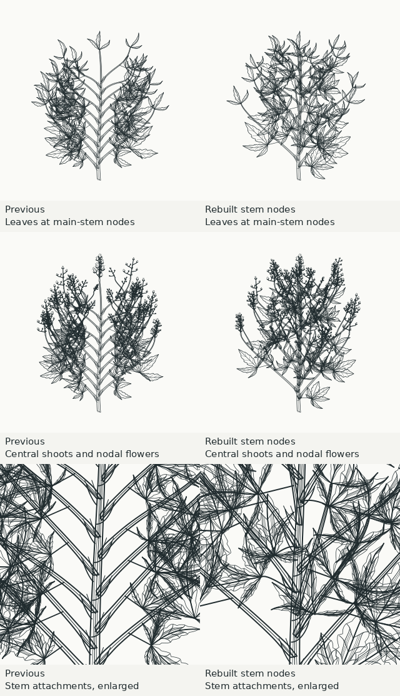
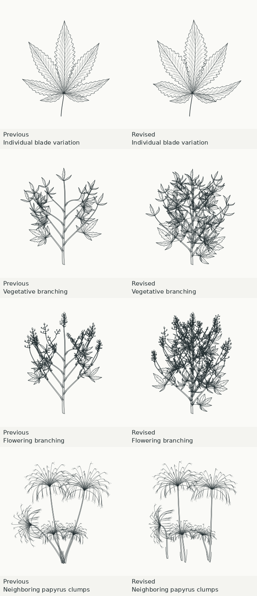
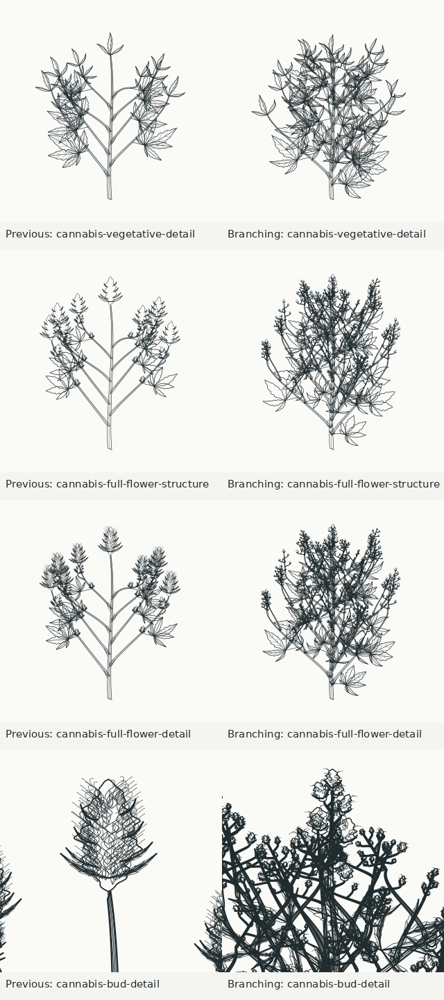
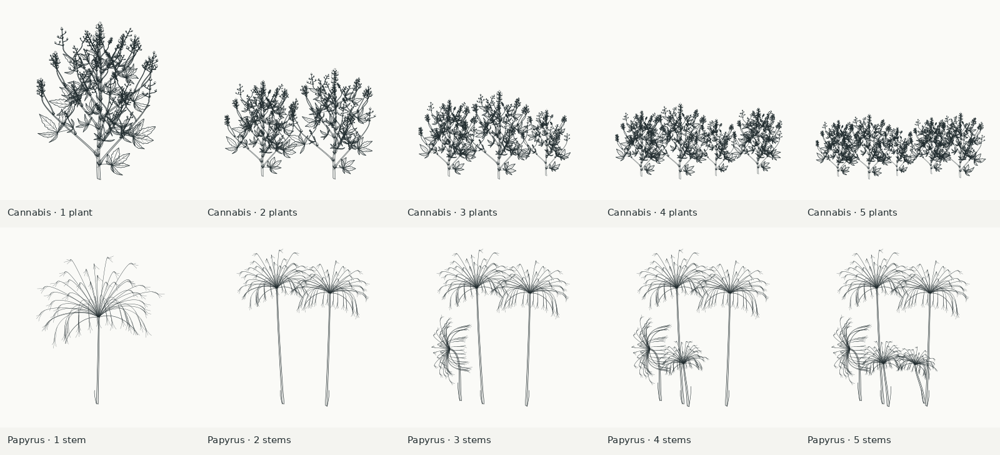
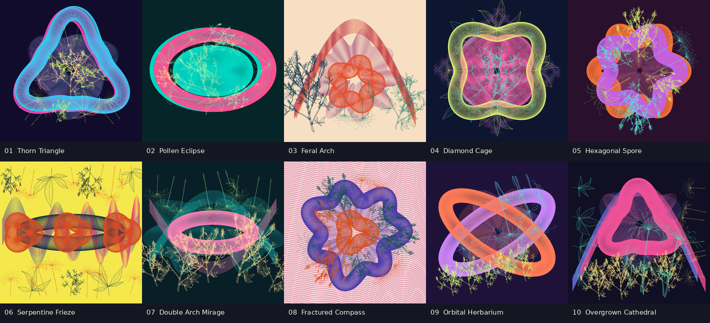
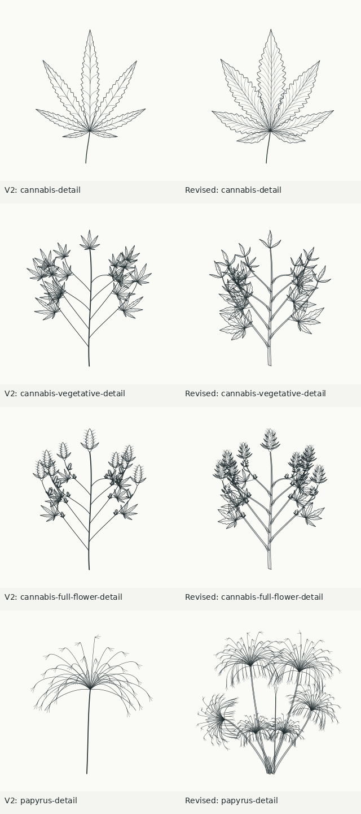
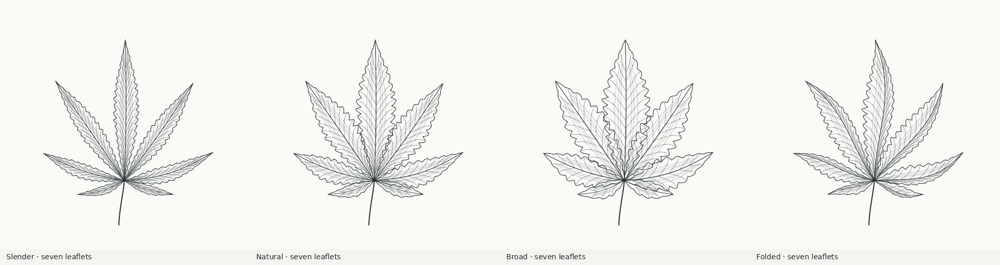
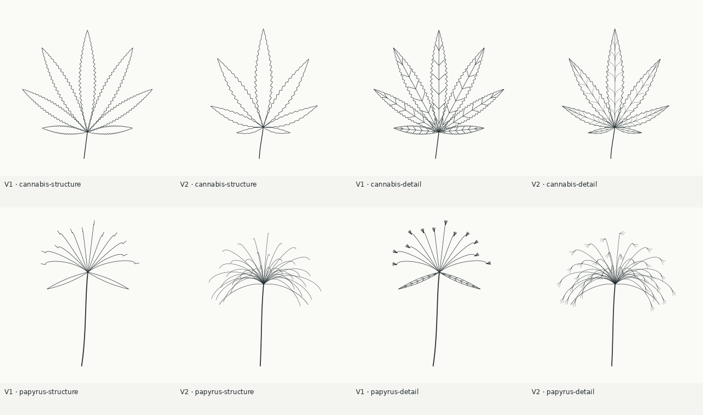
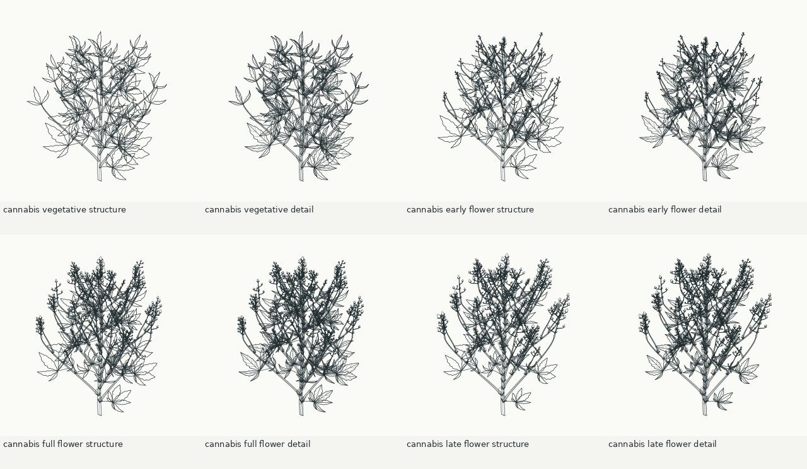

# Botanical passes v2 — papyrus and cannabis, with follow-up reconstruction

2026-11-07. Evaluated the **61 new photographs** in
`resources.static/botanical`: 38 cannabis
images and 23 papyrus images. Revised both native botanical constructions and
their review plates. Cannabis now includes whole plants with **vegetative,
early-flowering, full-flowering and late-flowering variants**, each in structure
and detail passes, alongside three/five/seven/nine-leaflet studies. The
follow-up keeps the accepted growth cycle and substantially rebuilds leaf
variation, buds, stems and the papyrus clump.

The photographs provide much stronger evidence for leaf proportions, branching
and flower/crown masses than the previous generic line constructions. They are
the visual basis for this revision; the forms remain procedural interpretations.

## Current revision: cannabis stem nodes, individual leaves, papyrus clumps and radial compositions

### Correcting the bare central cannabis stem

The density-only revision still left an incorrect empty central axis, with
most leaves and flowers displaced onto long side branches. The user rejected
that construction. Rechecking `IMG_20200802_112141.jpg` and
`IMG_20200815_092704.jpg` shows petioles and small shoots attached at main-stem
nodes, with foliage overlapping the center. `DSC_3280.JPG` shows flowering
growth continuing through that center. `DSC_3301.JPG` exposes the junctions
and repeated branching clearly; its cut-back tips are preparation artifacts.

The replacement construction distributes shoots around the main axis and
projects them into the drawing, including forward/backward directions.
Each branch begins at a stem node. Selected nodes carry direct, curved leaf
petioles with varied fan sizes; flowering stages also carry a flower group
at each node. Node placement continues up toward the apex, and branches rise
by unequal amounts. The accepted growth-stage sequence and doubled primary
branch counts remain intact. This changes the attachments and occupied space
through the center, beyond increasing lateral branch density.

[](../../generative_patterns/botanical-axis/comparison-320.png)

[Enlarged stem attachments](../../generative_patterns/botanical-axis/stem-attachments-960.png)
and [96 px comparison](../../generative_patterns/botanical-axis/comparison-96.png).
The preceding density-only SVGs are frozen in `botanical-axis/before/`.
Tests require central projected shoots, direct stem leaves, and nodal flower
groups attached at the same points as the corresponding primary branches.

### Density, leaf variation, clumps and compositions

The preceding evaluation exposed three remaining weaknesses: cannabis still looked
excessively pruned, papyrus culms converged on one artificial point, and the
wild plates changed their engraving more than their botanical composition.
The improvement plan was to increase the branch scaffold, vary each blade,
spread the roots across neighboring clumps, and compose whole specimens
along different geometric paths. These changes are now implemented:

- **Fuller cannabis:** doubled primary branches in the growth/detail studies
  (8 → 16), count studies (6 → 12 before instance variation), and whole-plant
  placements in all ten wild plates. Direct stem leaves and central projected shoots fill the previously
  bare scaffold. Late flowering retains more foliage while still reducing it
  relative to full flowering. The accepted four-stage cycle remains intact.
- **Individual leaves:** each blade has independent length, breadth, taper,
  marginal asymmetry, curvature and tooth variation. Some tips curl sideways
  and their margins roll inward, with a visible fold line at detail levels.
  These differences occur within a single fan as well as between specimens.
- **Papyrus braces:** culms emerge across neighboring groups of roots, with
  uneven basal heights, upright and flattened crowns, bent older heads and
  emerging shoots. The user’s riverbank description guides this composition.
- **Different botanical compositions:** plates 05 and 08 radiate whole
  branching specimens outward from irregular central root rings. Plate 02
  follows an oval with a tangential garland. Other plates use triangular
  edges, asymmetric arches, uneven hanging thickets, tilted stands and
  borders with varied size, stage and lean.

[](../../generative_patterns/botanical-density/comparison-320.png)

[96 px comparison](../../generative_patterns/botanical-density/comparison-96.png),
[enlarged individual leaves](../../generative_patterns/botanical-density/cannabis-natural-7-leaflets-960.png),
[vegetative plant](../../generative_patterns/botanical-density/cannabis-vegetative-detail-960.png),
[flowering plant](../../generative_patterns/botanical-density/cannabis-full-flower-detail-960.png),
and [papyrus brace](../../generative_patterns/botanical-density/papyrus-5-stems-960.png).
Frozen SVGs in `botanical-density/before/` preserve the immediately preceding
revision for this comparison.

The user's [second cannabis contact sheet](../../generative_patterns/botanical-v2/references-cannabis-2.jpg)
was checked against the local file; both have Git blob SHA
`f7cccbf0b418553b037906884f4a764884660f1e`. The exposed branching in
`DSC_3300.JPG`–`DSC_3303_ikebana_manicure.JPG` and the hanging flowering
shoots in `DSC_3296.JPG`–`DSC_3298_harvest3.JPG` make the earlier error clear:
increasing detail inside a large terminal bud outline did not represent the
branch hierarchy. The trimmed and hanging arrangements reveal attachments;
their preparation is not used as evidence of natural aging.

**Implemented correction:** primary branches now carry two to four unequal
side shoots. Flowering axes branch again, with small flower groups at nodes,
forks and tips. Open, compact and elongated structures have different
internode spacing, lateral reach, group sizes and terminal proportions.
The enclosing cone has been removed. Leaf size, angle, leaflet count and
natural/folded/broad/slender form vary within each plant. The four accepted
growth stages remain, including a vegetative stage without flowers.

[](../../generative_patterns/botanical-branching/comparison-320.png)

[Enlarged flowering shoot](../../generative_patterns/botanical-branching/flowering-shoot-960.png)
and [96 px comparison](../../generative_patterns/botanical-branching/comparison-96.png).

The native/JSON **`plants` control selects one through five whole cannabis
plants**. Each instance has a distinct seed, height and branch count.
Papyrus uses **`stems`**, with one-through-five studies and a catalog control
in that range; the existing native range of 1–12 remains available.
**`rotation`** accepts −2π through 2π for organic forms, transforming every
stem, leaf and flower together. Cannabis multi-plant stands require a
whole-plant stage. The native catalog adds `organic-cannabis-stand` with
plant count, primary branch count, flower fullness and growth-stage controls.
The catalog branch control is 6–12 (default 12); both full- and late-flower
maximum corners with five plants and fullness 1.6 fit the default resource
budget. The native `branches` range remains 3–32, subject to scene budgets.

[](../../generative_patterns/botanical-wild/counts-1-5.png)

### Ten complex botanical / guilloche / moiré attempts

The [interactive review](../../generative_patterns/botanical-wild/index.html)
provides count sliders, all ten **1280 px** previews, SVGs and authored scene
JSON. The layouts deliberately rotate, invert, overlap and interrupt plant
forms. Their engraving uses close frequencies, shifted origins, phase
families and nested contours; some also use optical interference or skewed
basketweaves. These are static experimental plates, with human acceptance
still marked `PENDING`. Fine linework needs the large previews; 320 px
reductions merge dense bands into tonal ribbons.

[](../../generative_patterns/botanical-wild/index.html)

| Attempt | Composition |
| --- | --- |
| 01 · Thorn Triangle | Unequal flowering shoots, rolled leaves and papyrus clumps trace three edges over triangular guilloche. |
| 02 · Pollen Eclipse | Tangential oval garland with varied flowering shoots, leaves and papyrus; displaced interference rings. |
| 03 · Feral Arch | Unequal flowering and vegetative columns, a papyrus keystone and nested drifting arches. |
| 04 · Diamond Cage | Two skewed woven lattices, a diamond-shaped leaf corona and a large tilted vegetative plant. |
| 05 · Hexagonal Spore | Six whole branching specimens point outward from irregular central roots across fivefold and sixfold fields. |
| 06 · Serpentine Frieze | Uneven flowering shoots and papyrus braces lean inward from opposing borders around a chirped ribbon. |
| 07 · Double Arch Mirage | Opposing arches frame upright and hanging thickets with unequal heights, stages, root positions and lean. |
| 08 · Fractured Compass | Nine unequal outward branching spokes mix flowering cannabis, foliage and paired papyrus crowns. |
| 09 · Orbital Herbarium | Tilted oval fields cross leaning five-plant/culm stands and three differently shaped leaf fans. |
| 10 · Overgrown Cathedral | Dense nested arches and triangular guilloche, an uneven mixed forest, and botanical side borders. |

The authoring script writes ten
strict native scenes in `examples/generative/botanical-wild/`. The existing
native plate generator renders them. The review script
creates the large previews, comparisons, count sheet and local review page.
The [plate manifest](../../generative_patterns/botanical-wild/manifest.json)
records each SVG hash, path count and point count.

The three form suggestions below have progressed: developmental families
now vary within a plant; clumps are parameterized; and mixed ornamental
arrangements have ten concrete experiments. Geometric occlusion remains a
possible further refinement—these drawings still expose overlapping lines.

## Earlier follow-up: leaf forms and papyrus clumps

The following comparison records the earlier follow-up, before the
flowering-branch correction above. Its large bud outlines are superseded.

The initial v2 cycle was accepted, but the leaf, flower and papyrus drawings
were still too schematic. Enlarging `IMG_20200802_111900.jpg` and `112052`
showed wider blades, unequal teeth and less uniform fans. `DSC_3280.JPG`
showed lumpy clusters with projecting small leaves, rather than smooth
oval flowers. `DSC_3303_ikebana_manicure.JPG` clarified tapered stems and
branch junctions. `papyrus_0993.jpg` supplied the most useful whole-clump
composition: two high heads, a strongly bent lower head, smaller spreading
heads and narrow emerging heads, all rising from one basal bundle.

| Follow-up change | Implementation and review |
| --- | --- |
| Make leaf variation structural | Four explicit forms: natural, slender, broad and folded. Three, five, seven and nine leaflets; graded, uneven reach; independently perturbed tooth positions; unequal margins; curved midribs, secondary veins, crosslinks and marginal forks. Sixteen new leaf studies make the differences directly comparable. |
| Increase bud and stem detail | Unequal lobes, staggered pointed bracts, paired curved filaments, small serrated leaves along the cluster, and smaller flowers along side shoots. Tapered stem outlines, ridges, branch collars and stipules replace single-line stems. Independent flower fullness changes cluster breadth. Enlarged bud and stem plates expose these details. |
| Rebuild papyrus as multiple fronds | One through twelve culms; the main plate uses seven, while the current catalog uses a 1–5 control. Distinct head heights, sizes and lean, including open, drooping and emerging heads. Front rays droop, back rays rise, and terminal forks carry finer spikelets at high detail. Additional five- and nine-culm studies show the grouping. |
| Keep the accepted growth cycle | The same four plant stages remain. Vegetative density comes from larger, staggered fans and folded new leaves. Flowering stages retain terminal and lateral flowers, with larger clusters and less broad foliage late in the cycle. |

[](../../generative_patterns/botanical-v3/comparison-320.png)

Left: the pushed v2 drawings. Right: this follow-up. The
[96 px comparison](../../generative_patterns/botanical-v3/comparison-96.png)
checks small-size readability. Frozen v2 SVGs are retained in `botanical-v3/before/`.

[](../../generative_patterns/botanical-v3/leaf-forms-480.png)

Inspect the [photo comparisons](../../generative_patterns/botanical-v3/photo-comparison.jpg),
[enlarged buds](../../generative_patterns/botanical-v3/cannabis-bud-detail-960.png),
[stem junctions](../../generative_patterns/botanical-v3/cannabis-stem-detail-960.png), and
[papyrus clump](../../generative_patterns/botanical-v3/papyrus-detail-960.png).
The [evidence record](../../generative_patterns/botanical-v3/evidence.json)
records exact source hashes and crop coordinates after EXIF rotation.
The enlarged bud/stem plates are cropped views of the same native plant,
not separately drawn illustrations. Fine veins and bracts need these larger
views; a 96 px whole plant conveys silhouette and mass.

## Evidence and evaluation

All 61 files were inspected in orientation-corrected contact sheets. Selected
leaf, flower, crown, terminal-fork and trimmed-branch views were also inspected
at larger sizes. The [inventory](../../generative_patterns/botanical-v2/reference-inventory.json)
records every filename, SHA-256, original and displayed dimensions, EXIF
orientation, contact-sheet location and intended visual use. The originals
remain untouched. Several portrait photographs require EXIF rotation; their
stored width and height alone would give the wrong presentation.

| Subject and evidence | Evaluation | Application |
| --- | --- | --- |
| Cannabis leaf faces: `IMG_20200802_111900.jpg`, `111934`, `112001`, `112043`, `112052`, `112120`, `112141`, `112147` from the same filename series | Best sources for the common leaflet junction, long center blade, shorter outer blades, sharply pointed teeth and unequal leaf attitudes. Overlap and perspective prevent precise dimensional measurement. | Curved leaflet axes, graded lengths, count-dependent spread, forward-pointing teeth and subordinate veins. |
| Cannabis standing foliage: `IMG_20200802_111817.jpg`, `111835`, `112030`; `IMG_20200809_104556.jpg`, `104604`; `IMG_20200815_092704.jpg`; `DSC_3286_xxx3.JPG` | Useful for branching and the separation between a leaf and an entire plant. Many views are closely related specimens or viewpoints. | Whole-plant scaffold with rising side shoots and fan leaves attached by petioles. |
| Cannabis flowering specimens: `DSC_2146.JPG`, `DSC_2202.JPG`, `DSC_3280.JPG` through `DSC_3285_xxx5.JPG` | Essential addition to the leaf evidence. Long terminal clusters and smaller clusters along branches dominate several silhouettes; the photographs do not establish a dated progression through growth stages. | Larger terminal flower masses, smaller lateral clusters, small projecting leaves and a separate fine-detail pass. |
| Hanging/cut material: `DSC_2190_white_cashmere_harvest_scaled2k.jpg`, `DSC_3294.JPG`–`DSC_3299.JPG`; trimmed arrangements: `DSC_3300.JPG`–`DSC_3303_ikebana_manicure.JPG` | Strong evidence for cluster spacing and exposed branching. Hanging orientation, cut ends and removed foliage are consequences of preparation. | Inform cluster and branch construction; do not interpret the preparation itself as natural senescence. |
| Cannabis context: `IMG_20200909_104956.jpg`, both `PXL_…` images; detached shoots in `IMG_20200802_112548.jpg` | Context views help overall habit; colored lighting and small subjects weaken color/detail evidence. Detached shoots help attachment reading. | Secondary references. No cultivar identity or color calibration is inferred from filenames or lighting. |
| Papyrus group views: `DSC_0927.JPG`, `papyrus_0993.jpg`, `0999`, `1002`, `1005`, `1018`, `1157`, `1158`, `1189` | Long, relatively bare culms, unequal crown heights, leaning stems and a tight basal bundle provide a strong composition model. Some crowns overlap. | Mixed clump with up to twelve unequal culms; the main study uses seven. |
| Papyrus crowns: `papyrus_1010.jpg`, `1011`, `1022`, `1149`, `1156`, `1195`; terminal detail: `papyrus_1204.jpg` | Best evidence against the old flat fan. Rays have different reaches and projected depths; peripheral rays bend downward. The terminal close-up shows fine forks, rather than broad arrowheads. | Three interleaved ray layers, arching/drooping periphery, thinner terminal forks and restrained bracts. |
| Brown/drooping heads: `papyrus_1179.jpg`, `1182`, `1185`; small/closed heads: `1187`, `1198`, `1201`, `1202` | Distinct useful forms. Their visible states support further drawings, but the images alone do not identify exact ages or causes of drooping. | Bent and emerging heads are included in mixed clumps. Separate dry-head and head-state selectors remain a possible extension. |

Contact sheets:
[cannabis 1](../../generative_patterns/botanical-v2/references-cannabis-1.jpg),
[2](../../generative_patterns/botanical-v2/references-cannabis-2.jpg),
[3](../../generative_patterns/botanical-v2/references-cannabis-3.jpg),
[4](../../generative_patterns/botanical-v2/references-cannabis-4.jpg);
[papyrus 1](../../generative_patterns/botanical-v2/references-cyperacea_papyrus-1.jpg),
[2](../../generative_patterns/botanical-v2/references-cyperacea_papyrus-2.jpg).
Short numeric names in the table retain the prefix and extension of their
series; the inventory contains the exact paths.

## Evaluation of the previous passes

**Cannabis:** the previous single-leaf construction was recognizable, but used
straight axes, nearly uniform angular spacing and a repeated tooth wave.
The center was congested in the detailed pass, while the outer leaflets had
little individual character. More significantly, it represented an entire
plant family with one leaf and supplied no flowering form.

**Papyrus:** the previous crown was a sparse semicircular fan with small
arrow-like terminals and two conspicuous broad bracts. It omitted much of the
photographs' crown depth, downward perimeter, fine branching and variation in
stem height. The three-stem version repeated essentially the same crown.

[](../../generative_patterns/botanical-v2/before-after-320.png)

This historical comparison places V1 at left and the initial V2 at right. The
[96 px comparison](../../generative_patterns/botanical-v2/before-after-96.png)
checks reduction. The [attachment comparison](../../generative_patterns/botanical-v2/attachments-before-after-320.png)
places the previous five/nine-leaflet and three-culm drawings above their
replacements. Frozen V1 SVGs are preserved in the comparison directory.

## Improvement plan and implementation

| Step | Intended improvement | Result |
| --- | --- | --- |
| 1. Separate silhouette from fine detail | Establish leaf, plant and crown recognition before engraving. | Completed. Structure/detail retain matching outer contours, stems and primary rays. |
| 2. Rebuild the cannabis leaf | Use a common attachment, curved axes, pointed directional teeth, graded reach and controlled asymmetry. | Follow-up adds three leaflets and four leaf forms, with unequal teeth and a finer branching vein network. |
| 3. Add cannabis flowering and age variation | Make flowers part of the plant's structure, with different foliage-to-flower proportions across stages. | Completed as four whole-plant stages and eight new plates. Flower outlines survive `detail: 0`; detailed passes add bracts and short filaments. |
| 4. Rebuild papyrus | Add crown volume, bending peripheral rays, fine terminal forks and unequal culms. | Follow-up supports one through twelve culms and uses a seven-culm mixed clump for the main review. Open heads retain three depth layers; emerging heads use narrow blades. |
| 5. Integrate and verify | Expose controls through native code, authored JSON and the review catalog; preserve reproducible examples and compare at two sizes. | Completed. Validation and rebuild instructions are below. |

The whole-plant cannabis sequence retains its trunk and primary branches,
adding subsidiary flowering shoots as it changes organs: vegetative plants emphasize fans; early flowering introduces small
terminal and lateral clusters; full flowering enlarges the clusters; late
flowering enlarges and bends them further while reducing broad foliage.
The early and late transitions are **inferred drawing choices**, supported by
the available foliage and flowering silhouettes. They are not a measured
time series, a claim that age alone determines flowering, or a simulation of
natural senescence. The sparse late form does not reproduce cut stems or
hanging specimens.

[](../../generative_patterns/guilloche-enrichment/sheets/cannabis-growth-320.png)

At 320 px the new flower masses and papyrus forks are legible. At 96 px the
main scaffold and mass changes remain readable, but individual teeth, bracts
and filaments merge. Use structure passes for small whole-plant icons; use the
isolated leaf when leaflet identification is the priority. These are open
line drawings: intersecting organs remain visible through one another.

## Three inferred improvements or form suggestions

1. **Cannabis as a developmental family.** Pair the isolated fan with whole
   plants whose flower mass increases and broad foliage decreases. The
   standing foliage and `DSC_3280`–`3285` photographs make this the highest-value
   extension. Implemented in v2; the follow-up adds independent flower
   fullness and four explicit leaf forms. Foliage retention could become
   independently selectable to widen the family further.
2. **Papyrus green, closed and dry crowns.** Use `papyrus_1195` for the open
   crown, `1198`/`1202` for a narrow closed-head study, and `1182`/`1185` for
   a bent, trailing dry-head study. The follow-up combines open, bent and
   emerging heads at unequal heights. A separately selectable dry crown
   could add trailing curled rays and distinctive terminal density.
3. **Specimen arrangements with controlled overlap.** The cannabis trimmed
   arrangement and papyrus basal-bundle photographs suggest taller, less
   emblematic compositions. V2 introduces whole plants and unequal culms.
   A subsequent specimen pass could add silhouette fills or geometric
   occlusion so dense flowers and overlapping leaves read as separate masses,
   with fine engraving reserved for larger output sizes.

## Controls, artifacts and validation

The implementation lives in
`izzi-svg-guilloche-organic.inc`,
with `cannabis_growth_stage` and `organic_spec::growth_stage` in
[`izzi-svg-guilloche.h`](../../html/izzi-svg-guilloche_8h.html).
The JSON parser/schema and native review catalog expose the same stage names.
Omitting `growth_stage` preserves the isolated leaf selection; the revised
geometry intentionally changes its appearance. Non-default cannabis stages
are rejected on other presets. Existing plate IDs remain available.
`cannabis_leaf_form`/`leaf_form` is available in native code, scene JSON and
the catalog; `flower_fullness` is a native/JSON control with range 0.65–1.6
and default 1. It changes flower-group breadth and the spread of their
supporting shoots. Non-default values require the cannabis preset. Papyrus
`stems` accepts any integer from 1 to 12. The native/JSON default remains
one culm for compatibility; the current catalog selects five and the earlier
main plate explicitly selects seven. New count studies cover exactly 1–5.

Example geometry within an authored scene:

```json
{
  "id": "plant",
  "kind": "organic_field",
  "preset": "cannabis",
  "growth_stage": "full-flower",
  "span": 280,
  "branches": 12,
  "leaflets": 7,
  "leaf_form": "natural",
  "flower_fullness": 1.3,
  "plants": 3,
  "rotation": 0,
  "detail": 2,
  "asymmetry": 0.18,
  "seed": 20261107
}
```

The [native gallery](../../generative_patterns/guilloche-enrichment/index.html)
now contains **173 plates**, including sixteen leaf variations, four
additional papyrus clump studies, two enlarged cannabis details, ten 1–5
count studies and ten mixed botanical interference experiments. Each new plate
has authored JSON, resolved metadata, SVG, and 320/96 px previews. The
gallery's artifact hash manifest covers the refreshed files. Discrete growth
stages change topology; no cross-stage animation interpolation is claimed.

Validation includes the native enrichment suite, schema/native agreement,
all 173 generated plates, SVG IDs/references and the existing lenticular
export contracts. Added geometry checks cover finite bounds at combined
parameter extremes, exact resource estimates, closed non-self-crossing
leaflet outlines, unique secondary veins, shared attachment points, seed determinism and stable IDs,
flower retention under accessible profiles, increasing flower area and
reduced late-stage foliage. Visual checks cover both 320 px and 96 px.
Follow-up checks cover all sixteen leaf-form/count combinations, broad-versus-
slender blade area, independent flower-fullness area, detailed bracts and stem
ridges, upper fans respecting the selected leaflet count, and distinct culm
heights in seven- and twelve-culm clumps. Schema
tests also reject unsupported leaf forms, fullness bounds and culm counts.
The latest checks cover exact plant counts 1–5, unique instance IDs, bounds,
within-plant flower-size variation, flowering-shoot attachment to parent
axes, exact estimates for denser 12-branch stands, rotation preserving every attachment,
selective rolled tips and unequal blade areas within a fan, and separated papyrus
roots across the three-, five-, seven- and twelve-culm cases. The catalog
contract also exercises its combined maximum density in full and late flower.
The final stem checks require direct nodal leaf attachments, central projected
shoots and flower groups at every main-stem node in flowering stages.

**Results:** all four enrichment CTests and `review.native-catalog` passed.
The saved gallery passed its 173-plate validation; all report links and 909
gallery artifact hashes were checked. The 61 source-image hashes still match
the inventory, which found no byte-identical duplicate photographs.

Rebuild the gallery with the repository's configured build:

```sh
cmake --build build/review-unified --target izzi_guilloche_enrichment izzi_guilloche_enrichment_plates izzi_guilloche_lenticular -j 3
cmake --build build/review-unified --target izzi_review_catalog_contract -j 3
python3 scripts/author-botanical-wild.py
ctest --test-dir build/review-unified -R '^guilloche.enrichment($|\.)' --output-on-failure
ctest --test-dir build/review-unified -R '^review.native-catalog$' --output-on-failure
build/review-unified/tests/izzi_guilloche_enrichment_plates docs/generative_patterns/guilloche-enrichment
python3 scripts/render-guilloche-enrichment-review.py --root docs/generative_patterns/guilloche-enrichment --groups botanical attachments cannabis-growth cannabis-leaves cannabis-details papyrus-stands botanical-counts botanical-wild
python3 scripts/review-botanical-wild.py
```

Raster generation uses CairoSVG when available and Inkscape otherwise.
This review used Inkscape; the before/after comparisons use the same renderer
on both sides. The current comparison script reads the preserved pre-branching
SVGs and leaves the source photographs untouched. Earlier V1/V2/V3 proofs
remain historical snapshots.
