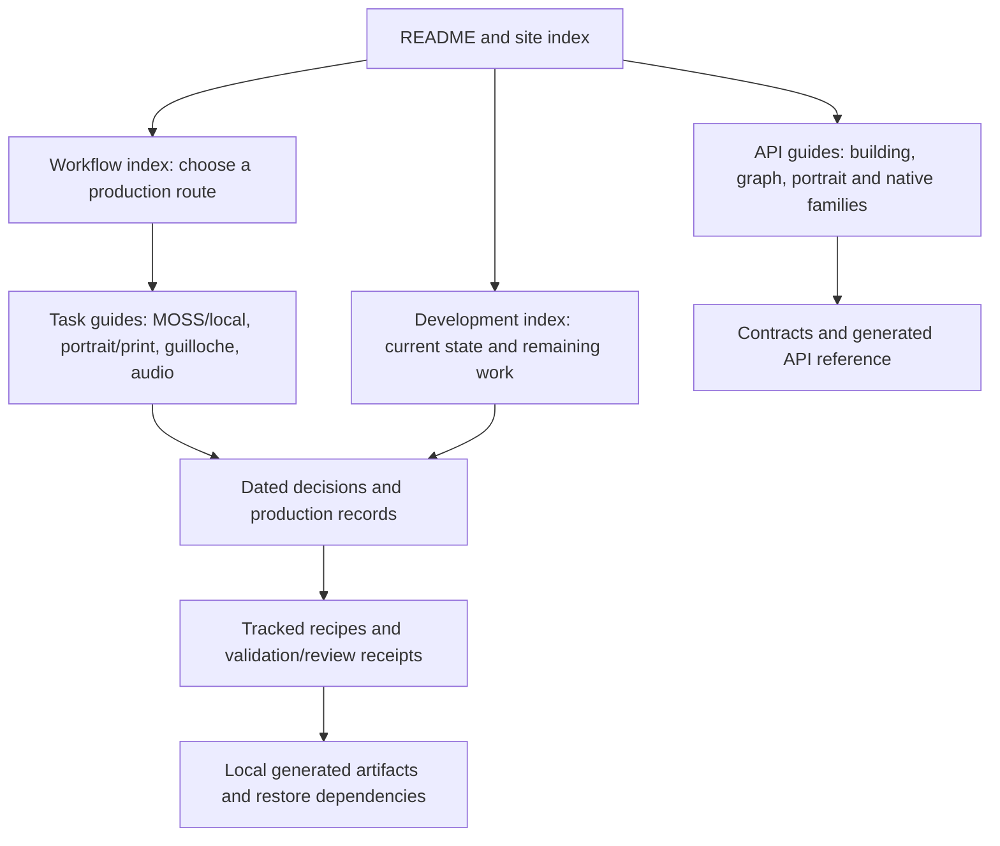

# Documentation review and development plan

Date: November 14, 2026. Baseline: `a00062fbb1cd59f762429e56a91a1a5e06418560`.
Scope: repository documentation, recent development coverage, organization,
Mermaid workflow updates including MOSS, approved D2–D4 implementation, and
the subsequently requested `izzi.public` documentation refresh.
The user also requested removal of `docs/training-conversion/` during review.

## Assessment

The implementation and production records are ahead of the entry-point docs.
Recent portrait/print work is complete, and the MOSS-to-local-film path is
documented in detail, but readers must reconstruct those facts from long dated
sessions. The main deficiencies are discovery, stale status language, missing
generated API pages, and incomplete environment/reproduction interfaces.
This review does not identify a need to rerun completed artwork or MOSS training.

The baseline contains **278 tracked Markdown files**, including **234 under
`docs/`** and **128 session records**, with **29 Mermaid blocks**. The local
link scan examined **2,264 relative Markdown links** outside code fences. It
found three missing documentation-file links, all to the renamed anniversary
stage-1 record, plus 126 missing artifact/other targets. The latter comprise
77 `outputs/`, 14 `build/`, 30 checkout-specific `home/` resolutions and five
generated Screen Glitch API references. These counts measure local path
availability, not completeness of development or published-site availability.
Fragments, external URLs and live worker state were outside that baseline scan.

Review evidence: recent commits through November 14; installed header and CMake
registrations; active navigation and dependency docs; workflow renderer code;
MOSS/local-production records; edition recipes and validation receipts. Saved
production results below were read, not recomputed by launching model or media
jobs. The local before/after audit files live in `build/documentation-review/`.

## Development status

| Area | Established result | Remaining work or limit |
| --- | --- | --- |
| [Portrait API](../../portrait.md) | Installed C++20 core/SVG adapter; banknote DLH, contour, flow, contrast and maximum-width controls; registered contract and replay tests | Proposed C++ JSON adapter and solid shadow masses remain unimplemented. Neither is required for the delivered editions. |
| [Anniversary stage 3](20261114.guilloche_anniversary_24_stage_3.md) | 20 front/back pairs, 124-case parameter explorer and full explorer PDF complete | Final selection, physical color/fine-line proof and duplex calibration |
| [Holiday v3](20261114.dk_2026_holiday_v3.md) | 50 whole-photo cards, vibrant/asymmetric layouts, all exports; 2,300 saved checks and 50 native replays | Physical printer proof and final selection |
| [Anniversary stage 4](20261114.guilloche_anniversary_24_stage_4.md) | 40 faces; only native portrait groups changed; 1,729 checks and 28 unique native replays | Same physical-print limits; preserve stage-3 source delivery dependency |
| [Holiday v4](20261114.dk_2026_holiday_v4.md) | `fall-crazy-pants`: 50 designs; 2,538 checks; 45 exact reused native portraits and five new independent replays | Keep output-name mapping explicit; a fresh reproduction needs the validated holiday-v3 delivery |
| [MOSS appearance](20261028.local_rendering_exploration_stage_2.md) | Stage-2 pilot accepted; subsequent step-512 appearance refinement complete | New appearance training would be new work, not completion of the pilot |
| [Local full episode](20261030.local_rendering_exploration_stage_5_durable_workflow.md#complete-episode-delivered--november-1-production) | Opening-v7 approved; full 52:35.375 episode, 75,729 frames and 257 lossless segments delivered and technically verified | Full-length audiovisual review remains open; record reports no independent-host archive copy |
| [Examples/Organica](../examples-workflows.md) | Form and composition books have independent coverage; Organica grouping and November botanical changes implemented | Photo-based editions are a separate coverage domain, not automatically covered by the generic books |
| [MSP projection](20261108.projection_grid_msp_3x3_metric.md) | 3 × 3 m and 2 × 2 m grids accepted with verified loops | Wall measurement, focus and device playback remain installation checks |

MOSS source details are in [Stage 2](20261028.local_rendering_exploration_stage_2.md),
[Stage 3](20261028.local_rendering_exploration_stage_3.md), and the
[historical appearance recipe](20261029.local_rendering_exploration_stage_4_durable_workflow.md#historical-moss-appearance-recipe).
The accepted step-512 checkpoint contains 511 successful updates because one
overflow update was skipped. Its saved bird/scenery pixels contribute to the
later film; saved Seedance poses and SAM masks supply other appearance/motion
inputs. Compiled replay invokes no MOSS/SAM inference, provider, LLM or GPU.

## Findings and disposition

| Priority | Finding and evidence | Disposition |
| --- | --- | --- |
| P1 | `docs/workflows.md` and all three shared diagrams stopped at the October 27 inventory, omitting MOSS/SAM and the November print path | Updated Mermaid, fixed-layout geometry and shared SVGs; retained observation dates and historical publication status |
| P1 | README, P9000 notes and anniversary README linked to nonexistent `20261108.guilloche_anniversary_24.md` | Removed the stale README route in favor of the edition map and repaired both retained stage-1 links; also repaired stale guilloche-review and hardware-section anchors |
| P1 | No stable entry for the installed portrait API or the cross-edition reproduction dependencies | Added [portrait API entry](../../portrait.md) and [print workflow](../../visual_workflow/tool_portrait_print.md); linked from landing pages, build docs and indexes |
| P1 | MOSS training evidence and the current CPU replay contract were scattered across stages; the development vertical row still led with provider Stage 5 | Added [MOSS/local guide](../../visual_workflow/tool_moss_local.md), linked current local Stage 5 and separated training from compiled replay |
| P1 | Generated `docs/html` contained no portrait pages; the focused `docs/html/screen-glitch/` tree was missing despite five links | Rebuilt both trees with Doxygen 1.16.1, retaining `SOURCE_BROWSER = NO` and disabling verbatim headers; all required references and 40,170 HTML/asset links pass |
| P1 | V3 environment receipt omits several imported dependency versions; scripts used fixed edition/candidate roots | Added complete read-only preflight and shared candidate configuration for holiday v3/v4; preserved original production receipts |
| P2 | Current navigation mixes task guides, chronological history and long operational narratives; `index.md` retained old site URLs and cut-v1 as its only development entry | Added task tables and current-status index; repaired landing links; folded the October queue history without deleting it |
| P2 | Holiday v2 still said work was in progress despite being superseded; holiday v4's document name differed from output name without an explicit note | Marked the trial checkpoint historical; documented the v4/`fall-crazy-pants` mapping |
| P2 | Active workflow pages still pointed at the already-relocated legacy evidence tree | Removed `docs/training-conversion/` as requested and updated active archive pointers. Historical session text and migration-baseline records remain historical |
| P2 | Renderer setup relied on a vanished `/tmp` Mermaid installation; all three fixed layouts also require a matching source graph | Documented reproducible pinned installation, recreated a local renderer, and checked source/layout parity; this is not a production-model dependency |
| P2 | 121 absent non-API targets and the legacy archive are host/local artifacts rather than missing Markdown | Keep an artifact-availability inventory and restore guidance. Do not silently regenerate or delete historical evidence to make a link scan pass |

The legacy archive location recorded by the removed README is
`examples.rizal/local-objects/legacy/izzi-docs-training-conversion-2026-08-12/`.
It is **not present in this checkout**. Removal deleted the single tracked
README placeholder. Historical archive contents and migration-baseline records
were not changed by the deletion.

## Organization adopted

Keep stable, task-based entry points above dated evidence. Avoid a wholesale
filename migration: session names are already referenced by receipts, scripts
and review pages. Directory `index.md` pages should remain short redirects or
curated pointers to their top-level guide, not duplicate narratives.

Use separate fields when adding a status summary: implementation state,
technical validation, human review, delivery/publication, and next action.
For example, the local full episode is delivered/technically verified while
full-length review remains open. Holiday v2 is superseded, not blocked. A
diagram can be locally rendered and unreviewed without being publicly deployed.

## Staged work plan

| Stage | Scope and dependency | Acceptance criteria | Status |
| --- | --- | --- | --- |
| D0 — establish evidence | Inspect navigation, recent code/records, local links and diagrams | Baseline and prioritized findings recorded; historical/optional work distinguished from unfinished requirements | Complete in this pass |
| D1 — repair discovery and diagrams | D0; current guides, links, statuses, MOSS/SAM/print diagrams, requested directory removal | Changed document paths resolve; source/layout parity and Mermaid checks pass; shared SVGs visually inspected; changes staged | Complete |
| D2 — complete reference contracts | D1; consolidate adapter environment receipt, map supported profiles, decide C++ JSON scope | A documented preflight lists every required dependency/resource; supported versus proposed features are explicit; no claim that recipe JSON is a public C++ API | Complete for holiday v3/v4; JSON and solid masses remain optional |
| D3 — generated docs and regression checks | D1; regenerate both Doxygen trees and add local-doc/anchor/Mermaid checks | Portrait and Screen Glitch API pages exist; no broken documentation links; tracked diagrams match source; public snapshot audit passes from the intended committed source | Local work complete; publication verification recorded below |
| D4 — reproduction and durability | D2; explicit candidate roots, dependency restoration and separate archive-copy plan | A fresh candidate cannot overwrite a delivered edition; prerequisite artifacts are checked up front; isolated restore verifies hashes and records what is missing | Complete for holiday v3/v4; independent-host archive remains a documented follow-up |
| D5 — review and release | D1/D3 plus selected review decisions | Diagram feedback recorded against new files; selected cards physically proofed; full episode review recorded; public refresh completed and verified | Public refresh authorized and tracked below; human/physical reviews remain open |

Implemented order: **D3's API rebuild and link/diagram checks**, then **D2's
dependency preflight**, then D4's holiday v3/v4 candidate-root work. These remove
reader-facing dead ends and failed fresh-checkout starts before adding new
rendering features. Decide on portrait JSON or solid masses only for a concrete
consumer; they are optional features, not hidden delivery debt.

Preparation, rendering, validation, delivery and review now share one edition
configuration containing source hashes, frame size, native controls, output
location and dependency identities. Resume requires the same identity; changed
inputs require a new root. Existing deterministic geometry/replay receipts
remain the references, within their recorded numeric environment boundaries.

## Initial D0/D1 changes and validation

- Added stable portrait, print-edition and MOSS/local-animation guides and the
  current development table. Updated README/site, workflow and family entry points.
- Revised the three shared Mermaid graphs and matching fixed SVG geometry;
  added focused MOSS and print flows and refreshed the native portrait flow.
  The diagram packet is `outputs/workflows-v2/20261114-documentation-review/`.
- Removed the requested directory; repaired renamed links, archive pointers,
  stale v2 status and v4 naming. Preserved immutable production receipts and
  the October diagram inventory/publication evidence.

| Check | Result and scope |
| --- | --- |
| Local Markdown path audit | 281 existing Markdown files, 2,369 relative links; zero missing Markdown documentation-file targets. The 126 pre-existing artifact/API targets remain itemized for restoration or D3; this is not an all-links/site pass. |
| Changed-page heading fragments | 25 checked; guilloche review and hardware anchor repairs included. This is a local heading check, not a complete Jekyll anchor audit. |
| Mermaid syntax/render | All seven changed/new blocks parsed and rendered with Mermaid 11.16.1 / CLI 11.16.0 and local Chrome. |
| Shared SVG layout | Source/node/edge/group parity passed. Browser bounds checks passed for 23 boxes and 69 labels, with no text overflow or group escapes. All three shared figures and four additional flowchart previews visually inspected. |
| Artifact consistency | Packet source and file hashes match; all three tracked documentation SVG copies equal the rendered packet. |
| Workflow stages | Existing validator passes all four review-to-plan stages. |
| Scope and formatting | Diagram Python parses; whitespace checks pass; requested directory absent. No production tests/renders or public deployment were needed for this documentation-only change. |

Local evidence: `build/documentation-review/links-before.json`,
`links-after.json`, `layout-checks.json`, `mermaid/` and the preview PNGs.
The shared packet's `manifest.json` records source/inventory hashes, pinned
renderer versions and `UNREVIEWED` status. Generated previews remain local;
the three documentation SVGs and source changes are staged in Git.

This initial checkpoint delivered the requested staged review. The following
approval expanded execution to development and public documentation publication.

## Approved continuation

The user approved this plan and requested unattended implementation. D3's API
rebuild and documentation regression checks proceed first, followed by D2's
dependency preflight and D4's candidate/restore work for the recent portrait
and print pipeline. Existing completed artwork and immutable receipts remain
the comparison references. Proposed portrait JSON and solid-shadow features
remain optional; no concrete consumer has been selected for them.

The user subsequently requested updating `izzi.public` with the current Izzi
documentation after this work, and recording the task and result here. The
publication step is now authorized. Its source revision, mirror validation and
publication result are tracked below. Human audiovisual review
and physical printer/installation checks remain human follow-up.

## Approved execution results

- Added `make docs-check` and `make docs-api`. API generation validates a new
  tree before replacing `docs/html`, retains a backup and never commits by
  itself. Both main and Screen Glitch references are now present, including
  the portrait core and SVG adapter. There are 1,185 generated HTML files.
- Added local path/heading regression checks, source-to-SVG parity checking and
  optional rendering of every Mermaid block. Five additional historical heading
  references now resolve through compatibility anchors; historical pages receive
  the same heading checks as active guides.
- Added `portrait-edition.py` preflight/init/run/restore commands for holiday
  v3/v4. The preflight records 19 runtime/tool versions and, for v4, 282
  input/code hashes. New runs live under `outputs/portrait-candidates/` with
  explicit resume, immutable configuration identity and one writer at a time.
- Updated the print guide and edition READMEs with current commands, restoration
  dependencies and the separate independent-host archive plan. Anniversary
  and MOSS pipelines were not migrated to this candidate interface.
- Updated the public mirror script to use the validated API generator, refuse
  a dirty mirror checkout, fast-forward its base before replacement and allow
  retrying a push when the snapshot content is already current.
- The committed-snapshot audit exposed one private-repository URL in the
  November 7 botanical record. Its contact-sheet link now uses the included
  relative documentation path, preserving the recorded reference hash.

| Check | Result |
| --- | --- |
| Documentation audit | 281 Markdown files; 2,480 local links and 217 heading references at this checkpoint; no missing documentation paths or heading targets. The 121 unavailable local artifacts remain listed for restoration. |
| Mermaid and shared diagrams | All 33 repository Mermaid blocks rendered, including the new candidate/restore flow; all three shared SVGs match their graph/layout sources. Initial visual/bounds checks remain applicable to the unchanged shared diagram geometry. |
| Generated API | 40,170 HTML/asset links pass; portrait and Screen Glitch pages exist; no source-listing pages. Doxygen emitted 216 main-reference diagnostic lines and zero focused-reference lines; comment cleanup remains non-blocking follow-up. |
| Registered regression tests | Three CTest entries pass: documentation links (4 fixtures), candidate safety (7 fixtures), public-mirror links (8 fixtures). Shell syntax and whitespace checks pass. |
| Fresh v3 trial | `documentation-review-v3`: H01-v03 rendered in an isolated root; both composed SVG and native SVG are byte-identical to the original delivery. This is a selected-card test, not a new full batch. |
| Isolated v4 restore | `documentation-review-v4`: copied and verified 404 artwork files, ten native input planes and the native binary; rebound only copied input-plane receipt paths; all 404 original delivery files and tracked production JSON records unchanged. |
| Restored v4 checks | All 2,538 checks passed, retaining 45 proven holiday geometries and independently replaying the five resized H02 portraits. |
| Restored PDF review | All 50 saved PDF-page comparisons remain valid against their file hashes; the review phase passed and regenerated ten comparison-page previews. This reused valid comparison caches, not 50 new independent PDF renders. |
| Delivery isolation | The v4 delivery adapter and its common exporter both resolve to the candidate artwork directory. The original PDF delivery was preserved. |

Evidence remains local in `build/api-mnog1yfm/`,
`build/documentation-review/final-doc-check/`,
`build/documentation-review/reproduction-result.json`, and the two candidate
directories. `restore.json`, `candidate.json`, phase logs and `state.json`
describe the restore and validation boundaries. The archive plan is documented;
no independent-host archive copy was made or claimed.

## Public documentation refresh

Task: update `bdekoz/izzi.public` from the completed, committed Izzi documentation
and record the source revision, mirror audit, push and live-page verification.
The curated snapshot contains documentation, generated API references, examples,
schemas and the explicitly selected workflow figures. Local artwork, photos,
model files and candidate directories remain outside the public snapshot.

Status: local implementation and validation complete; source commit, snapshot
audit, publication and live verification follow this checkpoint.

## Remaining human and optional work

Physical card/color/fine-line proofs, anniversary duplex calibration, final
design selection, diagram acceptance and full-length audiovisual review remain
human decisions. Independent-host archiving and installation checks also remain
open. Optional C++ portrait JSON, solid shadow masses and cleanup of Doxygen
comment warnings require separately scoped work; none blocks these delivered
editions or this documentation publication.
