# Generative pattern families

Generative curves, pattern families and export treatments implemented in
`izzi/src/`, with native examples, visual comparisons and construction notes.
The [guilloché enrichment guide](#native-guilloche-patterns) is part of this
page: contours, weaving, engraving, foliage, reef forms, Islamic geometry,
graphic water, optical treatments and lenticular export.

## docs/generative_patterns index

| File | Content |
| --- | --- |
| `index.md` | Directory entry page mirroring this index |
| `assessment_plan.md` | Assessment plan and per-family entry template |
| `hamonshu.md` | Canonical Hamonshū guide: source groupings, volume 2 catalogue, native water APIs, provenance and revision map |
| `guilloche.md` | Core guilloche API and historical capability/tuning notes; [native enrichment constructions](#native-guilloche-patterns) are documented on this page |
| `moire.md` | Family entry: moire |
| `danmu.md` | Family entry: danmu (danmaku text overlay), incl. W3C Bullet Chatting relation |
| `surface_tension.md` | Family entry: surface tension |
| `edge_tension.md` | Exact cubic bundles, sixteen authored reference recipes and eighty study plates |
| `keyframes.md` | Family entry: deterministic keyframes, route-derived framing, and K4 asset/review handoff |
| `radial.md` | Family entry: radial |
| `harmonograph.md` | Family entry: damped harmonograph |
| `grignani.md` | Family entry: grignani |
| `roulette.md` | Family entry: roulette |
| `images/` | Rendered previews from the parameter-space visual testers (gallery below) |
| `guilloche-enrichment/` | Generated SVG/JSON, rasters and calibration assets for the [native patterns documented below](#native-guilloche-patterns) |
| `docs/visual_workflow/visual_experiments_method.md` | Form-first method for visual experiments (cross-cutting, not family-specific) |

## Family index (izzi/src)

| Family | Headers | Docs / notes |
| --- | --- | --- |
| hamonshu | `src/izzi-svg-curves-hamonshu.h`, `src/izzi-svg-curves-hamonshu-v2.inc` | [Canonical Hamonshū guide](generative_patterns/hamonshu.md): APIs, three-volume source catalogue, native water fields, provenance and revision map |
| guilloche | `src/izzi-svg-guilloche.h`, `src/izzi-svg-guilloche-json.h`, `src/izzi-svg-graph-guilloche.h` | [Native contours, waves, basketweave, hobnail and flinqué](#native-guilloche-patterns); [core family](generative_patterns/guilloche.md); [title-card workflow](visual_workflow/tool_guilloche.md) |
| foliate and botanical | `src/izzi-svg-guilloche.h` (`organic_spec`) | [Vines, scrolls, palmettes and seven botanical forms](#foliate-and-botanical-forms) |
| coral and anemone | `src/izzi-svg-guilloche.h` (`organic_spec`) | [Eight coral forms and two distinct anemone forms](#reef-forms) |
| arabesque | `src/izzi-svg-guilloche.h` (`arabesque_spec`, `tile_graph`) | [Islamic geometric patterns and shared tile edges](#islamic-geometric-arabesque) |
| lenticular export | `src/izzi-svg-lenticular.h`, `src/izzi-svg-lenticular-json.h` | [Interlacing, physical units and calibration](#lenticular-export-and-calibration) |
| moire | `src/izzi-svg-moire.h` | [Field API and exact grating reference](generative_patterns/moire.md); [six native optical effect/control pairs](#water-forms-and-optical-controls) |
| danmu | `src/izzi-svg-text-overlay.h` | `docs/generative_patterns/danmu.md`; W3C Bullet Chatting relation; `examples/text-danmu-[1-5].cc` |
| surface tension | `src/izzi-svg-surface-tension.h` | visual experiments method |
| edge tension | `src/izzi-svg-edge-tension.h` | [Cubic API, sixteen reference recipes and study commands](generative_patterns/edge_tension.md) |
| radial | `src/izzi-svg-radial*.h` (6 headers) | visual experiments method |
| damped harmonograph | `src/izzi-svg-curves-damped-harmonograph.h` | — |
| grignani | `src/izzi-svg-curves-grignani.h` | — |
| roulette | `src/izzi-svg-curves-roulette.h` | — |

Doxygen-generated API reference for the family headers lives in `docs/html/`.

## Visual-tester gallery

Each family's parameter-space explorer example renders a grid or plate set that
sweeps its configuration surface. The previews below are those renders; the
generation classes each example exercises are listed beside the image.

| Family | Parameter-space example | Generation classes | Preview |
| --- | --- | --- | --- |
| hamonshu | `examples/curves-hamonshu.cc` (13 curated motifs × 7 curvature ratios) | `svg::hamonshu::motif_config`, `pattern_spec`, `pattern_box` | 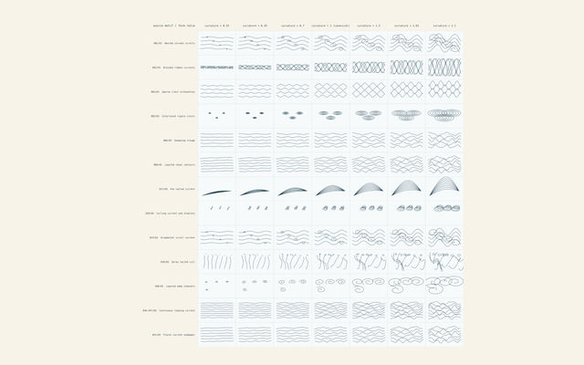 |
| guilloche | `examples/guilloche-plates.cc` (composition kinds × render profiles); `examples/guilloche-capability-plates.cc` (261 plates); `examples/guilloche-enrichment-plates.cc` ([123 new studies and lenticular packets](#native-guilloche-patterns)) | `izzi::guilloche::composition_spec`, `plate_spec`, `scene_spec`, `render_profile`, `pattern_class`, `pattern_family` | 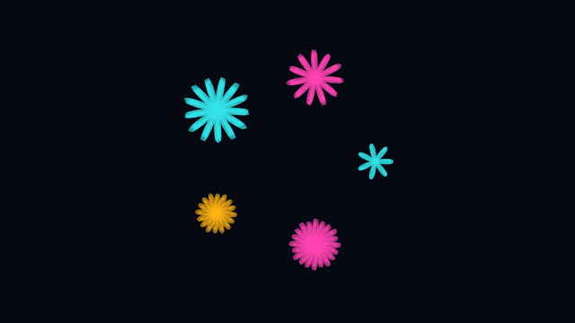 |
| moire | `examples/moire-plates.cc` (10 named plate scenes) | `izzi::moire::scene_spec`, `render_profile` | 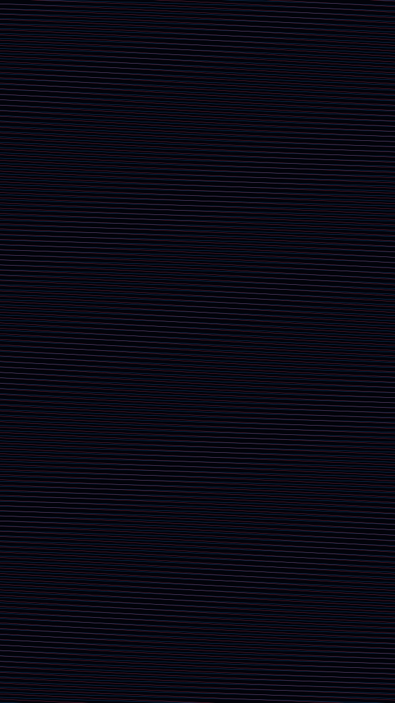 |
| surface tension | `examples/surface-tension-plates.cc` (10 named plate scenes) | `izzi::surface_tension::scene_spec`, `contour_layer_spec`, `render_profile` | 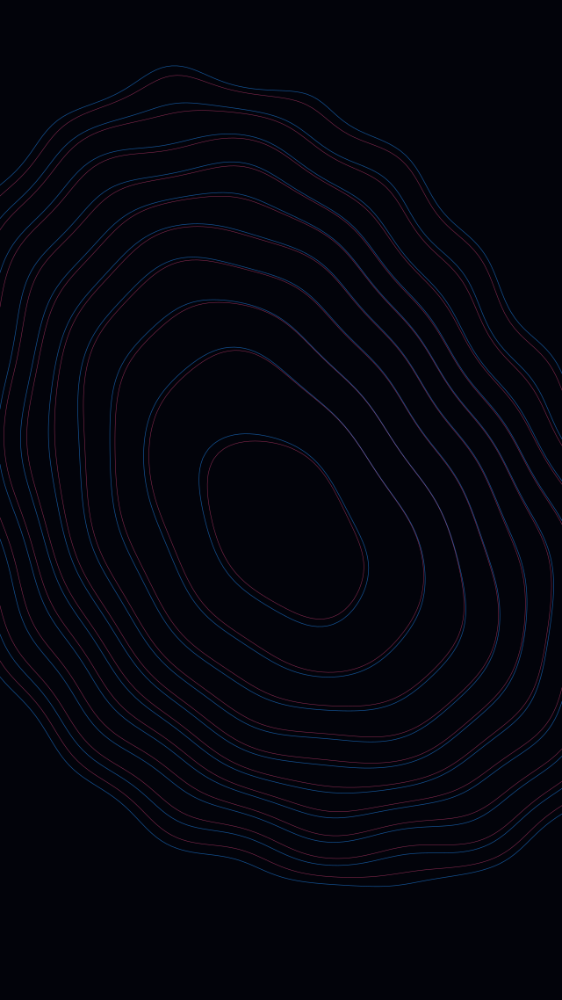 |
| radial | `examples/radial-gradient-variants.cc`, `examples/radial-graph-kusama-1.cc` (gradient and orbit parameter variants) | `svg::graph::radial_orbit_spec`, `svg::graph::radial_dataset`, `svg::radial` | 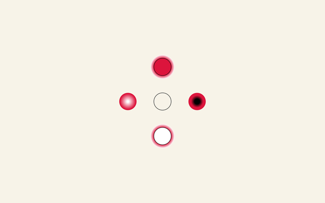 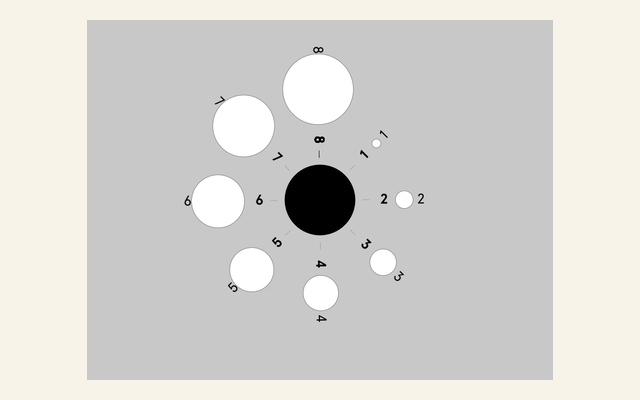 |
| damped harmonograph | `examples/curves-harmonic-4.cc` (interval × drift grid; `curves-harmonic-3.cc` triple explorer) | `generate_damped_harmonograph()`, `generate_triple_harmonograph()` | 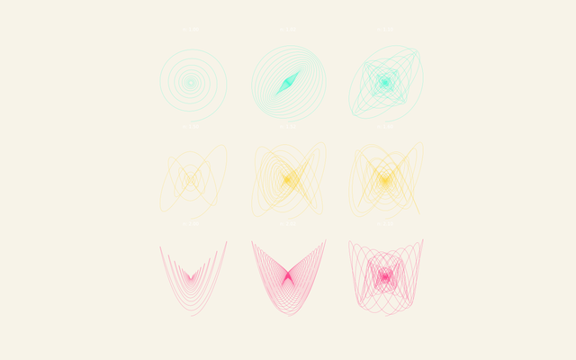 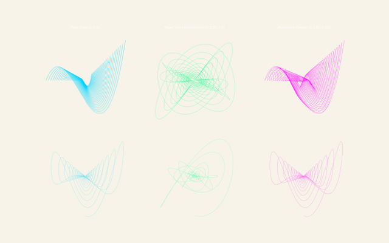 |
| grignani | `examples/curves-grignani-2.cc` (ripple amplitude/frequency/phase/decay/tilt grid; `curves-grignani-1.cc` ribbon grid) | `svg::grignani::ribbon_config`, `ripple_config` | 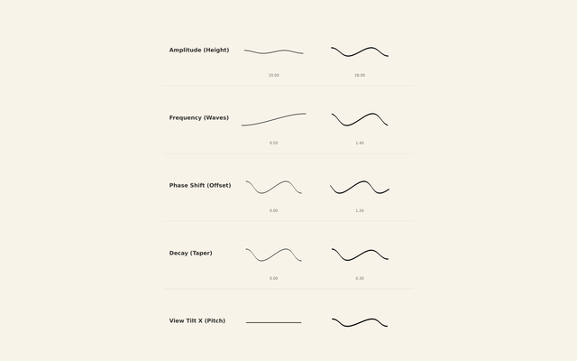 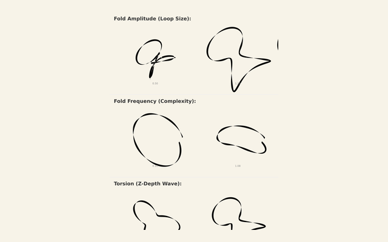 |
| roulette | `examples/curves-roulette.cc` (radius/kind parameter space) | `svg::roulette::trochoid_config`, `roulette_config`, `roulette_kind` | 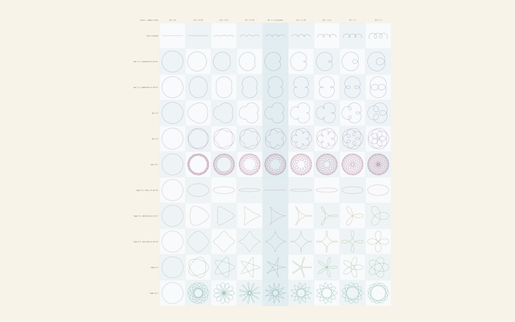 |

The guilloche, moire, and surface-tension previews are the canonical named
plates from their plate examples (`variant-data-orbit-experimental.svg`,
`moire-01-linear-close-beat.svg`, `surface-tension-01-paired-drops.svg`).

The [Dutch stage-6 reconstruction](generative_patterns/guilloche.md#stage-6--rectified-dutch-security-panel)
adds elliptical loop carriers, a complete security panel, engraved lettering,
ten structural variations and measured source comparisons. Regenerate with
`make guilloche-dutch-stage6-review`.

The [Dutch stage-7 medallion](generative_patterns/guilloche.md#stage-7--scalloped-medallion-and-scroll-frame)
adds scalloped loop carriers, a scroll-frame reconstruction, ten variations
with different compositions and element counts, a source-fitted vector master,
and a full script OTF with numerals, accents and tabular figures.
Use `make guilloche-dutch-stage7-review` and open the
local review index.

## Native guilloche patterns

These constructions are implemented in the native C++ geometry, JSON
authoring, profiles and graph adapters. **Foliate** means vines,
scrolls and vegetal forms; **arabesque** means Islamic geometric patterns.

Jump to [contours and waves](#positive-contours-and-directed-waves),
[basketweave and hobnail](#basketweave-and-hobnail),
[flinqué](#flinqué-engraving-aperture-and-finish),
[foliate and plants](#foliate-and-botanical-forms), [reef forms](#reef-forms),
[Islamic geometry](#islamic-geometric-arabesque),
[water and optical controls](#water-forms-and-optical-controls), or
[lenticular export](#lenticular-export-and-calibration). The later
[film studies](#film-studies-and-review-4--2026-09-29) have their own review
and delivery record.

The comparisons below are embedded in this document; select a sheet for
its larger rendering. Open the [native gallery](generative_patterns/guilloche-enrichment/index.html) for 123 individual
SVG studies, authoring JSON, resolved metadata and 320/96-pixel comparisons.
The [manifest](generative_patterns/guilloche-enrichment/manifest.json) records path and point
counts; [artifact hashes](generative_patterns/guilloche-enrichment/artifact-hashes.json) identify
the generated files. The original
[research sketches](development/sessions/20260928.meta_guilloche_studies/optical-lab.html)
remain design studies. Human acceptance of the new gallery remains pending.

| Review group | Contents |
| --- | --- |
| Core | Five families × three symmetry settings × two densities, three legacy controls and three directed waves: 36 plates. |
| Arabesque | Construction and finished ornament for star8, hex6 and a finite five-tile girih10 patch: six plates. |
| Flinqué | Lotus, swirl and eccentric engraving, bare and finished, plus legacy rays: seven plates. |
| Botanical | Seven structure/detail pairs: 14 plates. |
| Reef | Eight coral and two anemone structure/detail pairs: 20 plates. |
| Water | Seven source-crop/interpretation pairs plus eight one-parameter comparisons. |
| Optical | Six effect/control pairs: 12 plates. |
| Additional controls | Diagonal basketweave, six plant/foliate attachment variants and six deformation frames. |
| Lenticular | Separate two-view and four-view export packets, outside the plate count. |

### Film studies and Review 4 — 2026-09-29

The [Meta guilloche 2 production record](development/sessions/20260929.meta_guilloche_2.md)
extends the gallery into two complete films: 89 plates in the main Draft 3
and 23 in the combined moiré/visual-illusion companion. Together they retain
all 64 Draft 2 plates and add 48 selections. The local
review contains 78 stills, 13 detail
views and a 44-page PDF.
These production studies have a separate review set from the 123-plate API
gallery above.

Reference-led native recipes in
[izzi-svg-guilloche-meta.h](html/izzi-svg-guilloche-meta_8h.html), under
`izzi::guilloche::meta`, supply Japanese wisteria, revised vines and plants,
dimensional coral, separate mosque wall/coffer studies, and Ponzo,
Poggendorff, Hering, Wundt and Kanizsa constructions. The bridge
meta-guilloche-native.cc reads
`izzi.meta-guilloche-recipe/1` production recipes. These recipe IDs are
separate from the generic scene JSON preset and optical-treatment enums.
Peripheral drift and the existing optical, moiré and lenticular selections
join the companion reel.

Review 4 uses the warm central Imam vault, with an onion outline, three
recessed ledges and triangular coffers curved inward like slices of a
sphere. Jameh coffers grow toward the center. Saguaro arms sit close to an
irregular trunk; brain coral retains its meander network with closer
cropping and foreshortened edges. The
[revision ledger](development/sessions/20260929.meta_guilloche_2.md#human-review-revisions--29-september-2026)
also records foliage taper, branching and cluster variation, accepted
studies, and superseded candidates.

All artwork uses Izzi hues. Every ten-second clip expands and travels fully
offscreen, leaving only ivory for its last eleven native frames. The four
compact H.264/MP3 MKVs and all 112 endings passed technical verification;
latest-artwork acceptance and full human playback/listening remain open.
See the [rendering workflow](visual_workflow/tool_guilloche.md) for commands,
delivery links, sizes and verification records.

### Build and author

The generator uses the public headers and strict scene reader. From the
repository root:

```sh
CCACHE_DISABLE=1 CMAKE_BUILD_PARALLEL_LEVEL=2 make guilloche-check
make guilloche-enrichment-review
# Rebuild the checked-in gallery:
build/cmake/tests/izzi_guilloche_enrichment_plates \
  docs/generative_patterns/guilloche-enrichment .
python3 scripts/render-guilloche-enrichment-review.py \
  --root docs/generative_patterns/guilloche-enrichment
```

`make examples-forms` builds control and temporal comparisons for registered
native patterns. `make examples-composition` builds authored wild scenes and
crossovers. The standalone enrichment plates and interactive controls remain
available through the commands above.

The raster step needs CairoSVG, Pillow and DejaVu Sans. Individual native
SVGs and JSON documents do not require those tools. The generator is
[guilloche-enrichment-plates.cc](../examples/guilloche-enrichment-plates.cc).


```cpp
#include <izzi-svg-guilloche.h>
#include <iostream>

int main()
{
  using namespace izzi::guilloche;
  organic_spec leaf;
  leaf.preset = organic_preset::ginkgo;
  leaf.span = 280;
  leaf.detail = 2;
  scene_spec scene;
  scene.id = "ginkgo-study";
  scene.title = "Ginkgo fan and branching veins";
  scene.width = scene.height = 320;
  scene.plates = {{"ink", "#202B2E", .7, 1,
                   blend_mode::source_over, {}, 0}};
  scene.compositions = {make_organic({160, 160}, leaf)};
  std::cout << render_svg(scene);
}
```


For geometry-only JSON, use `content.kind: "none"` and
`layout.include_radial_field: false`. An accessible label remains required.
The radial-field default is still true for older documents. See a complete
[ginkgo document](generative_patterns/guilloche-enrichment/json/ginkgo-detail.json), rather than
treating the top-level `pattern` metadata as a geometry selector.
`canvas.transparent: true` omits the background rectangle.

| C++ builder | JSON geometry kind | Actual profile reduction |
| --- | --- | --- |
| `make_lobed_contour` | `lobed_contour` | Ring count and bounded sampling. |
| `make_directed_wave` | `directed_wave` | Repeated rows. |
| `make_basketweave` | `basketweave_field` | Strands within each band. |
| `make_hobnail` | `hobnail_field` | Inset contours. |
| `make_organic` | `organic_field` | Branches and internal detail. |
| `make_engraved_flinque` | `flinque`, explicit `engraving` | Engraved rings. |
| `make_arabesque` | `arabesque_field` | Periodic cell count/spacing; optional interlace. |
| `make_water` | `water_field` | Line density and bounded sampling. |
| `make_optical_study` | `optical_field` | Texture pitch. |

Graph synthesis has explicit cases for all new families. Its selectors
include `organic_form`, `engraving`, `arabesque`, `water_form` and
`optical`; each selects actual geometry. The historical latent-image and
Dutch-family fallbacks in this adapter remain documented in
[guilloche.md](generative_patterns/guilloche.md). Direct scene builders are available separately.

### Coordinates, topology and resource contracts

Unless a field says otherwise, lengths are SVG drawing units and angles
are radians. Geometry is constructed locally, deformed, then registered and
rotated with its plate. Open strokes retain explicit endpoints; closed
sampled paths repeat their first point exactly. Junctions at petioles,
branches and geometric edge ports are intentional contacts.

The default scene budget remains 20,000 paths, 2,000,000 points and 64 MiB
of estimated SVG. Checked counts run before sampled point allocation.
Basketweave/hobnail and ordinary organic construction use exact counts;
interlaced arabesque and water braids use conservative fragment bounds.
Clip definitions and finish shapes count too. Optical fills are explicit
polygons; transparent interlace uses missing lower-stroke intervals.

Sampling is a geometric approximation, not a guarantee that dense ink
remains separated after rasterization. Review both output sizes and choose
stroke width, density and scale together. The deliberately dense limit
plates expose merged strokes at 96 pixels; they are exploration limits.

### Positive contours and directed waves

[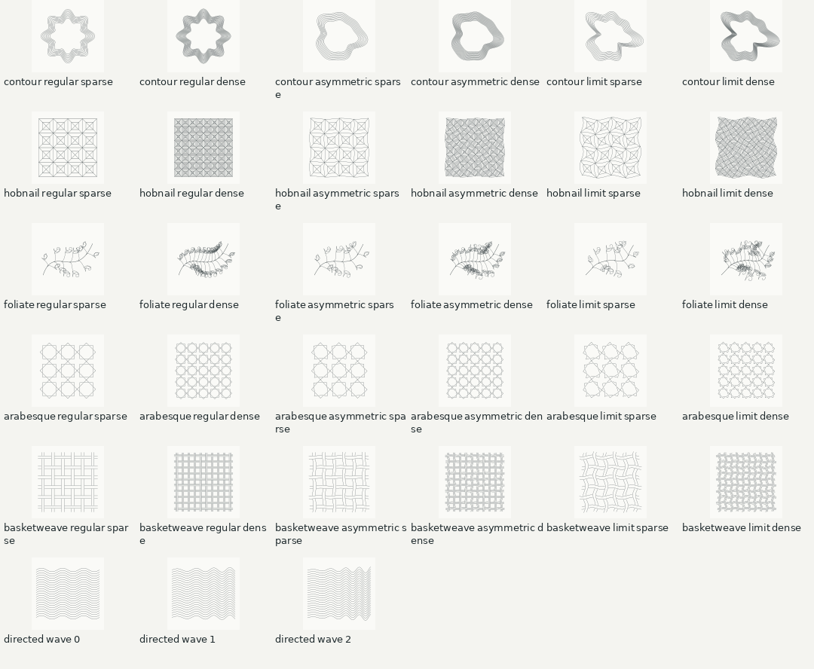](generative_patterns/guilloche-enrichment/sheets/core-320.png)

The contour is
`r(theta) = R * (1 + sum(a[k] * cos(k*theta + phase[k])))`.
It supports up to eight integer modes, frequencies 1–64, and
`sum(abs(a[k])) <= .45`. Thus radius remains positive. Related rings share
one angular profile and ordered positive radial scales, preserving nesting.
Ring-specific phase, rotation, normal offsets and jitter are rejected for
this construction. Radial spacing is not the Euclidean distance between
neighboring segments on steep lobes.

Samples must be at least 16 times the highest mode and at most 16,384.
Independent mode phases and unequal amplitudes change intrinsic symmetry.
A translation or color change does not. This positive contour differs from
a center-crossing mathematical rose. Integer angular modes follow the
[Fourier-series vocabulary in NIST DLMF §1.8](https://dlmf.nist.gov/1.8).

Directed waves extend harmonic waves with an amplitude envelope and a
quadratic phase term. Zero envelope/chirp uses the old evaluation path.
Envelope magnitude is at most .9; the instantaneous phase derivative must
stay positive. The sample floor accounts for the highest harmonic and
chirp. Rows share the same curve and fixed displacement.

### Basketweave and hobnail

[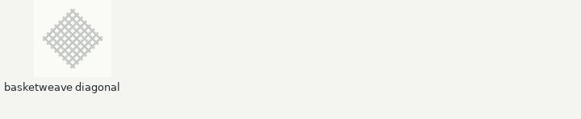](generative_patterns/guilloche-enrichment/sheets/basketweave-320.png)

Basketweave alternates crossing ownership by row/column parity. Upper
bands continue; lower bands split around the upper width, ink width and
clearance. Repeating fields require even row and column counts. The same
construction supports diagonal rotation and multiple plates without
background-colored patches. Rows/columns are bounded at 512 and strands
at 16; field budgets usually constrain large combinations sooner.

`basketweave_spec::width_ratios` accepts one through four positive, finite
multipliers of `band_width`. Scene JSON uses the optional field
`"width_ratios": [1, 1.5, 2, 3]` inside the basketweave object. The sequence
cycles across bands, with the vertical sequence offset by one position;
crossing gaps use the actual upper-band width. Each ratio must satisfy
`band_width * ratio + 2 * (plate.stroke_width + clearance) < pitch`.
Omitting the field retains the uniform `{1}` default, which the
JSON writer also omits. The film review compares `[1]`, `[1, 2]`,
`[1, 1.5, 2]` and `[1, 1.5, 2, 3]`; selected width studies use three widths.

Hobnail emits each long grid boundary once, four cell ridges, and 0–32
inset square contours per cell. This preserves shared edges and recognizable
faceting in monochrome. Rotation makes the square field read as diamonds.

### Flinqué: engraving, aperture and finish

[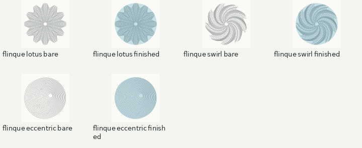](generative_patterns/guilloche-enrichment/sheets/flinque-320.png)

The legacy `rays` selector and `make_p3_flinque` remain unchanged.
`lotus` uses twelve-lobed nested engraving; `swirl` twists a nested field
by its physical radius; `eccentric` progressively offsets ring centers.
All three also supply related ribs. Ring count is 2–256 and samples are
256–8192. A separate circular aperture clips the engraving, while tint and
opacity control the finish.

For the new JSON selectors, `aperture_radius` is an absolute drawing-unit
radius. The old ray controls, including the fractional `overlay_radius`,
cannot be mixed with them. The watch-source cues are documented in the
[Bovet/Patek study](development/sessions/20260928.meta_guilloche_survey.md#d-three-flinqué-extensions--engraving-plus-finish).
These are original procedural interpretations of engraving vocabulary.

### Foliate and botanical forms

[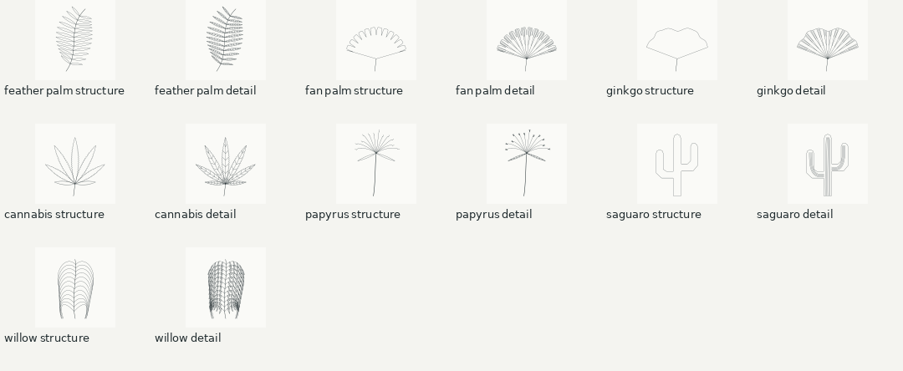](generative_patterns/guilloche-enrichment/sheets/botanical-320.png)

[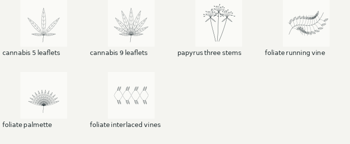](generative_patterns/guilloche-enrichment/sheets/attachments-320.png)

Foliate supplies running vines, tangent-attached scrolling branches and
palmettes. A running vine can select `interlace: true` for two crossing
stems with alternating underpass fragments; it shares the basketweave
interval splitter. Leaf bases attach to stems away from underpasses.
Other branch/leaf junctions remain contacts, not weave crossings.

Common controls are `span`, `branches` (3–32), `detail` (0–4),
`samples` (24–512), bounded `asymmetry` and a deterministic `seed`.
Silhouettes and attachments remain when detail is reduced. Narrow willow
blades suppress minor veins when their drawing-unit width is too small.

| Preset | Distinguishing structure |
| --- | --- |
| Feather palm | Curved rachis with attached pinnate blades. |
| Fan palm | Divided fan perimeter and radiating veins. |
| Ginkgo | Continuous notched fan with branching veins. |
| Cannabis | Five, seven or nine serrated leaflets meeting at a petiole; `leaflets` selects the count. |
| Papyrus | One or three unequal culms with terminal ray clusters; `stems` selects the arrangement. |
| Saguaro | One connected candelabra silhouette, joined arms and longitudinal ribs. |
| Willow | Drooping branchlets with separate narrow leaves. |

References explain morphology and construction rather than supply traced
contours: [UF palm structure](https://gardeningsolutions.ifas.ufl.edu/plants/trees-and-shrubs/palms-and-cycads/palm-leaf-structure/),
[NC State ginkgo](https://plants.ces.ncsu.edu/plants/ginkgo-biloba/common-name/ginkgo/),
[Florida hemp identification](https://ccmedia.fdacs.gov/content/download/96962/file/CIRCULAR-Hemp-01945.pdf),
[NC State papyrus](https://plants.ces.ncsu.edu/plants/cyperus-papyrus/),
[NPS saguaro](https://home.nps.gov/sagu/learn/nature/saguaro.htm) and
[NC State willow](https://plants.ces.ncsu.edu/plants/salix-babylonica/).
For attachment grammar and endpoint derivatives, see
[Algorithmic Botany](https://algorithmicbotany.org/papers/) and
[Shene's Bézier derivative notes](https://pages.mtu.edu/~shene/COURSES/cs3621/NOTES/spline/Bezier/bezier-der.html).

### Reef forms

[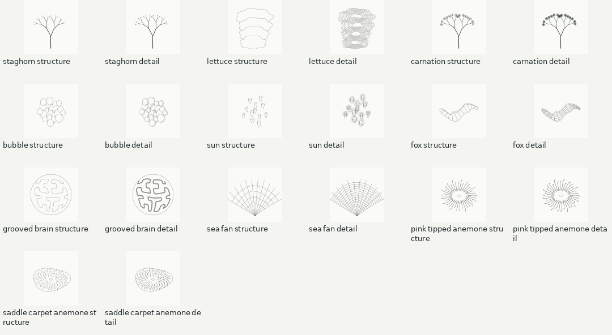](generative_patterns/guilloche-enrichment/sheets/reef-320.png)

The eight coral presets are staghorn, lettuce, carnation, bubble, sun, fox,
grooved brain and sea fan. Staghorn/carnation use bounded branching depth
2–5. Lettuce removes hidden rear plate edges; bubble removes hidden arcs
between overlapping vesicles. Fox uses a continuous folded mantle. Sun
uses tubular cups and optional polyp tentacles. Brain coral uses rounded
winding valleys with related offset ridges, mapped into a massive colony.
Sea fan retains cross-connections and cycles.

Pink-tipped and saddle-carpet forms have separate **anemone** metadata.
The former uses long tentacles; the latter distributes short tentacles
across a folded disc. Structure/detail pairs keep the underlying attachment
layout visible. These are stylized morphological constructions, not
species-identification diagrams. See the
[reef source table](development/sessions/20260928.meta_guilloche_survey.md#coral-foundations-and-the-expanded-reference-set)
and [NOAA growth-form overview](https://oceanservice.noaa.gov/education/tutorial_corals/coral03_growth.html).

### Islamic geometric arabesque

[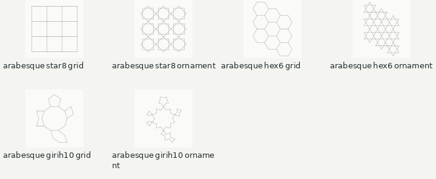](generative_patterns/guilloche-enrichment/sheets/arabesque-320.png)

`resolve_arabesque_topology` exposes shared vertices, unique edges and
incident faces. `star8` and `hex6` are periodic square/hexagonal recipes.
`girih10` is a finite patch of the five equal-edge girih tile types:
decagon, pentagon, rhombus, elongated hexagon and bow tie. Its row/column
counts must both be one; it does not claim a quasiperiodic tiling.

Decoration connects matched edge-midpoint ports inside each face.
Girih uses paired directions at 54°/126° relative to the edge. Interlacing
splits the lower segment at interior crossings without breaking shared
ports. Construction mode emits the tile graph alone. Grid dimensions are
bounded at 32, samples at 64, and clearance at .06 of the pitch.

The geometry follows the construction vocabulary in
[The Met's geometric-design activities](https://resources.metmuseum.org/resources/metpublications/pdf/Islamic_Art_and_Geometric_Design_Activities_for_Learning.pdf)
and [Lu–Steinhardt's girih paper](https://paulsteinhardt.org/wp-content/uploads/2023/01/LuSteinhardt2007.pdf).
The finite patch and its decoration are original implementations. For the
wider freeform problem, see [Lin–Kaplan](https://arxiv.org/abs/2301.01471).

### Shared asymmetry and motion

[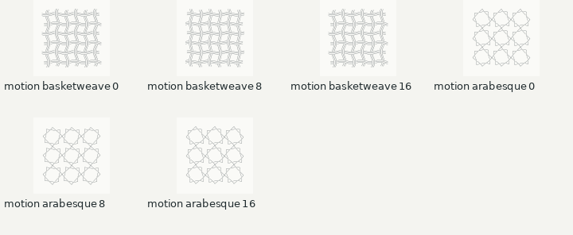](generative_patterns/guilloche-enrichment/sheets/motion-320.png)

Triangular deformation composes two sinusoidal shears:
`x' = x + a*Px*sin(2*pi*y/Py + phase)`, then
`y' = y + b*Py*sin(2*pi*x'/Px + phase + .7)`.
Each shear has an explicit inverse, so the complete plane map is injective.
The angular alternative uses a positive radial multiplier and strictly
increasing angular map. Coefficient bounds include seeded variation.

Every shared point receives the same spatial map before plate transforms.
Periodic basketweave and arabesque require compatible periods in their
repeat lattice; unsupported angular deformation of those fields is rejected.
Underpass gaps use a conservative lower scale bound. Sampling still limits
the accuracy of the exported polyline approximation.

`motion_amount` varies coefficients continuously with a cosine envelope.
Seeds and path order stay fixed, and declared loop endpoints coincide.
Accessible-static companions remove this coefficient motion. The gallery
contains first/middle/last frames for basketweave and star8; these establish
geometric continuity, not a universal perceptual motion-safety claim.

### Water forms and optical controls

[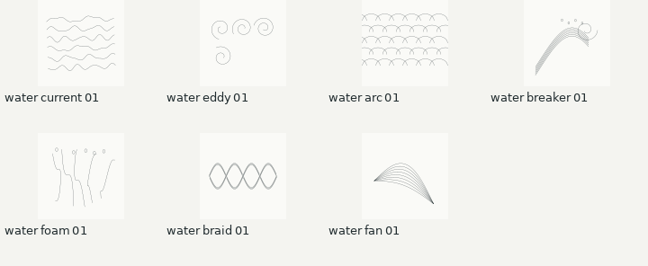](generative_patterns/guilloche-enrichment/sheets/water-320.png)

[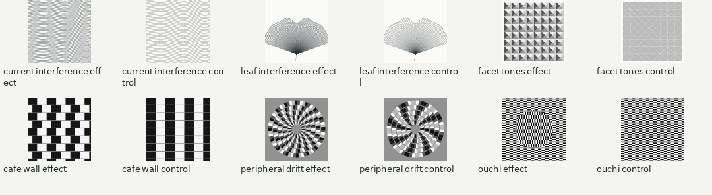](generative_patterns/guilloche-enrichment/sheets/optical-320.png)

Hamonshū supplies seven native water interpretations: currents, eddies,
arcs, crests, foam, braids and fans. The consolidated
[Hamonshū guide](generative_patterns/hamonshu.md) documents their APIs,
geometry keys, parameters, legacy compatibility and source provenance,
alongside the complete three-volume graphic-water catalogue. It is the
reference for the next water-pattern revision.

| Optical treatment | Cue-removing control |
| --- | --- |
| Current interference | One of the two related wave fields. |
| Leaf interference | One of the two clipped fan fields. |
| Facet tones | Uniform tone on exactly the same polygons. |
| Café Wall | Aligned tile rows with unchanged mortar. |
| Peripheral drift | Symmetric luminance sequence on the same sectors. |
| Ouchi | A common texture orientation inside and outside the disc. |

These static effect/control pairs adapt the mechanisms discussed in
[Gregory's Café Wall paper](https://richardgregory.org/papers/cafe_wall/cafe-wall_p1.htm),
[Kitaoka–Ashida on peripheral drift](https://www.psy.ritsumei.ac.jp/~akitaoka/PDrift.pdf)
and [the Ouchi texture study](https://pubmed.ncbi.nlm.nih.gov/10768044/).
Tone/coordinate equality is testable; the strength of an illusion depends
on viewing scale and observer. No automatic animation is needed.
The [moiré guide](generative_patterns/moire.md#exact-straight-grating-reference) documents the
exact ideal straight-grating reference and the limits of curved-field
period estimates.

### Lenticular export and calibration

Include `izzi-svg-lenticular.h`, or `izzi-svg-lenticular-json.h` for strict
`izzi.lenticular-array/1` authoring. Resolve 2–8 registered source scenes
through `resolve_lenticular` or `resolve_lenticular_json`; export with
`render_lenticular_svg`, `render_lenticular_calibration_svg` and
`render_lenticular_diagnostic_html`.

Physical size is millimeters, pitch is lenses per inch (LPI), phase is
millimeters, and raster resolution is pixels per inch (PPI). PPI describes
image sampling, not printer-dot resolution. A vertical lens axis means
vertical strips whose view selection changes along x; horizontal changes y.
The period is `25.4/LPI` mm, with `N` globally positioned strips per period.
View order is an explicit permutation. Crop and aspect ratio are shared
across all sources. Source SVG IDs and local references are prefixed.

With a raster target, integer-grid mode requires integral strip widths,
phase and physical canvas dimensions in pixels. Fractional mode retains
globally computed vector boundaries and reports the maximum boundary
rounding error in pixels; it does not round and accumulate each strip width.
Fewer than one raster sample per strip is rejected. Budgets cover source
geometry, reusable definitions, clip rectangles, references and output size.

The [two-view packet](generative_patterns/guilloche-enrichment/lenticular-two/diagnostic.html)
uses 60 LPI, vertical strips and 600 PPI with five pixels per view strip.
The [four-view packet](generative_patterns/guilloche-enrichment/lenticular-four/diagnostic.html)
uses 59.7 LPI, horizontal strips and fractional sampling. Both include
source scenes, authored/resolved JSON, interlaced SVG and a nine-pitch
calibration sheet with a 25.4 mm ruler and registration marks. The browser
slider shows the software view assignment; it is not a lens simulation.

**Physical lens/print proof has not been performed.** Actual material needs
pitch measurement, true-size printing and phase/alignment adjustment.
See [DPLenticular prepress](https://dplenticular.com/technology/prepress-process/)
and [Triaxes pitch testing](https://triaxes.com/docs/Pitch-test-en/Description.html).
