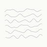
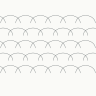
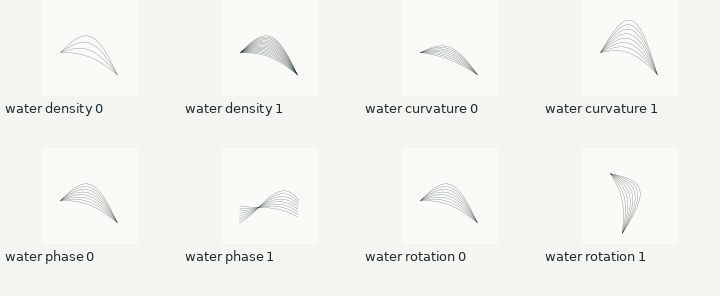
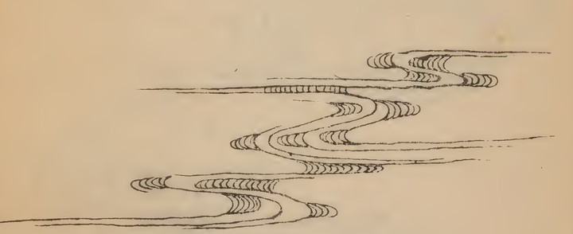
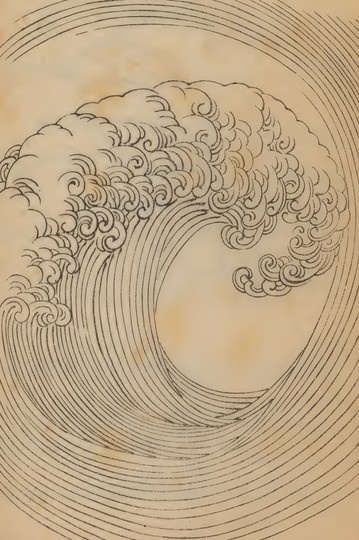
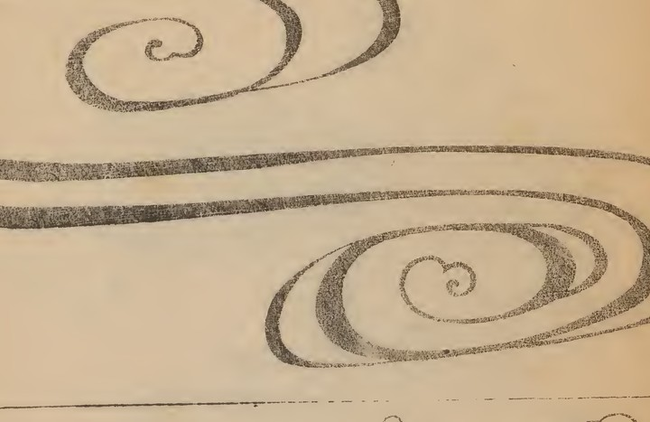
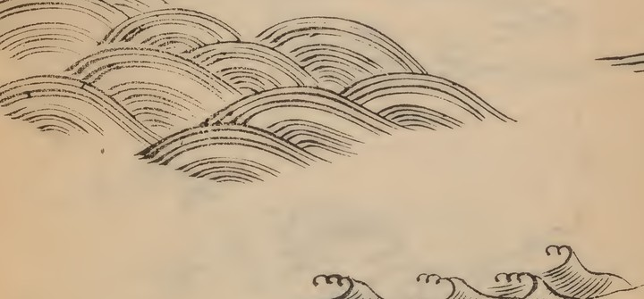
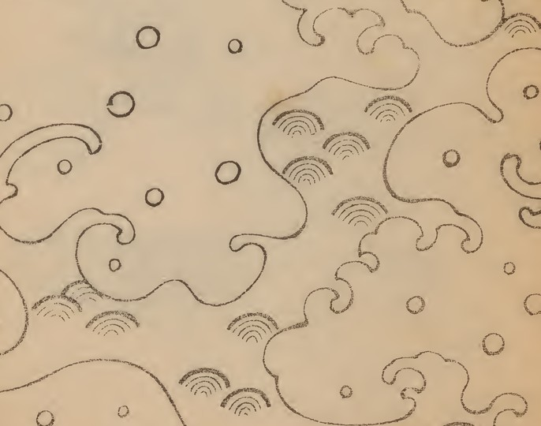
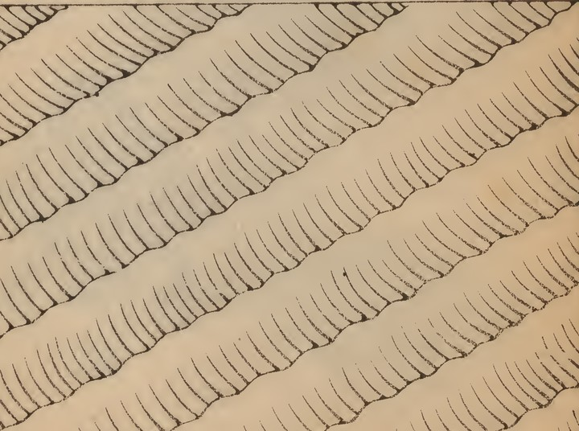
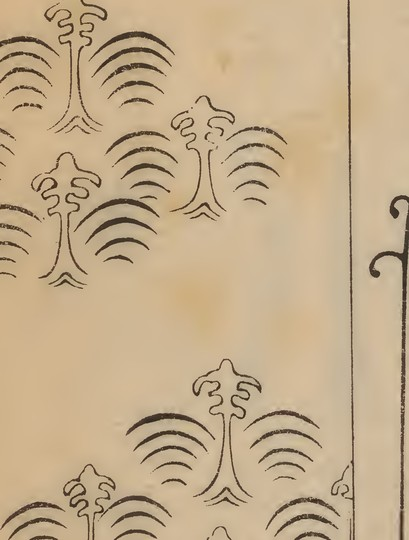

# Hamonshū water patterns

This is the canonical guide to Izzi's Hamonshū source collection,
classification, procedural geometry and downstream use. It brings the
three-volume graphic-water catalogue together with the volume 2 API and
new native water fields. Only graphic water forms are classified; writing
examples are excluded.

Start with [the three kinds of identity](#scope-and-identities),
[the V2 source reviews](#v2-source-reviews),
[structured geometry](#structured-geometry), [native water fields](#native-water-field),
[the full source catalogue](#graphic-water-catalogue),
[volume 2 page conventions](#page-and-name-conventions),
[verification and regeneration](#verification-and-regeneration), or
[the revision map](#revision-map).

## Scope and identities

| Collection | Unit and current coverage | Authoritative source |
| --- | --- | --- |
| Local historical scans | 86 scans across three volumes; 84 include water ornament and two are text-only exclusions. A scan can have several form/arrangement labels. | `resources.rizal/hamonshu/`; [classification JSON](hamonshu-water-catalogue.json) and [catalogue below](#graphic-water-catalogue). |
| Legacy volume 2 catalogue | 153 individual specimens; 16 procedural kinds; 13 selected specimens × seven curvature ratios = 91 curated variations. | Catalogue header and `pattern_specs`. |
| Native guilloché interpretations | Seven named water constructions with independent numeric geometry keys 101–107. | `water_interpretations` in [the Hamonshū header](../html/izzi-svg-curves-hamonshu_8h.html); `water_spec` in [the guilloché header](../html/izzi-svg-guilloche_8h.html). |

Scan IDs such as `v3-s018` name source files. Printed-page and specimen IDs
belong to the legacy volume 2 catalogue. Geometry keys identify procedural
constructions. Keep all three explicit when revising a specimen: a scan
number cannot replace a `pattern_spec` page number. Modern English group
names describe visible forms and are not translations of historical captions.

The [filterable source gallery](hamonshu-water-gallery.html) is a generated
browser for this document's catalogue. The
[native SVG/JSON gallery](guilloche-enrichment/index.html) contains the seven
source/interpretation comparisons. Their
[source provenance](guilloche-enrichment/sources/provenance.json) is a
portable copy of catalogue metadata, not a second classification source.

<a id="v2-source-review-book-1"></a>

## V2 source reviews

The [V2 project](../development/sessions/20260929.hamonshu-v2.md) starts again
from the historical drawings, with human-defined categories before algorithmic
reproduction. All three books now have source crop packets on
situationshipin.space, with **475 crops from 86 visually inspected scans**.
These complete the source-review preparation for stages 1–3. Human category
review remains the checkpoint before synthesis, parameter grids, and the later
API and guilloché stages.

The [saved session state](../development/sessions/20260929.hamonshu-v2.md#saved-state-2026-09-29)
records the publication commits, verification evidence, pending email sender,
and the next steps after human review.

| Public review | Inspected scans | Crops | Masked crops | Recorded selections |
| --- | ---: | ---: | ---: | --- |
| [Book 1](https://situationshipin.space/review/hamonshu-v2-book1/) | 29 | 165 | 6 | [Crop plan](hamonshu-book-1-crops.json) |
| [Book 2](https://situationshipin.space/review/hamonshu-v2-book2/) | 28 | 154 | 12 | [Crop plan](hamonshu-book-2-crops.json) |
| [Book 3](https://situationshipin.space/review/hamonshu-v2-book3/) | 29 | 156 | 14 | [Crop plan](hamonshu-book-3-crops.json) |

Each packet includes larger crop previews, 28 labeled scan-location overlays,
and seven contact sheets. Book 1 scan 002 and Book 3 scan 028 contain only
writing or blank pages and are excluded. Mixed pages contribute their graphic
water regions only. Book 3 scan 027 contributes the two water-patterned scrolls;
the calligraphy, lettered box, and surrounding objects are excluded.

Enter your own category names and notes, then **Download classifications** and
return the JSON file. Drafts save in that browser only, separately for each
book. Loading a saved file replaces that book's draft. Reviewers can work
without access to the private Izzi repository; each person's return is reviewed
separately before choosing which categories to apply.

The local galleries for Book 1,
Book 2, and
Book 3 also support
direct folder sorting. Full-resolution files start in
`resources.rizal/hamonshu/hamonshu_<book>.crops/uncategorized/`, named by book,
source scan, and segment, for example `hamonshu_2-003a.png`. Move those PNGs
into category directories you name alongside `uncategorized/`, preserving
their filenames. The `_review/` directory contains derived previews and
contact sheets.

Each crop plan records all source hashes, dimensions, selected regions, and
exclusions. Crops retain original pixels, colors, and resolution. Polygon
transparency excludes labels, surrounding objects, or neighboring forms.
Notes identify touching designs and occlusion already present in the source;
hidden linework is not reconstructed. Connected compositions remain together,
including medallions and currents spanning the gutter. Book 2's overlapping
sample panels and Book 3's folded ribbons retain the visible source geometry.
These segment IDs are independent of both the seven V1 scan groups and the
legacy volume 2 specimen IDs. Categories remain unassigned for human review.

The preparation script requires
Pillow. Run from the repository root, replacing `2` with the desired book;
Book 1 remains the default when no volume or plan is specified:

```sh
# Reproduce the crops and local packet from the recorded selections.
python3 scripts/prepare-hamonshu-crops.py --volume 2
# After sorting PNGs, refresh links and category counts without moving files.
python3 scripts/prepare-hamonshu-crops.py --volume 2 --refresh-index
# Preview a returned review; its volume selects the local crop directory.
python3 scripts/apply-hamonshu-categories.py /path/to/hamonshu-book-2-categories.json
# Apply the selected human review, then refresh that book's local packet.
python3 scripts/apply-hamonshu-categories.py /path/to/hamonshu-book-2-categories.json --apply
python3 scripts/prepare-hamonshu-crops.py --volume 2 --refresh-index
```

Refresh preserves file locations and validates their pixels against the crop
plan; missing, duplicate, or edited crops are reported rather than replaced.
The output manifest records each file's current category directory, source
bounds, and hashes for the next synthesis stage. The category importer validates
every crop and destination before moving files; empty categories leave existing
locations alone. It preserves the returned JSON, including notes and reviewer
identity, in `_review/category-reviews/`. It rejects a different volume, crop
plan, or mixed-book crop IDs, including when `--output-dir` is supplied, and
never merges reviewers' choices automatically.

Full-resolution crops remain host-local beside the source collection; the plans
and scripts are versioned. Public packets use JPEG derivatives of at most
1600 pixels per edge. In the situationshipin.space checkout, run
`scripts/publish-hamonshu-crops.py --volume 2 --izzi-root /home/bkoz/src/izzi --izzi-commit <40-hex>`
for each book being published. Refresh the portal build manifest and run its
site checker before committing and pushing publication. Publishing another
volume preserves the existing books and their saved-draft identities.

## API surface

- `svg::hamonshu::pattern_spec` (first/last page, motif, name);
  `pattern_specs` array.
- `svg::hamonshu::curated_motif_selection` + `curated_motif_selections`
  array; `curated_curvature_ratios`; `curated_variation_count`.
- `svg::hamonshu::pattern_box` (bounds with width/height helpers).
- `svg::hamonshu::motif_kind` (enum) and `motif_config`.
- `motif_polyline`, `motif_geometry`, `motif_budget`,
  `make_motif_geometry` and `serialize_motif_geometry`: structured paths,
  closure, bounds and counts beneath the legacy string renderer.
- `water_interpretations`: seven label-independent geometry keys with
  explicit form and arrangement metadata.
- Rendering helpers (`draw...` / `append...` family, detail namespace
  `svg::hamonshu::detail`).

## Structured geometry

Use `svg::hamonshu::make_motif_geometry` for sampled paths, closure, bounds
and point counts. It counts construction before allocating point arrays;
default `motif_budget` limits are 20,000 paths and 2,000,000 points.
`serialize_motif_geometry` produces the legacy SVG path-data representation.
Clipping, style and SVG layer assembly belong to the caller. Bounds describe
the actual geometry, which can extend beyond the nominal placement box.

```cpp
#include <izzi-svg-curves-hamonshu.h>
#include <iostream>

int main()
{
  using namespace svg::hamonshu;
  motif_config config;
  config.curvature = 1.3;
  const auto geometry = make_motif_geometry(
    pattern_specs.front(), {0, 0, 240, 180}, config);
  std::cout << serialize_motif_geometry(geometry) << '\n';
}
```

The overload taking `pattern_spec` preserves the legacy label-derived
construction key. The overload taking `motif_kind` and an explicit unsigned
geometry key separates construction from a display name. The string helper
`make_motif_path` retains its previous output. The curated example now fits
rows using structured bounds instead of parsing path data; unrounded bounds
can slightly change its row fit while individual legacy path bytes remain
unchanged.

| `motif_config` field | Meaning and bounds | Default |
| --- | --- | --- |
| `density` | Multiplier for repeated lines/shapes; 0.25–4. | 1 |
| `curvature` | Multiplier for wave height, curl radius and transverse displacement; 0.20–4. | 1 |
| `phase` | Finite angular offset from canonical phase, radians. | 0 |
| `rotation` | Finite added orientation, radians. | 0 |
| `reflected` | Reflect normalized coordinates about the placement box's vertical axis. | false |
| `samples_per_curve` | Relative sampling resolution, 8–4096; emitted counts depend on each construction. | 48 |

## Native water field

`izzi::guilloche::make_water(origin, water_spec)` builds a native composition.
Strict scene JSON uses `layout.geometries[].kind: "water_field"` and one
of the `form` values below. Set `content.kind: "none"` and
`layout.include_radial_field: false` for a geometry-only scene; a complete
[current example](guilloche-enrichment/json/water-current-01.json) shows the
required surrounding authoring fields.

| Source group | Native form / stable ID | Geometry key | Arrangement | Native preview |
| --- | --- | ---: | --- | --- |
| [Currents](#flow) | `current` / `water-current-01` | 101 | parallel-field |  |
| [Eddies](#eddy) | `eddy` / `water-eddy-01` | 102 | discrete-curls |  |
| [Arcs](#arc) | `arc` / `water-arc-01` | 103 | overlapping-rows |  |
| [Crests](#crest) | `breaker` / `water-breaker-01` | 104 | curl-and-trailing-lines |  |
| [Foam](#foam) | `foam` / `water-foam-01` | 105 | spray-clusters |  |
| [Braids](#weave) | `braid` / `water-braid-01` | 106 | crossing-bands |  |
| [Fans](#fan) | `fan` / `water-fan-01` | 107 | radiating-clusters |  |

C++ selects `water_spec.interpretation` with indices 0–6 in the table's
order; JSON selects the form string. These are broad procedural
interpretations, not a one-to-one reconstruction of every source specimen.
The braid resolver creates explicit lower-stroke fragments through the
shared basketweave interval splitter. Its rendered crossing geometry is
therefore more specialized than the legacy `motif_kind::braid` serializer.

`span` is a drawing-unit size in (0, 8192], default 280. Density, curvature,
phase and rotation retain the semantics above. Native `samples` is 96–3072,
default 192; the legacy default stays 48. `clearance` is 0–16 drawing units,
default 1.5, and the braid resolver checks it against band separation and
ink width. Native fields share scene resource budgets, plates, deformations,
profiles and graph selection with the
[other guilloché constructions](../generative_patterns.md#native-guilloche-patterns).

[](guilloche-enrichment/sheets/water-parameters-320.png)

## Legacy volume 2 catalogue

<a id="wave-pattern-catalogue-and-rendering-notes"></a>

The complete machine-readable 153-entry catalogue is defined in
`izzi-svg-curves-hamonshu-v2.inc`. Its curated selection and seven curvature
ratios live in `izzi-svg-curves-hamonshu.h`, shared by the native parameter
grid and the cartofreako ocean generator.

### Example: parameter-grid render

`src/izzi-svg-curves-hamonshu.h` provides a C++20, header-only catalogue and
deterministic procedural SVG paths for the 153 wave studies indexed to Mori
Yūzan's 1903 *Hamonshū*, volume 2. The `svg::hamonshu::motif_config` API
parameterizes line density, curvature, phase, rotation, reflection, and
sampling resolution, and emits normalized motif linework inside a
caller-supplied `svg::hamonshu::pattern_box`; clipping, styling, and SVG
layer assembly remain with the caller.

Build and run the curated parameter grid from the repository root:

```sh
g++ -Isrc -std=c++20 -Wall -Wextra -Wpedantic -Werror \
  examples/curves-hamonshu.cc -o /tmp/curves-hamonshu
(cd /tmp && ./curves-hamonshu)
```

The generated `curves-hamonshu.svg` is a monochrome parameter grid containing
one titled group per selected source specimen and curvature ratio. The
Smithsonian Libraries scan is CC0; the descriptive English labels are not
translations of historical captions.

### Page and name conventions

The cartofreako provenance PDF has 28 scan pages, while the bound work
represented by those scans has 51 content pages.  Scan 1 is the front cover.
Scan 2 contains illustrated page 1 and a blank facing page.  Scans 3 through
27 contain two book pages apiece, and scan 28 is the back cover.  Consequently
the generator maps illustrated page 1 to PDF scan 2 and any later illustrated
page `p` to PDF scan `floor((p + 4) / 2)`.

The catalogue records each visually bounded pattern specimen separately.  It
contains 153 specimens from illustrated pages 1 through 49 and 51.  Page 50
is the colophon and contributes no motif.  One composition spans pages 24-25,
three bands span pages 46-47, and the page-51 collage contributes five
separately bounded specimens.

The National Diet Library catalogue says that the source has no annotations
such as pattern names (`文様名などの注記なし`).  There are therefore no
Japanese motif captions to translate.  Labels such as `nested-current-scrolls`
are concise descriptive English catalogue names, not historical titles.

Every catalogue motif has this stable source ID:

```text
hamonshu-page-PPP[-PPP]-motif-MM-descriptive-english-name
```

Curated ocean layers append the zero-based curvature-column index:

```text
hamonshu-page-PPP[-PPP]-motif-MM-descriptive-english-name-curvature-C
```

Each ocean layer contains a water-region path and an Izzi-generated line
path. Its SVG `<title>` records the illustrated page or page span, the
corresponding PDF scan, the motif ordinal, descriptive name, and curvature
ratio. Clip paths use the same variation ID with a `clip-` prefix. This makes
source and form lookup possible from either an SVG editor's layer panel or
the XML itself.

### Vector interpretation

The catalogue distinguishes individual bands, medallions, sprays, crests,
scrolls, fields, and multi-page compositions. The Izzi C++20 curve header
translates their visible geometric vocabulary into sixteen procedural line
families:
waterlines, crests, spirals, spray, arcs, lattices, bubbles, scrolls, fans,
breakers, braids, cascades, ripples, fountains, clouds, and cells.  Page and
motif metadata seed the spacing, phase, direction, and density, so each
catalogued specimen produces a distinct path treatment.

The public `curated_motif_selections` array identifies page/motif rows
`001/01`, `002/01`, `003/01`, `003/02`, `006/02`, `009/01`,
`017/03`, `020/04`, `023/02`, `039/02`, `040/01`, `046-047/02`,
and `051/05`. The public `curated_curvature_ratios` array contains
`0.25`, `0.45`, `0.70`, `1.0`, `1.30`, `1.65`, and `2.10`.
Across a row, only wave height, curl radius, and transverse displacement
change; the `1.0` column preserves the canonical form. Density, phase,
orientation, reflection, sampling, and SVG color remain fixed.

These paths are clean vector interpretations intended for map texture, not
pixel-by-pixel facsimile tracings of the paper scans.  Curves, ellipses, and
spirals are sampled into `svg::vrange` values and serialized with Izzi's
`svg::make_path_data_from_points`; Izzi also creates every final SVG path.

<!-- BEGIN generated-hamonshu-water-catalogue -->

## Graphic-water catalogue

Reviewed 2026-09-28. **86 scans across three volumes; 84 contain water ornament, two are text-only exclusions.** This is a scan-level, multi-label index. A scan can appear in several groups; these counts are not counts of individual motifs.

[Open the filterable gallery](hamonshu-water-gallery.html) · [Machine-readable classifications](hamonshu-water-catalogue.json)

Only graphic water forms are classified. Titles, calligraphy, colophons, marginal writing and writing equipment are excluded. Mixed pages remain in the inventory with directions to their water region. Front and back covers contribute repeated spiral ornament, not new families. Originals remain in place.

Group names are modern descriptions, not translated historical captions. The seven thumbnails are literal water-only crops from volume 3. The full-source links retain page context and may include writing.

| Form group | Scans including this form | Geometric starting point |
| --- | ---: | --- |
| [Currents and waterlines](#flow) | 61 | Shared-displacement bands; cubic or harmonic centerlines; related contour families. |
| [Crests and breakers](#crest) | 54 | Parametric crest paths with a return curl; nested contours and optional foam. |
| [Eddies, scrolls and spirals](#eddy) | 56 | Spiral segments joined to flow paths; paired handedness and unequal curl radii. |
| [Ripples, scallops and nested arcs](#arc) | 20 | Nested arcs and partial rings; staggered repeats with explicit open and closed forms. |
| [Foam, spray, droplets and cells](#foam) | 45 | Sparse secondary marks following a parent crest; bounded point and small-loop motifs. |
| [Braids, lattices and herringbone](#weave) | 16 | Two related line directions or a crossing graph; preserve intended over-under order. |
| [Fans, fountains and feathered jets](#fan) | 9 | Diverging paths from an attachment region; bounded branching and a tip envelope. |

### How to use the grouping

Select a **form** first, then an **arrangement**: band, field, medallion, cluster, border or spread. For example, an eddy can occur inside a medallion or in a continuous band. Keep these axes separate in future preset metadata.

The existing 153-entry C++ catalogue covers volume 2 individual specimens. This index adds reviewed scan coverage for all three volumes; it does not invent per-motif IDs for volumes 1 and 3. Scan numbers are the PNG filename suffixes, not printed page numbers. Do not substitute them in current C++ `pattern_spec` page fields.

<a id="flow"></a>

### Currents and waterlines

Long meanders, flowing parallel lines, drifting pools and gently layered swells.



Representative: v3-s018. Shared-displacement bands; cubic or harmonic centerlines; related contour families.

- Volume 1: 003, 004, 006, 007, 010, 011, 012, 014, 016, 017, 018, 019, 020, 022, 023, 024, 025, 026, 028.
- Volume 2: 002, 003, 005, 006, 007, 009, 010, 011, 016, 017, 018, 019, 020, 022, 023, 025, 026.
- Volume 3: 002, 003, 004, 005, 006, 007, 008, 009, 010, 011, 012, 013, 014, 015, 017, 018, 019, 020, 021, 022, 023, 024, 025, 026, 027.

<a id="crest"></a>

### Crests and breakers

Overturning hooks, curling tips, upright breaking waves and layered wave fronts.



Representative: v3-s022. Parametric crest paths with a return curl; nested contours and optional foam.

- Volume 1: 003, 004, 005, 006, 009, 010, 012, 018, 019, 020, 022, 023, 027, 028.
- Volume 2: 003, 004, 007, 009, 010, 012, 013, 017, 018, 019, 020, 021, 022, 023, 024, 025, 026, 027.
- Volume 3: 003, 005, 006, 008, 009, 011, 012, 013, 014, 015, 016, 017, 018, 019, 020, 021, 022, 023, 024, 025, 026, 027.

<a id="eddy"></a>

### Eddies, scrolls and spirals

Coiled currents, opposing scrolls, whirlpools and spiral medallions.



Representative: v3-s016. Spiral segments joined to flow paths; paired handedness and unequal curl radii.

- Volume 1: 001, 003, 006, 007, 008, 011, 012, 013, 014, 016, 018, 021, 022, 023, 024, 025, 026, 027, 029.
- Volume 2: 001, 002, 005, 006, 008, 009, 010, 011, 012, 013, 016, 021, 022, 023, 025, 026, 027, 028.
- Volume 3: 001, 002, 004, 006, 007, 008, 010, 011, 012, 013, 014, 015, 016, 018, 021, 022, 024, 026, 029.

<a id="arc"></a>

### Ripples, scallops and nested arcs

Repeated arc bundles, ripple rings, scales and small rounded swells.



Representative: v3-s017. Nested arcs and partial rings; staggered repeats with explicit open and closed forms.

- Volume 1: 004, 005, 009, 015, 016, 026, 027.
- Volume 2: 011, 012, 013, 015, 020, 024, 027.
- Volume 3: 004, 010, 013, 016, 017, 019.

<a id="foam"></a>

### Foam, spray, droplets and cells

Detached water marks, dotted spray, bead chains, bubbly rims and cellular water textures.



Representative: v3-s016. Sparse secondary marks following a parent crest; bounded point and small-loop motifs.

- Volume 1: 004, 005, 008, 009, 010, 011, 013, 015, 019, 021, 022, 025, 026.
- Volume 2: 003, 004, 006, 008, 012, 013, 014, 015, 017, 018, 019, 021, 022, 024, 026.
- Volume 3: 003, 004, 008, 009, 014, 015, 016, 017, 018, 019, 020, 021, 022, 023, 025, 026, 027.

<a id="weave"></a>

### Braids, lattices and herringbone

Interlaced current ribbons, diagonal blocks, linked bands and geometric repeats.



Representative: v3-s020. Two related line directions or a crossing graph; preserve intended over-under order.

- Volume 1: 005, 015, 017, 020, 024.
- Volume 2: 004, 006, 007, 011, 016, 017, 027.
- Volume 3: 007, 010, 020, 021.

<a id="fan"></a>

### Fans, fountains and feathered jets

Splayed line bundles, upward jets and bilateral feather-like water forms.



Representative: v3-s022. Diverging paths from an attachment region; bounded branching and a tip envelope.

- Volume 1: 015, 021.
- Volume 2: 004, 008, 010, 015.
- Volume 3: 022, 023, 025.

### Scan inventory

These notes describe visible water forms only. Classification was manual, using contact sheets and selected full-size spreads. A future motif-level catalogue should record individual crop bounds and review ambiguous forms at full resolution.

| Scan | Content | Form groups | Arrangements | Graphic observations |
| --- | --- | --- | --- | --- |
| v1-s001 | mixed_cover | eddy | cluster | Spiral clusters on the cover; exclude the title strip and pasted label. |
| v1-s002 | excluded_text |  |  | Calligraphy and blank facing page; no water motif. |
| v1-s003 | mixed_text | flow, eddy, crest | field | Use only the graphic water panel on the left; exclude the calligraphy page. |
| v1-s004 | water | arc, foam, crest, flow | field, cluster | Scalloped clusters, foam-tipped swells and flowing wave panels. |
| v1-s005 | water | arc, foam, crest, weave | cluster, band | Small arch/ridge specimens, dotted sprays and angular repeat studies. |
| v1-s006 | water | eddy, flow, crest | field, band | Layered eddy channels, loose curling currents and long crest horizons. |
| v1-s007 | water | flow, eddy | medallion, band | Waterline medallions, spiral disks and a vertical scroll strip. |
| v1-s008 | water | eddy, foam | medallion, spread | Small rotating curl disks and a large ornamental water roundel spanning the gutter. |
| v1-s009 | water | crest, foam, arc | field, band | Sloping crest bands, opposing curls and a scallop/foam field. |
| v1-s010 | water | crest, foam, flow | field, band | Breaking sprays and dense overlapping wave contours. |
| v1-s011 | water | eddy, foam, flow | field, cluster | Ornamental curl sprays and isolated elongated spiral currents. |
| v1-s012 | water | eddy, flow, crest | cluster, band | Long hooked currents and separated curl/crest studies. |
| v1-s013 | water | eddy, foam | medallion, spread | Water wreaths and foam/curl disks, including a gutter-spanning circle. |
| v1-s014 | water | flow, eddy | medallion | Roundels with dense waves, connected curls and spiral centers. |
| v1-s015 | water | arc, weave, fan, foam | cluster, field | Angular lattice, vertical fountain, rounded scallops and foam studies. |
| v1-s016 | water | flow, eddy, arc | cluster, band | Braided diagonal ribbons, curl-ended roundels and repeated nested arcs. |
| v1-s017 | water | flow, weave | field, band | Fine parallel currents, oblique short strokes and lozenge-like ripples. |
| v1-s018 | water | flow, crest, eddy | field, band | Sparse ripple marks, elongated crest rows and thin interwoven current lines. |
| v1-s019 | water | crest, foam, flow | cluster, band | Foam-tipped breakers, low swell groups and sparse breaking ridges. |
| v1-s020 | water | crest, flow, weave | field, cluster | Fine contour swells, diagonal crossing streams and interleaved waves. |
| v1-s021 | water | eddy, fan, foam | cluster, medallion, border | Ornamental curl masses, a rotating fan, and vertical fountain/scroll borders. |
| v1-s022 | water | eddy, crest, flow, foam | band, cluster | Dark curling crests, meandering currents and a large row of simple hooks. |
| v1-s023 | water | crest, eddy, flow | band, field | Tall open breaker, broad eddy pools and long ornamental meanders. |
| v1-s024 | water | flow, eddy, weave | band, cluster | Long sparse waterlines, repeated hooked borders and oblique woven ripples. |
| v1-s025 | water | eddy, foam, flow | cluster, band | Unequal scroll sprays, linked curl ornament and fine horizon/current bands. |
| v1-s026 | water | eddy, foam, arc, flow | field, band | Linked curls, arc-and-spray groups and long curling stream ends. |
| v1-s027 | water | crest, arc, eddy | medallion, field | Fan-shaped water panel, circular breaker inset, nested swells and eddies. |
| v1-s028 | mixed_text | flow, crest | field | Use the dense water panel on the right; exclude the left colophon. |
| v1-s029 | water_cover | eddy | cluster | Back-cover spiral clusters; duplicate cover vocabulary, not a new specimen family. |
| v2-s001 | mixed_cover | eddy | cluster | Spiral cover ornament; exclude the title strip and pasted label. |
| v2-s002 | water | flow, eddy | field | Open current channels with curling terminals; blank facing page. |
| v2-s003 | water | flow, crest, foam | field, band | Dense currents, breaking wave sprays and towering contour crests. |
| v2-s004 | water | foam, weave, fan, crest | field, border | Spray inset, herringbone field, fountain-like curl repeat and opposed breakers. |
| v2-s005 | water | flow, eddy | band, spread, field | Long continuous hooked bands and a dense current field crossing the gutter. |
| v2-s006 | water | eddy, foam, flow, weave | field, band | Loose spiral/foam fields, ripple dashes and a diamond-crossing band. |
| v2-s007 | water | weave, flow, crest | band, field | Braided ribbons, dotted lozenges, small hook repeats and marching breaker silhouettes. |
| v2-s008 | water | eddy, foam, fan | medallion, border, cluster | Boxed currents, a symmetric scroll fountain, curl wreath and foam disks. |
| v2-s009 | water | eddy, crest, flow | field, band | Woodgrain eddies, cascading folds, ranked crests and a broad S-current. |
| v2-s010 | water | flow, crest, eddy, fan | band, cluster | Distant waves, a crest ridge, an elliptical eddy and fan-ended current. |
| v2-s011 | water | arc, eddy, weave, flow | medallion, border | Nested arc and spiral medallions, short patterned strips and knotted waterlines. |
| v2-s012 | water | eddy, foam, arc, crest | medallion | Foam/curl disks contrasted with densely lined and scallop-filled circles. |
| v2-s013 | water | eddy, foam, arc, crest | medallion, cluster, spread | Curl disks, a large unequal scrolling current across the gutter, ripple pools and small crests. |
| v2-s014 | water | foam | spread, field | Continuous irregular foam constellation and detached droplets across both pages. |
| v2-s015 | water | fan, arc, foam | border, cluster | Arch and spear fountains, small scallop borders and symmetrical crest sprays. |
| v2-s016 | water | eddy, flow, weave | cluster, band | Small ornamental current clouds, linked curls and loose spiral channels. |
| v2-s017 | water | weave, flow, crest, foam | field, band | Diamond and eye repeats, feathered current bands, crests and island-like open channels. |
| v2-s018 | water | flow, foam, crest | field, band | Broken waterlines, large open foam cells and bold diagonal breakers. |
| v2-s019 | water | crest, flow, foam | field, band | Interlocking crests, fine rolling seas, separated currents and colliding sprays. |
| v2-s020 | water | arc, crest, flow | field, band | Scallop sea with dark breakers, long meander and diagonal crest ridges. |
| v2-s021 | water | eddy, crest, foam | field, cluster | Spiral and crest textures, shaded wave mountains, drifting currents and spray-tailed curls. |
| v2-s022 | water | flow, eddy, crest, foam | field, band | Layered eddy channels, beaded swells, foam breakers and an oval current band. |
| v2-s023 | water | flow, eddy, crest | spread, field, band | Large river-bend study and long hooked or spiral-margin currents. |
| v2-s024 | water | foam, crest, arc | field, cluster | Positive/negative foam, fountain-like arcs, rock-and-wave study and low swells. |
| v2-s025 | water | flow, eddy, crest | band, spread | Three continuous ornamental currents crossing the gutter: curling crests, loops and marching hooks. |
| v2-s026 | water | eddy, flow, crest, foam | cluster, band, field | Spiral pools, feathered currents, ring cells and curling wave bands. |
| v2-s027 | mixed_text | eddy, arc, weave, crest | field, cluster | Use the right-page collage of water patterns only; exclude the left-page colophon. |
| v2-s028 | water_cover | eddy | cluster | Back-cover spiral ornament; repeated cover design, not a new family. |
| v3-s001 | mixed_cover | eddy | cluster | Cover spiral ornament only; exclude the title strip. |
| v3-s002 | water | flow, eddy | field, medallion | Circular waterline field within a curling frame on the left; right page blank. |
| v3-s003 | water | crest, foam, flow | field, band | Contour breakers and dark dotted wave fields. |
| v3-s004 | water | flow, arc, eddy, foam | cluster, field | Thin horizons, nested arcs, loose foamed curls and dense foam islands. |
| v3-s005 | water | flow, crest | field, spread | Paired full-page fields of broad, densely nested overlapping swells. |
| v3-s006 | water | crest, eddy, flow | field, band | Curl-tipped horizons, linked scroll fields and broken ripple lines. |
| v3-s007 | water | eddy, flow, weave | band, cluster, border | Scroll ornament, curl borders, meanders, looped current bands and diamond eddy repeats. |
| v3-s008 | water | eddy, flow, foam, crest | band, field | Elongated pools, dark and light spiral ribbons, diagonal hooks and droplets. |
| v3-s009 | water | crest, foam, flow | field, cluster | Fine stacked wave blocks, loosely drawn foamed breakers and foam channels. |
| v3-s010 | water | eddy, flow, weave, arc | field | Woodgrain-like whirlpools, interlaced scrolls with scallop infill and uneven currents. |
| v3-s011 | water | flow, crest, eddy | field, band | Long scroll currents, sweeping wave fields, fine bands and a bold spiral band. |
| v3-s012 | water | crest, eddy, flow | band, cluster | Small crest rows, interlaced hooks, loose breakers and feathered waves. |
| v3-s013 | water | crest, flow, eddy, arc | cluster, medallion, band | Small wave emblems, nested crest clusters, oval water fields and three-armed scrolls. |
| v3-s014 | water | eddy, flow, crest, foam | medallion, cluster | Circular crests, scrolls, waterline fills and droplet emblems. |
| v3-s015 | water | eddy, flow, foam, crest | medallion, cluster | Oval current coils, foamed wave clusters and large asymmetric swirling pools. |
| v3-s016 | water | eddy, arc, crest, foam | medallion, field, band | Spiral emblems, scalloped arcs, small swells and bold elongated eddies over a foam field. |
| v3-s017 | water | flow, foam, arc, crest | band, cluster, spread | Cross-spread current ribbon with droplets, layered arc clusters and curling breakers. |
| v3-s018 | water | flow, eddy, crest, foam | band, cluster | Thin meandering currents, two-ended eddies, foamed breakers and a fine swirling wave field. |
| v3-s019 | water | crest, foam, arc, flow | medallion, cluster | Crest ring and diamond emblems, beaded scallops, small hooked waves and meandering currents. |
| v3-s020 | water | crest, foam, flow, weave | field, band | Dense foamed waves, sparse droplet crests and diagonal interleaved bundles of waterlines. |
| v3-s021 | water | flow, eddy, weave, crest, foam | field, band, border | Bold looped currents, thin linked borders, framed scrolls, contour waves and foam crests. |
| v3-s022 | water | fan, eddy, flow, foam, crest | cluster, field, border | Fountain jets, tall hook-tipped lines, loose droplet field and a large curling breaker. |
| v3-s023 | water | flow, crest, foam, fan | field, cluster, band | Meandering currents, layered long swells, upright foaming jet and dense breaking water. |
| v3-s024 | water | flow, crest, eddy | field, cluster | Short strokes following currents, broad curl-tipped waves and loose meander emblems. |
| v3-s025 | water | fan, flow, crest, foam | border, cluster, band | Feathered fountain border, fine meanders, sparse swells and foamed breakers. |
| v3-s026 | water | flow, crest, foam, eddy | band, spread | Water-patterned flowing ribbons; classify their graphic fills, not the depicted paper substrate. |
| v3-s027 | mixed_text | flow, crest, foam | band, cluster | Use only the water-filled ribbon on the right; exclude left-page calligraphy and the writing equipment. |
| v3-s028 | excluded_text |  |  | Colophon and calligraphy only; excluded from the graphic water catalogue. |
| v3-s029 | water_cover | eddy | cluster | Back-cover spiral ornament; repeated cover design, not a new family. |

### Catalogue sources and regeneration

Local source PDFs: volume 1, volume 2, volume 3.

See [source provenance](#sources-and-provenance) and the [revision map](#revision-map) in this document. The [guilloche survey](../development/sessions/20260928.meta_guilloche_survey.md) explains structured-path integration, stable motif identities, asymmetric water fields, leaves, coral and optical treatments.

Regenerate with `python3 docs/development/sessions/20260928.meta_guilloche_studies/build_catalogue.py` from the repository root (Pillow required). The generator validates complete scan coverage and source links before updating this marked catalogue section, thumbnails and the gallery; it preserves the surrounding API, construction and consumer documentation.

<!-- END generated-hamonshu-water-catalogue -->

## Other Izzi consumers

Two existing consumers also depend on the legacy catalogue and path output:

- [Movement paths](../generative_movement/movement.md) select a specimen by
  its descriptive name. The [movement header](../html/izzi-svg-movement_8h.html)
  calls `make_motif_path` and parses its SVG path data into sampled points.
  Migrating that consumer to structured geometry belongs in the revision
  plan, including decisions about separate subpaths and closure.
- The [title-transition study](../../examples/seedance2/README.md) uses
  source-indexed Hamonshū geometry for a wave/mask reveal. Its
  [generator](../../examples/seedance2/title-transition-study.cc) is another
  compatibility checkpoint for changes to specimen selection or path data.

## Downstream cartofreako integration

The following notes describe the existing cartofreako consumer, which adds
geographic tiling, projection, ocean clipping, palette and layer assembly
around Izzi's paths. Its
[`tests/generate-ocean.cc`](https://github.com/bdekoz/cartofreako/blob/main/tests/generate-ocean.cc)
combines Natural Earth ocean geometry with the 91 curated volume 2
variations. The native Hamonshū API and catalogue can be revised and tested
independently, with this downstream contract kept visible.

### Ocean geometry and projection

Only `ne_10m_ocean.shp` is read. GDAL simplifies its topology by 0.04 degrees,
then intersects it with 10-degree geographic tiles for Cahill-Keyes and
Star-X or 5-degree tiles for AuthaGraph, Myriahedral, and Voronoi. Polygon
pieces are cut into antimeridian-safe registered longitude bands before
projection. Native-cell bisection separates periodic cuts; Myriahedral and
Voronoi filled pieces are instead mapped face-locally and intersected with
each exact planar triangle. Segmentation before the forward transform keeps
curved projected edges smooth.

The surviving water-only pieces form a non-overlapping mosaic.  They are
assigned across the 91 curated motif/curvature layers, while a pale
complete-ocean path covers small coastal and polar fragments omitted from the
mosaic. Each variation's linework is clipped to precisely its assigned Natural
Earth water regions; no land geometry is loaded or drawn.

Each output preserves its projection's exact aspect ratio with a largest
dimension of 44 units. `main()` verifies the projection-specific view box,
base ocean groups, all 91 variation groups, all 91 clip paths, two paths per
variation, curated IDs and source/curvature titles, and finite coordinates.

### Rebuild

GDAL development files, `curl`, `unzip`, and the neighboring Izzi source tree
are required. Cartofreako's Makefile tracks the Izzi Hamonshū header and
catalogue as direct build dependencies. Its Natural Earth fetch target
downloads and verifies the pinned physical-vector bundle when needed. Run
from a cartofreako checkout:

```sh
make generate-ocean-ck
make generate-ocean-projections
```

The commands build `tests/generate-ocean`. The first writes
`generated/svg/ocean-ck-44-22.svg`; the second writes the AuthaGraph,
Myriahedral, Star-X, and Voronoi ocean SVGs under `generated/svg/`. `make
clean` removes the binary and the generated SVG, PDF, and PNG directories.

## Sources and provenance

- [Cartofreako volume 2 source PDF](https://github.com/bdekoz/cartofreako/blob/main/assets/adhoc/hamonshū.wave-studies.1903.jp.02.pdf)
- Volume 2 PDF SHA-256:
  `bd45650723dc7282efd08871b735ee12a1a9b307c4909c8f2a4e61917fe22b23`
- [Smithsonian Libraries digital edition of *Hamonshū*, volume 2](https://library.si.edu/digital-library/book/hamonshuy00mori)
- [National Diet Library catalogue record](https://ndlsearch.ndl.go.jp/books/R100000094-I214457)
- [Natural Earth 1:10m physical vectors](https://www.naturalearthdata.com/downloads/10m-physical-vectors/)
- [Cartofreako Natural Earth data note](https://github.com/bdekoz/cartofreako/blob/main/docs/natural-earth-10m-physical-vectors.md)

The Smithsonian marks the digitized volume CC0.  Natural Earth data is public
domain; version, archive checksum, and extracted files are recorded in the
repository data note.

The [2026-08-15 source-publication record](../development/sessions/20260815.hamonshu-style-processing.md)
records the earlier whole-volume review and its publisher. It retains the
historical `resources/hamonshu/` paths; the current local source collection
is `resources.rizal/hamonshu/`. That review included complete pages. The
graphic-water catalogue here defines the writing exclusions for pattern work.

## Verification and regeneration

`tests/guilloche-enrichment.cc` exercises all 153 catalogue entries and 91
curated variations: structured/legacy serialization, bounds, point counts,
finite coordinates and resource rejection. Native water forms also pass the
scene JSON/schema and gallery checks. The implementation comparison against
`26407341` found all 244 legacy path outputs byte-identical; the
[verification record](../development/sessions/20260928.meta_guilloche_implementation.md#verification)
contains the receipt and hash. This is the current baseline for the revision
project, not a claim that the interpretations exhaust the source material.

Run from the Izzi repository root:

```sh
# Refresh the generated catalogue section, source crops and filterable gallery.
python3 docs/development/sessions/20260928.meta_guilloche_studies/build_catalogue.py
# Regenerate elsewhere for comparison; source scans are read only.
python3 docs/development/sessions/20260928.meta_guilloche_studies/build_catalogue.py \
  --output-dir build/hamonshu-catalogue-review
# Compile and verify the geometry, schemas and complete native review.
CCACHE_DISABLE=1 CMAKE_BUILD_PARALLEL_LEVEL=2 make guilloche-check
```

The catalogue generator reads `hamonshu-water-catalogue.json` and updates
only the marked **Graphic-water catalogue** section of this document.
Maintain API explanations and consumer notes outside those markers. It
validates all 86 source scans before generating the seven literal crops
and browser. Scratch regeneration includes a copy of the classification JSON
and adjusts local source links for its output directory.

`make examples-forms` exports registered native graphic-water control
comparisons. `make examples-composition` exports authored water scenes and
crossovers. The HTML source browser remains the volume/form filtering
interface for the source catalogue.

## Revision map

| Concern | Edit or inspect |
| --- | --- |
| Canonical narrative, current scope, identities and construction limits | This document, outside its generated catalogue markers. |
| Scan classifications, water-only crop bounds and source provenance | [hamonshu-water-catalogue.json](hamonshu-water-catalogue.json). Review individual source crops before adding specimen-level identities for volumes 1 and 3. |
| Generated catalogue and source browser | [build_catalogue.py](../development/sessions/20260928.meta_guilloche_studies/build_catalogue.py); the marked section here, seven JPEG crops and HTML browser are derived outputs. |
| Legacy specimens and stable page/motif IDs | izzi-svg-curves-hamonshu-v2.inc. |
| Procedural classification, explicit geometry keys, samplers and structured serialization | [izzi-svg-curves-hamonshu.h](../html/izzi-svg-curves-hamonshu_8h.html). Legacy label-based selection and new explicit-key selection currently coexist. |
| Native water composition, braid crossings and budgets | [izzi-svg-guilloche.h](../html/izzi-svg-guilloche_8h.html), enrichment resolver, [JSON reader](../html/izzi-svg-guilloche-json_8h.html) and [scene schema](../../schemas/izzi.guilloche-scene-1.schema.json). |
| Review grids and source/interpretation pairs | [curves-hamonshu.cc](../../examples/curves-hamonshu.cc), [guilloche-enrichment-plates.cc](../../examples/guilloche-enrichment-plates.cc) and its raster renderer. |
| Geometry/compatibility and native authoring checks | guilloche-enrichment.cc, schema cases, gallery validation and the package consumer. |
| Other Izzi consumers | [Movement sampling and title-transition study](#other-izzi-consumers); preserve name-based selection and review the remaining SVG path parser. |
| Downstream use | [Cartofreako integration notes](#downstream-cartofreako-integration), including page-to-scan mapping and the shared 91-variation selection. |

Current limits to address in the next revision are the coarse scan-level
coverage for volumes 1 and 3, broad procedural families standing in for many
specimens, label-derived legacy selection, and explicit source-to-construction
correspondence. Form and arrangement are independent axes. Retain the
writing exclusions and source/printed-page distinction as those records
become more detailed.
