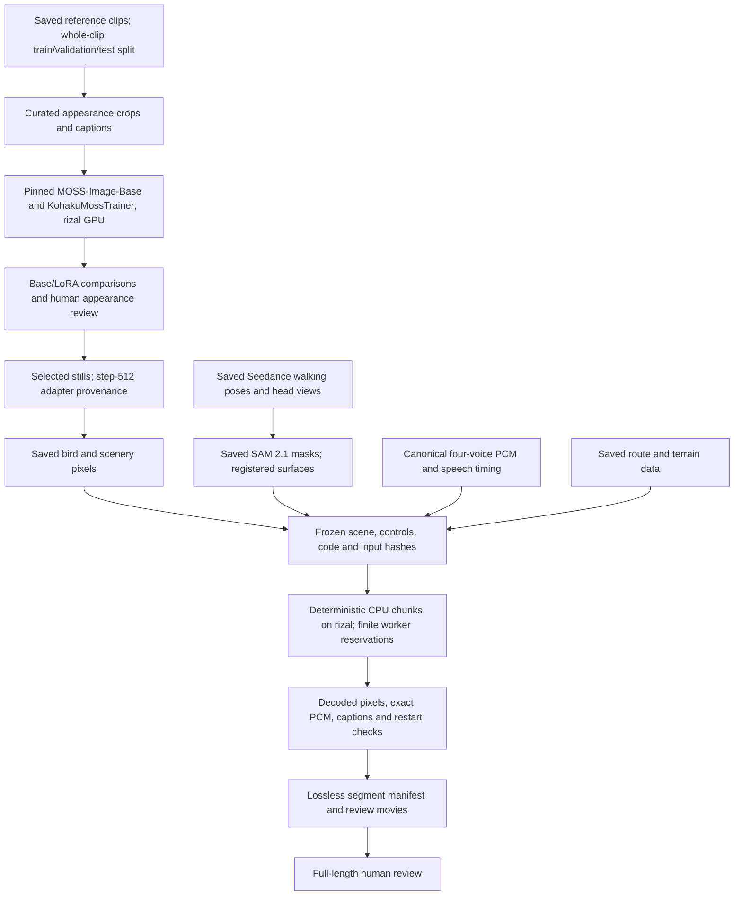

# MOSS appearance and local animation

This guide connects the recorded Here Lies Trouble MOSS experiments to the
delivered local film. It describes the pinned project workflow, not a fresh
host inventory or a generic model-training service.

## Current state

The MOSS appearance pilot and step-512 refinement are complete. The user
accepted the appearance direction. Later animation revisions combine saved
MOSS bird/scenery artwork with saved Seedance quadruped poses and SAM masks.
Opening-v7 was approved on November 1. The complete **52:35.375** episode was
delivered and technically verified; full-length audiovisual review remains
open in the [Stage-5 durable record](../development/sessions/20261030.local_rendering_exploration_stage_5_durable_workflow.md#complete-episode-delivered--november-1-production).

The CPU replay starts from frozen assets. It does not invoke MOSS, SAM, an
LLM, a provider or a GPU. MOSS supplies still appearance; speech timing,
gait, gaze and composition are separately authored controls and saved sources.

## Evidence and runtime boundaries

| Phase | Recorded environment and result | Canonical evidence |
| --- | --- | --- |
| Stage-2 feasibility | rizal Quadro RTX 4000, SM75, 8 GiB physical VRAM; FP16 with offloading; 64-step pilot completed | [Stage 2](../development/sessions/20261028.local_rendering_exploration_stage_2.md) |
| Appearance refinement | Accepted step-512 export; one skipped overflow update, hence 511 successful updates | [Pinned appearance recipe](../development/sessions/20261029.local_rendering_exploration_stage_4_durable_workflow.md#historical-moss-appearance-recipe) |
| Asset extraction | Saved Seedance frames and SAM 2.1 masks; later v7 reused masks without inference | [Stage-5 software and inputs](../development/sessions/20261030.local_rendering_exploration_stage_5_durable_workflow.md#software-hosts-ai-and-data-usage) |
| Complete film | 75,729 frames, 24 fps, 1080 × 1920; 257 ordered lossless segments; zero new provider credits, training or image inference | [Full delivery and restore](../development/sessions/20261030.local_rendering_exploration_stage_5_durable_workflow.md#complete-episode-delivered--november-1-production) |

The appearance model revision is `85975793d8b3d432f1b6e27f352abaa4c2a4c0d3`;
the KohakuMossTrainer revision is
`67f3bb54d8ee8f18384b11113f96b5b71d38c12f`. Historical training uses an isolated
Python 3.12 runtime; compiled film replay uses the recorded system Python
environment. Preserve their separate dependency pins. A step number is a
training checkpoint identity, not a denoising-step count.

## Restart and further work

Read the delivered candidate's `continuation.json`, `readiness.json` and
coordinator state before resuming an interrupted job. The
[full-production restart section](../development/sessions/20261030.local_rendering_exploration_stage_5_durable_workflow.md#full-production-restart-and-future-evolution)
defines commands and exact paths. Its scripts target the recorded episode;
they do not allocate a fresh candidate automatically.

Preserve the original frozen inputs, receipts and finite ledgers when creating
a new candidate. The compact recipe archive must be retained with the approved
prefix dependencies and the separately stored media/segment manifest. The
record reports no independent-host backup. Retraining, fresh image sampling,
rematting and model/runtime upgrades are separate development work; none is
required to replay the delivered film.

Open work is the full-length human review and, if selected, future motion or
appearance refinements. The original MOSS pilot is not an unfinished training
task. A candidate-root interface and an archive restore drill are proposed in
the [documentation review](../development/sessions/20261114.documentation_review.md).
