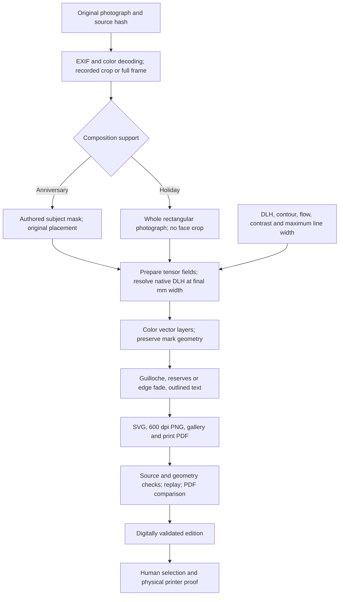
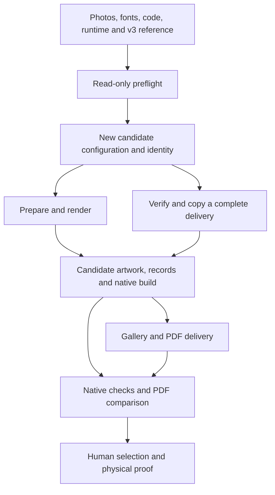

# Portrait and print workflow

Use the [portrait API](../portrait.md) for native marks and the edition scripts
for composition and delivery. The November 14 editions are digitally complete;
physical print proofing and final design selection remain separate steps.

## Production flow



## Edition map

| Edition | Delivered scope | Role and evidence |
| --- | --- | --- |
| [Anniversary stage 1](../development/sessions/20261108.guilloche_anniversary_24_stage_1.md) | 10 pairs / 20 faces | Initial Python portrait and native guilloche edition |
| [Anniversary stage 2](../development/sessions/20261113.guilloche_anniversary_24_stage_2.md) | 10 pairs / 20 faces; 16 source comparisons | Installed native API and revised contour-aligned hedcut |
| [Anniversary stage 3](../development/sessions/20261114.guilloche_anniversary_24_stage_3.md) | 20 pairs / 40 faces; 124 explorer cases and full explorer PDF | Banknote construction and dense guilloche source |
| [Holiday v1](../development/sessions/20261114.dk_2026_holiday_v1.md) | 5 photos × 4 DLH variations | Initial whole-photo study |
| [Holiday v2](../development/sessions/20261114.dk_2026_holiday_v2.md) | Selected visual trials | Superseded by the complete v3 set; no full-batch task remains |
| [Holiday v3](../development/sessions/20261114.dk_2026_holiday_v3.md) | 5 photos × 10 variations | Vibrant 6 × 4 inch landscape cards, asymmetric layouts and notan |
| [Anniversary stage 4](../development/sessions/20261114.guilloche_anniversary_24_stage_4.md) | 20 pairs / 40 faces | Holiday-v3 portrait settings inside unchanged stage-3 nonportrait artwork |
| [Holiday v4 / fall-crazy-pants](../development/sessions/20261114.dk_2026_holiday_v4.md) | 5 photos × 10 variations | Holiday portraiture with anniversary fields and currency typography |

Holiday v4 is the session-document name. Its code, recipes and output directory
retain `fall-crazy-pants`. Anniversary stage 4 is a separate edition.

V3/v4 retain the whole photograph within at most 61% of the 6 × 4 inch sheet,
coordinate portrait and guilloche colors, and use light text outlines of
0.5 pt. Ten recipes cover two inferred, two Japanese-inspired, two neon, two
blue/white/creme and two red/green/black palettes, with varied DLH and flow.
Anniversary stage 4 retains its original 6.14 × 2.61 inch page and shaped masks.

## Reproduction dependencies

Stage 4 reads the generated stage-3 SVGs and the saved holiday recipe settings.
V4 reads the generated holiday-v3 manifest/native geometry and imports the
stage-3 field function. It does not require a rendered anniversary stage-4 set.
Original photographs and fonts are local resources, not bundled outputs.

| Target | Restore or generate first | Commands and receipts |
| --- | --- | --- |
| Anniversary stage 3 | Anniversary source photographs, masks and fonts | Stage-3 README |
| Holiday v3 | Five original holiday photographs and fonts | V3 README |
| Anniversary stage 4 | Stage-3 SVG delivery and committed holiday recipes | Stage-4 README |
| Holiday v4 | Validated holiday-v3 delivery | V4 README |

## Isolated holiday v3/v4 candidates

The supported candidate runner covers `dk-2026-holiday-v3` and
`fall-crazy-pants`. It preserves the delivered edition directories and routes
preparation, native builds, rendering, delivery and checks through one
`candidate.json`. Anniversary stages retain their edition-specific interfaces.



Start with a dependency check. It imports the adapter libraries, probes the
compiler and Poppler tools, checks original-photo hashes and fonts, and for v4
verifies all 50 v3 native receipts against their saved replay evidence:

```sh
python3 scripts/portrait-edition.py preflight --edition fall-crazy-pants \
  --json build/portrait-preflight.json
```

For a fresh v3 reproduction, choose a new directory under
`outputs/portrait-candidates/`:

```sh
python3 scripts/portrait-edition.py init --edition dk-2026-holiday-v3 \
  --candidate outputs/portrait-candidates/holiday-v3-r01
python3 scripts/portrait-edition.py run --candidate outputs/portrait-candidates/holiday-v3-r01 \
  --action render -- --deliver
python3 scripts/portrait-edition.py run --candidate outputs/portrait-candidates/holiday-v3-r01 \
  --action check --resume -- --replay
python3 scripts/portrait-edition.py run --candidate outputs/portrait-candidates/holiday-v3-r01 \
  --action review --resume
```

To create v4 from that validated candidate, initialize `fall-crazy-pants` with
`--holiday-output outputs/portrait-candidates/holiday-v3-r01/artwork` and a
different candidate directory. Then use the same render/check/review phases.
Without that option, v4 reads the established `outputs/dk-2026-holiday-v3/`.

For a bounded trial, pass `--sources H01 --variants v03 --preview-only` after
`--` in the render command. `--action deliver --resume` builds the delivery
from a complete fifty-card candidate. The full checker requires fifty cards.

The configuration records source/code/font hashes, dependency versions, frame
size, native controls, recipes, output root and the v3 dependency identity.
Every phase rechecks these inputs. Prior work, including an interrupted render,
requires explicit `--resume`; changed inputs require a new candidate. A lock
prevents simultaneous writers. Direct v3/v4 render/check/review commands now
refuse writes without the candidate context. This is a fixed-edition runner,
not the proposed public C++ JSON adapter.

Each candidate contains `records/`, `build/`, `artwork/`, `logs/` and a phase
history in `state.json`. These are ignored local artifacts. Completed original
edition recipes and validation/review receipts stay in `examples.data/`.

## Restore and archive

A verified same-host restore can exercise checks without touching a delivery:

```sh
python3 scripts/portrait-edition.py restore --edition fall-crazy-pants \
  --candidate outputs/portrait-candidates/holiday-v4-restored \
  --from-artwork outputs/fall-crazy-pants \
  --from-build build/fall-crazy-pants \
  --from-records examples.data/fall-crazy-pants
python3 scripts/portrait-edition.py run --candidate outputs/portrait-candidates/holiday-v4-restored \
  --action check --resume -- --replay
```

Restore checks the fifty-card manifest, source/recipe identities, native binary
and ten input planes before creating the candidate. It copies files, verifies
every copied artwork hash and rebinds native input-plane paths only inside the
copy. `restore.json` inventories the original files, copied planes, changed
receipt paths and external prerequisites. Photos, fonts, code and the validated
v3 reference are still shared read-only prerequisites; missing inputs fail
preflight. Restoring v3 requires rerunning its replay phase before using the
restored receipts as a new v4 reference.

For an independent archive, retain the source revision, candidate configuration,
records, complete artwork tree, native binary/stamp and planes, original photos,
font files and all v3 reference files listed by preflight. Preserve the runtime
versions as well. Copy that package to a separate storage host, verify a full
SHA-256 inventory there, then restore into a fresh checkout/candidate and repeat
the checks. The November documentation review tested a same-host copy; it did
not create an independent-host archive or prove cross-platform numeric identity.

## What completion means

Saved validation reports record 686 checks for v1, 2,300 for v3, 1,729 for
anniversary stage 4, and 2,538 for v4. V4 reused 45 byte-identical v3 native
portraits and independently replayed the five resized H02 portraits.
The edition records distinguish vector print PDFs from raster comparison PDFs
and retain PDF-to-SVG comparisons at 600 dpi.

Code, recipes and durable validation/review records are tracked. Generated
artwork is under ignored `outputs/`; build and inspection evidence is under
ignored `build/`. A clone alone does not contain the rendered galleries.
Physical color, fine-line survival and anniversary duplex registration still
need the selected paper/printer proof; see the
[P9000 notes](../development/20261108_epson_9000_low_ink_gamut.md).
