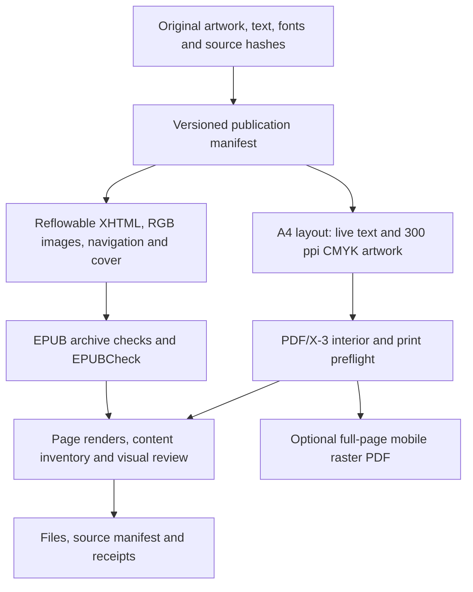

# Print books, mobile PDFs and EPUB

Use the optional Izzi publication tools when a visual project needs a book
interior and an ebook. The content project prepares a frozen manifest with
original artwork, readable text, source references and alternative text.
Izzi owns layout, rasterization, color conversion, packaging and format checks.

For screenplay formatting from reviewed transcripts, follow
[Audio → Transcription](../audio_workflow.md#transcription) and the
[transcription enrichment guide](../transcription-enrichment_workflow.md).



Start with the [standalone example](../../examples/publication/README.md),
then use the [manifest and CLI reference](../publication.md). Dependency setup
is documented in [dependencies](../dependencies.md#publication-production-november-2026).
The [implementation record](../development/sessions/20261114.publication_production.md)
describes tests, migration and the two Cartofreako integrations.

1. Freeze the selected source order and hashes. Keep original text; do not OCR
   a mobile PDF when source text exists.
2. Run `build-publication.py build` with an explicit manifest, destination and
   EPUBCheck jar. The tool produces the print PDF, EPUB, ebook cover and receipts.
   Then run `export-ebook-cover.py` against that receipt and manifest for the
   1600-pixel retailer JPEG and corresponding EPUB derivative; see the
   [cover export reference](../publication.md#retailer-ebook-cover-export).
3. Render the complete PDF at thumbnail scale and inspect title/contents,
   text-heavy pages, dense artwork, enlarged details and the final page at a
   useful reading size. Check every source chapter and source-note section.
4. Open EPUB chapters at phone/tablet widths and larger font sizes; check image
   scaling, links, reading order and light/dark themes. Use Kindle Previewer for
   the Amazon-specific review before submission.
5. Record review evidence separately from automatic structural checks. Keep
   exact source manifests, profiles and tool hashes beside the delivery.

For landscape artwork with an opposite legend, select
`config/publication/a4-landscape-facing-20261114.json`. The versioned
`facing-spreads-v1` layout fits the complete image to its safe frame and puts
all keys and explicitly referenced primary context on the facing page.
The content owner supplies `facing_context` indices and any verified crop
bounds. Longer notes flow after the key; essential-key overflow fails.

Inspect `spread-contact-*.jpg` as well as ordinary page contact sheets.
The reviewer checks even/odd pairing, exactly one image and no publication
text on artwork pages, and actual maximum-fit placement. Final page counts
select the binding allowance before artwork is rasterized. Use a new output
directory and receipt for this layout; a portrait receipt cannot be resumed
as a landscape edition. EPUB remains one reflowable chapter per artwork,
without imposed facing pages or parity blanks.

For repeatable local browser previews:

```sh
python3 scripts/review-epub-reader.py outputs/my-book/my-book.epub \
  --chapter EPUB/chapter-layers.xhtml --output outputs/my-book/validation/readers
```

This optional Firefox tool produces 390 x 844 phone, 390 x 844 larger-text
dark-theme, and 768 x 1024 tablet screenshots. It records the EPUB and tool
hashes. These are viewport simulations, not physical-device or Kindle tests.

Map/diagram labels can remain too small in a complete overview even when its
image passes a resolution check. Keep overviews for context, recompose their
keys and explanations, and supply selected original-source detail crops.
Print details must not be upsampled from a mobile derivative.

The CLI rejects conflicting input/output paths and existing incomplete
deliveries. Use `--resume` only for a completed matching receipt; use a new
output directory for revisions. The exporter uses temporary files and never
needs permission to alter the original artwork.

This workflow finishes local production. A print submission still needs the
provider's wraparound cover, title/ISBN setup, upload checks and a physical
proof. Those steps are separate from the creation of the interior and EPUB.

## Two-page artwork with full bleed

For one complete image across two portrait A4 pages, select
`a4-portrait-spread-20261114.json` and `portrait-map-spreads-v1`.
Every chapter occupies four pages: a full-bleed even/odd artwork spread,
then two pages of live legend/source text. The map is preserved with its
background extended; fold bleed contains matching adjacent pixels.
The independent review reconstructs the complete map from the final PDF.
See [the layout and bleed contract](../publication.md#full-bleed-portrait-spreads).
