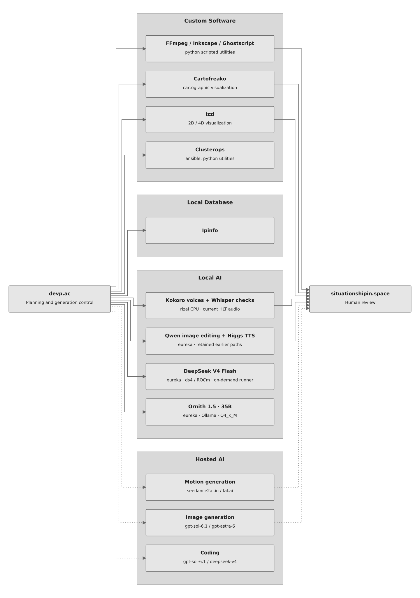
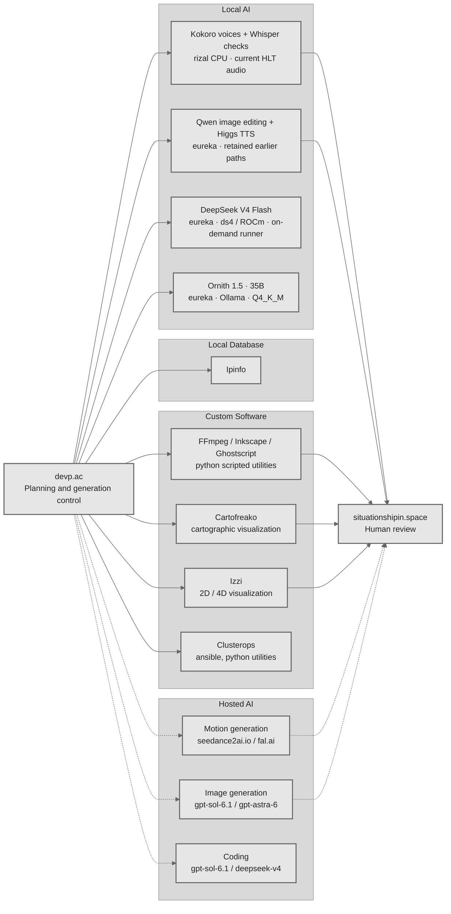
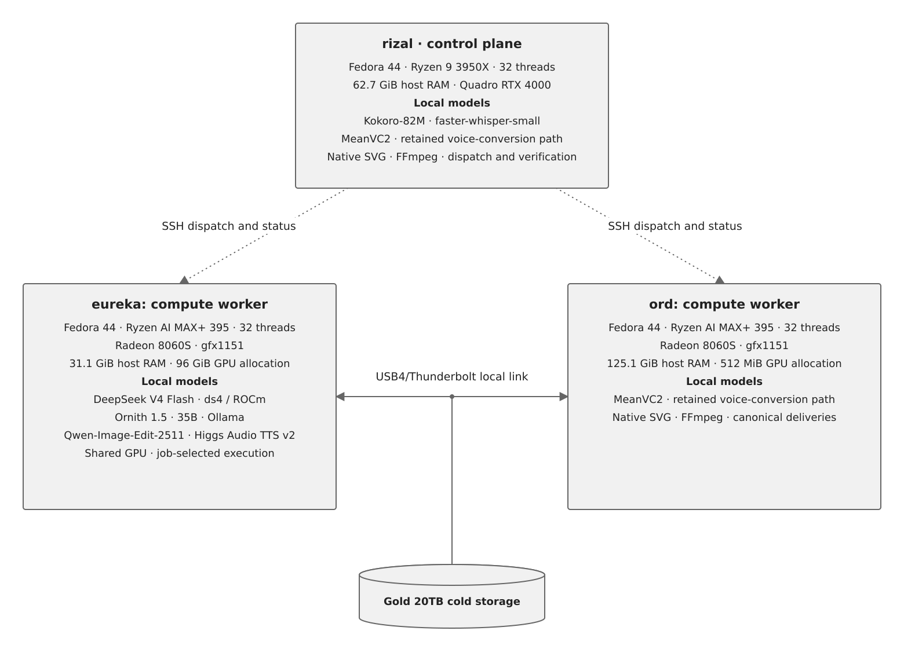
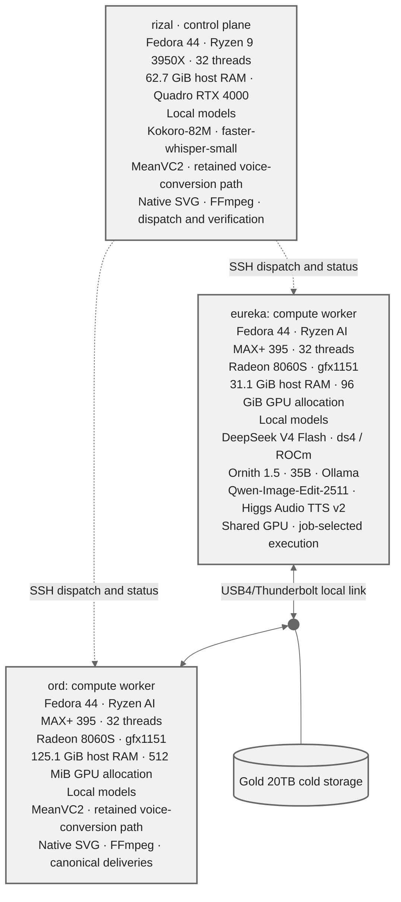
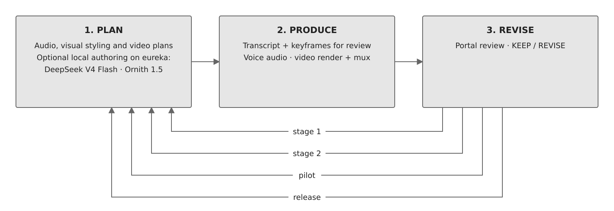
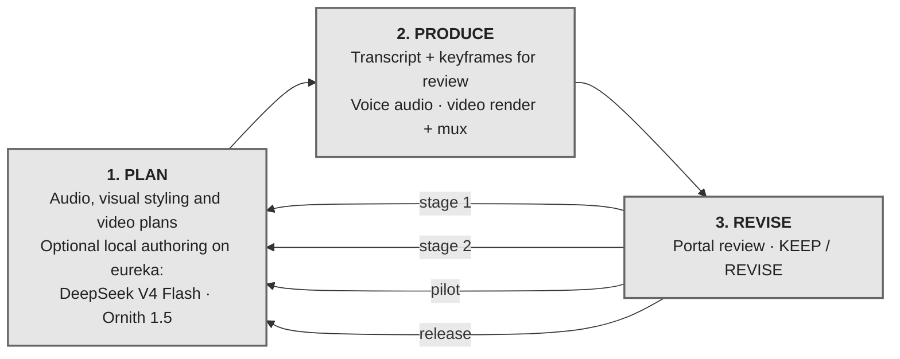

# Workflows

Status: CURRENT-MODEL-INVENTORY; UPDATED-DIAGRAMS-AWAITING-REVIEW
Recorded: 2026-08-18; updated 2026-10-27, America/Los_Angeles

See also: [transcription enrichment workflow](transcription-enrichment_workflow.md)
(post-transcription formatting layer for the here-lies-trouble canonical
transcript) and [visual workflow](visual_workflow.md) (visual passes plus
the [supercut](supercut.md) usage guide, moved there in the 2026-08-22
documentation pass).

## Compute software

Current software/model map, verified October 27, 2026. **Both new local
LLMs run on eureka:** DeepSeek V4 Flash and **Ornith 1.5**, whose installed
Ollama identifier is `ornith-1.5:35b`. The earlier “orinth” spelling refers
to this installation. DeepSeek here is a local GGUF model, separate from
the hosted DeepSeek models in the August interstitial provenance.

Dotted connections show paths to and from Hosted AI; local connections are solid. This refresh
documents the installed choices; it does not claim that automatic model
routing has been added to Izzi or that an LLM can grant human acceptance.

Editable compute software graph and labels

<!-- diagram: workflow-hardware-software-diagram -->

The grayscale layout incorporates [review #80](https://github.com/bdekoz/situationshipin.space/issues/80)
and subsequent layout feedback. Custom Software contains FFmpeg / Inkscape / Ghostscript,
Cartofreako, Izzi and Clusterops. Local Database contains Ipinfo between Custom Software
and Local AI's media models and both local LLMs. Hosted AI groups Motion generation,
Image generation and Coding below Local AI, with dotted connections to and from its nodes.
The enclosing groups use 15% gray; individual boxes use 10% gray.
The hosted-model labels retain the exact names requested in review #80.
The devp.ac and situationshipin.space boxes share the center horizontal row;
media paths connect directly to human review.

| Local model | Installed configuration | Evidence and current availability |
| --- | --- | --- |
| **DeepSeek V4 Flash** | eureka; `ds4` / `ds4-server`, ROCm; runtime revision `5379c1c9ac315f1540371b06a3db88491d4059ff`; mixed-quantization GGUF, 86,720,111,488 bytes; configured trial context 4,096 tokens. | October 21 smoke inference returned 0; structured output and a tool round trip passed. Weight verification receipt retained; current file size matches. The on-demand server binds `127.0.0.1:18080` when launched; it was **not listening** during the October 27 inventory. |
| **Ornith 1.5** | eureka; Ollama ID **`ornith-1.5:35b`**; `qwen35moe`, 35.5B parameters, `Q4_K_M`. | Installed model and local Ollama service verified October 27. Runtime metadata lists completion, thinking, tools and vision, with a model context limit of 262,144 tokens; that limit is not a tested working context for this machine. |

DeepSeek's installation is
`eureka:~/.local/share/deepseek-flash/trial-20261021/`; the launchers are
`run-cli.sh` and `run-server.sh`. Its weights file is
`weights/DeepSeek-V4-Flash-IQ2XXS-w2Q2K-AProjQ8-SExpQ8-OutQ8-chat-v2-imatrix-0731.gguf`.
The [inventory receipt](workflow-diagrams/local-model-inventory.20261027.json)
records exact model identity, saved-test provenance and observed host resources.
This documentation pass ran no model inference and changed no services.

Both models share **eureka's single 96 GiB GPU allocation**. Separate boxes
do not imply separate GPUs or validated simultaneous residency. The
current Here Lies Trouble speech path remains **Kokoro-82M + local
faster-whisper-small**, as recorded in the
[Stage 4 production details](development/sessions/20261026.here_lies_trouble_stage_4_production_details.md).
Qwen-Image-Edit-2511 and Higgs are retained prior media paths; their runtimes
were not re-tested during this inventory. Hosted image/model choices remain
job-specific and are not replaced merely by installing these local LLMs.

The accepted August host/model diagram remains a dated record in
[stage 2 §5.2.1](development/sessions/20260817.fal.ai_stage_2.md#521-host-and-model-map-visual-form-of-52).
Use the current diagrams here for today's resources and local model choices.

## devp.ac compute resources (2026-10-27)

**devp.ac** comprises rizal, ord and eureka. Rizal is the control plane;
ord and eureka are compute workers. All three were read-only inventoried on
October 27 and now run **Fedora 44**. Worker assignments remain per job;
the established USB4 link carries large worker-to-worker transfers.

Editable compute graph and labels

<!-- diagram: devpac-compute-resources-diagram -->

The [rendered hardware diagram](workflow-diagrams/devpac-compute-resources-diagram.svg)
places rizal above eureka and ord, with storage branching from their horizontal
USB4 link, as requested in [review #79](https://github.com/bdekoz/situationshipin.space/issues/79).
The diagram uses grayscale throughout, with storage below the worker boxes.
Model labels combine the current inventory with the retained media paths in
the architecture map and [host/model table](development/sessions/20260817.fal.ai_stage_2.md#52-model-and-tool-itemization).
The Gold 20TB storage label comes from that review's topology specification.

| Host | October 27 observation |
| --- | --- |
| rizal | Fedora 44; Ryzen 9 3950X, 32 logical CPUs; 62.7 GiB host-visible RAM. Quadro RTX 4000 PCI identity rechecked; GPU memory size was not remeasured. |
| ord | Fedora 44; Ryzen AI MAX+ 395 / Radeon 8060S, 32 logical CPUs; 125.1 GiB host-visible RAM. Kernel-reported dedicated GPU allocation is 512 MiB; this does not describe all available shared GPU memory. |
| eureka | Fedora 44; Ryzen AI MAX+ 395 / Radeon 8060S, 32 logical CPUs; 31.1 GiB host-visible RAM and 96 GiB kernel-reported GPU allocation. Both new local models reside here. |

Both `thunderbolt0` interfaces were UP. Their existing link-local addresses
are ord **169.254.4.107** and eureka **169.254.31.134**. This was a read-only
configuration check, not a new transfer benchmark.

### Established compute queues and delivery history

The following October 2–4 records document completed work and the queue
implementation. Their dated performance and delivery observations remain
historical; the inventory above supplies the current OS and memory labels.

The direct USB4 link uses `thunderbolt0`: ord **169.254.4.107**, eureka
**169.254.31.134**. Use these addresses for authenticated resumable rsync
between workers. Keep large masters and pass statistics off rizal's data
path. Verify SHA-256 before accepting transferred input, and verify and
atomically publish final output files and receipts on ord. The first 74.8 GB
master transfer completed in approximately two minutes over this link;
the destination hash matched the verified source.

For the approved decasia-agesia render, rizal runs
`decasia-agesia-work-queue.service`, implemented by
`coordinate-decasia-agesia.py`.
It owns `outputs/decasia-agesia/full/work-queue.json` and launches
`run-decasia-agesia-queue-job.py`
on either worker. Each whole-film HEVC pass, lossless rotation/retiming, and
rotated HEVC verification is a separate dependency-gated job. Successful
stage receipts survive controller restarts; remote stage locks prevent
duplicate execution. The preserved first pass is pinned to its existing
ord process; remaining stages can be claimed by either host.

Keep the approved 10-bit `libx265` veryslow two-pass encoder and upload size
cap. That encoder uses CPUs; GPU allocation does not change the quality
settings. For version 1, horizontal outputs come from rotating the vertical
footage 90°, with no separate horizontal artwork render. Its delivery set
contains normal and half-speed outputs in both orientations, as lossless
MKV and HEVC MP4.

The full timing, quality, verification, host paths, and live deployment
record are in the [decasia-agesia plan](development/sessions/20261001.short_center_frame_2_screen_decay.md).
`decasia-agesia-completion.service` on rizal watches the final ord receipts
and sends the requested desktop alert after all eight files are verified,
or after a recorded pipeline failure.

**Delivery status, October 3:** the devp.ac queue completed all nine stages
at 6:43 a.m. Pacific, with eight verified 4K outputs on ord. All four HEVC
copies are within the requested 0.5–1.0 GB size range. The normal vertical
HEVC is also on rizal at
`outputs/decasia-agesia/full/deliveries/decasia-agesia-full-vertical-a-normal-youtube-hevc.mp4`,
with its transfer checksum verified. The
[final delivery record](development/sessions/20261001.short_center_frame_2_screen_decay.md#final-delivery-record-october-3-2026)
lists exact sizes, artifact locations, and verification receipts. The desktop
completion notification was sent at 6:48 a.m. Pacific.

**Version 2 full production approved, October 3:** the
[current full production plan](development/sessions/20261003.decasia_agesia_version_2_full.md)
specifies one 4K vertical, normal-speed film: blue `rgb(0,0,255)` alpha
uses all 20 film algorithms once; red `rgb(255,0,0)` beta uses all 18
video algorithms once, then fills the last two cycles randomly from TV
broadcast and satellite. Canonical `20190325_palm_springs_pool_2.mp4`
is rotated 90° clockwise to fill the vertical frame without cropping or
stretching. The complete schedule is 6:32.2 at 30 fps.
Rizal's `decasia-agesia-v2-full.service` runs
`coordinate-decasia-agesia-v2.py`;
ord and eureka claim chunks from its shared queue and run
`render-decasia-agesia-v2-full.py`.
Verified eureka results transfer directly to ord over USB4. Ord assembles
the lossless MKV and encodes the size-targeted 10-bit HEVC through
`finish-decasia-agesia-v2-safe.py`,
which disables FFmpeg interactive stdin while preserving the frozen renderer
and manifest. Rizal receives
the verified HEVC and completion alert. Current outputs are under
`outputs/decasia-agesia/version-2/full/`. The earlier pool-3
[60-second review](development/sessions/20261003.decasia_agesia_version_2.md)
is preserved separately; version 1's completed queue and files remain separate.

**Version 2 deliveries complete, October 4:** the original 4K HEVC was
verified on rizal at 12:07 a.m. Pacific (984,413,856 bytes). The additional
user-requested 1080×1920 half-speed derivative completed verification and
delivery at 4:48 a.m. Pacific (982,123,141 bytes; duration 13:04.4).
The [final delivery record](development/sessions/20261003.decasia_agesia_version_2_full.md#final-delivery-record-october-4-2026)
lists both paths, sizes, checksums, and verification receipts.
Rizal's separate `decasia-agesia-v2-half-speed-1080p.service` runs
`derive-decasia-agesia-v2-half-speed.py`;
eureka encodes from the verified HEVC received over USB4, and rizal receives
the verified result and a separate completion notification. Its outputs
are under `outputs/decasia-agesia/version-2/half-speed-1080p/`.

The October 4 all-18 video-algorithm review is also verified on rizal at
`outputs/decasia-agesia/video-18-black-white/deliveries/video-18-black-white-titled-1080p-hevc.mp4`:
54 seconds, three seconds per algorithm, black on white, 1080×1920,
with bottom-center Atkinson Hyperlegible Next titles. All six VCR forms
occupy the first 18 seconds and passed visibility checks in the encoded file.

The user requested a second review because the first retained recognizable
canonical footage in its effect texture. The current
[version 3 video-space plan](development/sessions/20261004.decasia_agesia_version_3_videospace.md)
uses a visible moving black moiré background over fuchsia (#FF00FF), built
with the native moiré API, with no canonical video or source images.
All 18 video algorithms receive three three-second variations: 54 slots,
162 seconds, 1080×1920. Algorithm titles are uppercase, with italic
variation labels immediately below. Ord runs the native worker and
12 raster workers through `decasia-v3-videospace-round-2.service`; all 54
native parameter sets have passed preflight. All 162 render chunks and
4,860 lossless RGB frames are verified. A separate finisher encodes the
18 nine-second algorithm blocks through six parallel x265 veryslow CRF 12
jobs, then joins them without re-encoding and checks the complete file.
The separate production directory is
`outputs/decasia-agesia/version-3/videospace-round-2/`.
Rizal's `decasia-v3-videospace-delivery.service` receives the verified
10-bit HEVC, checks its SHA-256, and sends the completion notification.

**Version 3 review complete, October 4 at 9:42 a.m. Pacific:** the
162-second moiré-on-fuchsia review passed full decoding and lossless frame
checks, and its 164,285,981-byte HEVC is SHA-256-verified on rizal at
`outputs/decasia-agesia/version-3/videospace-round-2/deliveries/decasia-agesia-v3-videospace-fuchsia-3-variations-1080p-hevc.mp4`.
The desktop completion notification was sent. The
[final delivery record](development/sessions/20261004.decasia_agesia_version_3_videospace.md#final-delivery)
includes the checksum, receipts, encoded canary, and retained ord master.

The [version 4 film-space plan](development/sessions/20261004.decasia_agesia_version_4_filmspace.md)
applies the same review setup to all 20 film algorithms: moving black
moiré on RGB (0,255,0), three three-second variations per algorithm,
uppercase titles with italic variation labels, 1080×1920, 180 seconds.
Its separate native worker selects film-family forms. Ord runs
`decasia-v4-filmspace.service`; rizal's
`decasia-v4-filmspace-delivery.service` collects the verified HEVC and
sends the completion notification. Outputs are under
`outputs/decasia-agesia/version-4/filmspace/`.

**Version 4 film review complete, October 4 at 12:11 p.m. Pacific:** all
60 variations and 5,400 lossless RGB frames are verified. The 180-second,
509,756,075-byte HEVC passed full decoding and is SHA-256-verified on rizal
at `outputs/decasia-agesia/version-4/filmspace/deliveries/decasia-agesia-v4-filmspace-green-3-variations-1080p-hevc.mp4`.
The desktop completion notification was sent. Its
[final delivery record](development/sessions/20261004.decasia_agesia_version_4_filmspace.md#final-delivery)
includes the checksum, receipts, encoded canary, and retained ord master.

## Workflow

Editable workflow graph and labels

<!-- diagram: workflow-v2-loop-diagram -->

The four feedback edges carry the stage name, so every `REVISE` decision returns to the same stage's plan with its evidence attached.
The [rendered workflow diagram](workflow-diagrams/workflow-v2-loop-diagram.svg)
uses three equal gray boxes on one horizontal row. All feedback arrows run below
the middle box and enter the bottom of PLAN, as requested in
[review #78](https://github.com/bdekoz/situationshipin.space/issues/78).

## Stage gates

- Visual-styling `KEEP` unlocks video-production.
- Audio `KEEP`, together with visual-styling `KEEP`, unlocks video-production.
- Both approvals are published portal artifacts (`visual-styling.json`, `audio.json`) carrying `KEEP` or `REVISE`.
- These gates govern new video production. An explicit owner request can
  separately authorize publication of an already-produced artifact for
  review; that permission does not mark its creative result accepted or
  authorize more production. The October 27 Stage 4 publication records
  that distinction against the exact source and proxy hashes.
- The four development stages (stage-1, stage-2, pilot, release) and their
  review→plan feedback edges are enumerated in
  `workflow-stages.json`, checked by
  `scripts/check-workflow-stages.py`.

## Indexes

- [`docs/audio_workflow.md`](audio_workflow.md) — Status: `FIRST-PASS-SORT; NO-REMOVAL; NOT-SHARED`
- [`docs/visual_workflow.md`](visual_workflow.md) — Status: `FIRST-PASS-SORT; NO-REMOVAL; NOT-SHARED`

House rule: sort and link, do not rewrite evidence.

## Provenance and diagram files

The original two workflow diagrams were authored for the August 18 W1
proposal and render-verified with Mermaid 11.16.1. The October 27 update
adds both verified local model installations, refreshes the hardware map,
and publishes three diagrams: Compute software, compute hardware and Workflow.
The four stage-labeled review→plan feedback edges remain.
Updated diagrams await human review; historical acceptance does not transfer
automatically to new pictures.

- Editable content and graph: the three tagged Mermaid blocks in this file.
- The three revised diagrams use explicit SVG layouts in
  `scripts/render-workflow-diagrams.py` so regeneration preserves the requested
  alignment, grouping, triangle and arrow attachment points. Their per-diagram JSON
  configurations record the coordinates; librsvg exports the PNGs.
- Render command: `scripts/render-workflow-diagrams.py` (Mermaid 11.16.1;
  mermaid-cli 11.16.0; use the installed Chrome browser).
- Current local render packet: `outputs/workflows-v2/20261027-review-80/`
  (`.mmd`, `.svg`, `.png`, and `manifest.json`).
- Website source: `situationshipin.space/scripts/publish-workflow-diagrams.mjs`.
- Published images and downloads:
  `situationshipin.space/review/media/workflow-v2-diagrams/`.
- Public review index:
  <https://situationshipin.space/review/workflow-v2-diagram-index/>.

The original hardware/software diagram and its August acceptance remain
in [stage 2 §5.2.1](development/sessions/20260817.fal.ai_stage_2.md#521-host-and-model-map-visual-form-of-52).
Current models and machines are backed by the
[October 27 inventory](workflow-diagrams/local-model-inventory.20261027.json).
